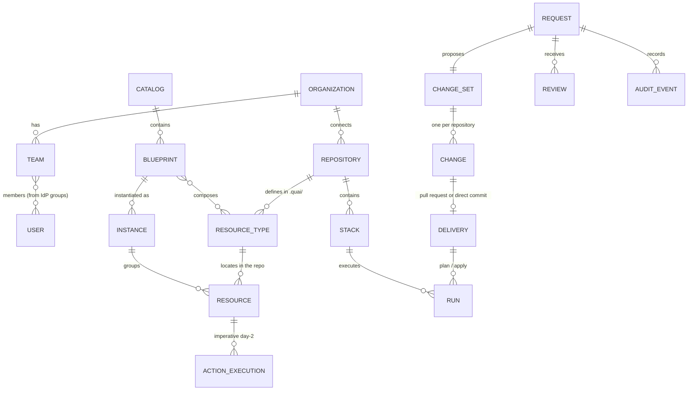
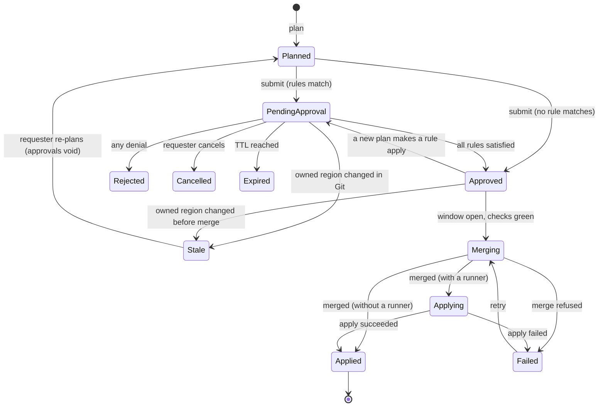

# Domain model

Status: Draft · 2026-10-26

## Entities

## Glossary

| Term | Meaning | Where it lives |
| --- | --- | --- |
| **Organization** | One Quai installation's tenant. A single organization per install for v1; several for managed-service providers later. | DB |
| **Team** | A group of people that owns resources and catalog items. Mapped to IdP groups. | DB, synced from IdP |
| **Repository** | A connection to one Git repository: connector (Azure DevOps, GitHub…), URL, credentials, delivery mode, runner. See [repository connections](../design/01-repository-connections.md). | DB, optionally config-as-code |
| **Definitions** | Resource types (and optionally blueprints) stored in a repository under `.quai/`. Versioned by commit. | Git |
| **Resource type** | Describes one kind of thing in one repository: where instances live (locator), what their content looks like (schema), how a form becomes file content (generator), who owns them, which stack applies them, approval rules and day-2 actions. See [resource types](../design/02-resource-types-and-generators.md). | Git, `.quai/types/` |
| **Locator** | The part of a type that maps a resource key to a region of the repository: a file, a directory, an entry in a shared file, or fields inside an entry. | Type |
| **Region** | The exact part of the repository a resource owns. Fingerprinted to detect concurrent changes. | Computed |
| **Generator** | Turns validated values into region content and reads region content back into values. | Type |
| **Resource** | One instance of a type: a file or entry that matches the locator. Exists because it is in Git, whoever wrote it. | Git; indexed in DB |
| **Resource ID** | `<repository>/<type>/<key>`, e.g. `infra-live/vm/prod/web01`. The key is the locator params joined by `/`. | Computed |
| **Stack** | The unit that plans and applies, e.g. a Terraform root module or an Argo CD application. Derived from the type (`stack: envs/{env}`). | Type; DB for status |
| **Catalog** | What users can request: blueprints, plus every type not hidden from the catalog. | Catalog repository, DB index |
| **Blueprint** | A catalog item that composes one or more resources, possibly across repositories, behind one form and one approval. See [blueprints and change sets](../design/04-blueprints-and-change-sets.md). | Catalog repository |
| **Instance** | One deployment of a blueprint: the set of resources it created, under one name. | Instance record in Git |
| **Request** | A user's ask: create, update, delete, or a day-2 action. Holds the reason, the plan and the approval state. | DB |
| **Change set** | The rendered change of a request: per repository, the file operations, the region fingerprints and a content hash. | DB |
| **Delivery** | How a change reaches a repository: a pull request (default) or a direct commit. | DB, Git platform |
| **Connector** | The per-platform integration (Azure DevOps first) that Quai uses for pull requests, statuses, policies, webhooks and pipelines. See [Git connectors](../design/12-git-connectors.md). | Code |
| **Review** | One approver's decision on a request, bound to the change set hash. | DB |
| **Run** | A plan, apply, sync or drift check reported by a runner for a stack at a commit. | DB |
| **Action** | A day-2 operation. *Declarative* actions change Git through the request flow; *imperative* actions call an executor. | Type |
| **Executor** | A configured integration that performs imperative actions: Kubernetes API, AWX, pipeline trigger, webhook. | DB, config |
| **Audit event** | An append-only, hash-chained record of something that happened. | DB, exported to SIEM |

## Identifiers and naming

- Repository names, type names and blueprint names are DNS labels (`[a-z][a-z0-9-]{0,62}`), unique within their scope.
- Resource keys are made of locator params. Each param value is one safe path segment: no `/`, no `..`, from `[A-Za-z0-9][A-Za-z0-9_.-]{0,62}`.
- A resource's identity is its location. Moving or renaming a file is a delete plus a create, exactly as Terraform's `for_each` sees it unless the repository uses `moved` blocks. Quai shows renames detected in Git history as such, but does not merge their identities.

## Lifecycles

### Request

In pull-request mode the PR is opened at submit, so CI can plan while approvals
are pending. In direct mode the commit happens at *Merging*. With a runner, a merged request is
*Applying* until the applies of its stacks report ([runs](../design/06-runs-status-and-drift.md#runs-and-requests));
a retry delivers again a request whose merge failed, not one whose apply failed: that change is
in Git, and the next apply of its stacks reports on it.

### Resource status

Resource status is derived, never stored as truth.

| Status | Meaning |
| --- | --- |
| **In repo** | Present in Git; no run has been reported for the commit that last changed it. |
| **Pending change** | An open request touches it; further requests are blocked until it completes. |
| **Planning / Applying** | A run for its stack is in progress at a commit that includes its last change. |
| **Applied** | The latest apply for its stack succeeded at or after its last change. |
| **Failed** | The latest apply for its stack failed and included its change. |
| **Drifted** | The latest drift check reported changes for its address. |
| **Non-conforming** | The file parses but violates the type's schema. Visible; edits are blocked until it is fixed. |
| **Unparseable** | The file cannot be parsed. Visible; never edited by Quai. |

## What lives where

| Data | Store | Rebuildable? |
| --- | --- | --- |
| Desired state (resource files) | Customer Git | It is the source |
| Definitions (types, blueprints, schemas) | Customer Git | It is the source |
| Instance records | Git (catalog or target repository) | It is the source |
| Inventory index, search | PostgreSQL | Yes, by re-scanning Git |
| Requests, change sets, reviews | PostgreSQL | No; the essentials are also in commit trailers and PR history |
| Runs, status | PostgreSQL | Partially, from runners' history |
| Audit log | PostgreSQL, exported to SIEM | No; protected by hash chain and export |
| Repository connections, settings | PostgreSQL, optionally config-as-code | Yes, if config-as-code is used |
