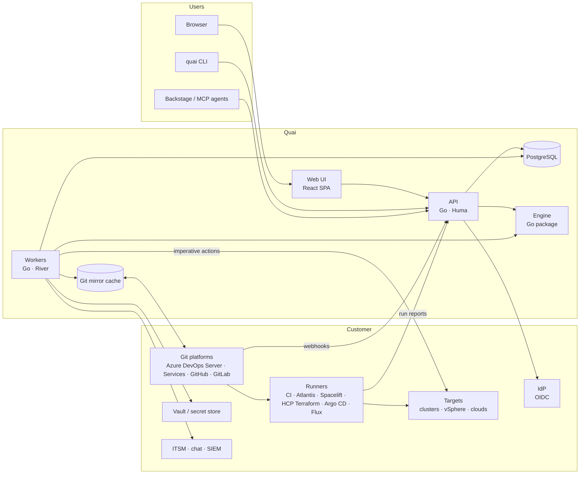

# Architecture overview

Status: Draft · 2026-10-26

Quai is a governed self-service front end for infrastructure that is already
managed as code. Users ask for something through a form. Quai turns the request
into a reviewed change in the customer's own Git repositories. The customer's
own pipelines (Terraform, OpenTofu, Argo CD, Flux) apply it. Quai shows the
outcome and lets owners run day-2 operations the same way.

This document describes the target architecture. The design documents in
[`../design/`](../design) cover each part; the delivery plan is in
[`../plan/roadmap.md`](../plan/roadmap.md).

## Where the prototype stands

The prototype (TypeScript, Fastify, React, SQLite) proves the core ideas. It is
not an enterprise product.

| Area | Prototype today | Needed for enterprise |
| --- | --- | --- |
| Stack | Node/TypeScript backend, React frontend with hand-written CSS | Go backend; React with TanStack Router/Query, Tailwind and shadcn/ui ([ADR 0006](../adr/0006-go-backend-react-frontend.md)) |
| Git | One repository, push to `main` | Many repositories through per-platform connectors (Azure DevOps Server first, Azure DevOps Services alongside, then GitHub, GitLab, Bitbucket); pull requests by default; per-repository credentials |
| Definitions | Blueprints in `blueprints/`, resource types in `.quai/types/` of the one repo | Types live next to the IaC in each repository; blueprints compose types across repositories; versioned and previewable |
| Generation | Identity mapping (file = form) and Kubernetes component renderers; `file` and `dir` layouts | Mapping generators with read-back, `entry` and `field` locators, JSON, tfvars and HCL editing, WASM plugins |
| Approvals | Rules with groups and thresholds; Quai commits after approval | Quai's approval enforced as a required check on the PR; content-bound approvals; separation of duties, delegation, change windows, ITSM |
| Status | One webhook per resource, simulated apply | Plan and apply runs per stack from real runners, mapped to resources; drift detection |
| Identity | Dev user switcher or trusted proxy headers | OIDC, teams from IdP groups, RBAC, API tokens, step-up MFA |
| State | SQLite, single process | PostgreSQL, durable job queue, several replicas |
| Audit | Event table and commit trailers | Append-only, hash-chained audit log; SIEM export; evidence bundles |
| Operations | Dockerfile, compose | Helm chart, OpenShift support, air-gapped installs, observability, backup and DR |

## Target architecture

Server, worker and CLI are **one Go binary** started in different roles
(`quai server`, `quai worker`, `quai lint`). The web UI is static files served
by the server or by any web server.

| Component | Responsibility |
| --- | --- |
| **Web UI** | Catalog, request forms, approvals inbox, inventory, resource pages, designer, admin. Client-rendered SPA. |
| **API** | Authentication, authorization, planning (dry run of a change), request lifecycle, webhook and run-report ingestion, admin endpoints. Stateless; scales horizontally. |
| **Workers** | Everything slow or external: Git fetch, branches and PRs, merges, connector API calls, notifications, ITSM calls, scheduled drift checks, imperative actions. Jobs are durable and retried. Work on one repository is serialized. |
| **Engine** | Pure Go package with no network or database access: CEL expressions, JSON Schema, locators, generators, format-preserving editors for YAML, JSON and HCL, diffing, approval policy evaluation. The API, the workers and `quai lint` all use it, so customer CI runs exactly the checks Quai runs. |
| **PostgreSQL** | Operational state and the job queue: requests, approvals, change sets, runs, inventory index, audit log, configuration. |
| **Git mirror cache** | A bare mirror per connected repository, with a short-lived worktree per job. It is a cache: losing it costs a re-clone, not data. |

## How a request flows

1. **Plan.** The user fills in a form. The API loads the definitions at a pinned commit, renders the change with the engine and returns the exact file diff, the stacks affected and the approval rules that apply. Nothing is written.
2. **Submit.** The request is stored with its rendered change, the definition commit and a fingerprint of every repository region it touches.
3. **Deliver.** A worker creates a branch per repository, commits the change (authored as the requester, signed by Quai) and opens a pull request. Quai posts a `quai/approval` check in a pending state.
4. **Plan run.** The customer's CI or runner plans the change and reports back: resources to add, change and destroy, policy results, cost. Quai shows this on the request page.
5. **Approve.** Approvers review the diff and the plan in Quai. Approvals are bound to the content: if the change has to be regenerated and differs, they are void.
6. **Merge.** When every rule is satisfied, checks are green and the change window allows it, Quai sets `quai/approval` to success and merges, or leaves the merge to a human if the repository is configured that way.
7. **Apply.** The runner applies on merge and reports the result. Quai maps it to the affected resources and updates their status.
8. **Operate.** Declarative day-2 actions go through the same flow. Imperative actions (reboot, snapshot) call an executor directly and are written to the audit log.

## Invariants

These hold across every design document. Breaking one needs an ADR.

1. **Every change to desired state is a commit in the customer's repository.** Quai never changes infrastructure directly for declarative operations and holds no cloud credentials for them. See [ADR 0001](../adr/0001-git-is-the-system-of-record.md).
2. **What is approved is what is merged.** Approvals are bound to a hash of the rendered change and the base it applies to. See [ADR 0002](../adr/0002-quai-is-the-approval-authority.md).
3. **Quai adapts to the repository, not the reverse.** Layout knowledge lives in definitions next to the IaC; human-maintained files are edited with minimal diffs. See [ADR 0003](../adr/0003-definitions-live-next-to-the-iac.md) and [ADR 0005](../adr/0005-minimal-diff-file-editing.md).
4. **User input never becomes code.** Expressions are CEL, outputs are built as data and then serialized, plugins run in a WASM sandbox. See [ADR 0004](../adr/0004-structured-generators-no-text-templates.md) and [ADR 0009](../adr/0009-cel-expressions.md).
5. **The database is rebuildable from Git, except the audit log.** Inventory and status are caches over Git and runner reports.

## Further reading

- Domain model and lifecycles: [domain-model.md](domain-model.md)
- Connecting repositories: [01-repository-connections.md](../design/01-repository-connections.md) and [12-git-connectors.md](../design/12-git-connectors.md)
- How files are generated: [02-resource-types-and-generators.md](../design/02-resource-types-and-generators.md)
- How files are edited: [03-file-editing.md](../design/03-file-editing.md)
- Backend and frontend engineering: [../engineering/](../engineering)
