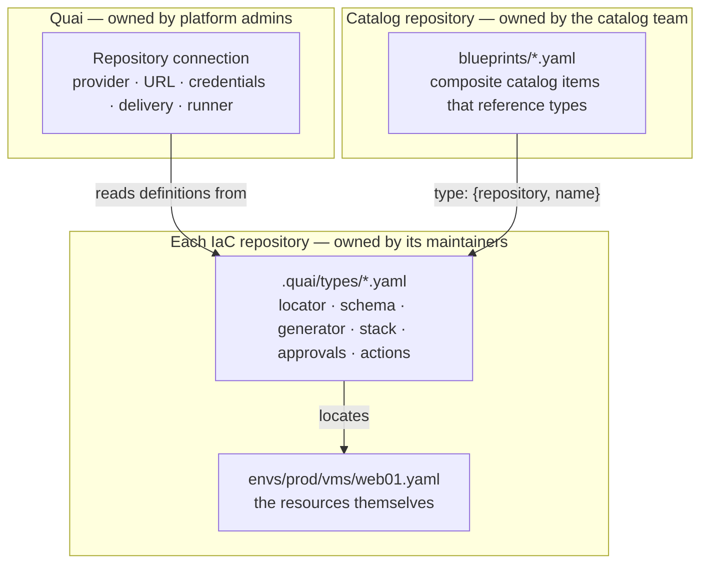

# Repository connections

Status: Draft · 2026-10-26

How Quai connects to customer repositories, and how catalog items find the
repository, branch, path and pipeline they belong to.

## The problem

To turn a form into a change, Quai has to know, for every resource:

- which repository and branch it lives in, and with which credentials to reach it;
- where in that repository it lives, and in which file format;
- how a form becomes file content, and how file content becomes a form again;
- how the change is delivered (pull request or direct commit) and who must approve it;
- which pipeline applies it, and where the result is reported.

The prototype answered all of this with one hard-coded repository. The
enterprise design splits it into three layers, each owned by different people.

## Three layers



| Layer | Question it answers | Owner | Stored in |
| --- | --- | --- | --- |
| **Repository connection** | How do I reach this repository, deliver changes to it and learn their outcome? | Platform admins | Quai (UI/API), optionally config-as-code |
| **Resource types** | What lives in this repository, where, in which shape, and how do I edit it? | The repository's maintainers | The repository itself, under `.quai/` |
| **Blueprints** | What can people request, and which types in which repositories does it combine? | Catalog team | A catalog repository |

Why types live in the IaC repository and not in Quai: they describe that
repository's layout, so they must change in the same pull request as the layout
does, and be reviewed by the same people. See
[ADR 0003](../adr/0003-definitions-live-next-to-the-iac.md).

A blueprint is optional. Every type in a connected repository appears in the
catalog as a simple item (one resource, the type's own form) unless it is
marked `catalog: hidden`. Blueprints are for composite items: "a namespace with
its quota, a VM and a DNS record, approved once".

## Repository connection

A connection is created by an admin in the UI or through the API, or declared
as config-as-code (a YAML file loaded at start-up, or a Helm value). Both forms
share one schema:

```yaml
apiVersion: quai.dev/v1beta1
kind: Repository
metadata:
  name: infra-live                 # used in resource IDs: infra-live/vm/prod/web01
  title: Infrastructure (Terraform)
  owners: [team:platform]          # who administers this connection
spec:
  provider: gitlab                 # github | gitlab | azure-devops | bitbucket | gitea | generic
  url: https://gitlab.acme.ch/infra/live.git
  defaultBranch: main
  credentials:
    ref: vault:kv/quai/repositories/infra-live    # or k8s:quai/infra-live-git, or env:QUAI_GIT_INFRA_LIVE
  definitions:
    path: .quai                    # where types live in this repository
    branch: main                   # definitions are read from here, pinned per request by commit
  delivery:
    mode: pull-request             # pull-request | direct
    branchPrefix: quai/
    merge: auto                    # auto: Quai merges when approved and green | manual: a human merges
    mergeMethod: squash            # merge | squash | rebase (as the provider supports)
    waitForChecks: [plan, policy]  # CI checks that must pass before Quai merges
    deleteBranch: true
  enforcement:
    requiredCheck: quai/approval   # Quai verifies the branch protection really requires it
    floorRules:                    # approval rules every type in this repo inherits and cannot remove
      - name: production-floor
        when: "params.env == 'prod'"
        approvers: [group:platform-admins]
  runner:
    kind: gitlab-ci                # see runs-status-and-drift.md
    reportToken:
      ref: vault:kv/quai/run-tokens/infra-live
  webhooks:
    secret:
      ref: vault:kv/quai/webhooks/infra-live
  sync:
    pollInterval: 5m               # safety net for lost webhooks
```

| Field | Notes |
| --- | --- |
| `metadata.name` | Immutable after creation: it is part of every resource ID and request record. |
| `spec.credentials.ref` | A reference, never the secret itself. Resolved at use time; never logged or returned by the API. |
| `spec.definitions` | One repository can host types for itself only. A type cannot point its locator into another repository. |
| `spec.delivery.mode` | `direct` exists for sandboxes and demos. Production repositories should use pull requests ([ADR 0008](../adr/0008-pull-requests-by-default.md)). |
| `spec.enforcement.floorRules` | Lets admins guarantee, for example, that nothing reaches `prod` without platform approval, whatever a type's author writes. Types can add rules, never remove floor rules. |
| `spec.runner` | Where plan and apply results come from. Optional: without it, resources show *In repo* after merge. |

## Providers

Every provider implements one Go interface. Git transport (clone, fetch, push)
always uses the `git` CLI, so SSH, HTTPS, proxies and partial clones behave as
customers expect. Provider APIs are used for everything Git cannot do.

```go
type Provider interface {
    // Pull requests
    OpenPullRequest(ctx context.Context, pr PullRequestSpec) (PullRequest, error)
    UpdatePullRequest(ctx context.Context, id string, upd PullRequestUpdate) error
    GetPullRequest(ctx context.Context, id string) (PullRequest, error)
    Merge(ctx context.Context, id string, opts MergeOptions) (MergeResult, error)
    Close(ctx context.Context, id string, comment string) error

    // Status reported by Quai, and by others
    SetCheck(ctx context.Context, commit string, check CheckSpec) error
    ListChecks(ctx context.Context, commit string) ([]Check, error)

    // Repository facts Quai needs to verify
    BranchProtection(ctx context.Context, branch string) (Protection, error)
    CodeOwners(ctx context.Context, ref string) (CodeOwners, error)

    // Webhooks
    VerifyWebhook(r *http.Request, secret []byte) (Event, error)
    EnsureWebhook(ctx context.Context, url string, secret []byte) error
}
```

How each provider enforces Quai's approval. Features marked † depend on the
provider's edition or plan; confirm them against the customer's installation
during onboarding.

| Provider | API library | Enforcing `quai/approval` | Notes |
| --- | --- | --- | --- |
| GitHub / GitHub Enterprise Server | `google/go-github` + GitHub App auth | Required status check, pinned to the Quai GitHub App so nobody else can set it | Check runs give a rich "pending approval" view in the PR. GitHub App commits made through the API show as verified. |
| GitLab (SaaS / self-managed) | `gitlab.com/gitlab-org/api/client-go` | External status checks†, or a merge request approval rule† requiring the Quai bot user, or protected branch where only the Quai bot may merge | Pick the mechanism per edition during onboarding; Quai's health page shows which one is active. |
| Azure DevOps (Services / Server) | `microsoft/azure-devops-go-api` | Branch policy "Require a successful status", restricted to Quai's identity as the authorized poster | Pull request statuses and policies map cleanly. |
| Bitbucket Cloud / Data Center | REST over `net/http` | Required builds or merge checks† | Phase 2. |
| Gitea / Forgejo | `code.gitea.io/sdk/gitea` | Required status check in branch protection | Also used for integration tests. |
| Generic Git | none | Not enforceable; direct mode only | For repositories without a supported API. |

## Credentials

Recommended credential per provider. Quai needs: read the repository, push
branches under its prefix, open and merge pull requests, write checks or
statuses, read branch protection, manage its webhook.

| Provider | Recommended | Why |
| --- | --- | --- |
| GitHub | GitHub App installed on the selected repositories | Short-lived installation tokens, fine-grained permissions, verified commits, no user seat. |
| GitLab | Project or group access token for a bot, with `api` and `write_repository` | Scoped to the project or group; rotate with expiry. |
| Azure DevOps | Service principal or managed identity (Entra ID) | No long-lived PAT; Entra policies apply. PAT as fallback. |
| Generic | SSH deploy key with write access | The only option without an API. |

Secrets are resolved through a `SecretStore` interface with implementations for
HashiCorp Vault (KV v2, with Kubernetes or JWT auth), Kubernetes Secrets and
environment variables. Quai checks expiry where the provider exposes it and
warns 30 days ahead.

## Definitions

Layout of `.quai/` in an IaC repository:

```
.quai/
  repository.yaml        # optional defaults for this repo: stacks, labels, catalog category
  types/
    vm.yaml
    namespace-quota.yaml
  schemas/               # optional; schemas can live anywhere in the repo (e.g. catalog/schemas/)
  plugins/
    tfvars.wasm          # WASM generator plugins, pinned by digest in the type
  instances/             # instance records when blueprints target only this repo
```

How Quai loads definitions:

1. On a push webhook (or poll) for the definitions branch, a worker fetches, reads `.quai/` at the new commit, validates every definition with the engine, and stores the parsed result keyed by `(repository, commit)`.
2. Invalid definitions are reported on the repository's health page and in a check on the commit that introduced them. The previous valid version stays active per type, so a broken edit never takes a catalog item down.
3. Every plan records the definitions commit it used. A request is always delivered with the definitions it was planned with; if the type changes before merge, the request is marked stale and must be re-planned.
4. Authors can preview definitions from any branch or open PR ("try this type before merging it"). Previews are visible only to the author and catalog admins and cannot be submitted.

### Trust

Definitions are code: whoever can merge to `.quai/` decides what forms show,
what gets written and which approval rules apply. Quai therefore:

- checks that `.quai/` is covered by `CODEOWNERS` (or the provider's equivalent) and that the default branch is protected, and shows a red warning on the repository and its catalog items if not;
- applies the connection's `floorRules` regardless of what types say;
- records in the audit log every change to definitions, with the commit and its author;
- never runs code from the repository except WASM plugins pinned by digest, in a sandbox with no file system or network access ([ADR 0004](../adr/0004-structured-generators-no-text-templates.md)).

## Binding catalog items to repositories

A type belongs to exactly one repository, so a type-backed catalog item needs
no binding. Blueprints reference types by repository and name:

```yaml
apiVersion: quai.dev/v1beta1
kind: Blueprint
metadata: { name: app-environment, title: Application environment }
spec:
  inputs: { $ref: schemas/app-environment.schema.json }
  resources:
    - id: ns
      type: { repository: platform-k8s, name: namespace-quota }
      params: { cluster: "${{ inputs.cluster }}", name: "${{ inputs.app + '-' + inputs.env }}" }
      values: { cpu: "${{ inputs.size == 'large' ? 16 : 4 }}" }
    - id: vm
      type: { repository: infra-live, name: vm, version: ">=1.2" }
      params: { env: "${{ inputs.env }}", name: "${{ inputs.app + '-vm01' }}" }
      values: { cpu: 4, memory_gb: 16, template: ubuntu-24.04 }
      dependsOn: [ns]
```

- `version` constrains the type's `metadata.version`. When a type changes incompatibly, the catalog flags affected blueprints instead of breaking at request time.
- `quai lint` in the catalog repository's CI resolves every reference against the connected repositories and validates `values` against each type's input schema.
- One request on this blueprint produces one change set with one pull request per repository. See [blueprints and change sets](04-blueprints-and-change-sets.md).

## Sync

| Mechanism | Purpose |
| --- | --- |
| Webhooks (push, pull request, check/status, merge) | Primary signal. Verified with the per-repository secret, de-duplicated by delivery ID, processed as jobs. |
| Polling | Safety net: fetch every `pollInterval`, compare heads, reconcile open PRs. Covers lost webhooks and providers without webhooks. |
| Mirror cache | One bare mirror per repository (`git clone --mirror`, partial clone with `--filter=blob:none` for large monorepos). Each job gets a temporary `git worktree`, with sparse checkout limited to the paths it needs. |
| Inventory index | On every new head, only the paths changed since the last indexed commit are re-read (`git diff --name-only`). A full re-index runs nightly and on demand. |

## Registering a repository

The admin flow, in the UI or API:

1. **Provider and URL.** Choose the provider, paste the URL, select a credential reference.
2. **Access test.** Quai checks read access, that it can push a branch under its prefix (then deletes it), open and close a draft pull request, write a check, and read branch protection. Each check shows pass or fail with the missing permission.
3. **Scan.** Quai looks for `.quai/`. If there is none, it offers the [onboarding assistant](10-onboarding.md), which proposes types from the repository's existing files.
4. **Delivery and enforcement.** Choose the delivery mode and merge policy. Quai shows exactly what branch protection must look like and verifies it.
5. **Runner.** Choose how plan and apply results come back and copy the generated report token.
6. **Webhook.** Installed automatically through the provider API where the credential allows, or shown for manual setup.

### Health

Each repository has a health page and metrics:

- credential validity and days to expiry;
- last webhook received, last successful fetch;
- branch protection still requires `quai/approval` (checked hourly). If not, approvals are not enforced: Quai blocks new pull requests to that repository and alerts admins;
- definitions valid at head, with errors per file;
- open Quai pull requests, oldest age, stale count.
