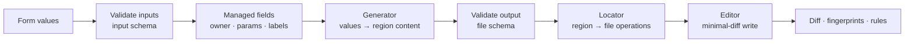

# Resource types and generators

Status: Draft · 2026-10-26

How Quai knows where a resource lives in a repository, and how it turns a form
into file content and back. The byte-level editing of files is in
[03-file-editing.md](03-file-editing.md).

## The pipeline



1. **Validate inputs** against the type's input schema (the form).
2. **Managed fields:** Quai sets fields it owns: the owner, fields mirrored from path params, optional labels.
3. **Generator:** turns values into the content of the resource's region. For day-2 changes it starts from the current content.
4. **Validate output** against the file schema, the same JSON Schema the repository's CI uses.
5. **Locator:** maps the resource key to a region (a file, a directory, an entry in a shared file, fields of an entry) and produces file operations.
6. **Editor:** applies the operations to the current files, changing only the bytes that must change.
7. **Diff:** produces the reviewable diff, the region fingerprints used to detect concurrent changes, and the inputs to approval rules.

Every step is in the engine (a pure Go package), so `quai lint` in customer CI
runs exactly the same code.

**Determinism:** the same definitions, inputs and base commit always produce
the same bytes. Generators may not read the clock, the network or the
environment. Golden tests enforce this.

## Type specification

Quai does not read the prototype's `quai.dev/v1alpha1` types. Compared with them, the
enterprise version adds input schemas, generators, more locators, Terraform
addresses and deletion policy.

```yaml
apiVersion: quai.dev/v1beta1
kind: ResourceType
metadata:
  name: vm
  title: Virtual machine
  description: One YAML file per VM; each environment is a Terraform stack.
  icon: server
  category: Compute
  version: 1.3.0
spec:
  # Where instances live.
  locate:
    strategy: file                       # file | dir | entry | field
    path: envs/{env}/vms/{name}.yaml
  params:
    - { name: env, type: enum, discover: true }
    - { name: name, pattern: "[a-z][a-z0-9-]{1,30}" }

  # What a valid file looks like. CI validates every file against it.
  schema: catalog/schemas/vm.schema.json

  # What the form asks. Optional: without it, the form is the file schema.
  inputs: catalog/schemas/vm.form.schema.json

  # How form values become file content, and back.
  generate:
    kind: mapping                        # identity | mapping | component | plugin
    template:
      template: ${{ inputs.os }}
      cpu: ${{ inputs.size == 'small' ? 2 : inputs.size == 'medium' ? 4 : 8 }}
      memory_gb: ${{ inputs.size == 'small' ? 4 : inputs.size == 'medium' ? 16 : 32 }}
      disks: ${{ inputs.disks }}
      network: { vlan: "${{ inputs.vlan }}" }
    read:                                # how to recover inputs from an existing file
      size: ${{ doc.cpu <= 2 ? 'small' : doc.cpu <= 4 ? 'medium' : 'large' }}

  ownership:
    field: owner                         # or: codeowners: true | team: platform
  stack: envs/{env}
  address: module.vm["{name}"]           # Terraform address prefix, for plan and drift mapping
  deletion: approval                     # allowed | approval | forbidden
  catalog: visible                       # visible | hidden (only usable from blueprints)
  entitlements:                          # who sees and requests it (docs/design/08, entitlements)
    visibility: [group:developers, group:finops]
    requesters: [group:developers]
    environments: { prod: [group:shop] }  # keyed by the env param's value; narrows requesters

  ui:
    order: [os, size, disks, vlan]
    fields:
      os: { immutable: true }
      vlan: { immutable: true }

  approval:
    rules:
      - name: large-vm
        when: "inputs.size == 'large' && (!has(previous.size) || previous.size != 'large')"
        approvers: [group:finops]

  actions:
    - name: resize
      kind: declarative
      inputs: [{ name: size, type: enum, options: [small, medium, large], required: true }]
      set: { size: "${{ action.size }}" }
    - name: restart
      kind: imperative
      executor: kubevirt
      operation: restart
      target: { namespace: "${{ params.env }}", name: "${{ params.name }}" }
```

Definitions are read strictly: an unknown field is an error, and an `apiVersion` other than
`quai.dev/v1beta1` is refused. `generate` may be omitted for the `identity` generator. The action
names `create`, `update`, `delete` and `transfer-ownership` are built in and cannot be redefined.

Expressions inside `${{ }}`, `when`, `visibleIf` and `availableIf` are CEL
([ADR 0009](../adr/0009-cel-expressions.md)). Variables available:

| Variable | Meaning |
| --- | --- |
| `inputs` | The validated form values |
| `params` | The locator params (`env`, `name`) |
| `doc` | The current region content (read-back and day-2) |
| `previous` | The values before a day-2 change (absent on create) |
| `action` | The action's own inputs |
| `request` | `kind`, `action`, `reason`; `type`, `blueprint` and `repository` as well, which change windows' conditions read ([change windows](05-delivery-and-approvals.md#change-windows-and-freezes)), `reason` being empty there |
| `user` | `name`, `groups` |

On create, `previous` and `doc` are empty, so conditions test fields first:
`!has(previous.size) || previous.size != 'large'`. Reading a missing key is an error, not a
null. Besides CEL's standard library, expressions may use optional values (`inputs.?vlan`,
`.orValue('default')`) and the strings extension (`lowerAscii`, `split`, `join`, `format`, …).
Each expression is at most 4,096 characters and each evaluation is bounded by a cost limit of
1,000,000 units, the limit Kubernetes applies to each CRD validation rule.

Bindings work on values, never on text:

- A string that is exactly one binding, spaces around it allowed, takes the binding's value and
  type: `${{ inputs.cpu }}` is a number, `${{ inputs.disks }}` a list.
- Bindings among other text are interpolated: strings as they are, null as nothing, other values
  as JSON. `x-${{ inputs.n }}` gives `x-4`.
- A binding that evaluates to `optional.none()` (`${{ inputs.?vlan }}`) is absent: its key or
  list item is left out of the template's result.
- Until values are typed by their schemas, whole numbers are ints and other numbers doubles, so
  `inputs.cpu * 2` and `inputs.ratio * 2.0` both work, whether the values came from YAML or JSON.
- Because the result is serialized by a YAML or JSON library, a value can never add structure
  to a file: `"a\nkind: Secret"` stays a string.

## Locators

A locator maps a resource key to a **region**: the part of the repository the
resource owns. The key is the param values in path order, joined by `/`
(`prod/web01`); each value is one path segment of 1 to 63 letters, digits, `.`,
`_` or `-`, starting with a letter or a digit and never containing `..`, so no
value can leave the pattern's directories. Inventory scans skip symbolic links
and `.git`. Regions decide what a change may touch and what is fingerprinted
to detect concurrent edits.

### `file`: one file per resource

```yaml
locate: { strategy: file, path: envs/{env}/vms/{name}.yaml }
```

- Region: the whole file.
- Create: write a new file. Delete: remove it. Update: edit it in place.
- Inventory: every file matching the pattern.
- Fits: VMs, buckets, DNS zones, anything a Terraform stack reads with `fileset()` + `yamldecode()`.

This is the strategy the pilot repository needs, and the one the prototype implements.

### `dir`: one directory per resource

```yaml
locate: { strategy: dir, path: deployments/{name} }
```

- Region: every file under the directory. Its fingerprint is each file's path and content hash ([design 03](03-file-editing.md#concurrency-and-fingerprints)).
- Used with the `component` generator for Kubernetes manifests (the prototype's blueprints), where one resource is several manifests plus a `kustomization.yaml`; a type with the `dir` locator and another generator is refused (a plugin writes one file).
- Contents:
  - `quai.yaml`, the record: the form's values, conforming to `spec.schema`, with the managed fields (owner, param mirrors) as for `identity`. Read-back uses it, because rendered manifests cannot be turned back into form values reliably; it is the resource's document. A directory without it cannot be edited.
  - `manifests.yaml`, the rendered manifests, one YAML document each ([multi-document](03-file-editing.md#yaml)), addressed by `kind` and `metadata.name` (and `metadata.namespace`).
  - `kustomization.yaml`, a `Kustomization` whose `resources` list `manifests.yaml` (not the record).
- Create: write the three files; the directory must not exist. Update and actions: read the values from the record, render, and edit each file in place: the record as `identity` edits a file, the manifests document by document (comments stay, documents no longer rendered are removed), the kustomization so that it lists `manifests.yaml`, keeping its other keys and resources (it is written again if missing). Other files in the directory are left as they are. Delete: remove every file under the directory.

### `entry`: a keyed item inside a shared file

```yaml
locate:
  strategy: entry
  path: clusters/{cluster}/namespaces.yaml
  collection: namespaces        # dotted path to a list or a map in the file
  key: name                     # for a list: the field that identifies an item; for a map: omit
  keyParam: name                # which param is the key value
```

Repository file:

```yaml
# Namespaces on prod-1. Platform team reviews quota changes.
namespaces:
  - name: shop
    quota: { cpu: "8", memory: 16Gi }
  - name: orders
    quota: { cpu: "4", memory: 8Gi }
```

- Region: one item of the collection (`namespaces[name=orders]`). Other items, the comment and the file's layout are outside the region and never touched.
- Create: append an item (at the end, or sorted by key if the type says `order: key`: before the first item or entry whose key sorts after it), in its siblings' style; a list item's key field comes first and always holds the key. A file or collection that does not exist yet is created. Delete: remove the item, with its own comments, and nothing else; the file stays. Update: edit inside the item; its key field cannot change. One request may change several entries of one file (a blueprint): they make one file change.
- Fingerprint: only the item. Two requests on two namespaces in the same file do not conflict; a human edit to `shop` does not invalidate an approval on `orders`.
- Duplicate keys in the collection make the whole file non-conforming; Quai refuses to edit it until fixed. So does an item without a valid key, or a collection that is not a list (with `key`) or a map (without it).
- Inventory: every entry of every file matching the path, keyed by the path's params and `keyParam` (`prod-1/orders`). A file without the collection has none; a file that cannot be read lists none, and `quai lint` reports it. The resource page shows the entry's value and its own bytes; its history and its status are its file's.
- The same in YAML, JSON (an array of objects, or an object) and HCL (a map attribute of a `*.tfvars` file, or of the `locals` block of a `.tf` file: `path: modules/apps/locals.tf`, `collection: apps`).
- Fits: namespace lists, firewall rules, user and group lists, DNS records kept in one file.

### `field`: fields of something owned by someone else

```yaml
locate:
  strategy: field
  path: clusters/{cluster}/namespaces.yaml
  collection: namespaces
  key: name
  keyParam: name
  fields: [quota]               # the only paths this type may write inside the entry
```

- Region: only the listed fields inside the item; without `collection` (and `key`, `keyParam`), the listed fields of each whole file matching the path (`path: envs/{env}/vms/{name}.yaml`, `fields: [backup]`).
- There is no create or delete: the item must exist. The resource exists while the item does. The catalog does not list field types; their resources are in the inventory, with their own page.
- The resource's document is the listed fields only, and the type's schema describes only them (a property of the schema that is not a listed field, or a parent of one, is a definitions problem): the form shows only those. A request that writes a path the type does not list is refused for that path.
- Fingerprint: the listed fields' bytes only. A request on the fields does not conflict with a change to the entry's other fields: on a new base it is made again, setting only its fields. The owning type's region is the whole entry, so a change to the fields makes an open request of the owning type on that entry stale.
- Used for "request a quota increase" on a namespace another team manages, or "toggle backup" on a VM file without owning the VM.
- Approval rules usually differ from the owning type; both can coexist on the same file.

## Generators

A generator converts values to region content (`write`) and region content to
values (`read`). `read` is what makes day-2 possible: the edit form starts from
the resource as it is in Git, not from what Quai remembers.

### `identity`: the file is the form

```yaml
generate: { kind: identity }
```

- `write`: the region content is the validated values, plus managed fields.
- `read`: the region content is the values.
- Input schema = file schema. The form is generated from the schema the repository already has.
- Fields the schema does not describe are preserved on update. Locked fields (the owner, param mirrors, fields the type marks `immutable` and those the schema marks `readOnly`) are kept when the form leaves them out and refused when it changes them.
- A declarative action's `set` writes each dotted path; a binding that evaluates to null removes the field, an absent one leaves it alone.
- Use when the file is already the right shape for a form. Implemented in the prototype.

### `mapping`: a structured template, with read-back

```yaml
generate:
  kind: mapping
  template:
    cpu: ${{ inputs.size == 'small' ? 2 : 8 }}
    template: ${{ inputs.os }}
  read:
    size: ${{ doc.cpu <= 2 ? 'small' : 'large' }}
```

- `write`: the template is evaluated as data (never as text) and merged into the region. Only paths the template defines are **managed**; anything else in the file (hand-added keys, comments) is left alone.
- `read`: inputs bound directly (`template: ${{ inputs.os }}`, or `${{ inputs.?os }}`) are read back automatically from the same path. Computed fields need an explicit `read` expression, which sees the region as `doc` and the params as `params`; one that evaluates to an absent value leaves the input out. An input of the input schema with neither is a definitions problem (`spec.generate.read`), which `quai lint` reports, so the type cannot be published until it is fixed. The edit form starts from the values read back (the API's `values`), and `previous` in rules and in the template is those values.
- A binding that evaluates to null removes the key; one that evaluates to an absent value leaves the key as it is.
- The form's values, with the input schema's defaults and without the fields `visibleIf` hides, are checked against the input schema (`spec.inputs`); the template sees them as `inputs`, the locator params as `params` and the region as it is as `doc`. A mapping in the template merges into the region's mapping key by key; a list or a scalar replaces the value. The result gets the managed fields (owner, param mirrors, labels) and is checked against the file schema: a failure there is the type's, not the form's. New files list their keys in the file schema's order.
- Approval rules of a mapping type read the form's values as `inputs` and the file as `doc`. Actions set fields of the region as for `identity`. It works with every locator and format; a list entry's key field is set by Quai, as a param mirror.
- Use when the form should be simpler than the file: t-shirt sizes, derived names, defaults hidden from users.

### `component`: built-in renderers for Kubernetes

```yaml
generate:
  kind: component
  component: crossplane.claim   # crossplane.claim | argocd.application | k8s.namespace | flux.kustomization | raw
  with:
    apiVersion: database.platform.acme.ch/v1alpha1   # crossplane.claim takes the XRD's group/kind
    kind: PostgreSQLInstance
    name: ${{ params.name }}
    namespace: ${{ params.namespace }}
    spec:
      parameters: { version: "${{ inputs.version }}", storageGB: "${{ inputs.storageGB }}" }
      compositionSelector: { matchLabels: { provider: aws } }
```

- Renders one or more manifests into a `dir` region, plus `kustomization.yaml` and the `quai.yaml` record. It needs the `dir` locator.
- The form is the record's schema, `spec.schema`; `spec.inputs` does not apply. `with` is a template, evaluated as data like a mapping template: it sees the record's values as `inputs` and the locator params as `params`, and gives the component's properties. A property the component does not have, or a required one missing, is a definition problem; what the component refuses in the values it is given (a name that is not a DNS label) is the type's, not the form's.
- The manifests are what the component renders, with no labels or annotations of Quai's own. A property whose value is null is not set, so `${{ inputs.?x }}` leaves it out when the form does. Names are checked as Kubernetes checks them: namespaces as DNS labels, objects' names as DNS subdomains.
- The components (required properties first; every component but `raw` also takes `labels` and `annotations`, mappings of strings):
  - `raw` (`manifests`): the manifests as given, each with `apiVersion`, `kind` and `metadata.name`.
  - `k8s.namespace` (`name`; `quota`): a `Namespace`, and a `ResourceQuota` named `quota` whose `spec.hard` is the `quota` mapping, when it has any value (a null value is left out, so `${{ inputs.?cpu }}` drops a quota the form leaves empty).
  - `crossplane.claim` (`apiVersion`, `kind`, `name`, `namespace`; `spec`): a claim of any XRD, its group/version and kind as the XRD names them, with `spec` as its spec (the XRD's parameters and Crossplane's fields, such as `compositionSelector` or `writeConnectionSecretToRef`). It is generic instead of the prototype's two hard-coded kinds, and renders a Crossplane 2 namespaced composite resource the same way.
  - `argocd.application` (`name`, `repoURL`; `namespace`, default `argocd`; `project`, default `default`; `path` or `chart`, exactly one; `targetRevision`, default `HEAD`, required with a chart; `values`, a mapping written as the source's `helm.valuesObject`; `server`, default `https://kubernetes.default.svc`, or `cluster`, the name Argo CD knows a cluster by; `destinationNamespace`; `automated`, a sync policy that prunes and heals; `syncOptions`, a list of strings; `cascadeDelete`, Argo CD's resources finalizer, so that deleting the Application deletes what it deployed): an `argoproj.io/v1alpha1` `Application`.
  - `flux.kustomization` (`name`, `source`; `namespace`, default `flux-system`; `sourceKind`, `GitRepository` (the default), `OCIRepository` or `Bucket`; `sourceNamespace`; `path`; `interval`, default `10m`; `prune`, default true; `targetNamespace`; `dependsOn`, a list of names; `wait`; `timeout`; `substitute`, a mapping of strings, the post-build substitutions): a `kustomize.toolkit.fluxcd.io/v1` `Kustomization`.
- The prototype's `kubevirt.vm` does not ([open question 12](../plan/open-questions.md#decided)): KubeVirt VMs in
  a GitOps repository are usually entries of a Helm chart's values, which the `entry` locator edits and the
  chart renders. A renderer for one directory of manifests per VM is a
  [future improvement](../plan/roadmap.md#future-improvements).
- Read-back uses the record file.
- Tested: golden examples per component, and the Kubernetes API server (envtest), with the CRDs the components render for, accepts what each renders in a server-side dry run. [`examples/kubernetes-repo`](../../examples/kubernetes-repo) has a type per component.

### `plugin`: anything else, in a sandbox

```yaml
locate: { strategy: file, path: "apps/{name}.ini" }
generate:
  kind: plugin
  module: .quai/plugins/ini.wasm
  digest: sha256:4f1c…                  # the module is refused if the digest differs
  config: { section: app }              # given to the plugin as it is
```

- A WebAssembly module for WASI preview 1 (`GOOS=wasip1`, built as a reactor), run with `wazero`. It owns the resource's file: `write(values, current) -> region` writes the values into the file's text before the request (none on create), keeping what it does not manage, and `read(region) -> values` reads them back. Use it for formats Quai cannot parse (TOML, INI, XML) or conventions the built-in generators do not cover. HCL is built in (see below), so plugins should be rare.
- The values are those of the `identity` generator: the form's values, conforming to `spec.schema` (the form; `spec.inputs` does not apply), with the owner field and param mirrors, and actions setting fields of the values the plugin read. The plugin turns them into text, and back.
- Only with the `file` locator, of any extension: the format is the plugin's, so `entry` and `field` regions, which Quai finds by parsing the file, do not apply; neither does `dir` (a directory written by a plugin is not built).
- **ABI.** The module exports `alloc(size i32) -> i32`, `write(ptr, len i32) -> i64` and `read(ptr, len i32) -> i64`, and its memory. The host writes a call's input, JSON, into a buffer from `alloc`; the function returns its output's address in the high 32 bits and its length in the low 32. `write` takes `{values, current, params, config}` and returns `{region}`; `read` takes `{region, params, config}` and returns `{values}`; either returns `{error}` to refuse its input, which Quai shows. A region is UTF-8 text.
- **Checks.** The module is refused when its SHA-256 differs from `digest`, when it imports anything but WASI preview 1, or when it does not export the ABI. Every write is read back: the request is refused when the plugin does not read the values it was given from what it wrote. `quai lint` checks the module, and runs the round trip and the golden examples through it.
- **Sandbox.** Each call runs in a new instance: nothing is kept between calls. WASI sees no file system (nothing is mounted), no network, a clock that starts at a fixed time and a fixed random source; arguments and environment are empty, standard output is discarded and standard error is shown when the call fails. Each call has 64 MiB of memory and 2 seconds, from instantiation to output. A call's output depends only on its input. Compiled modules are cached by digest.
- **Writing one.** A Go SDK (`plugins/sdk`, a module of its own) exports the ABI and runs a plugin's golden cases with `go test`; `plugins/template` is a plugin to start from, whose `Makefile` builds the module and prints its digest, and `plugins/ini` the example, for INI files. How to write a plugin: [engineering/plugins.md](../engineering/plugins.md).

## Formats

| Format | Read | Write | Editor |
| --- | --- | --- | --- |
| YAML (single and multi-document) | ✅ | ✅ | `go.yaml.in/yaml/v3` node tree with positions; minimal-diff splicing |
| JSON | ✅ | ✅ | A parser that keeps every value's byte range; text edits that keep formatting and key order |
| `*.tfvars.json` | ✅ | ✅ | As JSON |
| HCL `*.tfvars`, `locals` blocks | ✅ | ✅ | `hashicorp/hcl/v2`: `hclsyntax` for every value's byte range, text edits, `hclwrite` to render values and keep `terraform fmt`'s formatting |
| TOML, INI, XML | via plugin | via plugin | — |

The format of a type's files follows their extension (`locate.path`): `.yaml` and `.yml`,
`.json` (with `.tfvars.json`), `.tfvars` and `.hcl`, whose top-level attributes are the document,
and `.tf`, whose document is the attributes of its one `locals` block (a file without one, or with
several, cannot be read; a new `.tf` file holds a `locals` block).
Inventory, forms, requests and `quai lint` read and write every format the same way
(`internal/engine/edit`). A value an HCL file defines in code (an expression or a heredoc) is not
in the document: the form shows the expression and leaves it, the schema does not count it as
missing, and a request that writes it is refused for that field.

The editors and their safety checks are specified in [03-file-editing.md](03-file-editing.md).

## Managed fields

| Field | Behaviour |
| --- | --- |
| Owner (`ownership.field`) | Set to the requester (or their team) on create; locked afterwards; changed only by a `transfer-ownership` action. |
| Param mirrors (`paramFields`) | Kept equal to the locator params, e.g. `name:` inside `web01.yaml`, and a list entry's key field, which mirrors `keyParam`. Hidden from forms. |
| Labels (`labels`) | Optional fixed values by dotted field path, e.g. `managed_by: quai`. Off by default: many schemas forbid unknown keys. |
| Timestamps | Never written to files: they would make every change touch an extra line and make no-op changes impossible to detect. Creation and change dates come from Git history. |

## Ownership

| Mode | Owner is | Use when |
| --- | --- | --- |
| `field: owner` | The value in the file (user or `team:x`) | The schema has an owner field |
| `codeowners: true` | The owners the platform names for the resource's file on the target branch: its `CODEOWNERS` entries; on Azure DevOps, the reviewers of "Automatically included reviewers" policies whose path filters match. They are matched to Quai users and groups as in [identity](08-identity-access-tenancy.md#directory); those that match no one are shown on the resource page. Read again when the branch moves, and kept for a minute; while the platform cannot be read, such resources have no owner | Ownership is already managed through CODEOWNERS or reviewer policies |
| `team: platform` | A fixed team for every resource of the type | Shared infrastructure |

Resources with no owner can be changed only by admins and the type's
`operators`. They appear in the inventory with a warning.

## Validation layers

1. **Input schema:** form values, field by field, with messages shown next to the fields.
2. **File schema:** the generated content. A failure here is a bug in the type, not the user's fault. The request is refused and the type is flagged.
3. **Format:** the edited file must parse and decode to exactly the intended content (see [03-file-editing.md](03-file-editing.md)).
4. **Repository policy (optional):** if the repository ships an OPA/Rego bundle (`.quai/policy/` or the path its CI uses), Quai evaluates it in-process for early feedback. CI remains the enforcing check.

Schemas are JSON Schema 2020-12 unless they declare 2019-09 or draft 7 with `$schema`. `format`
is checked, not just an annotation, so an invalid `ipv4` fails as it does in most CI
validators. A `$ref` resolves only to schema files in the repository, by relative path or by
`$id`: Quai never fetches a schema from the network. Errors are keyed by dotted field path
(`disks.0.size_gb`, `$` for the document) with one message per field, such as "must be one of
110, 120, 130"; an `anyOf` or `oneOf` that fails is one message, not one per alternative.

## Terraform addresses

`address: module.vm["{name}"]` tells Quai which Terraform resources belong to a
Quai resource. With it, Quai can map `terraform show -json` output (parsed with
`hashicorp/terraform-json`) back to resources:

- the request page shows "web01: 1 to change (`module.vm["web01"].vsphere_virtual_machine.this`: `num_cpus` 4 → 8)";
- drift checks report which resources drifted, not just which stack;
- destroys are highlighted per resource, and a request whose plan destroys something it did not intend to can be blocked by a rule (`plan.destroys > 0`).

## Schema evolution

| Situation | Behaviour |
| --- | --- |
| A new optional field | Existing files stay valid. |
| A new required field, or a stricter rule | Existing files become *non-conforming*. They stay visible; edits are blocked until fixed. The type author sees the count in `quai lint` before merging. |
| A field renamed | The type ships a `migrate` CEL expression; Quai offers a bulk "migrate" change set, reviewed like any other. |
| `metadata.version` major bump | Blueprints that pin an older range are flagged in the catalog. |

A non-conforming resource keeps its page, with its file and the fields that do not conform;
Edit, actions and Delete are refused ("fix it in Git before Quai edits it") until its file
conforms again. `quai lint` prints one line per type with non-conforming resources, and how many
of them its migration fixes, before the summary:

```text
type team: 2 resources do not conform to its schema; its migration fixes 1, by a migrate request once merged
```

**`migrate`** is one `${{ … }}` binding over `doc`, the file's values as Quai reads them, and
`params`. It gives a JSON merge patch (RFC 7386) of the values: a key set to `null` is removed,
an object merges into the object it replaces, anything else replaces the value.

```yaml
spec:
  migrate: "${{ has(doc.size) ? {'tier': doc.size, 'size': null} : {} }}"
```

It applies to the generators whose file is the form, `identity` and `plugin`; `quai lint` refuses
it on the others. The patched values go through the same steps as an update (managed fields,
hidden fields, the file schema) and are written by the same editor, so comments and the fields
the patch leaves alone keep their bytes. Lint counts a non-conforming resource that the migration
makes conform, without reporting it as a problem, so a type change with its migration can merge;
the resources it does not fix stay problems.

A **migrate request** (`kind: migrate`, on the type, no key) is one change set over every
non-conforming resource of the type that the migration fixes, delivered and reviewed like any
other request: each resource's approval rules apply (floor rules and the type's, with
`request.kind == 'migrate'`, `inputs` the migrated values and `previous` the current ones), and
its owners are the resources' owners. A resource the migration does not change or leaves
non-conforming is listed in the plan, with why, and left as it is; a file Quai cannot read is
not migrated. The request operates every non-conforming resource of the type, so it needs the
right to operate each of them ([access](08-identity-access-tenancy.md#evaluation)): their
owning team, or a platform admin. A type has one open migrate request at a time (its target is
`repository/type`), and it shows on the page of each resource it fixes.

A blueprint pins a type with `type.version`, a range of its `metadata.version`
(`"^1.2"`, `">=1.2 <2"`). When the type leaves the range, a new major version, `quai lint`
reports the pin as a problem of the blueprint, the catalog flags the blueprint ("Needs an
update", with the pins it breaks), and new instances are refused until the blueprint is
updated; day-2 actions on existing instances still work.

## Deletion

| `deletion` | Behaviour |
| --- | --- |
| `allowed` | Delete is a normal day-2 action under the type's approval rules. |
| `approval` (default) | Delete always needs at least one approval from the owners or the repository floor rules, even when other changes do not: when no rule applies, Quai adds one whose approvers are `owners` and every approver the repository's floor rules name. |
| `forbidden` | No delete action. Removal is done by hand in Git. |

A delete's plan exists once its pull request does: the request page shows what the plan
destroys, first, as soon as the runner has reported it, before anyone approves.

## Testing a type

`quai lint` (the same binary, run in the IaC repository's CI) checks:

- every definition parses, every expression compiles, every referenced schema and plugin exists and matches its digest;
- every file the locator matches parses and conforms to the file schema;
- **round trip**: for every existing resource, `write(read(file))` produces zero diff. A type that cannot reproduce existing files would rewrite them on the first edit, so it is rejected;
- golden examples under `.quai/tests/<type>/` (input values → expected files) still produce the same bytes: each case is a directory, `.quai/tests/<type>/<case>/`, with `request.yaml` (`kind`: create, update, delete, action or migrate; `params` for a create, `key` otherwise; `values`, `action`, `actionInputs`, `owner`; and `deleted`, the files the request deletes), the files the case starts from under `before/` (laid over the repository, optional), and the files the request must write under `after/`, compared byte for byte. A file written but not under `after/`, or under `after/` but not written, is a problem;
- with `--plan plan.json --stack envs/prod`, every Terraform resource the plan of that stack changes belongs to exactly one resource, through the types' `stack` and `address` patterns.

It prints one line per problem (`file: field: message`) and exits with status 1 when there
is any. The round trip of a mapping type reads the values back and writes them through the template; that of a
`dir` region reads the values from its record (which must conform to the schema) and renders
them: the record, the manifests and the kustomization must stay byte for byte; that of a plugin
type reads the values through the plugin and writes them back through it. A golden case's
`before/` may hold some of a directory's files: the others are the repository's. The backend CI runs it on `examples/gitops-repo`, whose `.quai/tests/vm/` holds golden
examples.
