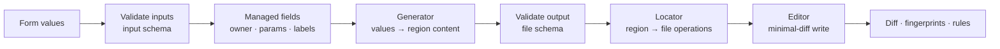

# Resource types and generators

Status: Draft · 2026-10-26

How Quai knows where a resource lives in a repository, and how it turns a form
into file content and back. The byte-level editing of files is in
[03-file-editing.md](03-file-editing.md).

## The pipeline



1. **Validate inputs** against the type's input schema (the form).
2. **Managed fields:** Quai sets fields it owns: the owner, fields mirrored from path params, optional labels.
3. **Generator:** turns values into the content of the resource's region. For day-2 changes it starts from the current content.
4. **Validate output** against the file schema, the same JSON Schema the repository's CI uses.
5. **Locator:** maps the resource key to a region (a file, a directory, an entry in a shared file, fields of an entry) and produces file operations.
6. **Editor:** applies the operations to the current files, changing only the bytes that must change.
7. **Diff:** produces the reviewable diff, the region fingerprints used to detect concurrent changes, and the inputs to approval rules.

Every step is in the engine (a pure Go package), so `quai lint` in customer CI
runs exactly the same code.

**Determinism:** the same definitions, inputs and base commit always produce
the same bytes. Generators may not read the clock, the network or the
environment. Golden tests enforce this.

## Type specification

Quai does not read the prototype's `quai.dev/v1alpha1` types. Compared with them, the
enterprise version adds input schemas, generators, more locators, Terraform
addresses and deletion policy.

```yaml
apiVersion: quai.dev/v1beta1
kind: ResourceType
metadata:
  name: vm
  title: Virtual machine
  description: One YAML file per VM; each environment is a Terraform stack.
  icon: server
  category: Compute
  version: 1.3.0
spec:
  # Where instances live.
  locate:
    strategy: file                       # file | dir | entry | field
    path: envs/{env}/vms/{name}.yaml
  params:
    - { name: env, type: enum, discover: true }
    - { name: name, pattern: "[a-z][a-z0-9-]{1,30}" }

  # What a valid file looks like. CI validates every file against it.
  schema: catalog/schemas/vm.schema.json

  # What the form asks. Optional: without it, the form is the file schema.
  inputs: catalog/schemas/vm.form.schema.json

  # How form values become file content, and back.
  generate:
    kind: mapping                        # identity | mapping | component | plugin
    template:
      template: ${{ inputs.os }}
      cpu: ${{ inputs.size == 'small' ? 2 : inputs.size == 'medium' ? 4 : 8 }}
      memory_gb: ${{ inputs.size == 'small' ? 4 : inputs.size == 'medium' ? 16 : 32 }}
      disks: ${{ inputs.disks }}
      network: { vlan: "${{ inputs.vlan }}" }
    read:                                # how to recover inputs from an existing file
      size: ${{ doc.cpu <= 2 ? 'small' : doc.cpu <= 4 ? 'medium' : 'large' }}

  ownership:
    field: owner                         # or: codeowners: true | team: platform
  stack: envs/{env}
  address: module.vm["{name}"]           # Terraform address prefix, for plan and drift mapping
  deletion: approval                     # allowed | approval | forbidden
  catalog: visible                       # visible | hidden (only usable from blueprints)

  ui:
    order: [os, size, disks, vlan]
    fields:
      os: { immutable: true }
      vlan: { immutable: true }

  approval:
    rules:
      - name: large-vm
        when: "inputs.size == 'large' && (!has(previous.size) || previous.size != 'large')"
        approvers: [group:finops]

  actions:
    - name: resize
      kind: declarative
      inputs: [{ name: size, type: enum, options: [small, medium, large], required: true }]
      set: { size: "${{ action.size }}" }
    - name: restart
      kind: imperative
      executor: kubevirt
      operation: restart
      target: { namespace: "${{ params.env }}", name: "${{ params.name }}" }
```

Definitions are read strictly: an unknown field is an error, and an `apiVersion` other than
`quai.dev/v1beta1` is refused. `generate` may be omitted for the `identity` generator. The action
names `create`, `update`, `delete` and `transfer-ownership` are built in and cannot be redefined.

Expressions inside `${{ }}`, `when`, `visibleIf` and `availableIf` are CEL
([ADR 0009](../adr/0009-cel-expressions.md)). Variables available:

| Variable | Meaning |
| --- | --- |
| `inputs` | The validated form values |
| `params` | The locator params (`env`, `name`) |
| `doc` | The current region content (read-back and day-2) |
| `previous` | The values before a day-2 change (absent on create) |
| `action` | The action's own inputs |
| `request` | `kind`, `action`, `reason` |
| `user` | `name`, `groups` |

On create, `previous` and `doc` are empty, so conditions test fields first:
`!has(previous.size) || previous.size != 'large'`. Reading a missing key is an error, not a
null. Besides CEL's standard library, expressions may use optional values (`inputs.?vlan`,
`.orValue('default')`) and the strings extension (`lowerAscii`, `split`, `join`, `format`, …).
Each expression is at most 4,096 characters and each evaluation is bounded by a cost limit of
1,000,000 units, the limit Kubernetes applies to each CRD validation rule.

Bindings work on values, never on text:

- A string that is exactly one binding, spaces around it allowed, takes the binding's value and
  type: `${{ inputs.cpu }}` is a number, `${{ inputs.disks }}` a list.
- Bindings among other text are interpolated: strings as they are, null as nothing, other values
  as JSON. `x-${{ inputs.n }}` gives `x-4`.
- A binding that evaluates to `optional.none()` (`${{ inputs.?vlan }}`) is absent: its key or
  list item is left out of the template's result.
- Until values are typed by their schemas, whole numbers are ints and other numbers doubles, so
  `inputs.cpu * 2` and `inputs.ratio * 2.0` both work, whether the values came from YAML or JSON.
- Because the result is serialized by a YAML or JSON library, a value can never add structure
  to a file: `"a\nkind: Secret"` stays a string.

## Locators

A locator maps a resource key to a **region**: the part of the repository the
resource owns. The key is the param values in path order, joined by `/`
(`prod/web01`); each value is one path segment of 1 to 63 letters, digits, `.`,
`_` or `-`, starting with a letter or a digit and never containing `..`, so no
value can leave the pattern's directories. Inventory scans skip symbolic links
and `.git`. Regions decide what a change may touch and what is fingerprinted
to detect concurrent edits.

### `file`: one file per resource

```yaml
locate: { strategy: file, path: envs/{env}/vms/{name}.yaml }
```

- Region: the whole file.
- Create: write a new file. Delete: remove it. Update: edit it in place.
- Inventory: every file matching the pattern.
- Fits: VMs, buckets, DNS zones, anything a Terraform stack reads with `fileset()` + `yamldecode()`.

This is the strategy the pilot repository needs, and the one the prototype implements.

### `dir`: one directory per resource

```yaml
locate: { strategy: dir, path: deployments/{name} }
```

- Region: every file under the directory.
- Used with the `component` generator for Kubernetes manifests (the prototype's blueprints), where one resource is several manifests plus a `kustomization.yaml`.
- Read-back uses a record file in the directory (`quai.yaml`), because rendered manifests cannot be turned back into form values reliably.

### `entry`: a keyed item inside a shared file

```yaml
locate:
  strategy: entry
  path: clusters/{cluster}/namespaces.yaml
  collection: namespaces        # dotted path to a list or a map in the file
  key: name                     # for a list: the field that identifies an item; for a map: omit
  keyParam: name                # which param is the key value
```

Repository file:

```yaml
# Namespaces on prod-1. Platform team reviews quota changes.
namespaces:
  - name: shop
    quota: { cpu: "8", memory: 16Gi }
  - name: orders
    quota: { cpu: "4", memory: 8Gi }
```

- Region: one item of the collection (`namespaces[name=orders]`). Other items, the comment and the file's layout are outside the region and never touched.
- Create: append an item (at the end, or sorted by key if the type says `order: key`: before the first item or entry whose key sorts after it), in its siblings' style; a list item's key field comes first and always holds the key. A file or collection that does not exist yet is created. Delete: remove the item, with its own comments, and nothing else; the file stays. Update: edit inside the item; its key field cannot change. One request may change several entries of one file (a blueprint): they make one file change.
- Fingerprint: only the item. Two requests on two namespaces in the same file do not conflict; a human edit to `shop` does not invalidate an approval on `orders`.
- Duplicate keys in the collection make the whole file non-conforming; Quai refuses to edit it until fixed. So does an item without a valid key, or a collection that is not a list (with `key`) or a map (without it).
- Inventory: every entry of every file matching the path, keyed by the path's params and `keyParam` (`prod-1/orders`). A file without the collection has none; a file that cannot be read lists none, and `quai lint` reports it. The resource page shows the entry's value and its own bytes; its history and its status are its file's.
- The same in YAML, JSON (an array of objects, or an object) and HCL (a map attribute of a `*.tfvars` file, or of the `locals` block of a `.tf` file: `path: modules/apps/locals.tf`, `collection: apps`).
- Fits: namespace lists, firewall rules, user and group lists, DNS records kept in one file.

### `field`: fields of something owned by someone else

```yaml
locate:
  strategy: field
  path: clusters/{cluster}/namespaces.yaml
  collection: namespaces
  key: name
  keyParam: name
  fields: [quota]               # the only paths this type may write inside the entry
```

- Region: only the listed fields inside the item; without `collection` (and `key`, `keyParam`), the listed fields of each whole file matching the path (`path: envs/{env}/vms/{name}.yaml`, `fields: [backup]`).
- There is no create or delete: the item must exist. The resource exists while the item does. The catalog does not list field types; their resources are in the inventory, with their own page.
- The resource's document is the listed fields only, and the type's schema describes only them (a property of the schema that is not a listed field, or a parent of one, is a definitions problem): the form shows only those. A request that writes a path the type does not list is refused for that path.
- Fingerprint: the listed fields' bytes only. A request on the fields does not conflict with a change to the entry's other fields: on a new base it is made again, setting only its fields. The owning type's region is the whole entry, so a change to the fields makes an open request of the owning type on that entry stale.
- Used for "request a quota increase" on a namespace another team manages, or "toggle backup" on a VM file without owning the VM.
- Approval rules usually differ from the owning type; both can coexist on the same file.

## Generators

A generator converts values to region content (`write`) and region content to
values (`read`). `read` is what makes day-2 possible: the edit form starts from
the resource as it is in Git, not from what Quai remembers.

### `identity`: the file is the form

```yaml
generate: { kind: identity }
```

- `write`: the region content is the validated values, plus managed fields.
- `read`: the region content is the values.
- Input schema = file schema. The form is generated from the schema the repository already has.
- Fields the schema does not describe are preserved on update. Locked fields (the owner, param mirrors, fields the type marks `immutable` and those the schema marks `readOnly`) are kept when the form leaves them out and refused when it changes them.
- A declarative action's `set` writes each dotted path; a binding that evaluates to null removes the field, an absent one leaves it alone.
- Use when the file is already the right shape for a form. Implemented in the prototype.

### `mapping`: a structured template, with read-back

```yaml
generate:
  kind: mapping
  template:
    cpu: ${{ inputs.size == 'small' ? 2 : 8 }}
    template: ${{ inputs.os }}
  read:
    size: ${{ doc.cpu <= 2 ? 'small' : 'large' }}
```

- `write`: the template is evaluated as data (never as text) and merged into the region. Only paths the template defines are **managed**; anything else in the file (hand-added keys, comments) is left alone.
- `read`: inputs bound directly (`template: ${{ inputs.os }}`) are read back automatically from the same path. Computed fields need an explicit `read` expression. An input with neither is reported by `quai lint` as unrecoverable, so the type cannot be published until it is fixed.
- A binding that evaluates to null removes the key; one that evaluates to an absent value leaves the key as it is.
- Use when the form should be simpler than the file: t-shirt sizes, derived names, defaults hidden from users.

### `component`: built-in renderers for Kubernetes

```yaml
generate:
  kind: component
  component: kubevirt.vm        # kubevirt.vm | crossplane.claim | argocd.application | k8s.namespace | flux.kustomization | raw
  with:
    apiVersion: database.platform.acme.ch/v1alpha1   # crossplane.claim takes the XRD's group/kind
    kind: PostgreSQLInstance
```

- Renders one or more manifests into a `dir` region, plus `kustomization.yaml` and the `quai.yaml` record.
- The prototype's components move here. `crossplane.claim` becomes generic (any XRD) instead of hard-coding two kinds.
- Read-back uses the record file.

### `plugin`: anything else, in a sandbox

```yaml
generate:
  kind: plugin
  module: .quai/plugins/tfvars.wasm
  digest: sha256:4f1c…                  # the module is refused if the digest differs
  config: { variable: vms }
```

- A WASM module exporting `write(values, current) -> region` and `read(region) -> values`, run with `wazero`.
- No file system, network, clock or randomness; memory and CPU limits per call. Deterministic by construction.
- A small Go plugin SDK with tests and a template repository.
- Use for formats or conventions the built-in generators do not cover. HCL is built in (see below), so plugins should be rare.

## Formats

| Format | Read | Write | Editor |
| --- | --- | --- | --- |
| YAML (single and multi-document) | ✅ | ✅ | `go.yaml.in/yaml/v3` node tree with positions; minimal-diff splicing |
| JSON | ✅ | ✅ | A parser that keeps every value's byte range; text edits that keep formatting and key order |
| `*.tfvars.json` | ✅ | ✅ | As JSON |
| HCL `*.tfvars`, `locals` blocks | ✅ | ✅ | `hashicorp/hcl/v2`: `hclsyntax` for every value's byte range, text edits, `hclwrite` to render values and keep `terraform fmt`'s formatting |
| TOML, INI, XML | via plugin | via plugin | — |

The format of a type's files follows their extension (`locate.path`): `.yaml` and `.yml`,
`.json` (with `.tfvars.json`), `.tfvars` and `.hcl`, whose top-level attributes are the document,
and `.tf`, whose document is the attributes of its one `locals` block (a file without one, or with
several, cannot be read; a new `.tf` file holds a `locals` block).
Inventory, forms, requests and `quai lint` read and write every format the same way
(`internal/engine/edit`). A value an HCL file defines in code (an expression or a heredoc) is not
in the document: the form shows the expression and leaves it, the schema does not count it as
missing, and a request that writes it is refused for that field.

The editors and their safety checks are specified in [03-file-editing.md](03-file-editing.md).

## Managed fields

| Field | Behaviour |
| --- | --- |
| Owner (`ownership.field`) | Set to the requester (or their team) on create; locked afterwards; changed only by a `transfer-ownership` action. |
| Param mirrors (`paramFields`) | Kept equal to the locator params, e.g. `name:` inside `web01.yaml`. Hidden from forms. |
| Labels (`labels`) | Optional fixed values by dotted field path, e.g. `managed_by: quai`. Off by default: many schemas forbid unknown keys. |
| Timestamps | Never written to files: they would make every change touch an extra line and make no-op changes impossible to detect. Creation and change dates come from Git history. |

## Ownership

| Mode | Owner is | Use when |
| --- | --- | --- |
| `field: owner` | The value in the file (user or `team:x`) | The schema has an owner field |
| `codeowners: true` | The `CODEOWNERS` entry for the resource's path | Ownership is already managed through CODEOWNERS. From Phase 4 ([#100](https://github.com/damhau/quai/issues/100)); until then it has no effect |
| `team: platform` | A fixed team for every resource of the type | Shared infrastructure |

Resources with no owner can be changed only by admins and the type's
`operators`. They appear in the inventory with a warning.

## Validation layers

1. **Input schema:** form values, field by field, with messages shown next to the fields.
2. **File schema:** the generated content. A failure here is a bug in the type, not the user's fault. The request is refused and the type is flagged.
3. **Format:** the edited file must parse and decode to exactly the intended content (see [03-file-editing.md](03-file-editing.md)).
4. **Repository policy (optional):** if the repository ships an OPA/Rego bundle (`.quai/policy/` or the path its CI uses), Quai evaluates it in-process for early feedback. CI remains the enforcing check.

Schemas are JSON Schema 2020-12 unless they declare 2019-09 or draft 7 with `$schema`. `format`
is checked, not just an annotation, so an invalid `ipv4` fails as it does in most CI
validators. A `$ref` resolves only to schema files in the repository, by relative path or by
`$id`: Quai never fetches a schema from the network. Errors are keyed by dotted field path
(`disks.0.size_gb`, `$` for the document) with one message per field, such as "must be one of
110, 120, 130"; an `anyOf` or `oneOf` that fails is one message, not one per alternative.

## Terraform addresses

`address: module.vm["{name}"]` tells Quai which Terraform resources belong to a
Quai resource. With it, Quai can map `terraform show -json` output (parsed with
`hashicorp/terraform-json`) back to resources:

- the request page shows "web01: 1 to change (`module.vm["web01"].vsphere_virtual_machine.this`: `num_cpus` 4 → 8)";
- drift checks report which resources drifted, not just which stack;
- destroys are highlighted per resource, and a request whose plan destroys something it did not intend to can be blocked by a rule (`plan.destroys > 0`).

## Schema evolution

| Situation | Behaviour |
| --- | --- |
| A new optional field | Existing files stay valid. |
| A new required field, or a stricter rule | Existing files become *non-conforming*. They stay visible; edits are blocked until fixed. The type author sees the count in `quai lint` before merging. |
| A field renamed | The type ships a `migrate` CEL expression; Quai offers a bulk "migrate" change set, reviewed like any other. |
| `metadata.version` major bump | Blueprints that pin an older range are flagged in the catalog. |

## Deletion

| `deletion` | Behaviour |
| --- | --- |
| `allowed` | Delete is a normal day-2 action under the type's approval rules. |
| `approval` (default) | Delete always needs at least one approval from the owners or the repository floor rules, even when other changes do not: when no rule applies, Quai adds one whose approvers are `owners` and every approver the repository's floor rules name. |
| `forbidden` | No delete action. Removal is done by hand in Git. |

A delete's plan exists once its pull request does: the request page shows what the plan
destroys, first, as soon as the runner has reported it, before anyone approves.

## Testing a type

`quai lint` (the same binary, run in the IaC repository's CI) checks:

- every definition parses, every expression compiles, every referenced schema and plugin exists and matches its digest;
- every file the locator matches parses and conforms to the file schema;
- **round trip**: for every existing resource, `write(read(file))` produces zero diff. A type that cannot reproduce existing files would rewrite them on the first edit, so it is rejected;
- golden examples under `.quai/tests/<type>/` (input values → expected files) still produce the same bytes;
- with `--plan plan.json --stack envs/prod`, every Terraform resource the plan of that stack changes belongs to exactly one resource, through the types' `stack` and `address` patterns.

It prints one line per problem (`file: field: message`) and exits with status 1 when there
is any. Types whose locator or generator the running version does not implement are listed as
not checked rather than failing. The backend CI runs it on `examples/gitops-repo`.
