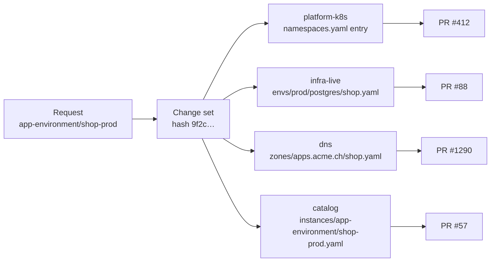

# Blueprints and change sets

Status: Draft · 2026-10-26

How catalog items that combine several resources, possibly in several
repositories, are requested, delivered and operated.

## Blueprints

A blueprint is a catalog item made of resources of existing types. It adds
one form, one approval and day-2 actions that span its resources. It never
writes files itself: each resource is written by its type's generator, in its
type's repository.

```yaml
apiVersion: quai.dev/v1beta1
kind: Blueprint
metadata:
  name: app-environment
  title: Application environment
  category: Applications
  version: 2.0.0
  owners: [team:platform]
spec:
  inputs:
    $ref: schemas/app-environment.schema.json   # JSON Schema for the form
  ui:
    order: [app, env, size, withDatabase]
  resources:
    - id: ns
      type: { repository: platform-k8s, name: namespace-quota }
      params: { cluster: "${{ inputs.env == 'prod' ? 'prod-1' : 'nonprod-1' }}", name: "${{ inputs.app + '-' + inputs.env }}" }
      values:
        cpu: "${{ inputs.size == 'large' ? '16' : '4' }}"
        memory: "${{ inputs.size == 'large' ? '32Gi' : '8Gi' }}"
    - id: db
      when: "inputs.withDatabase"
      type: { repository: infra-live, name: postgres }
      params: { env: "${{ inputs.env }}", name: "${{ inputs.app }}" }
      values: { size: "${{ inputs.size }}" }
      dependsOn: [ns]
    - id: dns
      type: { repository: dns, name: record }
      params: { zone: apps.acme.ch, name: "${{ inputs.app }}" }
      values: { type: CNAME, target: "${{ 'ingress.' + inputs.env + '.acme.ch' }}" }
  approval:
    rules:
      - { name: production, when: "inputs.env == 'prod'", approvers: [group:platform-admins] }
  actions:
    - name: scale
      title: Change size
      inputs: [{ name: size, type: enum, options: [small, large], required: true }]
      apply:                          # fans out to resource-level changes
        ns: { values: { cpu: "${{ action.size == 'large' ? '16' : '4' }}" } }
        db: { action: resize, inputs: { size: "${{ action.size }}" } }
```

Rules:

- `inputs` is a JSON Schema, written inline or as a `$ref`; like any `$ref`, it resolves relative to the blueprint's file.
- `values` are validated against each type's input schema at catalog load (`quai lint`) and again at plan time.
- A blueprint's approval rules add to each type's rules and each repository's floor rules; they never replace them. The approval shown to users is the union, de-duplicated by approver group.
- `when` includes or excludes a resource. Changing an input that flips `when` on day-2 adds or removes that resource.

### What the designer becomes

The prototype's canvas stays, but its palette lists **types from connected
repositories** instead of hard-coded components. Dragging "VM (infra-live)"
onto the canvas adds a resource with that type reference; the inspector shows
the type's input schema; edges become `dependsOn`. The designer saves the
blueprint as a pull request to the catalog repository, reviewed like any other
definition change.

Edges express ordering and naming, not runtime data. Quai can wire values known
at plan time (names, sizes, zones). Values only known after apply (an IP
address, a generated password) flow through the IaC itself: Terraform remote
state, Crossplane connection secrets, external-dns. Quai does not pass outputs
between pipelines.

## Instances

An instance is one deployment of a blueprint (`app-environment/shop-prod`).
Its record lists the resources it created:

```yaml
apiVersion: quai.dev/v1beta1
kind: Instance
metadata: { name: shop-prod, blueprint: app-environment, blueprintVersion: 2.0.0, owner: team:shop }
spec:
  inputs: { app: shop, env: prod, size: large, withDatabase: true }
  resources:
    ns: platform-k8s/namespace-quota/prod-1/shop-prod
    db: infra-live/postgres/prod/shop
    dns: dns/record/apps.acme.ch/shop
```

- The record lives in Git, in the catalog repository under `instances/`, or in the target repository's `.quai/instances/` when every resource is in that one repository, as `<blueprint>/<instance>.yaml`. Its `spec.inputs` are the form values with the schema's defaults applied. It is part of the same change set, so Git remains the source of truth.
- Day-2 actions on an instance read the record, then the current content of each resource.
- If someone deletes one of the resources by hand, the instance shows it as missing and offers to re-create or detach it.

## Change sets

A request produces a change set: per repository, the file edits, region
fingerprints and a content hash. The hash is a SHA-256 over each change's
operation, path and the SHA-256 of its new content, in path order: the same
intent on the same base always gives the same hash, and approvals are bound to
it.



- **One pull request per repository**, one commit per pull request. Several resources in one repository share a PR.
- **Approval is per change set.** Approvers see every PR's diff and plan on one page and approve once. Quai sets `quai/approval` on every PR together.
- **Ordering:** `dependsOn` between resources in different repositories orders the merges. Quai merges the PR for `ns`, waits for its apply to succeed, then merges the next. Resources with no dependency merge together.

### No cross-repository transactions

Git offers no atomic commit across repositories. Quai is explicit about it:

| Situation | Behaviour |
| --- | --- |
| A later PR cannot merge (conflict, failed check) after an earlier one was applied | The change set is **partially applied**. The request page shows which parts are live. The requester can retry, fix and re-plan the remaining part, or roll back. |
| Roll back | Quai generates revert commits for the applied parts as a new change set, under the same approval rules except where the type marks rollbacks as `approval: owners`. |
| An apply fails | Later merges are not started. The failed stack's run is linked. |

The instance record merges last, so it only lists what was actually created.

## Bulk changes

The same action on many resources (rotate every dev VM to a new template, raise
every namespace's quota by 20%) is one request and one change set, with one PR
per repository and stack. The approval page groups the diff by resource and
shows the plan summary per stack.
