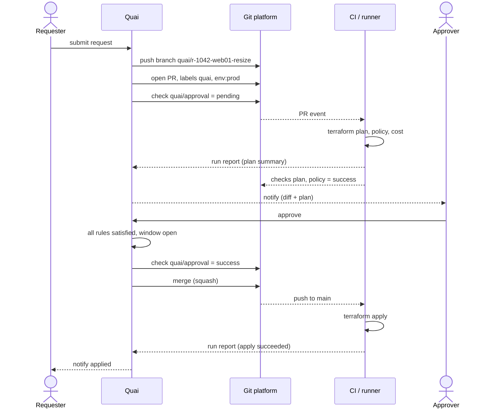

# Delivery and approvals

Status: Draft · 2026-10-26

How a planned change reaches a repository, and how Quai's approval is made
binding.

## Delivery modes

| Mode | What happens | Use for |
| --- | --- | --- |
| `pull-request` (default) | Branch + PR at submit; CI plans while approvals are pending; Quai merges when approved and green. | Every production repository. |
| `direct` | Quai commits to the branch after approval, as the prototype does. No CI plan before approval. | Sandboxes, demos, repositories without a supported connector. |

In `direct` mode the worker, under the repository's lock: fetches the mirror, checks out
the branch head in a temporary worktree, recomputes the request's region fingerprints
(any difference, including a file to create that now exists, makes the request stale),
writes the changes, commits with the requester as author, Quai as committer and the
trailers below, and pushes. A push that loses a race with another push is retried on
the new head, up to four attempts. Git runs without hooks, prompts, or system and global
configuration.

See [ADR 0008](../adr/0008-pull-requests-by-default.md).

## Pull request protocol



### Branch, commit, pull request

- **Branch:** `quai/r-<request number>-<slug>`, created from the current head of the target branch.
- **Commit:** one per PR. Author: the requester (name and email from the IdP). Committer: Quai. Signed (GitHub App API commits are verified; elsewhere SSH or GPG signing with a key from the secret store). Message:

  ```
  quai: resize infra-live/vm/prod/web01

  Black Friday traffic; see INC-5512.

  Quai-Request: #1042 3b6f2a8c-…
  Quai-Change-Set: 9f2c41…
  Quai-Stack: envs/prod
  Requested-by: Bob Builder <bob@acme.ch>
  ```

  `Approved-by:` trailers cannot be in this commit (approval happens after it). They are added to the squash-merge commit message, or recorded on the PR as a final comment when the merge method keeps the original commit.
- **Pull request:** title as the commit subject; body with the reason, a link to the request, the resources touched, and a machine-readable marker (`<!-- quai:request=3b6f2a8c… -->`) so webhook events map back to the request. Labels: `quai`, plus labels from the type (`env:prod`, `stack:envs/prod`).

### The `quai/approval` check

| State | When |
| --- | --- |
| `pending` ("Waiting for 1 of 2 approvals") | PR opened, rules not yet satisfied |
| `success` ("Approved by alice, fiona") | All rules satisfied and change window open |
| `failure` ("Rejected by nora: CIDR overlaps") | A reviewer denied, or the request expired or was cancelled |
| `neutral` ("Stale: re-plan required") | The owned region changed on the base branch |

Branch protection on the target branch must require `quai/approval`. Quai
verifies this at registration and hourly; see
[repository connections](01-repository-connections.md#health). How the check
is published and enforced differs per platform; see
[Git connectors](12-git-connectors.md):

- **Azure DevOps (first):** a pull request status (`genre: quai`, `name: approval`) on the latest iteration, required by a "Status check" branch policy whose authorized identity is Quai, with status reset on new changes. Quai then sets auto-complete and Azure DevOps completes the PR once every policy passes.
- **GitHub:** a check run, required by branch protection or a ruleset pinned to the Quai app.
- **GitLab:** a commit status, enforced with the mechanism the edition offers.

### Merge

- `merge: auto`: when `quai/approval` is success and every check in `waitForChecks` is green, Quai merges with the configured method. If the provider has a merge queue or merge train (GitHub merge queue, GitLab merge trains; availability depends on the provider's edition), Quai enqueues instead of merging directly.
- `merge: manual`: Quai sets the check and notifies the requester; a human merges. Useful where the customer insists on a human pressing the button.
- After merge, Quai deletes the branch and records the merge commit on the request.

How this is implemented (P1-13): at submit, the request's delivery is recorded (its branch,
`<branchPrefix>r-<number>-<slug of the resource and the verb>`), and a job pushes the branch from
the target's head with the one commit, opens the pull request (labels `quai` and
`stack:<stack>`; the body links the request when `server.publicURL` is set) and publishes
`quai/approval`. The status follows every change of state: pending, success once approved,
failure on a rejection or a cancellation (the pull request is then closed and its branch
deleted), not-applicable when stale (failure on Gitea, which has no such state). Once approved,
with `merge: auto`, Quai waits for the `waitForChecks` (the pull request's statuses, and its
policy evaluations on Azure DevOps), then asks the platform to merge when its own policies pass
(auto-complete on Azure DevOps, merge-when-checks-succeed on Gitea) with the approved head pinned;
with `merge: manual` it stops at the status. The merge, seen by the job, a webhook or a poll (a
poll re-reads every pull request Quai waits on), applies the request; one merged before Quai's
approval is recorded as such (`merged_without_approval`). A pull request closed outside Quai
cancels its request.

Approvals are recorded in Git (P1-14): a commit in direct mode, made after the approvals, carries
them as `Approved-by:` trailers; in pull-request mode, the merge or squash commit's message does.
When the merge keeps Quai's commit as it is (`mergeMethod: rebase`), or a person merges
(`merge: manual`), Quai adds them to the pull request as a final comment instead.

Signing: with `git.signingKey.ref` (an SSH private key in a secret store), every commit Quai
makes is signed with it (`gpg.format=ssh`); the platform's own merge commits are the platform's.
To verify them, put Quai's committer email and public key (`ssh-keygen -y -f <key>`) in an allowed
signers file, then:

```bash
git config gpg.ssh.allowedSignersFile ~/.config/git/allowed_signers   # quai@acme.ch ssh-ed25519 AAAA…
git verify-commit <commit>        # or: git log --show-signature
```

## Approvals bound to content

An approval is valid only for one **change set hash**: a SHA-256 over the
rendered file edits (each file's operation, path and new content). Reviews of
another hash do not count. What the edits were planned from is bound by
staleness instead: if the definitions or a region's fingerprint change, the
request is stale, so an approval never outlives what was reviewed.

| Event | Effect |
| --- | --- |
| The base branch moves, owned regions unchanged | Quai rebuilds the branch on the new base by re-applying the edits. Same hash: approvals kept; CI re-plans. |
| The base branch moves and an owned region changed | Request becomes **stale**. Approvals void, check `neutral`, requester notified to re-plan. |
| Someone pushes to the `quai/` branch | Approvals void; the PR shows "modified outside Quai". Quai re-plans from the branch content only if the new diff still stays inside the owned regions; otherwise the request is closed. |
| The PR is closed outside Quai | Request cancelled. |
| The PR is merged without `quai/approval` success | Should be impossible with enforcement. Recorded as a **bypass** audit event and alerted. |
| The type or blueprint definition changes before merge | Request becomes stale. |

After every fetch of a repository (a push webhook or a poll), Quai reconciles
the pull request of each request waiting on approval or merge with what Git
holds:

- Before acting on a branch, it re-reads the pull request: one merged or
  closed meanwhile (the base then holds its content) is handled as a merge or
  a close, never as a change of the base.
- A rebuild re-applies the request's edits, with the planned region
  fingerprints, on the base's head, and replaces the branch with a push that
  is refused if the branch is no longer at Quai's commit (`--force-with-lease`):
  a rebuild never overwrites someone's push. An approved request is then merged
  on the new head. While the platform merges (`merging`), the branch is not
  rebuilt.
- A push by someone else: the files it changes, from the merge base, must all
  be files the request changes or inside the regions it owns. Then the
  request's change set becomes the branch's diff, with a new hash, its
  `quai/approval` turns pending ("Modified outside Quai") and the request
  waits for approval of the new content under its rules; with the same content
  (a reworded or rebased commit), the approvals stand and `quai/approval` is
  published again on the new head. Beyond those files, the request is
  cancelled and its pull request closed.
- A bypass is a `merged_without_approval` event on the request and an
  `alert_bypass` event on the repository's timeline (`repository:<name>`),
  naming the pull request, the merge commit and the state the request was in.
- "Requester notified": until the notification channels (Phase 7,
  [integrations](11-integrations.md)), the requester sees the stale state and
  its reason on the request.

## Approval policy

Rules come from three places, evaluated together:

1. **Repository floor rules** (admin-owned, cannot be removed);
2. **Type rules** (in the IaC repository);
3. **Blueprint rules** (in the catalog), for blueprint requests.

```yaml
approval:
  rules:
    - name: production
      when: "params.env == 'prod'"
      approvers: [group:platform-admins]
      min: 1
    - name: owners
      approvers: [owners]                      # the resource's owning team
    - name: cost
      when: "plan.cost.monthlyDelta > 500"     # available once the plan run has reported
      approvers: [group:finops]
    - name: change-ticket
      when: "params.env == 'prod'"
      external: servicenow                     # satisfied by an approved change request
  expiry: 7d
  stepUp: "params.env == 'prod'"               # approvers must have re-authenticated recently
```

How rules combine and decide:

- A rule applies when its `when` holds; `min` defaults to 1. An action's own `approval` replaces
  the type's rules for that action (`rules: []` for none); floor rules always apply, and a
  blueprint's rules add to its types'.
- Rules with the same approvers (and external system) are merged into one requirement with the
  highest `min`, so a floor rule and a type rule for `group:platform-admins` need one approval,
  not two.
- Each reviewer's latest decision counts. A denial rejects the request only when it comes from
  someone who could approve for a rule that applies; an external rule is satisfied when its
  system approves and rejects the request when it refuses.

### Approver kinds

| Approver | Resolved from |
| --- | --- |
| `group:<name>` | IdP group |
| `user:<name>` | A named user |
| `owners` | The resource's owner (user or team) |
| `codeowners` | `CODEOWNERS` entries for the paths in the change set; on Azure DevOps, the reviewers of "Automatically included reviewers" policies whose path filters match |
| `manager` | The requester's manager, from the IdP attribute |
| `external: <integration>` | An external system (ServiceNow change request, generic webhook) that returns approved or rejected |

### Separation of duties

- A requester never approves their own request, even as an admin.
- One person counts once, even when they qualify for several rules, unless a rule sets `distinct: false`.
- Optional: authors of a definition change cannot approve requests planned with that definition for N days (`separationOfDuties.definitionAuthors: 7d`).
- Approving a request that includes a plan with destroys can require a second approver (`destroys: requireTwo`).

### Delegation, reminders, escalation

- Approvers can delegate to a named colleague for a date range (out of office). The delegate's approval is recorded as "by X on behalf of Y".
- Reminders go to eligible approvers after a configurable delay; after a second delay, escalation goes to a fallback group.
- Requests expire after `expiry`; the PR is closed with a comment.

### Step-up authentication

For rules with `stepUp`, an approval is accepted only if the approver
authenticated with the IdP within the last N minutes, using OIDC `max_age` (and
`acr_values` when the IdP supports MFA levels). The UI triggers a
re-authentication before the approve button works.

### Change windows and freezes

```yaml
changeWindows:
  - name: prod-business-hours
    when: "params.env == 'prod'"
    allow: ["Mon-Thu 08:00-16:00 Europe/Zurich"]
  - name: year-end-freeze
    deny: ["2026-12-18T00:00 to 2027-01-05T00:00 Europe/Zurich"]
```

An approved request outside its window waits in *Approved* and merges when the
window opens. The request page shows the next possible merge time.

### Break-glass

For incidents, a member of the `break-glass` role can merge a request without
the normal approvals:

- they must give a reason and an incident reference;
- `quai/approval` is set to success with "break-glass by <name>";
- security and the owning team are alerted immediately;
- a post-incident review is created and stays open until two reviewers sign it off.

## ITSM

For organizations whose change management lives in ServiceNow (or Jira Service
Management):

- On submit, Quai creates a change request (standard change for catalog items marked as pre-approved; normal change otherwise) with the diff, plan summary and risk fields.
- The `external: servicenow` rule is satisfied when the change request reaches an approved state.
- On apply, Quai moves the change request to implemented and closes it, attaching the evidence bundle (see [security and compliance](09-security-and-compliance.md#evidence-bundle)).
- If the change request is rejected or cancelled, the Quai request is rejected.

## Notifications

Events: request submitted, approval needed, approved, rejected, stale, merged,
applied, failed, expiring soon. Channels: email, Microsoft Teams, Slack,
outgoing webhooks. Approvers can approve from Teams or Slack messages when the
rule does not require step-up authentication. See
[integrations](11-integrations.md).
