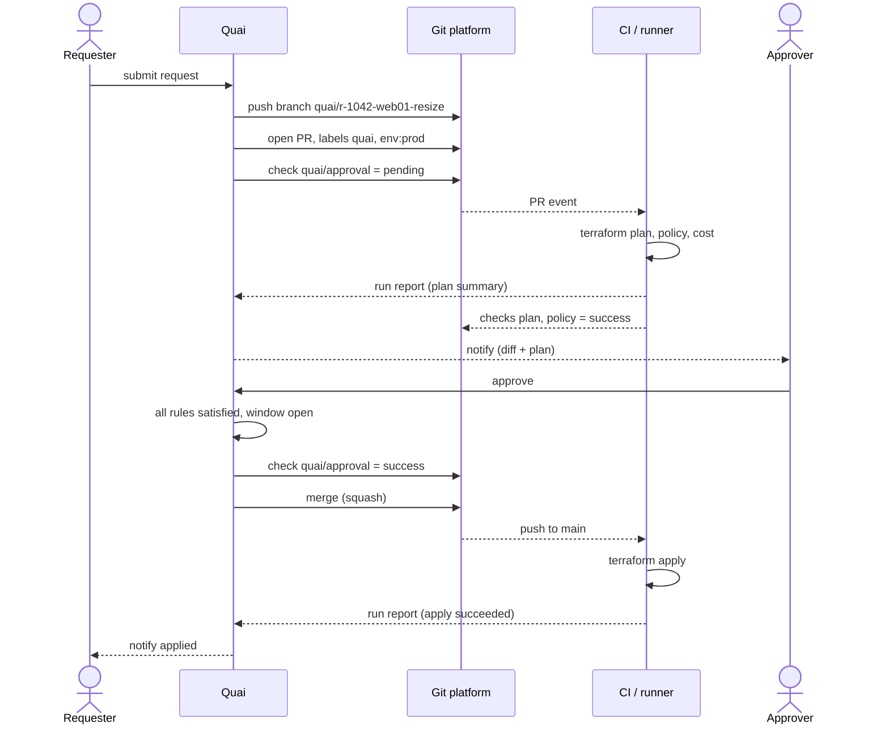

# Delivery and approvals

Status: Draft · 2026-11-09

How a planned change reaches a repository, and how Quai's approval is made
binding.

## Delivery modes

| Mode | What happens | Use for |
| --- | --- | --- |
| `pull-request` (default) | Branch + PR at submit; CI plans while approvals are pending; Quai merges when approved and green. | Every production repository. |
| `direct` | Quai commits to the branch after approval, as the prototype does. No CI plan before approval. | Sandboxes, demos, repositories without a supported connector. |

In `direct` mode the worker, under the repository's lock: fetches the mirror, checks out
the branch head in a temporary worktree, recomputes the request's region fingerprints
(any difference, including a file to create that now exists, makes the request stale),
writes the changes, commits with the requester as author, Quai as committer and the
trailers below, and pushes. A push that loses a race with another push is retried on
the new head, up to four attempts. Git runs without hooks, prompts, or system and global
configuration.

See [ADR 0008](../adr/0008-pull-requests-by-default.md).

## Pull request protocol



### Branch, commit, pull request

- **Branch:** `quai/r-<request number>-<slug>`, created from the current head of the target branch.
- **Commit:** one per PR. Author: the requester (name and email from the IdP). Committer: Quai. Signed (GitHub App API commits are verified; elsewhere SSH or GPG signing with a key from the secret store). Message:

  ```
  quai: resize infra-live/vm/prod/web01

  Black Friday traffic; see INC-5512.

  Quai-Request: #1042 3b6f2a8c-…
  Quai-Change-Set: 9f2c41…
  Quai-Stack: envs/prod
  Requested-by: Bob Builder <bob@acme.ch>
  ```

  `Approved-by:` trailers cannot be in this commit (approval happens after it). They are added to the squash-merge commit message, or recorded on the PR as a final comment when the merge method keeps the original commit.
- **Pull request:** title as the commit subject; body with the reason, a link to the request, the resources touched, and a machine-readable marker (`<!-- quai:request=3b6f2a8c… -->`) so webhook events map back to the request. Labels: `quai`, plus labels from the type (`env:prod`, `stack:envs/prod`).

### The `quai/approval` check

| State | When |
| --- | --- |
| `pending` ("Waiting for 1 of 2 approvals") | PR opened, rules not yet satisfied |
| `pending` ("Approved; waits for the change window, opens Mon 08:00 Europe/Zurich") | Approved, outside its [change windows](#change-windows-and-freezes) |
| `success` ("Approved by alice, fiona") | All rules satisfied and change window open |
| `failure` ("Rejected by nora: CIDR overlaps") | A reviewer denied, or the request expired or was cancelled |
| `neutral` ("Stale: re-plan required") | The owned region changed on the base branch |

Branch protection on the target branch must require `quai/approval`. Quai
verifies this at registration and hourly; see
[repository connections](01-repository-connections.md#health). How the check
is published and enforced differs per platform; see
[Git connectors](12-git-connectors.md):

- **Azure DevOps (first):** a pull request status (`genre: quai`, `name: approval`) on the latest iteration, required by a "Status check" branch policy whose authorized identity is Quai, with status reset on new changes. Quai then sets auto-complete and Azure DevOps completes the PR once every policy passes.
- **GitHub:** a check run, required by branch protection or a ruleset pinned to the Quai app.
- **GitLab:** a commit status, enforced with the mechanism the edition offers.

### Merge

- `merge: auto`: when `quai/approval` is success and every check in `waitForChecks` is green, Quai merges with the configured method. If the provider has a merge queue or merge train (GitHub merge queue, GitLab merge trains; availability depends on the provider's edition), Quai enqueues instead of merging directly.
- `merge: manual`: Quai sets the check and notifies the requester; a human merges. Useful where the customer insists on a human pressing the button.
- After merge, Quai deletes the branch and records the merge commit on the request.

How this is implemented (P1-13): at submit, the request's delivery is recorded (its branch,
`<branchPrefix>r-<number>-<slug of the resource and the verb>`), and a job pushes the branch from
the target's head with the one commit, opens the pull request (labels `quai` and
`stack:<stack>`; the body links the request when `server.publicURL` is set) and publishes
`quai/approval`. The status follows every change of state: pending, success once approved,
failure on a rejection or a cancellation (the pull request is then closed and its branch
deleted), not-applicable when stale (failure on Gitea, which has no such state). Once approved,
with `merge: auto`, Quai waits for the `waitForChecks` (the pull request's statuses, and its
policy evaluations on Azure DevOps), then asks the platform to merge when its own policies pass
(auto-complete on Azure DevOps; on GitHub auto-merge, or the merge queue where the base branch
requires one; on Gitea a merge, asked again while a required check is pending) with the approved
head pinned. A merge queue checks a merge group, a commit of its own holding the pull request on
top of the base, and requires `quai/approval` there too: Quai publishes its success on that commit
as well. Until the platform has merged, Quai publishes its status again and
asks again every 20 seconds. Statuses are published one at a time per request, each from the
request's latest state, so that one published from an older state never comes last;
with `merge: manual` it stops at the status. The merge, seen by the job, a webhook or a poll (a
poll re-reads every pull request Quai waits on), applies the request; one merged before Quai's
approval is recorded as such (`merged_without_approval`), one merged while Quai held it for its
[change windows](#change-windows-and-freezes) too (`merged_outside_window`). Outside its windows,
an approved request is neither merged nor asked of the platform. A pull request closed outside Quai
cancels its request. After a merge the platform made by itself (auto-complete), a job deletes the
branch when `deleteBranch` is set, since GitHub's auto-merge and merge queue keep it; GitHub
refuses for a few seconds after its merge queue merged, so the job tries again every 10 seconds,
for 5 minutes.

Approvals are recorded in Git (P1-14): a commit in direct mode, made after the approvals, carries
them as `Approved-by:` trailers; in pull-request mode, the merge or squash commit's message does.
When the merge keeps Quai's commit as it is (`mergeMethod: rebase`), a person merges
(`merge: manual`), or the platform has a merge queue, which merges with the method and message its
own rule sets (GitHub), Quai adds them to the pull request as a final comment instead.

Signing: with `git.signingKey.ref` (an SSH private key in a secret store), every commit Quai
makes is signed with it (`gpg.format=ssh`); the platform's own merge commits are the platform's.
To verify them, put Quai's committer email and public key (`ssh-keygen -y -f <key>`) in an allowed
signers file, then:

```bash
git config gpg.ssh.allowedSignersFile ~/.config/git/allowed_signers   # quai@acme.ch ssh-ed25519 AAAA…
git verify-commit <commit>        # or: git log --show-signature
```

## Approvals bound to content

An approval is valid only for one **change set hash**: a SHA-256 over the
rendered file edits (each file's operation, path and new content). Reviews of
another hash do not count. What the edits were planned from is bound by
staleness instead: if the definitions or a region's fingerprint change, the
request is stale, so an approval never outlives what was reviewed.

| Event | Effect |
| --- | --- |
| The base branch moves, owned regions unchanged | Quai rebuilds the branch on the new base by re-applying the edits. Same hash: approvals kept; CI re-plans. |
| The base branch moves and an owned region changed | Request becomes **stale**. Approvals void, check `neutral`, requester notified to re-plan. |
| Someone pushes to the `quai/` branch | Approvals void; the PR shows "modified outside Quai". Quai re-plans from the branch content only if the new diff still stays inside the owned regions; otherwise the request is closed. |
| The PR is closed outside Quai | Request cancelled. |
| The PR is merged without `quai/approval` success | Should be impossible with enforcement. Recorded as a **bypass** audit event and alerted. |
| The type or blueprint definition changes before merge | Request becomes stale. |

After every fetch of a repository (a push webhook or a poll), Quai reconciles
the pull request of each request waiting on approval or merge with what Git
holds:

- Before acting on a branch, it re-reads the pull request: one merged or
  closed meanwhile (the base then holds its content) is handled as a merge or
  a close, never as a change of the base.
- A rebuild re-applies the request's edits, with the planned region
  fingerprints, on the base's head, and replaces the branch with a push that
  is refused if the branch is no longer at Quai's commit (`--force-with-lease`):
  a rebuild never overwrites someone's push. An approved request is then merged
  on the new head. While the platform merges (`merging`), the branch is not
  rebuilt, unless it no longer merges onto the base (`git merge-tree`), which
  the platform cannot do: two requests on one file approved together both
  append to its collection, so the first to merge conflicts with the second,
  which is rebuilt on it and merged with its approvals.
- A push by someone else: the files it changes, from the merge base, must all
  be files the request changes or inside the regions it owns. Then the
  request's change set becomes the branch's diff, with a new hash, its
  `quai/approval` turns pending ("Modified outside Quai") and the request
  waits for approval of the new content under its rules; with the same content
  (a reworded or rebased commit), the approvals stand and `quai/approval` is
  published again on the new head. Beyond those files, the request is
  cancelled and its pull request closed.
- A bypass is a `merged_without_approval` event on the request (or
  `merged_outside_window`, approved but held for its change windows) and an
  `alert_bypass` event on the repository's timeline (`repository:<name>`),
  naming the pull request, the merge commit, the state the request was in and
  the request's event (`event`).
- "Requester notified": the requester sees the stale state and its reason on
  the request, and is sent a `stale` notification when a channel is configured
  ([notifications](#notifications)).

## Approval policy

Rules come from three places, evaluated together:

1. **Repository floor rules** (admin-owned, cannot be removed);
2. **Type rules** (in the IaC repository);
3. **Blueprint rules** (in the catalog), for blueprint requests.

```yaml
approval:
  rules:
    - name: production
      when: "params.env == 'prod'"
      approvers: [group:platform-admins]
      min: 1
    - name: owners
      approvers: [owners]                      # the resource's owning team
    - name: cost
      when: "plan.cost.monthlyDelta > 500"     # available once the plan run has reported
      approvers: [group:finops]
    - name: change-ticket
      when: "params.env == 'prod'"
      external: servicenow                     # satisfied by an approved change request
  expiry: 7d
  stepUp: "params.env == 'prod'"               # approvers must have re-authenticated recently
```

How rules combine and decide:

- A rule applies when its `when` holds; `min` defaults to 1. An action's own `approval` replaces
  the type's rules for that action (`rules: []` for none); floor rules always apply, and a
  blueprint's rules add to its types'.
- Rules with the same approvers (and external system) are merged into one requirement with the
  highest `min`, so a floor rule and a type rule for `group:platform-admins` need one approval,
  not two.
- Each reviewer's latest decision counts. A denial rejects the request only when it comes from
  someone who could approve for a rule that applies; an external rule is satisfied when its
  system approves and rejects the request when it refuses.

### Rules on the plan

A rule's `when` may read the Terraform plan of the request's pull request through `plan`, in the
approval rules of types, blueprints and floor rules only. It holds the request's latest
succeeded plan of each stack ([runs](06-runs-status-and-drift.md#run-report-protocol)), summed:
`add`, `change` and `destroy` (a replace counts in both `add` and `destroy`), `destroys` (the same
as `destroy`), `cost` (`currency` and `monthlyDelta`, only when every plan reported a cost in the
same currency) and `policies` (each `name` and `result`). As decided
([open question 7](../plan/open-questions.md#decided)):

- **Undecided until a plan reports.** Such a rule is kept apart, never merged with another, and
  the request cannot reach *Approved* while it waits: approvals given in the meantime count for it
  and stand, and a denial from its approvers rejects the request as for any rule. A condition
  whose result does not depend on the plan is decided at once, as any rule's:
  `params.env == 'prod' && plan.cost.monthlyDelta > 500` does not apply in dev, whatever the plan.
- **Decided by each plan.** When a plan reports, the rule applies or not; each new plan of the
  same change set (after a rebuild on a moved base, say) decides it again. A rule that no longer
  applies is satisfied. A request that is approved but not merged yet, which a new plan makes need
  more approvals, goes back to *pending approval*, and `quai/approval` with it.
- **When in doubt, it applies.** A condition the plan cannot decide (`plan.cost.monthlyDelta`
  without a reported cost) makes the rule apply, and the request says why. With direct delivery,
  where no plan comes before the commit, the rule applies from the start.
- The request page shows the plans, what they change by resource and what they destroy first,
  and for each such rule whether it waits for the plan, applies, or does not apply.

### Approver kinds

| Approver | Resolved from |
| --- | --- |
| `group:<name>` | IdP group |
| `user:<name>` | A named user |
| `owners` | The resource's owner (user or team) |
| `codeowners` | `CODEOWNERS` entries for the paths in the change set, on the target branch at the plan's commit; on Azure DevOps, the reviewers of "Automatically included reviewers" policies whose path filters match. Every owner of every changed path counts. They are matched to Quai users and groups as in [identity](08-identity-access-tenancy.md#directory), and kept with the request when it is submitted: a later change to `CODEOWNERS` does not change who may approve it. The plan and the request page list them, and those that match no one. When the platform cannot be read, the plan fails rather than leaving the rule without approvers |
| `manager` | The requester's manager (P4-11): the identity provider's immutable identifier of them that the requester's last sign-in found (`auth.oidc.managerClaim`, or Microsoft Graph with `auth.graph.manager`), or for a person SCIM provisions the enterprise extension's `manager` ([SCIM](08-identity-access-tenancy.md#scim-provisioning), P4-15), which must name exactly one person in the [directory](08-identity-access-tenancy.md#directory) who is not deactivated and is not the requester. Resolved when planning, and kept with the request when it is submitted: a later change of manager, a new plan or a rebuild does not change who may approve it ([open questions 69 and 70](../plan/open-questions.md#still-open)). Without one (no claim, Graph has none or could not be read, the manager never signed in or is not provisioned yet, is ambiguous or deactivated, the requester is their own manager), nobody can satisfy the rule, and the plan and the request say why. The requester never approves as their own manager |
| `external: <integration>` | An external system (ServiceNow change request, generic webhook) that returns approved or rejected |

### Separation of duties

- A requester never approves their own request, even as an admin.
- One person counts once, even when they qualify for several rules, unless a rule sets `distinct: false`.
- Optional, in the repository document (`spec.enforcement.separationOfDuties`, admin-owned like
  floor rules; types and blueprints cannot set it, [open question
  23](../plan/open-questions.md#still-open)):

```yaml
spec:
  enforcement:
    separationOfDuties:
      definitionAuthors: 7d   # Nd or a duration such as 36h; positive, at most 90d
      destroys: requireTwo    # the only value
```

As built (P4-12):

- **`definitionAuthors`: who changed the definitions cannot approve.** The people who changed the
  files of the request's type or blueprint (its schemas included) in the period before it is
  planned cannot approve or deny it, like the requester, whatever rule names them.
  - *Which changes.* The period is measured on what Quai recorded, never on the commits' dates,
    which their authors write: the commits after the definitions commit Quai had recorded when
    the period began (by the database's clock), up to the request's definitions commit, that
    touch those files (a merge that brings such a commit in included). When Quai had recorded
    none that early (a new connection), or that commit left the history, the whole history
    counts ([open question 72](../plan/open-questions.md#still-open)).
  - *Who.* Every identity a commit carries: its author, its committer and its `Co-authored-by`
    trailers. An identity names the people whose verified email is its email ([open question
    30](../plan/open-questions.md#still-open)), in any case, and Quai's own
    `<name>@users.quai` the person of that name. An identity that matches no one excludes no one
    when the request is planned, and the request lists it; whoever has one of its emails as a
    verified email when they review is excluded too. Quai does not read the platform's records
    (who pushed, who opened or merged the pull request) yet ([open question
    71](../plan/open-questions.md#still-open)).
  - *Kept.* The period, when it began, the commits, the people and the identities are computed
    when the request is planned and kept with it: the plan and the request page show them, and
    `request.submitted` records them (people as pseudonyms). A later commit does not change them.
- **`destroys: requireTwo`: two different approvers when something is destroyed.** The request
  gets the rule `separationOfDuties/destroys`: two different people, by name, never the requester
  or a definition author, among the people whose approval counts for the request's other rules
  that apply (`distinct: false` on those rules never lets one person count twice here, and an
  external approval is no person). Without such a rule, its own approvers count: the resources'
  owners and the floor rules' approvers. A denial from one of them rejects the request, as for
  any rule ([open question 73](../plan/open-questions.md#still-open)).
  - *Decided by each plan*, as [rules on the plan](#rules-on-the-plan) are, on `plan.destroys > 0`
    (a replace destroys), except that it **applies until a plan says otherwise**: before any plan,
    while a stack of the request has no plan yet, when the latest plan of a stack failed, and with
    direct delivery, where no plan comes. A plan that destroys nothing makes it not apply; a new
    plan that destroys, or fails, makes it apply again, and an approved request not merged yet
    goes back to *pending approval*. Approvals given under an earlier plan stand.
- **A later change of the options.** A request keeps the options it was planned with. When the
  repository's become stricter (a longer `definitionAuthors` period, or `requireTwo` where it had
  none), a request still pending approval goes stale instead of taking its next review or being
  approved by a plan, and is planned again under the new options; one already approved is left as
  decided. Looser options change nothing for requests planned before ([open question
  74](../plan/open-questions.md#still-open)).
- The request page says why someone a rule names cannot review it: they requested it, or which
  of their commits changed its definitions in the period.

### Delegation

Approvers can delegate to a named colleague for a date range (out of office). The delegate's
approval is recorded as "by X on behalf of Y". As built (P4-13, [open questions 24 and 75 to
77](../plan/open-questions.md#still-open)):

- **Who makes one.** Only the delegator, for themselves, on their profile page or with
  `POST /api/v1/me/delegations`, signed in: the delegator is the session's person, never a name in
  the path or the body, and an API token is refused. When `auth.stepUp` is configured, making one
  needs a step-up: handing on one's approvals is as sensitive as approving. The delegate is
  someone else who has signed in to Quai and is not deactivated. Audited as
  `delegation.created`.
- **The period.** From a start, inclusive, to an end, exclusive, instants kept in UTC: at most 90
  days, starting now at the earliest (a start less than a minute in the past, a clock behind, is
  now) and at most a year ahead. The profile page reads and shows times in the browser's time
  zone; an empty start is now.
- **One delegate at a time, no chains.** A delegator has one delegate at any instant: a delegation
  overlapping one not revoked is refused until that one is revoked. Nobody delegates to someone who
  has delegated their own approvals for part of the period, so delegations form no cycle. A
  delegate holds the delegator's own rights only, never what the delegator holds through a
  delegation: when A delegates to B and B to C, C may review what B could in their own right,
  never what A could.
- **Revoking.** The delegator revokes it at any time, on the profile page or with
  `DELETE /api/v1/delegations/{id}`, without a step-up. A platform admin may revoke anyone's
  (`GET /api/v1/delegations` lists those neither revoked nor ended), and never makes one for
  someone else. Audited as `delegation.revoked`, with who revoked it (`delegator` or `admin`).
- **What a delegate may do.** During the period, approve or deny on the delegator's behalf what
  the delegator could approve or deny at that moment, judged when the review is made with the
  delegator as the directory describes them then (their groups, teams and email, kept with the
  review): the delegator not deactivated, named by the rule, not the requester, not a definition
  author the request's separation of duties excludes. The checks no delegation lifts are the
  delegate's own as well: the delegate did not request it and is not such a definition author. So
  a delegate never approves their own request, nor the delegator's. The delegation is read again,
  locked, in the review's transaction, so one revoked or ended a moment before takes no review; a
  review made before stands, as any review does.
- **One human, one approval.** A review on someone's behalf is both people's, the delegate's and
  the delegator's, and each person's latest review counts: the delegate's review for the delegator
  replaces the delegate's own earlier review and the delegator's, and a later review by either
  replaces it. For `distinct` and `destroys: requireTwo`, a delegate and the delegator they review
  for are one person: one human never makes two approvals through a delegation. A delegate cannot
  review for a delegator who reviewed the current content themselves: their decision stands. When
  someone may review both in their own right and for a delegator, the request page asks which
  ("Review as").
- **Step-up and chat links.** A step-up applies to the delegate, the human acting. A card sent to a
  delegate is theirs: its links are bound to the delegate and to the delegator they would review
  for, and give only a review on that delegator's behalf ([approving from
  chat](#approving-from-chat)).
- **Where it shows.** Both people and the delegation used, wherever the review appears: the
  request page (its reviews, the approval chain's "Approved by fiona (on behalf of alice)", the
  timeline, a rejection included), the audit log (`request.reviewed` and `request.approved`
  carry `onBehalfOf` and the delegation's ID), and the commit's
  `Approved-by: fiona (on behalf of alice)` trailers, each value one line without control
  characters or line separators, so that no name adds a trailer. The evidence bundle names both,
  with the delegation and its period ([evidence bundle](09-security-and-compliance.md#evidence-bundle)).
- **Notifications.** During the period, a delegator's "approval needed" goes to their delegate
  instead, saying on whose behalf, when the delegate may review the request for them; otherwise,
  or once the delegate has reviewed it, it stays with the delegator. It goes no further, whatever
  the delegate delegated in turn. The delegate reads the request's content as an approver does,
  since they may review it. The delegator keeps everything else, their requests' notifications and
  alerts included ([notifications](#notifications)).

### Reminders, escalation, expiry

A request that waits for approval reminds its approvers after a while, then tells an escalation
group, and expires after its `expiry`. As built (P4-14, [open questions 25 and 78 to
82](../plan/open-questions.md#still-open)):

- **Where they are set.** Reminders and escalation are Quai's configuration, the same for every
  repository: `approvals.reminders.after`, `approvals.escalation.after` and
  `approvals.escalation.to` (`group:<name>` or `user:<name>` entries), off by default
  ([configuration](../operations/deployment-and-operations.md#reminders-escalation-and-expiry)).
  The repository document does not override them (yet). The expiry is the definitions':
  `expiry` in an approval block, whole minutes, hours or days (`30m`, `12h`, `7d`) from `1m` to
  `365d`.
- **Which expiry.** The shortest `expiry` of the approval blocks a request's definitions apply:
  its type's, its action's, its blueprint's, each of its resource types' and its blueprint
  action's. It is fixed when the request is submitted and kept with it (`expiry`, and
  `expiresAt`: the submission, by Quai's clock, plus the expiry). A later change of the
  definitions neither expires a waiting request sooner nor spares it; a request submitted before
  P4-14 has none.
- **When.** The worker's `approval_sweep` job runs every minute (once a minute, whatever the
  replicas) and takes the steps due by Quai's clock, from instants kept with the request: its
  submission and its expiry, never a commit's date. Reminders, escalation and the warning count
  from the submission; a new plan does not start them again. Each step is taken once: under the
  request's row lock, on its state read again, and marked in the transaction that records its
  event. A review takes the same lock, so an expiry and a final approval (or a denial, a
  cancellation, a new plan) at the same moment are decided one after the other: whichever commits
  first wins, and the other finds the request decided and does nothing (a review gets 409).
- **Reminder**, at the submission plus `approvals.reminders.after`: an "approval needed" again,
  to the people the request waits for then, as the first one: a delegate in their delegator's
  place, saying on whose behalf; never its requester or an excluded definition author. It
  follows each person's preferences for approval needed (at once, or in their digest), with
  their Teams or Slack card. Its subject says "Reminder".
- **Escalation**, at the submission plus `approvals.escalation.after`: the people
  `approvals.escalation.to` names, who signed in to Quai and are not deactivated, never the
  requester, are told the request still waits. Escalation notifies; it makes no one an approver.
  A contact the request waits for reads its content; the others get its identifiers only (the
  repository, its number and state, how long it waited and its link), as alerts. Like an alert,
  it goes at once, on every channel that reaches the person, whatever their preferences; Teams and
  Slack channel posts do not get it.
- **Expiring soon**: its requester hears a day before it expires (half its expiry before, when
  the expiry is under two days).
- **Expiry**, at `expiresAt`: the request becomes **Expired**, which is final: it cannot be
  reviewed, cancelled or retried. Its approvals are void: marked so on the request, they never
  count again. Its requester hears of it, and asks again with a new request, which is planned
  and approved afresh. `quai/approval` fails ("Expired in Quai"). On its pull request, the one
  Quai opened and recorded, never one found by its branch's name, Quai comments once (the
  request's number, its expiry and its link, which the pull request's readers already see, and a
  marker by which a retry finds the comment), closes it and deletes its branch. A pull request
  merged meanwhile is a merge without approval (the bypass alert; the request is applied as
  merged); one someone else closed is left as it is (`pull_request_left`), and the request stays
  expired.
- **Audit.** `request.reminded` (the people reminded, as pseudonyms), `request.escalated` (the
  groups, and the users as pseudonyms), `request.expired` (the expiry, the submission, the expiry
  instant and how many reviews it voided) and `request.pull_request_closed`
  ([audit log](09-security-and-compliance.md#audit-log)).

### Step-up authentication

An approval block's `stepUp` is a condition, with the variables of `when`: when it holds for a
request, the request's reviews count only from people who authenticated with the IdP within
`auth.stepUp.maxAge` (five minutes by default), with `auth.stepUp.acrValues` and Entra ID's
authentication context when set ([design 08](08-identity-access-tenancy.md#step-up)). As built
(P4-06, [open question 50](../plan/open-questions.md#still-open)):

- It is decided once, at submission, for the whole request, with its rules: the request needs a
  step-up when the `stepUp` of any approval block that applies to it holds (its type's, its
  blueprint's, each of its resource types'; an action's `approval` replaces the rules, not the
  type's `stepUp`). A condition that cannot be evaluated counts as holding. The plan and the
  request say so (`stepUp`).
- Approving and denying alike need it, checked on the server when the review is made; a review
  refused is audited (`auth.step_up_refused`) and not recorded. An API token never steps up.
- A review keeps whether its reviewer had stepped up, with their `auth_time`, `acr` and `acrs`. On
  a step-up request only those reviews count, however old the reviewer's session grows after.
- The request page asks for a new sign-in before the approve and deny buttons appear, says until
  when a sign-in counts, and comes back to the request after it.

### Change windows and freezes

```yaml
changeWindows:            # Quai's configuration; spec.enforcement.changeWindows in a repository document
  - name: prod-business-hours
    when: "has(params.env) && params.env == 'prod'"
    allow: ["Mon-Thu 08:00-16:00 Europe/Zurich"]
  - name: year-end-freeze
    deny: ["2026-12-18T00:00 to 2027-01-05T00:00 Europe/Zurich"]
```

An approved request outside its window waits in *Approved* and merges when the
window opens. The request page shows the next possible merge time. As built
(P4-16, `internal/engine/window` and `internal/requests/windows.go`; [open
questions 26 and 89 to 93](../plan/open-questions.md#still-open)):

- **Where.** Quai's configuration (`changeWindows`, every repository) and the repository document
  (`spec.enforcement.changeWindows`, that repository); never types or blueprints. **Every window
  that applies must be open**, so the repository document only narrows what the configuration
  allows: it adds freezes or restricts hours, and can neither widen a window nor lift a freeze of
  the configuration. At most 32 windows in each, 32 allow and 32 deny entries in a window; names
  (letters, digits, `.`, `_`, `-`) unique in each.
- **Entries.** An allow entry is `<days> <HH:MM>-<HH:MM> <zone>`: days `Mon` to `Sun`, as a list
  and ranges (`Mon,Wed`, `Mon-Thu`, `Fri-Mon` wraps), hours from `00:00` to `24:00`, the end after
  the start (an entry does not cross midnight: write `Fri 22:00-24:00` and `Sat 00:00-02:00`). A
  deny entry (a freeze) is `<from> to <to> <zone>`, each `YYYY-MM-DDTHH:MM` or a date (its
  midnight), from before to. The zone is an IANA name (`Europe/Zurich`, `UTC`), checked when the
  configuration or the document loads, from the system's database or the one built into Quai;
  `Local` and paths are refused. A window with allow entries is open only within one of them, one
  without at any time; a deny entry closes it. Overlapping allow entries add up, overlapping
  freezes too, and a freeze wins over an allow entry.
- **Wall-clock time and DST.** An allow entry holds while the zone's clock reads a time inside it,
  on one of its days. On the day the clock springs forward, the skipped hour never comes
  (`08:00-16:00` is unaffected; `02:00-03:00` is empty that day); on the day it falls back, the
  repeated hour comes twice (`02:00-03:00` lasts two hours). A freeze runs from the first instant
  the clock reads its start to the last instant it reads its end, a time in a skipped hour being
  the jump: an ambiguous freeze is the longer one.
- **`when`** is CEL with `params` and `request` (`kind`, `action`, `type`, `blueprint`,
  `repository`; [the expression language](02-resource-types-and-generators.md#type-specification)),
  evaluated for each of the request's resources as planned (a blueprint's each): the window applies
  when it holds for one. It sees no `inputs`, `doc`, `previous`, `action`, `user` or `plan`, and
  not the request's reason: what a requester writes never decides when a change merges. **A
  condition that fails holds the request**, whatever the time, with the error shown (a param a type
  does not have fails: write `has(params.env) && …`). A request planned before P4-16 has no
  resources recorded: every window with a `when` applies to it.
- **Decided at merge time.** Quai decides when it would merge, under the request's row lock, and in
  pull-request mode again under its merge lock right before it asks the platform, with the windows
  as they are stored then (the configuration, and the repository document as stored, read again
  when the registry has not reloaded it yet), never as they were at approval: a freeze added while
  a request waits holds it. One function moves an approved request to merging (`gate`); the
  delivery around it checks everything it checked before.
- **Waiting.** Outside its windows, an approved request stays *Approved*, held: `quai/approval` is
  pending with the reason ("Approved; waits for the change window, opens Mon 08:00
  Europe/Zurich", "Approved; waits for the change window: none opens within a year", "Approved;
  held: change window gold: no such key: tier"); Quai neither merges nor asks the platform to (no
  auto-complete, no merge queue, no approval of a merge group); in direct mode, nothing is
  committed. The hold is recorded once (`window_waiting`, audited as `request.window_waiting`
  with the windows that hold it and when they open).
- **The windows' sweep** (the worker's `window_sweep` job, every minute and at start, by the
  service's clock): a held request whose windows opened is released (`window_opened`, audited)
  and delivered again, through the same delivery; an approved request whose windows closed is held
  and its `quai/approval` turns pending (with `merge: manual`, a person can no longer merge it);
  a held request's `quai/approval` follows its reason when it changes (a freeze added meanwhile); a
  merging request whose windows closed is delivered again, and its delivery takes it back to
  approved under the merge lock. Each is decided again under its row lock, so a sweep run twice or
  after a restart converges, and a request merges once. A request merges within a minute of its
  windows opening.
- **The request page** says, while a request is pending approval, approved or merging and a window
  applies: when its windows open next, the next possible merge, in the browser's time zone and in
  the window's; until when they stay open; why they cannot be decided; or that none opens within
  366 days, in which case it waits until the windows change.
- **Expiry** applies to pending approval only: an approved request waiting for its windows does not
  expire.
- **A merge on the platform while Quai holds the request** (its protection bypassed) is a bypass:
  the request is applied as merged (`merged_outside_window`, audited) and the bypass alert goes
  to the admins, as for a merge without approval.
- **What remains.** Quai turns `quai/approval` pending within a minute of a window closing, which
  as a required check stops a merge the platform was asked for in the window (auto-merge,
  auto-complete); a merge already under way then (a merge group GitHub has approved, checks that
  pass in that minute) can still land just after the window closes. Quai does not disarm
  auto-merge nor take the pull request out of the queue at close. Change windows govern requests:
  what Quai commits itself (a blueprint published, an audit checkpoint) is not one.
- **Break-glass** ([below](#break-glass)) merges whatever the windows say: `exempt` in
  `internal/requests/windows.go` is the one place it lifts them, for a request broken by
  break-glass.

### Break-glass

For incidents, a member of the `break-glass` role can merge a request without
the normal approvals:

- they must give a reason and an incident reference;
- `quai/approval` is set to success with "Break-glass by <name>";
- security and the owning team are alerted immediately;
- a post-incident review is created and stays open until two reviewers sign it off.

Built in P4-17 (`internal/requests/breakglass.go`; [open questions 27 and 94 to
99](../plan/open-questions.md#still-open)):

- **Who.** A member of the `break-glass` role ([roles](08-identity-access-tenancy.md#roles)): a
  platform admin without it may not. Never the requester, nor a person who holds a delegation of
  the requester's approvals (active, or starting later, not revoked), nor a definition author the
  request's separation of duties excludes ([separation of duties](#separation-of-duties)). In a
  browser session only: an API token is refused, whatever its scopes, since breaking glass is a
  person's act; CSRF as for every session write; a step-up when `auth.stepUp` is configured,
  through the same check as reviews ([step-up](08-identity-access-tenancy.md#step-up)); a
  deactivated person is refused (read again in the transaction). The request page offers the
  button only to those who may, and says why to a member of the role who may not.
- **Which requests.** Pending approval, or approved and held by its change windows. Not an
  approved request its windows do not hold (it merges without break-glass), nor one merging,
  stale, rejected, cancelled, expired, failed or applied: 409. A request is broken once; if its
  content changes later (it goes stale and is planned again), the new content needs its approvals.
- **What is merged.** Exactly what the breaker saw: `POST /api/v1/requests/{id}/break-glass`
  carries the change set's hash and, with a pull request, its head, as the page showed them, and
  is refused (409) when the request changed since. A request whose pull request is not opened yet
  cannot be broken (409: wait for it). Pending approval, the request is checked as a review is
  first: stale content, changed definitions or tightened separation turn it stale (409).
- **Recorded first.** Under the request's row lock, in one transaction, before any call to the
  platform: the request turns *Approved* (from pending approval) or is released from its hold
  (`window_held_at` cleared), `break_glass_at` and `break_glass_by` are set on it, the
  `break_glass` row (who, their email, their sign-in time and `acr`, whether they stepped up, the
  reason, the incident, the change set's hash, the head, the state it was broken from, when) and
  its review are written, the `break_glass` event and audit event (`request.break_glass`, the
  reason personal data) and the `alert_break_glass` event are recorded, and the delivery job is
  queued. A crash after the platform merged still leaves the record; a review, a cancellation or
  the expiry at the same moment is taken before or after it under the row lock, never both.
- **One delivery.** Break-glass merges through the request's delivery, as an approval does
  (`gate` with `exempt` true, the merge lock, the head pinned): it lifts **Quai's approvals and
  Quai's change windows, nothing else**. The platform's branch protection, its other required
  checks and its own approvals still apply, as does `spec.delivery.waitForChecks`. `quai/approval`
  turns success with "Break-glass by <name>" (within the platform's limit; never the reason, which
  anyone who reads the pull request would see), and the merge (or the direct commit) carries
  `Break-glass-by` and `Break-glass-incident` trailers after the approvals'. With `merge: manual`,
  Quai's comment on the pull request says it was let through by break-glass and a person merges.
  The merge is `merged` with `breakGlass` (event and audit), never a bypass. A new plan of the same
  content does not take a broken request back to pending approval; a failed one retried stays
  broken.
- **Inputs.** The reason is required, one line, at most 500 characters; the incident reference is
  required, at most 64 characters, a ticket's identifier (letters, digits, then `.`, `_`, `:`,
  `/`, `#`, `-`: `INC0012345`, `SEC-42`, `PagerDuty#P1A2B3C`). Both refuse control characters, the
  line and paragraph separators (U+2028, U+2029) and bidirectional marks and overrides (422, by
  field). The reason stays in Quai and the audit log: it is not sent to the platform nor in the
  alerts, and the request page shows it as text. With `itsm.servicenow` configured, the incident
  must be a ServiceNow incident's number (`^[A-Z]{2,10}[0-9]{1,16}$`, such as `INC0012345`) that
  ServiceNow knows and has not closed or canceled: it is checked against ServiceNow before the
  break-glass, and linked to the change request after it ([ITSM](#itsm), [open questions 119 to
  122](../plan/open-questions.md#still-open)).
- **Alerts at once.** `alert_break_glass` goes to the alert audience (the repository's admins and
  `notifications.alerts`) and the request's owners (its resources' owner entries, matched as an
  `owners` rule is, deactivated people skipped), on every channel they have: email, and the Teams
  and Slack channels whose routes take alerts for the repository or the owning team. It carries
  identifiers only (the request, its state when broken, who broke glass, the incident, the pull
  request), like every alert, and a person's preferences cannot mute it. Delivery is retried as
  every notification is ([notifications](#notifications)) and never holds back or undoes the
  merge.
- **The post-incident review** opens with the break-glass and closes when **two different
  people** have signed it off ([open question 27](../plan/open-questions.md#still-open)): each a
  platform admin, an auditor or an owner of the request (the capacity is recorded), never the
  breaker or the requester, nor a delegate of either; once each; in a browser session, with a
  step-up when `auth.stepUp` is configured; with a comment saying what the review found (required,
  at most 2000 characters, line breaks allowed). `POST /api/v1/requests/{id}/break-glass/sign-off`
  records `break_glass_signed_off` (event and audit); the second records
  `break_glass_review_closed` too. A sign-off is never withdrawn and the review closes no other
  way. The request page shows the break-glass, the reason and the review; `GET
  /api/v1/break-glass` (`?open=false` for every review) and the *Break-glass* page list them, open
  first, for platform admins and auditors.
- **Reminders.** The approvals' sweep ([reminders, escalation, expiry](#reminders-escalation-expiry))
  reminds an open review 24 hours after the break-glass, then every 24 hours: under the review's
  row lock, once per period (`break_glass_reminded`, audited), `alert_break_glass_review` to the
  same audience but the people who signed it off already.

## ITSM

For organizations whose change management lives in ServiceNow (or Jira Service
Management):

- On submit, Quai creates a change request (standard change for catalog items marked as pre-approved; normal change otherwise) with the diff, plan summary and risk fields.
- The `external: servicenow` rule is satisfied when the change request reaches an approved state.
- On apply, Quai moves the change request to implemented and closes it, attaching the evidence bundle (see [security and compliance](09-security-and-compliance.md#evidence-bundle)): the JSON and its PDF summary without the proof, the request's own events with their hashes, as an API token downloads it, since the change request's readers are not all auditors of the whole platform ([open question 102](../plan/open-questions.md#still-open)).
- If the change request is rejected or cancelled, the Quai request is rejected.

Built in P4-19 for ServiceNow (`internal/servicenow`, the client; `internal/requests/servicenow.go`,
the change requests; `itsm.servicenow` in the configuration; [open questions 28 and 107 to
114](../plan/open-questions.md#still-open)). It follows ServiceNow's documentation, read on
2026-11-09, and is tested against a fake built from it (`internal/servicenowtest`): it is **not
verified against a real instance** yet.

- **When a change request is opened.** For a request that a rule with `external: servicenow`
  applies to, once that rule is decided: at submission, or when a plan makes a rule on the plan
  apply ([rules on the plan](#rules-on-the-plan)). A request no such rule applies to gets none.
  Such rules are type and blueprint rules: floor rules have no `external` ([open question
  113](../plan/open-questions.md#still-open)). Without `itsm.servicenow`, the rule is never
  satisfied: the request waits, says why on its page, and expires or is broken.
- **Standard or normal.** `itsm.servicenow.standardChanges` maps a catalog item (a repository's
  type or blueprint, optionally some request kinds and actions) to a standard change template, by
  its sys_id: a request for it gets a standard change from that template (`POST
  /api/sn_chg_rest/change/standard/{template}`), the others a normal change (`POST
  /api/sn_chg_rest/change/normal`), through the Change Management API. Pre-approval stays with
  Quai's admins and ServiceNow's change board, who own the templates.
- **What it carries.** The short description (`Quai #<number>: <title>`); the description (who
  asks for what, the type or blueprint, the request's number, ID and link); the justification (the
  reason); the implementation plan (the change set's hash, then each file with its operation and
  the lines it adds and removes, at most 50 files: never their content); the risk and impact
  analysis (`risk_impact_analysis`: the approval rules that apply, and those a plan may make
  apply); the planned window from the change windows (`start_date`, `end_date`: from now to their
  close when open, their next opening to its close otherwise, in UTC; none without windows);
  `correlation_display` (`Quai #<number>`); and the fields of `itsm.servicenow.fields` (such as
  `assignment_group`, written as configured). A standard change keeps its template's description
  and implementation plan: Quai's go into a work note. The risk and impact choice fields are left
  to ServiceNow's risk assessment. When a plan reports, a work note says its stack, outcome, what
  it adds, changes and destroys, its cost and its policies: never a value. Never secrets, plan
  values, a break-glass's reason or another request's data ([open question
  110](../plan/open-questions.md#still-open)).
- **Neutral text, within limits.** Every text Quai writes is made neutral first
  (`servicenow.Text`): `[code]` and `[/code]`, in any case and with spaces, which a journal field
  renders as HTML, become `(code)`; `&`, `<` and `>` are escaped; control characters (but line
  breaks and tabs), line and paragraph separators and bidirectional controls are dropped. Each is
  cut to its field's length in the dictionary's defaults: 160 characters for
  `short_description`, 100 for `correlation_display`, 4,000 for the others, an ellipsis saying so.
- **Which change request.** Quai trusts only the change request it created. Each has a
  correlation ID, `quai:<request>:<generation>:<16 random hex digits>`, set as `correlation_id`
  when it is created: a creation whose answer was lost is found again by it (the Table API,
  `correlation_id=<it>`), so a retry never makes a second one, and no one can make one beforehand
  that Quai would take for its own. Once ServiceNow answers, Quai keeps the change request's
  sys_id and number with the request and the change set's hash, and from then on reads that
  sys_id only (`GET /api/sn_chg_rest/change/{sys_id}`): never by number or a text a person could
  set. Two change requests with its correlation ID are ambiguous and nothing is taken; a reading
  whose correlation ID is not Quai's stays pending and is logged; a creation that does not keep it
  is a problem shown on the request, whose approval Quai never takes ([open question
  108](../plan/open-questions.md#still-open)).
- **Bound to the content.** A change request is for the change set it was created for. When the
  content changes (a push to the request's branch within its regions), the change request is
  superseded: a work note says it no longer counts and why, and a new one, the next generation, is
  opened for the new content. Its approval never counts for other content, and Quai never cancels
  the old one in ServiceNow: its readers decide ([open question 107](../plan/open-questions.md#still-open)).
- **Taken for approval.** Once its long fields are written, Quai moves a normal change from New
  to Assess and a standard one from New to Scheduled, as ServiceNow's state model allows (`PATCH
  /api/sn_chg_rest/change/{sys_id}`, `state`). Quai never writes `approval`. A move ServiceNow
  refuses is a problem on the request page ("Someone must act in ServiceNow"), and the request
  waits for someone to move it there.
- **What approves.** Quai maps the documented states (New -5, Assess -4, Authorize -3, Scheduled
  -2, Implement -1, Review 0, Closed 3, Canceled 4) and `approval` values (`not requested`,
  `requested`, `approved`, `rejected`) exactly: `approval` rejected rejects the request; Canceled
  rejects it as cancelled; Closed, before the request merged, rejects it as closed; `approval`
  approved **and** the state Scheduled or Implement satisfies the rule, for a standard change as
  for a normal one (as ServiceNow reports it, never on creation). Anything else is pending: Review
  with an approval, New, Assess, Authorize, and every value ServiceNow does not document, which is
  logged (fail closed) ([open question 109](../plan/open-questions.md#still-open)). Quai's own
  rules still apply: the change request is one rule among the request's.
- **Decided under the lock.** A reading is applied in one transaction under the request's row
  lock, to the change request still current for the request's content: one superseded meanwhile,
  of another sys_id, or of other content changes nothing. The decision is the request's policy,
  evaluated with the change request's outcome and its reviews: when it is the last rule waited
  for, the request turns *Approved* as by a review, and merges through the gate, its change
  windows and the one delivery ([change windows and freezes](#change-windows-and-freezes)). A
  rejection, cancellation or closure rejects the request, as a denial does, with ServiceNow as the
  actor: the event's actor is `ServiceNow (CHG…)`, the audit event's the system `servicenow`, with
  the change request's number, sys_id, state and approval, and the requester is notified as for a
  rejection. An approval ServiceNow withdraws before the merge starts takes the request back to
  *pending approval* (`request.approval_withdrawn`). Once merging, Quai reads it no more.
- **Polling.** Quai reads the change requests it waits on: pending approval, or approved and not
  merging yet, without break-glass (and, since P4-20, those it is closing, and break-glass
  incidents to check again or link). Every `itsm.servicenow.pollInterval` (5 minutes by default),
  and when the request's page opens (from a job, at most every 30 seconds). The sweep runs every
  minute, takes at most 50 change requests due, the most overdue first, 4 at once, and stops when
  ServiceNow is unreachable; one change request is synced at a time (an advisory lock), whoever
  asked. ServiceNow needs no access to Quai.
- **When ServiceNow cannot be reached.** Nothing is lost and nothing is approved by default. The
  change request is a row recorded with the submission (or the plan), its job tries at once, and
  each step (created, fields written and taken for approval, read) is recorded when done, so a
  crash or a failure takes it again, and only it. A failed call is recorded on the change request
  with when to try again: a backoff from a minute (opening) or the poll interval (reading),
  doubling, at most an hour. The request page shows why and since when; the worker logs each
  failure, as an error after an hour (`ServiceNow has been failing for over an hour`); the metric
  `quai.servicenow.calls` counts the calls by operation and outcome (`ok`, `refused`,
  `unreachable`) ([open question 111](../plan/open-questions.md#still-open)).
- **Outgoing calls.** Only to `itsm.servicenow.instanceURL` (https, the instance's root, checked at
  start), through `network` with TLS verified (its CAs and proxy); 30 seconds per call; answers of
  at most 1 MiB; no redirect followed, and nothing an answer holds is called: the change request's
  link on the request page is made from the configured root and a sys_id checked as 32 hex
  digits. A throttled call (429, 503) is tried again twice, after `Retry-After` or a backoff with
  jitter, within 10 seconds; other failures wait for the next try. OAuth client credentials
  (`/oauth_token.do`), the token cached until two minutes before it expires and fetched again
  after a 401, or basic authentication of a service account; the secret, password and token are
  secret references read when needed, never logged or in an error.
- **Break-glass** lifts the `external: servicenow` rule as it lifts the others: Quai stops reading
  the change request and adds a work note with the time, who broke glass and the incident (with
  its link once ServiceNow confirmed it, or "not verified in ServiceNow yet"), never the reason
  ([open questions 97 and 112](../plan/open-questions.md#still-open)).
- **Requests that end without merging** (rejected in Quai, cancelled, expired, stale) leave their
  change request as it is: ServiceNow's readers see the work notes and the request's link
  ([open question 114](../plan/open-questions.md#still-open)). So does a delivery that fails
  before anything merged.

Built in P4-20, closing the change request on apply (`internal/requests/servicenow_close.go`) and
the break-glass incident (`internal/requests/servicenow_incidents.go`), from the same
documentation and on the same fake, which gained ServiceNow's Attachment API and incidents: **not
verified against a real instance** either.

- **When it is closed.** When the content the change request is for is applied (the runner's
  apply, or the merge when no runner reports), its closing is recorded, in the same transaction, on
  the request's current change request, if it is for the change set that landed: close code
  `successful`. When the apply fails (`apply_failed`), the same with `unsuccessful`. A failed
  delivery, a cancelled or rejected request closes nothing ([open question
  115](../plan/open-questions.md#still-open)). A superseded change request is never attached to
  nor closed: it was for other content ([open question 117](../plan/open-questions.md#still-open)).
- **The evidence attached.** First, the request's evidence bundle
  ([evidence bundle](09-security-and-compliance.md#evidence-bundle)) without its proof, as an API
  token downloads it, made at closing time, and its PDF summary, through the Attachment API
  (`POST /api/now/attachment/file`, table `change_request`, the change request's stored sys_id).
  Their names are Quai's own, never from a person's text: `quai-evidence-<number>-<token>.json`
  and `.pdf`, the token 64 random bits drawn once per change request, so that no one attaches a
  file beforehand that Quai would take for its own; content types `application/json` and
  `application/pdf`; at most 10 MiB each, a larger one not sent and a problem. Each file's size
  and SHA-256 are recorded before its upload and its sys_id once ServiceNow answers: a retry whose
  answer was lost looks the file up by its name on the change request (`GET /api/now/attachment`)
  and uploads it only when it is not there, so nothing is attached twice ([open question
  116](../plan/open-questions.md#still-open)).
- **Then closed.** Quai reads the change request, then moves it as the state model allows, from
  Scheduled to Implement, Implement to Review, and Review to Closed with `close_code` and
  `close_notes` (the request, whether it was applied or its apply failed and when, the files
  attached and how to verify the JSON bundle, the request's link), each step taken from the state
  ServiceNow reports, so that a retry moves nothing twice. A change request closed or canceled in
  ServiceNow already is left as it is (`already`); one never approved (broken by break-glass,
  merged outside Quai) or in another state than Scheduled, Implement or Review gets the evidence and
  a work note saying how the content landed, and is left to its change manager (`left`); one whose
  correlation ID is no longer Quai's gets nothing and is a problem ([open question
  118](../plan/open-questions.md#still-open)).
- **Refused, unreachable.** An upload, lookup, move or note ServiceNow refuses is a problem on the
  request page ("Someone must act in ServiceNow") and a warning in the log, and is not tried again
  (`refused`). Unreachable, the closing is tried again by the sweep with the backoff from the poll
  interval, shown on the request page, as for reading. Quai is done with the change request once
  closed, already closed, left or refused: it reads it no more.
- **The incident checked.** With `itsm.servicenow`, a break-glass's incident must be a ServiceNow
  incident's number: capital letters then digits (`^[A-Z]{2,10}[0-9]{1,16}$`), refused before any
  call otherwise, so no `^`, `=`, `@`, space or operator word ever reaches an encoded query. It is
  queried exactly (`GET /api/now/table/incident`, `sysparm_query=number=<it>`), and the answer
  filtered for that exact number afterwards. Before the break-glass's transaction, never under the
  request's lock, with a 10-second bound: none, two (ambiguous), or one closed or canceled (state
  7 or 8, or not active) refuses the break-glass with a field error on `incident`; New, In
  Progress, On Hold and Resolved count as existing ([open question
  120](../plan/open-questions.md#still-open)). When ServiceNow cannot say (unreachable, refused, an
  answer neither yes nor no), the break-glass goes ahead, because an emergency must not wait on
  ServiceNow, and the incident is recorded as not verified (`incidentCheck`, in the event, the
  audit details and the request page). A job, then the sweep with a backoff from a minute, asks
  again; when ServiceNow then says no, it is a problem on the break-glass review and an audit
  event by `servicenow` (`request.break_glass_incident`), and nothing is undone; an unclear answer
  is a problem, asked no more ([open questions 121 and 122](../plan/open-questions.md#still-open)).
- **The incident linked.** Once verified, a job links it to the request's change request for the
  content broken for, once that is opened, by setting the incident's `rfc` field ("Incidents Fixed
  By Change" on the change request) to the change request's stored sys_id (`PATCH
  /api/now/table/incident/{sys_id}`). An incident whose `rfc` names another change request already
  is kept as it is (`kept`); a refused link is a problem on the review ([open question
  119](../plan/open-questions.md#still-open)). The incident's link on the page and in the work note
  is made from the configured root and the sys_id ServiceNow answered, checked as 32 hex digits,
  never a URL from an answer. Without `itsm.servicenow` nothing of this happens: the incident is a
  ticket's identifier, checked nowhere.
- **The request page** shows the change request in the approval card: its number, linked to its
  form, normal or standard, its state and approval as last read and when, what it means for the
  request, its closing and the files attached (name, size, SHA-256), why ServiceNow cannot be
  reached, a problem, and how many change requests of earlier content no longer count. The
  break-glass card shows whether ServiceNow confirmed the incident, linked to its form, whether it
  is linked, and what ServiceNow did not confirm. The timeline records `change_request_opened`,
  `change_request_superseded`, `change_request_closed`, `break_glass_incident` and
  `incident_linked`; the audit log `request.change_request_opened`,
  `request.change_request_superseded`, `request.approval_withdrawn`,
  `request.change_request_closed`, `request.break_glass_incident` and `request.incident_linked`.

## Notifications

Events: request submitted, approval needed (and its reminder), approved,
rejected, stale, merged, applied, failed, expiring soon, expired; an
escalation; and alerts: a bypass (`alert_bypass`),
enforcement lost (`alert_enforcement`), break-glass. Channels: email (Phase 4,
P4-07), Microsoft Teams (P4-09) and Slack (P4-10), outgoing webhooks.
Approvers can start an approval from a Teams or Slack message: its buttons open
the request in Quai with the decision ready, and they confirm it there, signed
in, after a step-up when the request needs one ([approving from
chat](#approving-from-chat)). See [integrations](11-integrations.md#notifications).

Built (`internal/notify`):

- **One place.** The events below are recorded through `store.RecordEvent`,
  whose hook enqueues a `notify_event` job in the event's transaction
  (River's `InsertTx`): an event is notified once, and a rollback notifies
  nothing.
  The events notified, by kind: `submitted` (the requester, unless no rule
  applies, and the approvers), `approval_needed`, `plan_decided` and
  `modified_outside_quai` with a new content hash (the approvers);
  `approved`, `rejected`, `stale` (the requester); `merged`,
  `merged_without_approval`, `merged_outside_window` and `committed` (the
  requester, as merged);
  `applied`; `failed` and `apply_failed`; `expiring_soon` and `expired` (the
  requester); `reminded` (the approvers, as approval needed); `escalated` (the
  escalation contacts, as `escalation`: [reminders, escalation,
  expiry](#reminders-escalation-expiry)); `alert_bypass`, `alert_enforcement`,
  `alert_break_glass` and `alert_break_glass_review` to admins and the
  request's owners ([break-glass](#break-glass)). A cancelled request and
  reviews notify no one.
- **Recipients**, resolved when the job runs, from the directory (people who
  signed in): the requester, and the people who may give each approval the
  request still waits for (`policy.CanReview`: users, owners, members of a
  group Quai knows from logins), skipping the rules no one may give. After a
  plan, only the rules its decision made apply are announced. Alerts go to the
  repository's admins (`metadata.owners`, matched as an `owners` rule is) and
  to `notifications.alerts`, plain addresses that get alerts only. A
  deactivated person gets nothing ([open question
  56](../plan/open-questions.md#still-open)). An approver who delegated their
  approvals is replaced by their delegate while the delegation is active and
  the delegate may review the request for them ([delegation](#delegation)).
- **Content.** A request's content (title, reason, diff summary, plan) goes
  only to people who may read the request: its requester, and an approver
  while the request waits for them (`requests.CanReview`, checked again when
  the message is sent). The plan in a message is its summary, cost, policy
  results and the addresses of the resources it changes with their actions,
  never an attribute's value: less than the request page shows. Alerts carry
  identifiers only (the repository, the request's number and state, the pull
  request, the merge commit, the branch, the problems), since their
  recipients may not read the request; so does an escalation, to a contact
  the request does not wait for (checked when it is sent: an escalation of a
  request no longer pending is skipped). Links start with `server.publicURL`,
  never with a request's `Host`
  ([open questions 53 to 55](../plan/open-questions.md#still-open)).
- **Delivery.** One `notifications` row per event, recipient and channel
  (unique: a job run twice sends once), and one `send_notification` job per
  row, retried with backoff (30 seconds doubling to an hour, 20 attempts,
  about 14 hours) on the `notifications` queue: a failure never holds a
  request back. An approval-needed message is checked again when sent: the
  request still pending, the person still among those it waits for; otherwise
  the row is `skipped` with the reason. A row is `pending`, `sent`, `skipped`
  (no address, the person deactivated, no longer needed) or `failed` (the
  last attempt failed); `last_error` and `attempts` say why. A crash between
  sending and recording it may send a message twice (at least once; [open
  question 57](../plan/open-questions.md#still-open)).
- **No one to notify.** When a channel is configured, a rule waiting for
  approvals whose approvers Quai cannot reach says so on the request
  (`noOneToNotify`), and so does a request whose requester Quai cannot reach
  (`requesterNotNotified`). An approver is reached when they have an address on
  a channel that notifies people (a verified email, for email and Slack; an
  Entra ID object ID with the Teams bot) where they did not turn approvals
  needed off; the requester when they have an address on one, whatever they
  chose. A Teams or Slack channel post reaches no one in particular and does
  not count ([open question 60](../plan/open-questions.md#still-open)). Slack
  is counted from the verified email alone: whether Slack has a member with it
  is known only when sending, so the request may say someone is reached whom
  Slack then skips (the row says why; [open question
  67](../plan/open-questions.md#still-open)).
- **Preferences** (P4-08). Each person chooses, per channel and kind of
  notification (approval needed, submitted, approved, rejected, stale, merged,
  applied, failed, expiring soon, expired), whether it goes at once (`immediate`), in
  their daily digest (`digest`) or not at all (`off`), and when their digest
  goes: an hour of the day (0 to 23) in an IANA time zone. Until they choose,
  `notifications.defaults` applies (every kind at once, the digest at 08:00
  UTC, unless configured). Only the choices that differ from the defaults are
  kept, so a choice equal to a default follows it when the configuration
  changes. Alerts and escalations are not kinds one chooses: they always go at
  once, on every channel, whatever is stored. Approval needed is never off on every channel
  (with email alone: at once or in the digest), so a request never waits for
  someone who hears nothing of it; a stored preference that would turn it off
  everywhere (a channel removed since) counts as at once. The profile page
  (`/profile`) sets them through `GET` and `PUT /api/v1/me/preferences`, which
  act on the caller's own preferences only, named by the session, never by the
  path or the body, and refuse API tokens ([open question
  58](../plan/open-questions.md#still-open)). Every value comes from a fixed
  list or is checked on the server: the kinds, channels (configured ones) and
  modes; the hour; the time zone, a strict IANA name (no path, no `..`, not
  `Local`) that `time.LoadLocation` knows, from the system or the database
  built into Quai. Unknown fields are refused. Each change is in the audit log
  (`preferences.changed`, the person and their time zone pseudonymised); the
  same preferences again are not a change.
- **Fan-out with preferences.** The fan-out applies the recipient's
  preferences when it writes the rows: `off` is a `skipped` row ("they turned
  it off in their preferences"), `digest` a row in state `digest` with no send
  job, `immediate` a `pending` row and its job as before. A person without an
  address on the channel or deactivated gets nothing, whatever they chose.
- **Digests** (P4-08). The worker's `notify_digests` job (every 5 minutes)
  finds the people with notifications waiting for a digest and, once the
  latest hour of their digest has passed on their wall clock, gathers the
  notifications added before that hour into one digest
  (`notification_digests`, unique per recipient, channel and period, the
  local date of that hour), with a `send_digest` job: the key makes one digest
  per person, channel and day however often the job runs, a notification
  joins one digest only (its `digest_id` is set once), and a digest with
  nothing in it is not made. A notification for the digest is never sent on
  its own: `send_notification` sends `pending` rows only. The hour is the
  wall clock's across changes to and from daylight saving time (23 or 25
  hours between two digests); an hour the change skips is the moment of the
  change, an hour that happens twice the first. Sending composes each
  notification under the rules of an immediate one, at that moment: a person
  deactivated since, a request deleted, an approval the request no longer
  waits for from them, leave the notification out (`skipped`, with the
  reason), and a digest with nothing left is `skipped`. One message lists
  each notification's headline, request and link, with a link to the profile
  page; immediate messages to people link to it too. Retries are those of a
  notification; after the last, the digest and its notifications are
  `failed` ([open question 59](../plan/open-questions.md#still-open)).
- **Chat** (P4-09). Teams sends personal cards to people's Entra ID object ID
  and posts the events a Teams channel chooses through its webhook, both
  [described with the integrations](11-integrations.md#notifications). A
  channel post is one more row (`teams-channel:<name>`), for the requests of
  the repositories or owning teams the channel names, with identifiers, the
  state and a link only, as an alert: its readers may not read the request
  ([open question 64](../plan/open-questions.md#still-open)). With the bot,
  preferences have a Teams channel, every kind at once unless
  `notifications.defaults.channels.teams` says otherwise; channel posts are
  not a preference. Slack (P4-10) is the same: direct messages to the member of
  the app's workspace with the person's verified email, skipped with the reason
  when there is none ([open question 66](../plan/open-questions.md#still-open)),
  posts to the Slack channels configured (`slack-channel:<name>`), and a Slack
  channel in the preferences, `notifications.defaults.channels.slack`
  configuring its defaults.

### Approving from chat

An approval card in Teams, or message in Slack, has **Approve** and **Deny**. Each
opens a link made for that person, that decision and the change set the card
showed; the link opens the request with the decision ready and decides
nothing ([open question 22](../plan/open-questions.md#still-open)):

- The person confirms in Quai, signed in: the review is the page's, with its
  CSRF token and every check of a review (they may review, the step-up when
  the request needs one, the content hash). A request that needs a step-up
  asks them to sign in again first, then comes back to the link.
- On top, the link must be one Quai signed, unexpired (a day), for this
  request, sent to the person signed in, for that decision, while the request
  waits for approval with the content the card showed. Otherwise it is
  refused with the reason, in the audit log (`request.link_refused`), and the
  page is the request as without it ([open questions 61 and
  62](../plan/open-questions.md#still-open)). A link sent to a delegate also
  names the delegator, and decides only on that delegator's behalf (`behalf`
  otherwise; [delegation](#delegation)).
- Once the request no longer waits for that person (they reviewed it, it was
  decided, its content changed, their approval is no longer needed), their card
  is updated to say so, without its buttons: a refresh job on the
  notifications queue, after each event of the request
  ([integrations](11-integrations.md#approving-from-chat)).
- Slack also sends Quai a request for each click, even on a button that opens a
  link: Quai verifies its signature and acknowledges it, and nothing else. The
  decision is never taken from Slack's request, nor the person from Slack's
  account ([open question 67](../plan/open-questions.md#still-open)).
