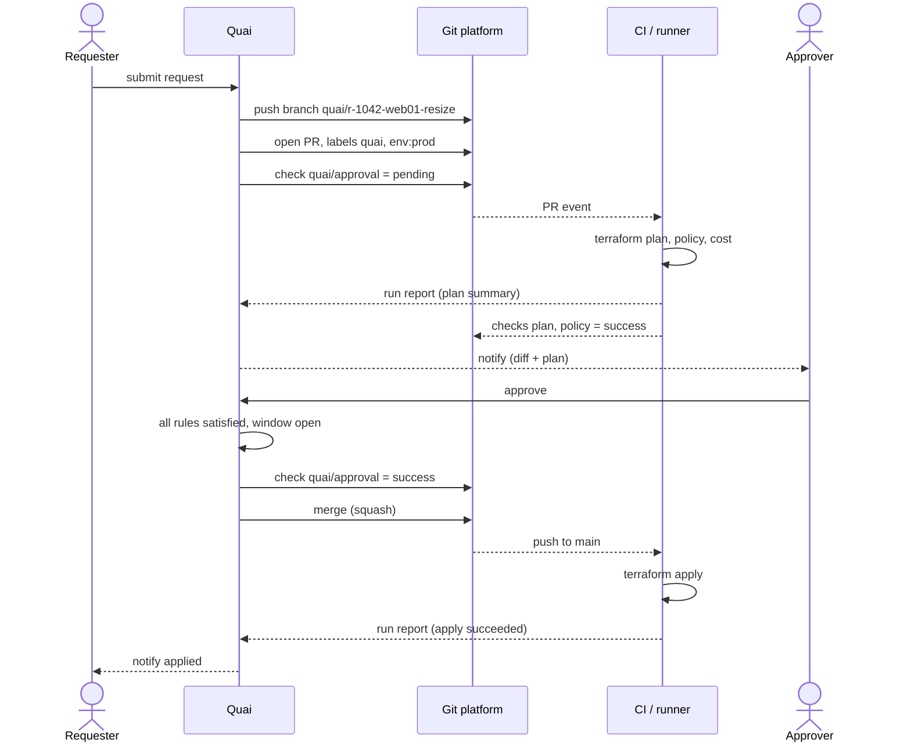

# Delivery and approvals

Status: Draft · 2026-10-26

How a planned change reaches a repository, and how Quai's approval is made
binding.

## Delivery modes

| Mode | What happens | Use for |
| --- | --- | --- |
| `pull-request` (default) | Branch + PR at submit; CI plans while approvals are pending; Quai merges when approved and green. | Every production repository. |
| `direct` | Quai commits to the branch after approval, as the prototype does. No CI plan before approval. | Sandboxes, demos, repositories without a supported connector. |

In `direct` mode the worker, under the repository's lock: fetches the mirror, checks out
the branch head in a temporary worktree, recomputes the request's region fingerprints
(any difference, including a file to create that now exists, makes the request stale),
writes the changes, commits with the requester as author, Quai as committer and the
trailers below, and pushes. A push that loses a race with another push is retried on
the new head, up to four attempts. Git runs without hooks, prompts, or system and global
configuration.

See [ADR 0008](../adr/0008-pull-requests-by-default.md).

## Pull request protocol



### Branch, commit, pull request

- **Branch:** `quai/r-<request number>-<slug>`, created from the current head of the target branch.
- **Commit:** one per PR. Author: the requester (name and email from the IdP). Committer: Quai. Signed (GitHub App API commits are verified; elsewhere SSH or GPG signing with a key from the secret store). Message:

  ```
  quai: resize infra-live/vm/prod/web01

  Black Friday traffic; see INC-5512.

  Quai-Request: #1042 3b6f2a8c-…
  Quai-Change-Set: 9f2c41…
  Quai-Stack: envs/prod
  Requested-by: Bob Builder <bob@acme.ch>
  ```

  `Approved-by:` trailers cannot be in this commit (approval happens after it). They are added to the squash-merge commit message, or recorded on the PR as a final comment when the merge method keeps the original commit.
- **Pull request:** title as the commit subject; body with the reason, a link to the request, the resources touched, and a machine-readable marker (`<!-- quai:request=3b6f2a8c… -->`) so webhook events map back to the request. Labels: `quai`, plus labels from the type (`env:prod`, `stack:envs/prod`).

### The `quai/approval` check

| State | When |
| --- | --- |
| `pending` ("Waiting for 1 of 2 approvals") | PR opened, rules not yet satisfied |
| `success` ("Approved by alice, fiona") | All rules satisfied and change window open |
| `failure` ("Rejected by nora: CIDR overlaps") | A reviewer denied, or the request expired or was cancelled |
| `neutral` ("Stale: re-plan required") | The owned region changed on the base branch |

Branch protection on the target branch must require `quai/approval`. Quai
verifies this at registration and hourly; see
[repository connections](01-repository-connections.md#health). How the check
is published and enforced differs per platform; see
[Git connectors](12-git-connectors.md):

- **Azure DevOps (first):** a pull request status (`genre: quai`, `name: approval`) on the latest iteration, required by a "Status check" branch policy whose authorized identity is Quai, with status reset on new changes. Quai then sets auto-complete and Azure DevOps completes the PR once every policy passes.
- **GitHub:** a check run, required by branch protection or a ruleset pinned to the Quai app.
- **GitLab:** a commit status, enforced with the mechanism the edition offers.

### Merge

- `merge: auto`: when `quai/approval` is success and every check in `waitForChecks` is green, Quai merges with the configured method. If the provider has a merge queue or merge train (GitHub merge queue, GitLab merge trains; availability depends on the provider's edition), Quai enqueues instead of merging directly.
- `merge: manual`: Quai sets the check and notifies the requester; a human merges. Useful where the customer insists on a human pressing the button.
- After merge, Quai deletes the branch and records the merge commit on the request.

How this is implemented (P1-13): at submit, the request's delivery is recorded (its branch,
`<branchPrefix>r-<number>-<slug of the resource and the verb>`), and a job pushes the branch from
the target's head with the one commit, opens the pull request (labels `quai` and
`stack:<stack>`; the body links the request when `server.publicURL` is set) and publishes
`quai/approval`. The status follows every change of state: pending, success once approved,
failure on a rejection or a cancellation (the pull request is then closed and its branch
deleted), not-applicable when stale (failure on Gitea, which has no such state). Once approved,
with `merge: auto`, Quai waits for the `waitForChecks` (the pull request's statuses, and its
policy evaluations on Azure DevOps), then asks the platform to merge when its own policies pass
(auto-complete on Azure DevOps; on GitHub auto-merge, or the merge queue where the base branch
requires one; on Gitea a merge, asked again while a required check is pending) with the approved
head pinned. A merge queue checks a merge group, a commit of its own holding the pull request on
top of the base, and requires `quai/approval` there too: Quai publishes its success on that commit
as well. Until the platform has merged, Quai publishes its status again and
asks again every 20 seconds. Statuses are published one at a time per request, each from the
request's latest state, so that one published from an older state never comes last;
with `merge: manual` it stops at the status. The merge, seen by the job, a webhook or a poll (a
poll re-reads every pull request Quai waits on), applies the request; one merged before Quai's
approval is recorded as such (`merged_without_approval`). A pull request closed outside Quai
cancels its request. After a merge the platform made by itself (auto-complete), a job deletes the
branch when `deleteBranch` is set, since GitHub's auto-merge and merge queue keep it; GitHub
refuses for a few seconds after its merge queue merged, so the job tries again every 10 seconds,
for 5 minutes.

Approvals are recorded in Git (P1-14): a commit in direct mode, made after the approvals, carries
them as `Approved-by:` trailers; in pull-request mode, the merge or squash commit's message does.
When the merge keeps Quai's commit as it is (`mergeMethod: rebase`), a person merges
(`merge: manual`), or the platform has a merge queue, which merges with the method and message its
own rule sets (GitHub), Quai adds them to the pull request as a final comment instead.

Signing: with `git.signingKey.ref` (an SSH private key in a secret store), every commit Quai
makes is signed with it (`gpg.format=ssh`); the platform's own merge commits are the platform's.
To verify them, put Quai's committer email and public key (`ssh-keygen -y -f <key>`) in an allowed
signers file, then:

```bash
git config gpg.ssh.allowedSignersFile ~/.config/git/allowed_signers   # quai@acme.ch ssh-ed25519 AAAA…
git verify-commit <commit>        # or: git log --show-signature
```

## Approvals bound to content

An approval is valid only for one **change set hash**: a SHA-256 over the
rendered file edits (each file's operation, path and new content). Reviews of
another hash do not count. What the edits were planned from is bound by
staleness instead: if the definitions or a region's fingerprint change, the
request is stale, so an approval never outlives what was reviewed.

| Event | Effect |
| --- | --- |
| The base branch moves, owned regions unchanged | Quai rebuilds the branch on the new base by re-applying the edits. Same hash: approvals kept; CI re-plans. |
| The base branch moves and an owned region changed | Request becomes **stale**. Approvals void, check `neutral`, requester notified to re-plan. |
| Someone pushes to the `quai/` branch | Approvals void; the PR shows "modified outside Quai". Quai re-plans from the branch content only if the new diff still stays inside the owned regions; otherwise the request is closed. |
| The PR is closed outside Quai | Request cancelled. |
| The PR is merged without `quai/approval` success | Should be impossible with enforcement. Recorded as a **bypass** audit event and alerted. |
| The type or blueprint definition changes before merge | Request becomes stale. |

After every fetch of a repository (a push webhook or a poll), Quai reconciles
the pull request of each request waiting on approval or merge with what Git
holds:

- Before acting on a branch, it re-reads the pull request: one merged or
  closed meanwhile (the base then holds its content) is handled as a merge or
  a close, never as a change of the base.
- A rebuild re-applies the request's edits, with the planned region
  fingerprints, on the base's head, and replaces the branch with a push that
  is refused if the branch is no longer at Quai's commit (`--force-with-lease`):
  a rebuild never overwrites someone's push. An approved request is then merged
  on the new head. While the platform merges (`merging`), the branch is not
  rebuilt, unless it no longer merges onto the base (`git merge-tree`), which
  the platform cannot do: two requests on one file approved together both
  append to its collection, so the first to merge conflicts with the second,
  which is rebuilt on it and merged with its approvals.
- A push by someone else: the files it changes, from the merge base, must all
  be files the request changes or inside the regions it owns. Then the
  request's change set becomes the branch's diff, with a new hash, its
  `quai/approval` turns pending ("Modified outside Quai") and the request
  waits for approval of the new content under its rules; with the same content
  (a reworded or rebased commit), the approvals stand and `quai/approval` is
  published again on the new head. Beyond those files, the request is
  cancelled and its pull request closed.
- A bypass is a `merged_without_approval` event on the request and an
  `alert_bypass` event on the repository's timeline (`repository:<name>`),
  naming the pull request, the merge commit and the state the request was in.
- "Requester notified": the requester sees the stale state and its reason on
  the request, and is sent a `stale` notification when a channel is configured
  ([notifications](#notifications)).

## Approval policy

Rules come from three places, evaluated together:

1. **Repository floor rules** (admin-owned, cannot be removed);
2. **Type rules** (in the IaC repository);
3. **Blueprint rules** (in the catalog), for blueprint requests.

```yaml
approval:
  rules:
    - name: production
      when: "params.env == 'prod'"
      approvers: [group:platform-admins]
      min: 1
    - name: owners
      approvers: [owners]                      # the resource's owning team
    - name: cost
      when: "plan.cost.monthlyDelta > 500"     # available once the plan run has reported
      approvers: [group:finops]
    - name: change-ticket
      when: "params.env == 'prod'"
      external: servicenow                     # satisfied by an approved change request
  expiry: 7d
  stepUp: "params.env == 'prod'"               # approvers must have re-authenticated recently
```

How rules combine and decide:

- A rule applies when its `when` holds; `min` defaults to 1. An action's own `approval` replaces
  the type's rules for that action (`rules: []` for none); floor rules always apply, and a
  blueprint's rules add to its types'.
- Rules with the same approvers (and external system) are merged into one requirement with the
  highest `min`, so a floor rule and a type rule for `group:platform-admins` need one approval,
  not two.
- Each reviewer's latest decision counts. A denial rejects the request only when it comes from
  someone who could approve for a rule that applies; an external rule is satisfied when its
  system approves and rejects the request when it refuses.

### Rules on the plan

A rule's `when` may read the Terraform plan of the request's pull request through `plan`, in the
approval rules of types, blueprints and floor rules only. It holds the request's latest
succeeded plan of each stack ([runs](06-runs-status-and-drift.md#run-report-protocol)), summed:
`add`, `change` and `destroy` (a replace counts in both `add` and `destroy`), `destroys` (the same
as `destroy`), `cost` (`currency` and `monthlyDelta`, only when every plan reported a cost in the
same currency) and `policies` (each `name` and `result`). As decided
([open question 7](../plan/open-questions.md#decided)):

- **Undecided until a plan reports.** Such a rule is kept apart, never merged with another, and
  the request cannot reach *Approved* while it waits: approvals given in the meantime count for it
  and stand, and a denial from its approvers rejects the request as for any rule. A condition
  whose result does not depend on the plan is decided at once, as any rule's:
  `params.env == 'prod' && plan.cost.monthlyDelta > 500` does not apply in dev, whatever the plan.
- **Decided by each plan.** When a plan reports, the rule applies or not; each new plan of the
  same change set (after a rebuild on a moved base, say) decides it again. A rule that no longer
  applies is satisfied. A request that is approved but not merged yet, which a new plan makes need
  more approvals, goes back to *pending approval*, and `quai/approval` with it.
- **When in doubt, it applies.** A condition the plan cannot decide (`plan.cost.monthlyDelta`
  without a reported cost) makes the rule apply, and the request says why. With direct delivery,
  where no plan comes before the commit, the rule applies from the start.
- The request page shows the plans, what they change by resource and what they destroy first,
  and for each such rule whether it waits for the plan, applies, or does not apply.

### Approver kinds

| Approver | Resolved from |
| --- | --- |
| `group:<name>` | IdP group |
| `user:<name>` | A named user |
| `owners` | The resource's owner (user or team) |
| `codeowners` | `CODEOWNERS` entries for the paths in the change set, on the target branch at the plan's commit; on Azure DevOps, the reviewers of "Automatically included reviewers" policies whose path filters match. Every owner of every changed path counts. They are matched to Quai users and groups as in [identity](08-identity-access-tenancy.md#directory), and kept with the request when it is submitted: a later change to `CODEOWNERS` does not change who may approve it. The plan and the request page list them, and those that match no one. When the platform cannot be read, the plan fails rather than leaving the rule without approvers |
| `manager` | The requester's manager, from the IdP attribute |
| `external: <integration>` | An external system (ServiceNow change request, generic webhook) that returns approved or rejected |

### Separation of duties

- A requester never approves their own request, even as an admin.
- One person counts once, even when they qualify for several rules, unless a rule sets `distinct: false`.
- Optional: authors of a definition change cannot approve requests planned with that definition for N days (`separationOfDuties.definitionAuthors: 7d`).
- Approving a request that includes a plan with destroys can require a second approver (`destroys: requireTwo`).

### Delegation, reminders, escalation

- Approvers can delegate to a named colleague for a date range (out of office). The delegate's approval is recorded as "by X on behalf of Y".
- Reminders go to eligible approvers after a configurable delay; after a second delay, escalation goes to a fallback group.
- Requests expire after `expiry`; the PR is closed with a comment.

### Step-up authentication

An approval block's `stepUp` is a condition, with the variables of `when`: when it holds for a
request, the request's reviews count only from people who authenticated with the IdP within
`auth.stepUp.maxAge` (five minutes by default), with `auth.stepUp.acrValues` and Entra ID's
authentication context when set ([design 08](08-identity-access-tenancy.md#step-up)). As built
(P4-06, [open question 50](../plan/open-questions.md#still-open)):

- It is decided once, at submission, for the whole request, with its rules: the request needs a
  step-up when the `stepUp` of any approval block that applies to it holds (its type's, its
  blueprint's, each of its resource types'; an action's `approval` replaces the rules, not the
  type's `stepUp`). A condition that cannot be evaluated counts as holding. The plan and the
  request say so (`stepUp`).
- Approving and denying alike need it, checked on the server when the review is made; a review
  refused is audited (`auth.step_up_refused`) and not recorded. An API token never steps up.
- A review keeps whether its reviewer had stepped up, with their `auth_time`, `acr` and `acrs`. On
  a step-up request only those reviews count, however old the reviewer's session grows after.
- The request page asks for a new sign-in before the approve and deny buttons appear, says until
  when a sign-in counts, and comes back to the request after it.

### Change windows and freezes

```yaml
changeWindows:
  - name: prod-business-hours
    when: "params.env == 'prod'"
    allow: ["Mon-Thu 08:00-16:00 Europe/Zurich"]
  - name: year-end-freeze
    deny: ["2026-12-18T00:00 to 2027-01-05T00:00 Europe/Zurich"]
```

An approved request outside its window waits in *Approved* and merges when the
window opens. The request page shows the next possible merge time.

### Break-glass

For incidents, a member of the `break-glass` role can merge a request without
the normal approvals:

- they must give a reason and an incident reference;
- `quai/approval` is set to success with "break-glass by <name>";
- security and the owning team are alerted immediately;
- a post-incident review is created and stays open until two reviewers sign it off.

## ITSM

For organizations whose change management lives in ServiceNow (or Jira Service
Management):

- On submit, Quai creates a change request (standard change for catalog items marked as pre-approved; normal change otherwise) with the diff, plan summary and risk fields.
- The `external: servicenow` rule is satisfied when the change request reaches an approved state.
- On apply, Quai moves the change request to implemented and closes it, attaching the evidence bundle (see [security and compliance](09-security-and-compliance.md#evidence-bundle)).
- If the change request is rejected or cancelled, the Quai request is rejected.

## Notifications

Events: request submitted, approval needed, approved, rejected, stale, merged,
applied, failed, expiring soon; and alerts: a bypass (`alert_bypass`),
enforcement lost (`alert_enforcement`), break-glass. Channels: email (Phase 4,
P4-07), Microsoft Teams and Slack (P4-09, P4-10), outgoing webhooks. Approvers
can approve from Teams or Slack messages when the rule does not require step-up
authentication. See [integrations](11-integrations.md#notifications).

Built (`internal/notify`):

- **One place.** The events below are recorded through `store.RecordEvent`,
  whose hook enqueues a `notify_event` job in the event's transaction
  (River's `InsertTx`): an event is notified once, and a rollback notifies
  nothing.
  The events notified, by kind: `submitted` (the requester, unless no rule
  applies, and the approvers), `approval_needed`, `plan_decided` and
  `modified_outside_quai` with a new content hash (the approvers);
  `approved`, `rejected`, `stale` (the requester); `merged`,
  `merged_without_approval` and `committed` (the requester, as merged);
  `applied`; `failed` and `apply_failed`; `expiring_soon` (P4-14 records it);
  `alert_bypass`, `alert_enforcement`, `alert_break_glass` (P4-17 records
  it), to admins. A cancelled request and reviews notify no one.
- **Recipients**, resolved when the job runs, from the directory (people who
  signed in): the requester, and the people who may give each approval the
  request still waits for (`policy.CanReview`: users, owners, members of a
  group Quai knows from logins), skipping the rules no one may give. After a
  plan, only the rules its decision made apply are announced. Alerts go to the
  repository's admins (`metadata.owners`, matched as an `owners` rule is) and
  to `notifications.alerts`, plain addresses that get alerts only. A
  deactivated person gets nothing ([open question
  56](../plan/open-questions.md#still-open)).
- **Content.** A request's content (title, reason, diff summary, plan) goes
  only to people who may read the request: its requester, and an approver
  while the request waits for them (`requests.CanReview`, checked again when
  the message is sent). The plan in a message is its summary, cost, policy
  results and the addresses of the resources it changes with their actions,
  never an attribute's value: less than the request page shows. Alerts carry
  identifiers only (the repository, the request's number and state, the pull
  request, the merge commit, the branch, the problems), since their
  recipients may not read the request. Links start with `server.publicURL`,
  never with a request's `Host`
  ([open questions 53 to 55](../plan/open-questions.md#still-open)).
- **Delivery.** One `notifications` row per event, recipient and channel
  (unique: a job run twice sends once), and one `send_notification` job per
  row, retried with backoff (30 seconds doubling to an hour, 20 attempts,
  about 14 hours) on the `notifications` queue: a failure never holds a
  request back. An approval-needed message is checked again when sent: the
  request still pending, the person still among those it waits for; otherwise
  the row is `skipped` with the reason. A row is `pending`, `sent`, `skipped`
  (no address, the person deactivated, no longer needed) or `failed` (the
  last attempt failed); `last_error` and `attempts` say why. A crash between
  sending and recording it may send a message twice (at least once; [open
  question 57](../plan/open-questions.md#still-open)).
- **No one to notify.** When a channel is configured, a rule waiting for
  approvals whose approvers Quai cannot reach (none signed in with a verified
  email) says so on the request (`noOneToNotify`), and so does a request whose
  requester has none (`requesterNotNotified`).
- **Preferences** (P4-08). Each person chooses, per channel and kind of
  notification (approval needed, submitted, approved, rejected, stale, merged,
  applied, failed, expiring soon), whether it goes at once (`immediate`), in
  their daily digest (`digest`) or not at all (`off`), and when their digest
  goes: an hour of the day (0 to 23) in an IANA time zone. Until they choose,
  `notifications.defaults` applies (every kind at once, the digest at 08:00
  UTC, unless configured). Only the choices that differ from the defaults are
  kept, so a choice equal to a default follows it when the configuration
  changes. Alerts are not a kind one chooses: they always go at once, on every
  channel, whatever is stored. Approval needed is never off on every channel
  (with email alone: at once or in the digest), so a request never waits for
  someone who hears nothing of it; a stored preference that would turn it off
  everywhere (a channel removed since) counts as at once. The profile page
  (`/profile`) sets them through `GET` and `PUT /api/v1/me/preferences`, which
  act on the caller's own preferences only, named by the session, never by the
  path or the body, and refuse API tokens ([open question
  58](../plan/open-questions.md#still-open)). Every value comes from a fixed
  list or is checked on the server: the kinds, channels (configured ones) and
  modes; the hour; the time zone, a strict IANA name (no path, no `..`, not
  `Local`) that `time.LoadLocation` knows, from the system or the database
  built into Quai. Unknown fields are refused. Each change is in the audit log
  (`preferences.changed`, the person and their time zone pseudonymised); the
  same preferences again are not a change.
- **Fan-out with preferences.** The fan-out applies the recipient's
  preferences when it writes the rows: `off` is a `skipped` row ("they turned
  it off in their preferences"), `digest` a row in state `digest` with no send
  job, `immediate` a `pending` row and its job as before. A person without an
  address on the channel or deactivated gets nothing, whatever they chose.
- **Digests** (P4-08). The worker's `notify_digests` job (every 5 minutes)
  finds the people with notifications waiting for a digest and, once the
  latest hour of their digest has passed on their wall clock, gathers the
  notifications added before that hour into one digest
  (`notification_digests`, unique per recipient, channel and period, the
  local date of that hour), with a `send_digest` job: the key makes one digest
  per person, channel and day however often the job runs, a notification
  joins one digest only (its `digest_id` is set once), and a digest with
  nothing in it is not made. A notification for the digest is never sent on
  its own: `send_notification` sends `pending` rows only. The hour is the
  wall clock's across changes to and from daylight saving time (23 or 25
  hours between two digests); an hour the change skips is the moment of the
  change, an hour that happens twice the first. Sending composes each
  notification under the rules of an immediate one, at that moment: a person
  deactivated since, a request deleted, an approval the request no longer
  waits for from them, leave the notification out (`skipped`, with the
  reason), and a digest with nothing left is `skipped`. One message lists
  each notification's headline, request and link, with a link to the profile
  page; immediate messages to people link to it too. Retries are those of a
  notification; after the last, the digest and its notifications are
  `failed` ([open question 59](../plan/open-questions.md#still-open)).
