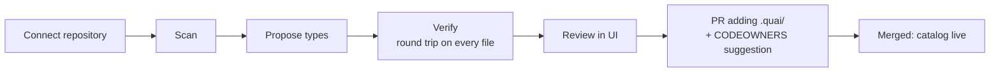

# Onboarding an existing repository

Status: Draft · 2026-10-26

Custom portals usually die at onboarding: every repository has its own
conventions, and writing the mapping by hand takes weeks of consulting per
customer. Quai's goal is **an afternoon of reviewing generated definitions**
for a typical repository.

If three different customer repositories can be onboarded without code changes
to Quai, it is a product. If not, it is consulting.

## Flow

1. **Connect** the repository ([repository connections](01-repository-connections.md)).
2. **Scan.** Quai walks the default branch and collects:
   - groups of data files with the same shape under the same path pattern (`envs/*/vms/*.yaml` → pattern `envs/{env}/vms/{name}.yaml`);
   - Terraform root modules and how they read those files (`fileset`, `yamldecode`, `jsondecode`, `for_each` keys), parsed with `hashicorp/hcl/v2`;
   - module `variable` blocks with their types, defaults and `validation` rules;
   - existing JSON Schemas, `CODEOWNERS`, CI configuration (to pick the runner adapter).
3. **Propose** for each group a resource type: locator and params, file schema, generator (identity unless the data clearly needs mapping), ownership, stack and Terraform address, approval rules from simple heuristics (`env == 'prod'` → platform admins).
4. **Verify** every proposal mechanically (below). Proposals that fail are shown with the failing files, never silently accepted.
5. **Review.** The admin sees each proposed type with its form preview, the matching files, and the verification result, and edits anything before accepting.
6. **Deliver.** Quai opens a pull request adding `.quai/` (and a `CODEOWNERS` entry for it if missing). Once merged, the types are live.

## How proposals are made

Deterministic analysis first; a language model only where judgement helps.

| Step | Method |
| --- | --- |
| Path patterns | Cluster file paths by directory structure and extension; variable segments become params; values seen in a segment become enum options or `discover: true`. |
| File schema | Inferred from all samples (types, required keys = present in every file, enums for small value sets, numeric ranges), then tightened with the Terraform variable types and `validation` blocks the files feed. |
| Stack and address | From the root module that reads the files and the `for_each` key expression (`module.vm[trimsuffix(f, ".yaml")]` → `module.vm["{name}"]`). |
| Titles, descriptions, grouping | A language model drafts human-friendly titles, field descriptions and categories from file names, comments and variable descriptions. |
| Mapping generators | When files are clearly derived (sizes always paired), the model may suggest a simpler form with a `mapping` generator. Always a suggestion, never the default. |

### Using a language model safely

- Off by default. When enabled, the endpoint is chosen by the customer: an on-premises model or an approved provider.
- Only structure is sent: paths, key names, value types and small enum sets. Values are redacted unless an admin allows samples for a specific repository.
- Model output is a draft. Nothing it produces is accepted without passing verification and a human review.

## Verification gates

A proposed type is accepted only if all pass:

1. Every matching file parses.
2. Every matching file validates against the proposed schema (or the admin explicitly accepts listed files as non-conforming).
3. **Round trip:** for every file, `write(read(file))` produces zero diff with the file editors. This proves Quai can edit those files without rewriting them.
4. Key uniqueness: no two files map to the same resource key.
5. With a recent plan JSON (optional), every module instance address maps to exactly one resource.

The same gates run in CI afterwards through `quai lint`, so a human edit that
breaks the contract is caught in the pull request that makes it.

## Schema from Terraform variables

`quai schema from-terraform ./modules/vm` converts a module's variables into a
JSON Schema draft for the file shape: `number` → `number`, `list(object(…))` →
`array` of `object`, `optional(string, "standard")` → optional with default,
`validation { condition = contains([...], var.x) }` → `enum` where the
condition is a recognizable pattern. Unrecognized validations are kept as
comments for a human to translate.

## Success metrics

- Time from connection to first live catalog item, measured per onboarding.
- Share of proposed types accepted without edits.
- Number of onboardings that needed a code change in Quai (target: zero after the first three customers).
