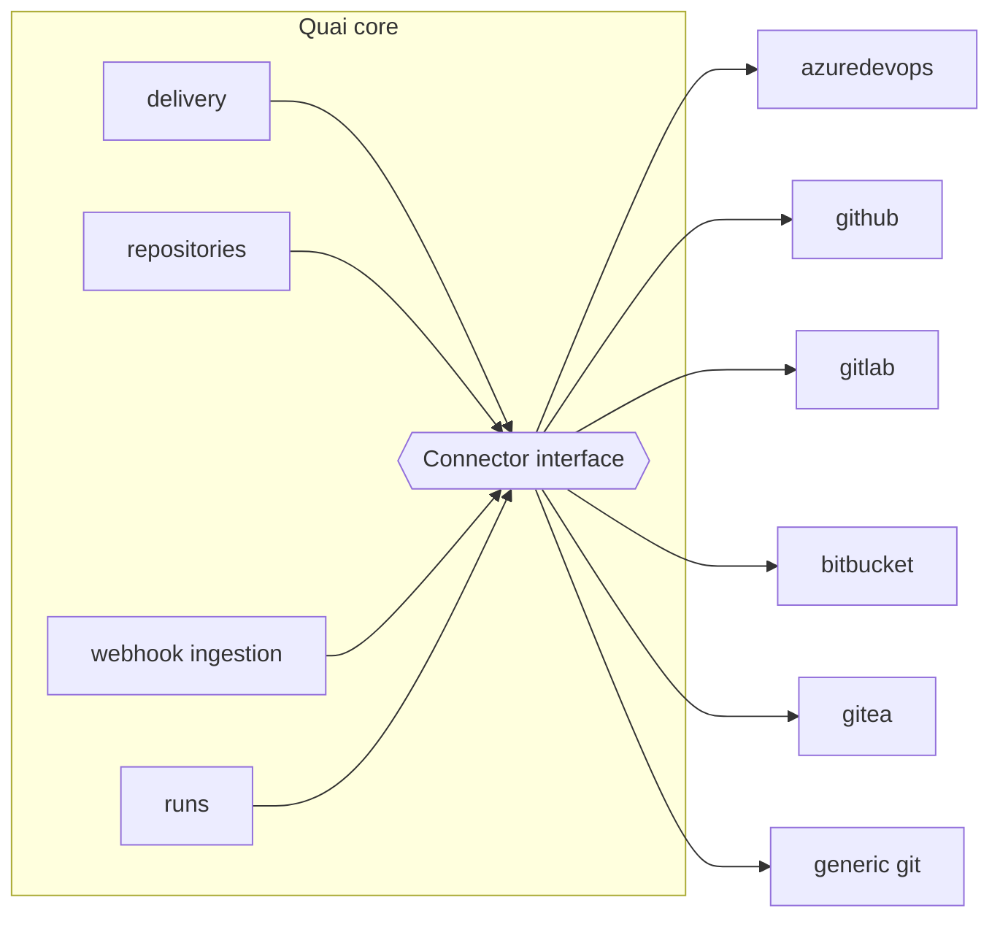
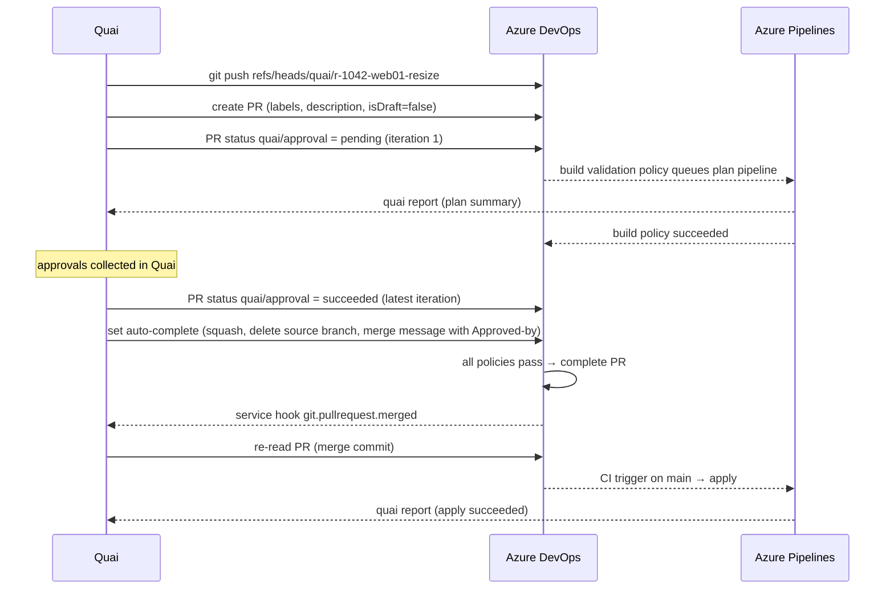

# Git connectors

Status: Draft · 2026-10-26 · Decision: [ADR 0010](../adr/0010-git-connectors-azure-devops-first.md)

A connector is everything Quai needs to work with one Git platform: authentication, pull requests,
statuses, branch policies, ownership rules, webhooks and, optionally, pipelines. Each platform
does these differently, so each gets its own connector behind one interface.

**Build order:** Azure DevOps first: **Azure DevOps Services** for Phase 1 and the M1 pilot, and
**Azure DevOps Server (on-premises)** on the same connector as a
[future improvement](../plan/roadmap.md#future-improvements); then GitHub, then GitLab, then
Bitbucket. Gitea is built alongside Azure DevOps as the reference connector for tests.

## Architecture



- Connectors are Go packages compiled into the binary (`internal/connectors/<platform>`), not plugins. They hold credentials and make network calls, so they must be in-tree and security-reviewed. The WASM plugin sandbox is for generators only.
- Git transport (clone, fetch, push) is shared: the `git` CLI, with credentials supplied by the connector (HTTP header, SSH key, credential helper).
- Everything else goes through the platform API, behind the connector.
- A registry makes each connection's connector from `spec.connector`. Until a platform's own connector is built, its connections get Git transport only, like generic (direct delivery, no enforcement), and Quai logs a warning.
- API calls go through one shared HTTP client: the CA bundle and proxy Quai is configured with, rate limits honoured (`Retry-After` holds back calls to that host and retries a 429, or a 503 when the call is idempotent; `X-RateLimit-Remaining: 0` waits for `X-RateLimit-Reset`; exponential backoff without `Retry-After`; a wait over a minute fails the call rather than blocking it), and logging of method, URL without credentials or secret-looking query values, status and duration only.

### Interface

The interface is split into capabilities. A connector reports which ones it supports, so the core
can degrade explicitly (for example, generic Git has no pull requests and supports direct delivery
only).

```go
type Connector interface {
    Info() Info // platform, edition, API version, capabilities

    GitAuth(ctx context.Context) (GitCredentials, error) // header, SSH key or helper for the git CLI

    PullRequests() PullRequests   // open, update, get, complete or merge, abandon, auto-complete
    Statuses() Statuses           // publish quai/approval; list other checks on a commit or PR
    Policies() Policies           // read branch protection or policies; verify enforcement
    Owners() Owners               // CODEOWNERS or the platform's path-based reviewer rules
    Webhooks() Webhooks           // subscribe, verify, parse into normalized events
    Pipelines() Pipelines         // optional: trigger runs (drift checks), read run status
    Identities() Identities       // map platform users to IdP users (by email or UPN)
}

type Capability string

const (
    CapPullRequests    Capability = "pull-requests"
    CapEnforcedStatus  Capability = "enforced-status"   // a required status only Quai can set
    CapAutoComplete    Capability = "auto-complete"     // the platform merges once policies pass
    CapMergeQueue      Capability = "merge-queue"
    CapSignedWebhooks  Capability = "signed-webhooks"
    CapPipelines       Capability = "pipelines"
    CapCodeOwnersFile  Capability = "codeowners-file"
)
```

### Normalized events

Webhook payloads differ per platform. Connectors turn them into a small set of internal events,
which the rest of Quai consumes. The connection's own connector parses its deliveries and drops
other repositories' events (an Azure DevOps service hook can be project-wide), so the events below
belong to that repository:

| Event | Fields |
| --- | --- |
| `Push` | ref, before, after, changed paths (when the payload has them) |
| `PullRequestChanged` | PR id, action (opened, updated, completed, abandoned), head commit, source and target branches |
| `StatusChanged` | PR id or commit, name, state, URL |
| `PolicyChanged` | branch (for enforcement re-checks) |
| `PipelineRunChanged` | pipeline, run id, state, result, commit |

**Webhooks are notifications, not truth.** After an event, Quai re-reads the pull request, status
or ref from the API before acting. A forged or replayed payload can at worst trigger an extra read.
This matters most on platforms that do not sign webhook payloads, Azure DevOps among them.

### Conformance suite

Every connector must pass one shared suite (`internal/connectors/conformance`), run against a real
instance of the platform. The connector's tests give it a harness: a throwaway repository on the
instance, and what only an administrator does there (requiring the check, adding an ownership rule,
a second identity, recorded webhook deliveries when the platform cannot reach the test). Steps the
connector's capabilities or the harness do not cover are skipped, with the reason:

1. Push a branch under `quai/`, open a PR, update it with a second commit.
2. Publish `quai/approval` pending, then succeeded; verify the platform shows it on the latest iteration or commit.
3. With enforcement configured, verify the PR cannot complete while the status is pending, and can once it succeeded.
4. Verify that a status published by another identity does not satisfy the policy (where the platform supports restricting it).
5. Complete or merge with each supported merge strategy; verify the merge commit and branch deletion.
6. Read branch protection and ownership rules; detect when enforcement is removed.
7. Receive and verify each webhook event type; reject a payload with a wrong secret.
8. Rate limiting: honour `Retry-After` and back off.

On Azure DevOps, which cannot reach a test machine, step 7 replays what the platform tried to
deliver: the harness subscribes to an address that does not resolve before the suite starts, and
reads each request back, body as sent, from the subscription's notification history.

A connector ships when the suite passes against the platform editions the customer runs. For
Azure DevOps that means a sandbox organization for Services and, once Server is supported, an
**Azure DevOps Server 2022 instance** (a Windows Server VM in the lab, or a test project on a
customer's own Server).

## Azure DevOps (first): Services, then Server

One connector covers both editions, whose REST APIs are almost identical. **Azure DevOps Services
(SaaS) is the first target**: Phase 1 builds and tests the connector on it, and the M1 pilot is
accepted on it. **Azure DevOps Server (on-premises)**, which the pilot runs, is a
[future improvement](../plan/roadmap.md#future-improvements): the connector is written against
Server 2022's API version, URL forms and PAT authentication, and what remains is running the
conformance suite on a real Server and fixing the differences.

### Editions and versions

| Edition | REST API version | Status in Quai |
| --- | --- | --- |
| Azure DevOps Server 2022 (and its updates) | 7.0 | **The API baseline**; supported once the conformance suite passes on it ([future improvement](../plan/roadmap.md#future-improvements)) |
| Azure DevOps Server releases after 2022 | 7.x, detected | Supported once the conformance suite passes on them |
| Azure DevOps Server 2020 | 6.0 | Only if the pilot still runs it; some features (PR labels, parts of the policy API) need verification |
| Azure DevOps Server 2019 and older (TFS) | 5.0 and below | Not supported |
| Azure DevOps Services | 7.1 | **First target**: Phase 1 and the M1 pilot, called with 7.0 |

The connector reads the instance's version at registration (`_apis/connectionData` and the
resource-area version lists), stores it on the connection, and pins every call to an API version
the instance supports. Until registration exists (P1-17), it reads them, and the repository's IDs,
on first use and keeps them in memory; an instance whose Git API is older than 7.0 is refused. Code is written against the **lowest supported version (7.0)**; features
only available in newer versions are capabilities, detected and reported, never assumed.

### URLs

| Edition | Repository URL |
| --- | --- |
| Server | `https://devops.acme.ch/{virtual-directory}/{collection}/{project}/_git/{repository}`, e.g. `https://devops.acme.ch/tfs/DefaultCollection/Infrastructure/_git/live`. The virtual directory (`tfs`) is optional and configurable on the server. |
| Services | `https://dev.azure.com/{organization}/{project}/_git/{repository}` (and the legacy `https://{organization}.visualstudio.com/...`) |

The connector parses both forms into collection or organization, project and repository, and
builds API URLs from the collection URL. Repository and project names may contain spaces and
non-ASCII characters; they are always URL-encoded and stored by their IDs once resolved, so a
rename does not break the connection.

### Library

`github.com/microsoft/azure-devops-go-api/azuredevops/v7` for the Git, Policy, Pipelines and
Service Hooks clients, wrapped in Quai's own thin client. The SDK targets Services and pins API
versions per endpoint, some of them newer than Server 2022 accepts. The wrapper therefore controls
the API version of every call, and calls endpoints the SDK lacks, models incorrectly or pins too
new through `net/http`. Verifying this against a Server 2022 instance is part of the Server
[future improvement](../plan/roadmap.md#future-improvements).
The SDK's Git client pins its calls to 7.1 previews, so the wrapper sends every call itself: through
the SDK's location service with its own version (the SDK puts it in the `Accept` header and only
ever negotiates it down), or over HTTP with `api-version` in the query.

### Authentication

| Edition | Recommended | Alternatives |
| --- | --- | --- |
| **Server (first)** | **PAT of a dedicated service account** (an Active Directory account used only by Quai), with expiry and rotation reminders | SSH key for Git transport only (API calls still need a PAT). Windows authentication (NTLM or Kerberos) is not supported in the first release: it is awkward from Linux containers and rarely needed when PATs are enabled. |
| Services | **PAT**, as on Server (decided 2026-10-28: the sandbox and the first customers use it) | **Microsoft Entra service principal** added to the organization, with workload identity federation from the cluster (no secret), a certificate or a client secret; managed identity when Quai runs on Azure. For customers who forbid PATs; planned before GA (#97) |

- **Server, PAT:** API calls use basic authentication with an empty user name and the PAT as password; Git over HTTPS uses the same as an `http.extraHeader` (`Authorization: Basic …`). PAT scopes: Code (read and write), Code (status), and Build (read and execute) only if pipeline features are used. Quai shows the PAT's expiry on the repository health page and warns 30 days ahead.
- **Services, PAT:** the same as on Server.
- **Services, Entra (before GA):** tokens are requested with `azidentity` for the Azure DevOps resource (`499b84ac-1321-427f-aa17-267ca6975798/.default`) and refreshed before expiry. Git over HTTPS uses the same token as a bearer header, so Git and API calls share one identity.

### Network (Server)

- Quai runs on-premises next to the Server. No internet access is needed for the connector.
- **Corporate TLS:** Server usually presents a certificate from an internal CA. The CA bundle configured for Quai (`network.caFile`, trusted in addition to the system's certificates) applies to API calls and to `git` (`http.sslCAInfo`, given the system's certificates and the extra ones); certificate verification is never disabled.
- **HTTP proxy:** honoured for both API and Git if configured, from `HTTPS_PROXY`, `HTTP_PROXY` and `NO_PROXY`: Quai decides the proxy for each URL and gives `git` the same answer (`http.proxy`). Credentials in the proxy URL are sent with Basic authentication on the first request, by Go's clients and by `git` alike. Server is usually reached directly. SSH remotes do not go through the proxy.
- **Service hooks need a path from the Server to Quai's webhook endpoint.** If firewalls do not allow it, the connection runs in **polling mode** (pull requests and refs polled every minute, policies every few minutes) with no loss of function, only latency.

### Permissions

The registration access test verifies each one and reports what is missing.

| Where | Permission | Why |
| --- | --- | --- |
| Repository | Read, Contribute to pull requests | Read files, open and update PRs |
| Branch folder `refs/heads/quai/*` | Create branch, Contribute, Force push | Push and rebuild Quai's own branches only |
| Target branch (`main`) | Nothing beyond read | Quai never pushes to it; completion goes through the PR |
| Repository | **Not** "Bypass policies when completing pull requests" | Quai must be subject to the same policies as everyone |
| Project | View project-level information; read policy configurations | Verify enforcement |
| Project | Edit subscriptions (optional) | Create the service hook subscription automatically; otherwise a project admin creates it once |
| Pipelines | Queue builds (optional) | Trigger drift-check runs |

Restricting Quai to the `quai/` branch folder is done with branch-level security: in the web UI,
with the security REST API, or on Server with `tf git permission` (the same command administrators
use to require branches in folders). The registration wizard shows the exact commands for the
detected edition.

### Mapping Quai concepts to Azure DevOps

| Quai | Azure DevOps |
| --- | --- |
| Pull request | Pull request. Each push creates a new *iteration*. The description is limited to 4000 characters: Quai cuts the text, never the request marker. A draft does not complete, even with auto-complete set. Publishing it does not reliably let that auto-complete act: live, some publishes dropped it, and others left it set and never firing, until it was cleared and set anew. Quai opens requests' pull requests ready, not as drafts. |
| `quai/approval` check | **PR status** with context `{genre: "quai", name: "approval"}`, posted on the latest iteration. States used: `pending`, `succeeded`, `failed`, `notApplicable` (stale). |
| Enforcement | **Branch policy "Status check"** on the target branch requiring `quai/approval`, with **authorized identity** set to Quai's identity and **"reset status whenever there are new changes"** enabled. A push to the PR branch then invalidates the status, which matches Quai's content-bound approvals. Quai verifies that a blocking status check policy for `quai/approval` applies to the target branch, that its authorized identity is Quai's, that it resets on new changes, that it applies by default (not only when a status is posted) and that it has no path filter; each missing part is reported as a problem. |
| `waitForChecks` | The other branch policies on the target branch: build validation, required reviewers, comment resolution, work item linking. Quai reads their state with the **policy evaluations** API for the PR, and lists them among the PR's checks as `policy:<name>` (the policy's display name, or "Status check: genre/name"). Completing a PR checks that every blocking policy is approved first. |
| Auto merge | **Auto-complete**: Quai sets auto-complete with its completion options once its status is succeeded; Azure DevOps completes the PR when every policy passes. While a request is merging, Quai sets it again every 20 seconds. With `merge: manual`, Quai only sets the status. |
| Merge methods | `squash`, `noFastForward` (merge commit), `rebase`, `rebaseMerge`; `deleteSourceBranch: true`; the merge commit message carries the `Approved-by:` trailers. |
| Labels | PR labels (`quai`, `env:prod`, `stack:envs/prod`). |
| CODEOWNERS | Azure Repos has **no CODEOWNERS file**. The equivalent is the **"Automatically included reviewers"** branch policy with path filters. The `codeowners` approver kind resolves to the reviewers of the policies whose path filters match the change. |
| Protecting `.quai/` | A required-reviewer policy with path filter `/.quai/*` on the target branch. Quai checks that one exists and warns if not. |
| Webhooks | **Service hook subscriptions** (Web Hooks consumer, available on Server and Services) for `git.push`, `git.pullrequest.created`, `git.pullrequest.updated` and `git.pullrequest.merged` of the repository, and `ms.vss-pipelines.run-state-changed-event` of the project (pipeline runs, which Quai reads again and keeps when they are the repository's). The connector creates one subscription per event type, or updates those already delivering to Quai's URL. |
| Webhook authentication | Azure DevOps does **not sign** service hook payloads. Quai uses a per-subscription secret in a custom HTTP header (or basic auth) over TLS, accepts hooks only on the dedicated webhook host name, and **re-reads every object from the API** before acting. The header is `X-Quai-Webhook-Secret`, compared in constant time; events carry only IDs, which ingestion re-reads. |
| Pipelines | Runs are read through the Builds API (a YAML pipeline's run is a build: its commit, branch, pull request and results page); a pull request's build validation runs through its policy evaluations; artifacts through the Pipelines API's signed content; drift checks are triggered with the Pipelines **runs** API; run results arrive through service hooks or `quai report` (see [runs](06-runs-status-and-drift.md#adapters)). The PAT needs Build (read and execute). |
| Commit signing | Quai signs commits with its SSH or GPG key so history can be verified offline; Azure Repos does not display signature verification in its UI at the time of writing. |
| Identities | Commit author is the requester's email; Azure DevOps links it to the user when the email matches their account. PR "created by" is Quai's identity; the PR description names the requester. Quai finds identities by email through the identities API (on Services, the organization's `vssps` host). |
| Work items (optional) | Link the PR to a work item given by the requester or created per request, for organizations that track changes in Azure Boards. |

### Delivery sequence on Azure DevOps



### Azure DevOps specifics to handle

- **Completion is asynchronous:** a PR's merge is computed in the background, and a completion asked for before it is done can be dropped. Quai waits for the merge (`mergeStatus: succeeded`, or stops at `conflicts`), asks for completion pinned to the approved head (`lastMergeSourceCommit`), asks again if it was not queued, and waits for `completed`.
- **Throttling:** Azure DevOps throttles by resource usage and returns `Retry-After` and `X-RateLimit-*` headers. The client honours them and spreads polling.
- **Server versions:** API versions and some features (for example PR labels, auto-complete details) differ between Server releases. The connector records the detected version, and the conformance suite runs against every supported Server release before it is listed as supported.
- **Collections:** a Server can host several collections; one Quai installation can connect repositories from any of them, each with its own credentials if the service account differs.
- **Identities on Server:** commit authors are matched to Active Directory accounts by email. If the directory has no email for an account, the PR description still names the requester, and the request record keeps the IdP identity.
- **Proxies and certificates:** on-premises Server often sits behind corporate TLS. Custom CA bundles and HTTP proxy settings apply to both API calls and `git`.
- **Large repositories:** Azure Repos supports partial clone; the mirror cache uses `--filter=blob:none`.

## GitHub (second)

| Concern | Approach |
| --- | --- |
| Library | `google/go-github`, `bradleyfalzon/ghinstallation` |
| Authentication | GitHub App installed on selected repositories or a whole organization. `spec.credentials.ref` names the app's private key and `spec.credentials.appId` holds its ID ([open question 13](../plan/open-questions.md#still-open)). A JWT signed with the key finds the app's installation on the repository (`GET /repos/{owner}/{repo}/installation`, so nothing else needs configuring) and is exchanged for an installation token **limited to that one repository**, renewed a minute before it expires. The key is read on each use, so a rotated one applies from the next call; the installation is looked up again after GitHub refuses a token (the app reinstalled has a new ID) |
| Git | The installation token, fresh for each command, as HTTPS Basic credentials for the user `x-access-token` (`Authorization: Basic …`, through the same header mechanism as the other connectors, scoped to the host) |
| `quai/approval` | Check run created by the app on the pull request's head, a new one for each state: `pending` is `in_progress`, `succeeded` is `completed` with conclusion `success`, `failed` and `error` are `failure`, and a stale approval (not applicable) is `action_required`, which blocks a merge where `neutral` or `skipped` would satisfy the required check. The app needs the Checks (read and write) permission |
| Enforcement | An active repository ruleset, or branch protection, requiring the check **pinned to the Quai app** (`integration_id` in a ruleset, `app_id` in branch protection), and binding the app: no bypass entry for it in the ruleset, and branch protection that applies to administrators ("Do not allow bypassing the above settings", `enforce_admins`), since the app is one. Quai reads both, with the Administration (read) permission; one binding rule is enough. A rule it cannot read is reported as not verified, never as enforcement ([specifics](#github-specifics-to-handle)) |
| Merge | `auto-complete`: once Quai approves, GitHub merges, pinned to the approved head. Where the base branch requires a **merge queue** (`merge-queue`), the pull request joins it, and Quai publishes `quai/approval` on the queue's merge group too; otherwise **auto-merge** is enabled with `spec.delivery.mergeMethod` and Quai's message. Both are GraphQL only (`enablePullRequestAutoMerge`, `enqueuePullRequest`, with `expectedHeadOid`); the app needs the Merge queues (read and write) permission for the queue. Where GitHub could merge at once, or the repository does not allow auto-merge, the connector merges through the merge API, pinned to the approved head (`sha`), with methods merge, squash and rebase. GitHub's merge keeps the source branch: the connector deletes it after its own merge, and core after GitHub's ([specifics](#github-specifics-to-handle)) |
| Ownership | `CODEOWNERS` file (`.github/`, the root, then `docs/`, the first found), parsed by the connector with GitHub's rules, without what GitHub reports it ignores. CODEOWNERS only requests reviews: definitions are trusted when the branch also requires code owners' review (a ruleset's pull request rule or branch protection) |
| Webhooks | A **repository webhook** delivering to `/webhooks/<name>`, signed with HMAC-SHA256 (`X-Hub-Signature-256`, compared in constant time; a missing, unprefixed, `sha1=` or wrong signature is refused), for `push`, `pull_request`, `check_run`, `status`, `merge_group`, `branch_protection_rule` and `repository_ruleset`. `Subscribe` installs it, or updates the one already delivering there, when the app has the Webhooks (read and write) repository permission; without it, the error names the permission and the health page says how to add the webhook by hand. The app's own webhook is not used, since it is one URL and one secret for every repository the app is installed on ([open question 15](../plan/open-questions.md#still-open)); its deliveries parse the same way, which is how the tests replay them |
| Commits | Pushed over Git with the installation token, so GitHub shows them as unverified (`reason: unsigned`, measured); only commits the app creates through the API are verified. A branch that requires signed commits refuses Quai's pushes: not supported yet |
| Editions | github.com: `spec.url` must be `https://github.com/<owner>/<repository>`, and any other host is refused, since the app's JWT and tokens go where the URL says. GitHub Enterprise Server is a [future improvement](../plan/roadmap.md#future-improvements) ([#137](https://github.com/damhau/quai/issues/137)): the API URL stays configurable, with feature detection by version when it is built |

### GitHub specifics to handle

Measured on the sandbox ([test infrastructure](../plan/phase-3-backlog.md#test-infrastructure)) unless marked; `TestLiveMerge`, `TestLivePullRequests`, `TestLiveForks`, `TestLiveRuleset`, `TestLiveBranchProtection`, `TestLiveOwners`, `TestLiveAutoMerge`, `TestLiveMergeQueue` and `TestLiveWebhooks` pin them, and `TestGitHubDelivery` and `TestGitHubReplay` the whole path through Quai.

- **A merge is synchronous, and its refusals say different things.** The merge call answers with the merge commit, which is what the connector reports; `Get` then shows the same commit. Its 405 and 409 refusals mean:

  | GitHub's answer | What it means | What the connector does |
  | --- | --- | --- |
  | 405 `Base branch was modified` | Another merge landed at that moment, as when two pull requests merge at once | Asks again, every second for up to 30 s |
  | 405 or 409 with `mergeable: null` | GitHub has not computed mergeability yet (a precaution: a merge asked while it was `null` has not been refused so far) | Asks again, as above |
  | 409 `Head branch was modified`, the pull request still showing the approved head | The merge saw a newer head than the API does yet (a precaution: not seen so far) | Asks again, as above |
  | 409, the pull request showing another head | The branch moved after approval | `ErrBlocked` |
  | 405 `Pull Request is still a draft`, `… has merge conflicts`, and any other refusal, such as a required check pending, failed or stale (measured with a ruleset and with branch protection) | Waiting on someone | `ErrBlocked` (Quai asks again later) |
  | 405 `… merges are not allowed on this repository` | The repository's settings forbid `spec.delivery.mergeMethod`, which waiting will not change | `ErrUnsupported`, so the request fails and says why rather than waiting forever |

  `mergeable_state` does not tell these apart: a draft and a forbidden method both show `clean`. Mergeability is `null` for a moment after a pull request opens, yet a merge asked at once usually succeeds, so the connector asks first and reads afterwards. A pull request closed without merging is an error, not a wait. One already merged is a success, which is what a retry after a lost response finds.
- **Labels are a second call.** GitHub keeps them on the issue every pull request also is, and creates the ones it does not know. If labelling fails, `Open` fails with the pull request open: the retry finds it (`List`) and goes on without its labels, which are a convenience and carry no meaning for Quai (the [marker](05-delivery-and-approvals.md#branch-commit-pull-request) in the description does).
- **Limits.** GitHub refuses a description over 65536 characters when opening, so the connector cuts one to that many bytes, keeping the marker, and a comment the same way (its limit is not measured). A label holds 50 characters, and a cut one is created under its shorter name. A title is cut to 256, the limit GitHub's refusal names, though it accepted longer ones on an edit.
- **Forks.** Anyone can open a pull request from a fork of a public repository, with a branch named `quai/…`. `List` leaves these out, since core takes what it returns for its own pull request, and `Merge` never deletes a fork's branch: GitHub reports only the branch's name, so deleting by it would delete the repository's branch of that name, which could be `main`. Without this check, both happen on the sandbox. A pull request's source is in the repository only when `head.repo` and `base.repo` are the same repository; `head.repo` is null once a fork is gone.
- **Branch deletion** works straight after the merge. A branch already gone (422, say the repository's "automatically delete head branches" setting) is not an error, and a failure to delete is logged without failing the merge, which stands.
- **Rate limits** go through the shared transport like every API call, including the JWT calls and the token exchange; go-github's own accounting is off. A 403 for a primary or secondary limit that reaches the connector is `ErrRateLimited`.
- **The latest check run counts.** GitHub's merge and the `filter=latest` listing both take the newest run of a name, so a stale approval after a success blocks the merge again. `List` reads the latest check runs and the commit statuses of the head, and keeps the least favourable state of each name, so a commit status of the same name cannot hide a failing run.
- **The app bypasses branch protection that spares administrators.** With `enforce_admins` off, the app merged a pull request whose required check was pending; with it on, the merge was refused. On a ruleset, a bypass entry for the app makes `current_user_can_bypass` (read as the app) `always` and lets the merge through. So `Verify` counts a required check only in an active ruleset whose `current_user_can_bypass` is `never`, or in branch protection with `enforce_admins` on. Other bypass entries (an organization admin, a team) are not flagged: as on Azure DevOps, Quai verifies that the policy binds it, and a person who bypasses it merges a change Quai did not deliver.
- **Rulesets come from two calls.** `GET /repos/{owner}/{repo}/rules/branches/{branch}` lists the active rules that apply to the branch, from repository and organization rulesets alike, each with its ruleset's ID; a disabled ruleset is not listed. The ruleset itself (`GET …/rulesets/{id}?includes_parents=true`) gives its name, enforcement and the caller's bypass mode. A rule type the connector does not know is ignored, never counted.
- **Unreadable is not verified.** A 403 or 404 on any of these calls, or an answer the connector cannot decode, becomes a problem saying the protection or rulesets could not be read and are not verified; enforcement is then never reported, and `Protection` returns an error, which the access test shows with the permission it needs. On the free plan, a private repository has neither branch protection nor rulesets, and GitHub answers 403 `Upgrade to GitHub Pro or make this repository public to enable this feature` to the reads too. A rate limit, a 5xx or a network error is an error instead, so Quai keeps the enforcement it last recorded.
- **CODEOWNERS is checked by GitHub.** Its patterns follow gitignore's rules, with a few of GitHub's own: a leading or inner `/` anchors a pattern, a trailing `/` matches a folder's contents, a final lone `*` matches files directly in a folder, `**` crosses folders, `\` escapes a character such as a space, and `!` and `[…]` ranges are not supported (GitHub reports a bracket as an invalid pattern); matching is case-sensitive and the last matching line wins, including a line without owners, which leaves its paths unowned. GitHub ignores owners it does not know or who lack write access, and lines it cannot read; the connector reads which from `GET …/codeowners/errors` and leaves them out the same way. That call answers 404 for a moment after a commit changes the file, until GitHub has checked it: `Rules` then returns an error, and the trust check keeps its last result until the next poll.

- **Auto-merge is asked again until GitHub merges.** Each `AutoComplete` reads the pull request (GraphQL: `autoMergeRequest`, `mergeQueueEntry`, `isMergeQueueEnabled`, the head) and takes up where the last call left off: auto-merge already enabled with the same method is kept, and one with another method is disabled and enabled again. The squash or merge commit's headline and body are Quai's message; a rebase sends none, since it keeps Quai's commits. GitHub merged about 24 s after the required check succeeded, with that message, and kept the branch. Its refusals to enable auto-merge, which arrive as GraphQL errors with HTTP 200, mean:

  | GitHub's answer | What it means | What the connector does |
  | --- | --- | --- |
  | `Pull request Auto merge is not allowed for this repository` | The repository's "Allow auto-merge" setting is off, as it is by default | Merges through the merge API, as Quai would without auto-complete: blocked while a check is pending, so Quai asks again every 20 s |
  | `Pull request Pull request is in clean status` (or `unstable`, `has_hooks`) | GitHub could merge now, and merges such a pull request only on a merge call | Merges through the merge API at once |
  | `Merge method … merging is not allowed on this repository` | The settings forbid `spec.delivery.mergeMethod` | `ErrUnsupported` |
  | `expected head oid does not match …`, and any other refusal | The branch moved, or waiting on someone | `ErrBlocked` |
- **Auto-merge survives a push.** GitHub keeps auto-merge enabled after the branch moves, and would merge a head nobody approved once its checks pass. So when the head is no longer the approved one, `AutoComplete` disables auto-merge, takes the pull request out of the merge queue, and returns `ErrBlocked`; core's staleness handling then takes the request back ([delivery](05-delivery-and-approvals.md)).
- **The merge queue merges as itself.** A ruleset's "Require merge queue" rule works on the free plan, with a public repository. With it, the merge API answers 405 `Repository rule violations found … Changes must be made through the merge queue`, which `Merge` reports as `ErrUnsupported`. `enqueuePullRequest` is refused while a required check is pending (`Required status check "quai/approval" is in progress.`): `ErrBlocked`, and Quai asks again. Once queued, the entry is `QUEUED`, then `AWAITING_CHECKS` with a merge group: a commit on `gh-readonly-queue/<base>/pr-<number>-<base sha>` holding the pull request on top of the base and of the entries ahead of it. GitHub requires the same checks there, `quai/approval` from the app included, so `AutoComplete` publishes the approval it is given (`MergeOptions.Approval`) on the group's commit, once. GitHub merged about 30 s later, as the app, with the method and message the ruleset sets, and keeps the branch: for a few seconds after the merge, deleting it is refused (`GH006` … `Branches that are queued for merging cannot be updated`), so core's deletion job tries again. Quai's `Approved-by` trailers do not reach the commit, so core comments the approvals on the pull request whenever the connector has `merge-queue` ([delivery](05-delivery-and-approvals.md#merge)). A pull request that drops out of the queue (a group whose checks fail, not measured) is enqueued again on the next call.
- **Webhook events.** A delivery for another repository is dropped (an app's webhook delivers every installation's), except an organization ruleset's, which has none. `push` is a push, with the paths of its commits. `pull_request` `opened` and `reopened` open; `synchronize`, `edited`, `ready_for_review`, `converted_to_draft`, `enqueued`, `dequeued`, `auto_merge_enabled` and `auto_merge_disabled` update; `closed` completes or abandons, by `merged`; other actions (labels, reviewers) are dropped. A `check_run` is a status change for each of the repository's pull requests it names, or for its commit; the app's own check runs are dropped, since they are Quai's own approval, and re-reading on them would loop. `status` is a status change of its commit. `merge_group` updates the pull request its branch names. `branch_protection_rule` and `repository_ruleset` are policy changes, which have Quai verify enforcement again. Form-encoded deliveries (`payload=`) are read as well as JSON.

## GitLab (third)

| Concern | Approach |
| --- | --- |
| Library | `gitlab.com/gitlab-org/api/client-go` |
| Authentication | Project or group access token for a bot user |
| `quai/approval` | Commit status (`quai/approval`) on the merge request's head |
| Enforcement | Depends on the edition: external status checks, a merge request approval rule requiring the Quai bot, or a protected branch where only the Quai bot may merge. Detected and verified at registration. |
| Merge | Merge API; auto-merge when the pipeline succeeds; merge trains where available |
| Ownership | `CODEOWNERS` file (parsed by the connector; code-owner approval enforcement depends on edition) |
| Webhooks | Secret token header (`X-Gitlab-Token`) |
| Editions | GitLab.com and self-managed; Free, Premium and Ultimate differ in enforcement features |

## Bitbucket, Gitea, generic

| Connector | Notes |
| --- | --- |
| Bitbucket Cloud and Data Center | REST over `net/http`; build statuses as `quai/approval`; required builds or merge checks for enforcement (edition-dependent). After GitLab. |
| Gitea and Forgejo | `code.gitea.io/sdk/gitea`; commit status; required status checks in branch protection. Built first alongside Azure DevOps because it runs in a container and anchors the conformance suite. An access token (`spec.credentials.ref`) authenticates the API and Git (`Authorization: token …`), with the `write:repository` and `write:issue` scopes (Gitea labels pull requests as issues) of an account with write access, and admin access to read the branch protection. Gitea cannot restrict who sets a status, so it has no `enforced-status` capability; a stale approval is published as `failure`, since Gitea has no "not applicable". Merge methods merge, squash and rebase, with the approved head pinned. No `auto-complete` capability: Gitea's merge-when-checks-succeed merges on a status change, and Quai posts its status more than once, which could merge a pull request twice; Quai merges itself and asks again while a required check is pending (the connector's `AutoComplete` still schedules such a merge when called); CODEOWNERS read from `CODEOWNERS`, `docs/` or `.gitea/` (Gitea's patterns are regular expressions); webhooks signed with HMAC-SHA256 (`X-Gitea-Signature`). |
| Generic Git | Git transport only; direct delivery; no enforcement. Quai shows "approvals not enforced" on every request. Authenticates with an SSH deploy key (`spec.credentials.ref`) against the host keys of `spec.credentials.knownHosts`; without credentials, the URL is used as it is (a public repository, or a local one). |
