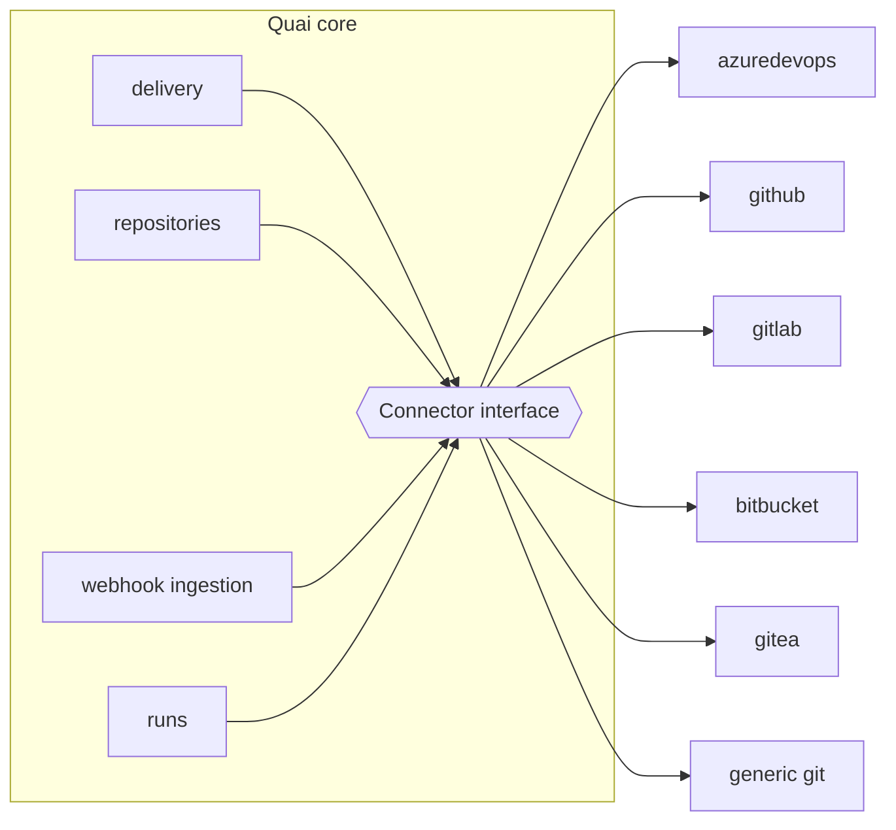
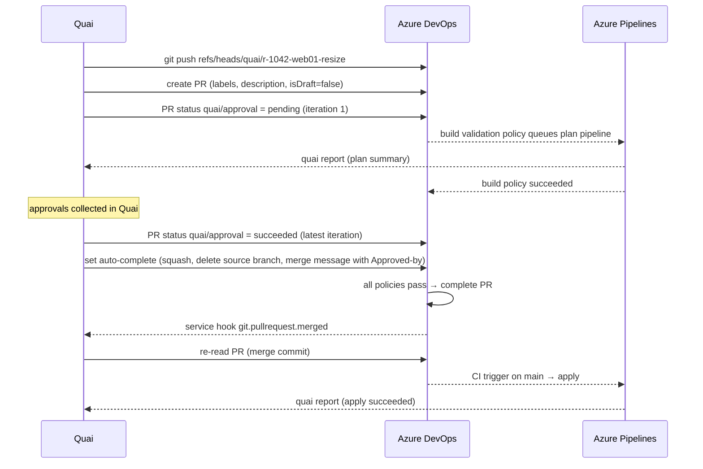

# Git connectors

Status: Draft · 2026-10-26 · Decision: [ADR 0010](../adr/0010-git-connectors-azure-devops-first.md)

A connector is everything Quai needs to work with one Git platform: authentication, pull requests,
statuses, branch policies, ownership rules, webhooks and, optionally, pipelines. Each platform
does these differently, so each gets its own connector behind one interface.

**Build order:** Azure DevOps first (the pilot's platform), then GitHub, then GitLab, then
Bitbucket. Gitea is built alongside Azure DevOps as the reference connector for tests.

## Architecture



- Connectors are Go packages compiled into the binary (`internal/connectors/<platform>`), not plugins. They hold credentials and make network calls, so they must be in-tree and security-reviewed. The WASM plugin sandbox is for generators only.
- Git transport (clone, fetch, push) is shared: the `git` CLI, with credentials supplied by the connector (HTTP header, SSH key, credential helper).
- Everything else goes through the platform API, behind the connector.

### Interface

The interface is split into capabilities. A connector reports which ones it supports, so the core
can degrade explicitly (for example, generic Git has no pull requests and supports direct delivery
only).

```go
type Connector interface {
    Info() Info // platform, edition, API version, capabilities

    GitAuth(ctx context.Context) (GitCredentials, error) // header, SSH key or helper for the git CLI

    PullRequests() PullRequests   // open, update, get, complete or merge, abandon, auto-complete
    Statuses() Statuses           // publish quai/approval; list other checks on a commit or PR
    Policies() Policies           // read branch protection or policies; verify enforcement
    Owners() Owners               // CODEOWNERS or the platform's path-based reviewer rules
    Webhooks() Webhooks           // subscribe, verify, parse into normalized events
    Pipelines() Pipelines         // optional: trigger runs (drift checks), read run status
    Identities() Identities       // map platform users to IdP users (by email or UPN)
}

type Capability string

const (
    CapPullRequests    Capability = "pull-requests"
    CapEnforcedStatus  Capability = "enforced-status"   // a required status only Quai can set
    CapAutoComplete    Capability = "auto-complete"     // the platform merges once policies pass
    CapMergeQueue      Capability = "merge-queue"
    CapSignedWebhooks  Capability = "signed-webhooks"
    CapPipelines       Capability = "pipelines"
    CapCodeOwnersFile  Capability = "codeowners-file"
)
```

### Normalized events

Webhook payloads differ per platform. Connectors turn them into a small set of internal events,
which the rest of Quai consumes:

| Event | Fields |
| --- | --- |
| `Push` | repository, ref, before, after, changed paths (when the payload has them) |
| `PullRequestChanged` | repository, PR id, action (opened, updated, completed, abandoned), head commit, source and target branches |
| `StatusChanged` | repository, PR id or commit, name, state, URL |
| `PolicyChanged` | repository, branch (for enforcement re-checks) |
| `PipelineRunChanged` | repository, pipeline, run id, state, result, commit |

**Webhooks are notifications, not truth.** After an event, Quai re-reads the pull request, status
or ref from the API before acting. A forged or replayed payload can at worst trigger an extra read.
This matters most on platforms that do not sign webhook payloads, Azure DevOps among them.

### Conformance suite

Every connector must pass one shared suite (`internal/connectors/conformance`), run against a real
instance of the platform:

1. Push a branch under `quai/`, open a PR, update it with a second commit.
2. Publish `quai/approval` pending, then succeeded; verify the platform shows it on the latest iteration or commit.
3. With enforcement configured, verify the PR cannot complete while the status is pending, and can once it succeeded.
4. Verify that a status published by another identity does not satisfy the policy (where the platform supports restricting it).
5. Complete or merge with each supported merge strategy; verify the merge commit and branch deletion.
6. Read branch protection and ownership rules; detect when enforcement is removed.
7. Receive and verify each webhook event type; reject a payload with a wrong secret.
8. Rate limiting: honour `Retry-After` and back off.

A connector ships when the suite passes against the platform editions the customer runs.

## Azure DevOps (first)

Covers Azure DevOps Services (cloud) and Azure DevOps Server (on-premises). The connector detects
which one it talks to and the highest REST API version the instance supports (for example 7.1 on
Services, 7.0 on Server 2022) and uses that.

### Library

`github.com/microsoft/azure-devops-go-api/azuredevops/v7` for the Git, Policy, Pipelines and
Service Hooks clients, wrapped in Quai's own thin client. Endpoints the SDK lacks or models
incorrectly are called through `net/http` in the same wrapper, so the rest of the code never sees
the difference.

### Authentication

| Instance | Recommended | Alternatives |
| --- | --- | --- |
| Services | **Microsoft Entra service principal** added to the organization, using workload identity federation from the cluster (no secret), or a certificate | Managed identity (when Quai runs on Azure); client secret; PAT as a last resort |
| Server | **PAT** of a dedicated service account, with expiry and rotation | Windows authentication (NTLM or Kerberos) if PATs are disabled |

- Entra tokens are requested with `azidentity` for the Azure DevOps resource (`499b84ac-1321-427f-aa17-267ca6975798/.default`) and refreshed before expiry.
- Git over HTTPS uses the same token as a bearer header (`http.extraHeader: Authorization: Bearer …`), so Git and API calls share one identity.
- PAT scopes when a PAT is used: Code (read and write), Code (status), and Build (read and execute) only if the pipeline features are used.

### Permissions

The registration access test verifies each one and reports what is missing.

| Where | Permission | Why |
| --- | --- | --- |
| Repository | Read, Contribute to pull requests | Read files, open and update PRs |
| Branch folder `refs/heads/quai/*` | Create branch, Contribute, Force push | Push and rebuild Quai's own branches only |
| Target branch (`main`) | Nothing beyond read | Quai never pushes to it; completion goes through the PR |
| Repository | **Not** "Bypass policies when completing pull requests" | Quai must be subject to the same policies as everyone |
| Project | View project-level information; read policy configurations | Verify enforcement |
| Project | Edit subscriptions (optional) | Create the service hook subscription automatically; otherwise a project admin creates it once |
| Pipelines | Queue builds (optional) | Trigger drift-check runs |

Restricting Quai to the `quai/` branch folder is done with branch-level security (in the UI, or
with the security REST API or `az devops security`). The registration wizard shows the exact
commands.

### Mapping Quai concepts to Azure DevOps

| Quai | Azure DevOps |
| --- | --- |
| Pull request | Pull request. Each push creates a new *iteration*. |
| `quai/approval` check | **PR status** with context `{genre: "quai", name: "approval"}`, posted on the latest iteration. States used: `pending`, `succeeded`, `failed`, `notApplicable` (stale). |
| Enforcement | **Branch policy "Status check"** on the target branch requiring `quai/approval`, with **authorized identity** set to Quai's identity and **"reset status whenever there are new changes"** enabled. A push to the PR branch then invalidates the status, which matches Quai's content-bound approvals. |
| `waitForChecks` | The other branch policies on the target branch: build validation, required reviewers, comment resolution, work item linking. Quai reads their state with the **policy evaluations** API for the PR. |
| Auto merge | **Auto-complete**: Quai sets auto-complete with its completion options once its status is succeeded; Azure DevOps completes the PR when every policy passes. With `merge: manual`, Quai only sets the status. |
| Merge methods | `squash`, `noFastForward` (merge commit), `rebase`, `rebaseMerge`; `deleteSourceBranch: true`; the merge commit message carries the `Approved-by:` trailers. |
| Labels | PR labels (`quai`, `env:prod`, `stack:envs/prod`). |
| CODEOWNERS | Azure Repos has **no CODEOWNERS file**. The equivalent is the **"Automatically included reviewers"** branch policy with path filters. The `codeowners` approver kind resolves to the reviewers of the policies whose path filters match the change. |
| Protecting `.quai/` | A required-reviewer policy with path filter `/.quai/*` on the target branch. Quai checks that one exists and warns if not. |
| Webhooks | **Service hook subscriptions** (Web Hooks consumer) for `git.push`, `git.pullrequest.created`, `git.pullrequest.updated` and `git.pullrequest.merged`, plus pipeline run state changes when runner features are used. |
| Webhook authentication | Azure DevOps does **not sign** service hook payloads. Quai uses a per-subscription secret in a custom HTTP header (or basic auth) over TLS, accepts hooks only on the dedicated webhook host name, and **re-reads every object from the API** before acting. |
| Pipelines | Build validation results come through policy evaluations; drift checks are triggered with the Pipelines **runs** API; run results arrive through service hooks or `quai report` (see [runs](06-runs-status-and-drift.md)). |
| Commit signing | Quai signs commits with its SSH or GPG key so history can be verified offline; Azure Repos does not display signature verification in its UI at the time of writing. |
| Identities | Commit author is the requester's email; Azure DevOps links it to the user when the email matches their account. PR "created by" is Quai's identity; the PR description names the requester. |
| Work items (optional) | Link the PR to a work item given by the requester or created per request, for organizations that track changes in Azure Boards. |

### Delivery sequence on Azure DevOps



### Azure DevOps specifics to handle

- **Throttling:** Azure DevOps throttles by resource usage and returns `Retry-After` and `X-RateLimit-*` headers. The client honours them and spreads polling.
- **Server versions:** API versions and some features (for example PR labels, auto-complete details) differ on older Server versions. The connector records the detected version and the conformance suite runs against each supported Server release.
- **Proxies and certificates:** on-premises Server often sits behind corporate TLS. Custom CA bundles and HTTP proxy settings apply to both API calls and `git`.
- **Large repositories:** Azure Repos supports partial clone; the mirror cache uses `--filter=blob:none`.

## GitHub (second)

| Concern | Approach |
| --- | --- |
| Library | `google/go-github`, `bradleyfalzon/ghinstallation` |
| Authentication | GitHub App installed on selected repositories; short-lived installation tokens for API and Git |
| `quai/approval` | Check run created by the app |
| Enforcement | Branch protection or repository ruleset requiring the check, **pinned to the Quai app** as expected source; Quai reads both protection and rulesets |
| Merge | Merge API, or auto-merge; merge queue when enabled |
| Ownership | `CODEOWNERS` file, parsed by the connector |
| Webhooks | App webhooks signed with HMAC-SHA256 (`X-Hub-Signature-256`) |
| Commits | Commits created through the API by the app are shown as verified |
| Editions | github.com and GitHub Enterprise Server (feature detection by version) |

## GitLab (third)

| Concern | Approach |
| --- | --- |
| Library | `gitlab.com/gitlab-org/api/client-go` |
| Authentication | Project or group access token for a bot user |
| `quai/approval` | Commit status (`quai/approval`) on the merge request's head |
| Enforcement | Depends on the edition: external status checks, a merge request approval rule requiring the Quai bot, or a protected branch where only the Quai bot may merge. Detected and verified at registration. |
| Merge | Merge API; auto-merge when the pipeline succeeds; merge trains where available |
| Ownership | `CODEOWNERS` file (parsed by the connector; code-owner approval enforcement depends on edition) |
| Webhooks | Secret token header (`X-Gitlab-Token`) |
| Editions | GitLab.com and self-managed; Free, Premium and Ultimate differ in enforcement features |

## Bitbucket, Gitea, generic

| Connector | Notes |
| --- | --- |
| Bitbucket Cloud and Data Center | REST over `net/http`; build statuses as `quai/approval`; required builds or merge checks for enforcement (edition-dependent). After GitLab. |
| Gitea and Forgejo | `code.gitea.io/sdk/gitea`; commit status; required status checks in branch protection. Built first alongside Azure DevOps because it runs in a container and anchors the conformance suite. |
| Generic Git | Git transport only; direct delivery; no enforcement. Quai shows "approvals not enforced" on every request. |
