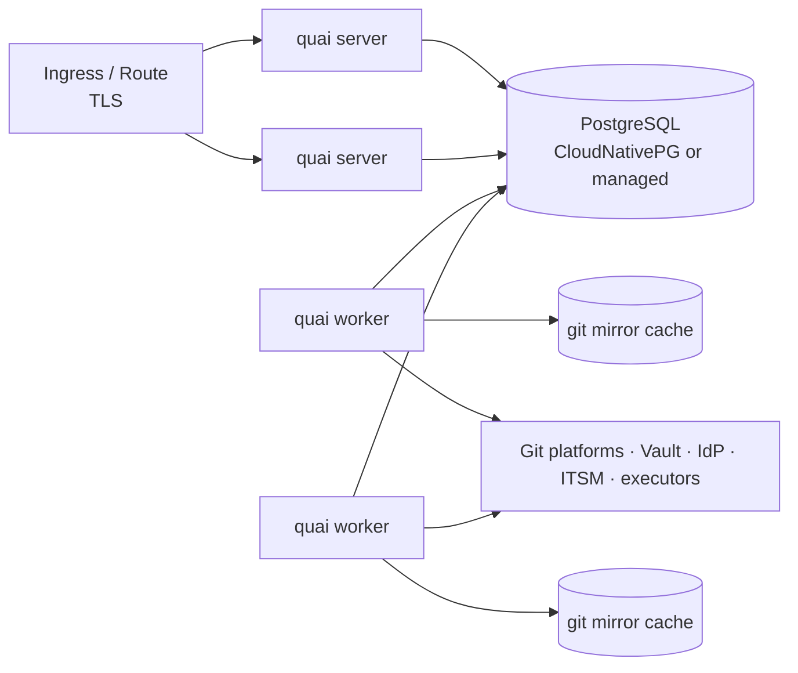

# Deployment and operations

Status: Draft · 2026-10-26

## Topology



| Process | Replicas | State |
| --- | --- | --- |
| `quai server` (API + static UI) | 2+ | None; sessions in PostgreSQL |
| `quai worker` (jobs, schedules) | 2+ | Git mirror cache on a volume per pod (rebuildable); can be `emptyDir` with a warm-up clone |
| PostgreSQL | Primary + replica | All operational state and the job queue |

One image, one binary; the role is a sub-command. Small installs can run a
single pod with both roles.

## Packaging

- **Image:** static Go binary on a distroless or UBI-minimal base, plus `git` and `openssh` (needed for transport). Non-root, read-only root file system, no shell in the distroless variant. Today (`Dockerfile`): Alpine with `git` and `openssh-client`, user 10001 in group 0 (OpenShift's arbitrary user ids run in it), the frontend's build embedded in the binary and served by `quai server` at every path the API and `/auth` do not answer, with a strict Content-Security-Policy and year-long caching of hashed assets. It runs with a read-only root file system given a writable `/tmp` and `/var/cache/quai` (the Git mirror cache). Base images are pinned by digest. CI builds the final stage without its layer cache, and that stage upgrades Alpine's packages, so each image has the fixes Alpine has that day, without waiting for a new base image. The Go dependencies compile in a layer of their own, cached while the packages the binaries import and `go.sum` do not change, so a commit compiles only Quai's packages. Each commit on `main` publishes it to `ghcr.io/damhau/quai` as `main`, `sha-<commit>` and `main-<commit time, UTC, YYYYMMDDHHMMSS>-<short commit>`, which sorts by date so that Argo CD Image Updater can follow `main`; the local stack's fake runner (the `fake-runner` target) is published with the same tags to `ghcr.io/damhau/quai-fake-runner`, for demo installations in a cluster.
- **Helm chart:** server and worker Deployments, PodDisruptionBudgets, HorizontalPodAutoscaler for the server, NetworkPolicies, ServiceMonitor, optional CloudNativePG `Cluster`, configuration via values and a mounted `quai.yaml`. Today (`deploy/helm/quai`, [below](#helm)): server and worker Deployments, the server's Service, PodDisruptionBudget and optional HorizontalPodAutoscaler, an optional Ingress, an optional PrometheusRule with the chart's alerts (`prometheusRule`, [observability](#observability)), `quai migrate` as a pre-install and pre-upgrade hook Job (it needs the database Secrets alone, so it runs before the release's other objects exist), the configuration from values (or from an existing Secret when repository URLs carry tokens), the database URL and OIDC client secret from existing Secrets, a Role that lets the pods read the Secrets that repository connections reference (`secretStore.kubernetes`, optionally restricted by name), and the outgoing network setup (`network`: an internal CA from a ConfigMap, the proxy variables). The migrations Job alone connects as the schema's owner, from a Secret of its own (`database.migrate`); the server and the worker never get it. Pods run non-root with a read-only root file system and no capabilities. CI lints it and checks the rendered objects against the Kubernetes schemas (the PrometheusRule against the Prometheus Operator's), and installs it on kind.
- **Local stack:** `docker compose up --build` runs the server, a worker, PostgreSQL (with the schema's owner, `quai`, which the `migrate` step connects as, and the application role, `quai_app`, which the server and the worker connect as) and Gitea, which a one-shot step seeds with `examples/gitops-repo` as `quai/infra-live` (a random password, and a token and a webhook secret Quai reads from a shared volume). Requests go through pull requests: `main` requires `quai/approval`, and Gitea's webhook reaches Quai's server. A fake runner stands in for the repository's pipelines: on Gitea's webhooks it reports a plan of each pull request and an apply of each push to `main` with `quai report`, so merged requests go through *Applying* to *Applied*. The development sign-in and its demo users are on; `QUAI_PORT`, `GITEA_PORT` and `FAKERUNNER_PORT` move the published ports.
- **OpenShift:** runs under the `restricted-v2` SCC with an arbitrary UID; a `Route` instead of an `Ingress`; UBI-based image variant.
- **Air-gapped:** an offline bundle (images, chart, `quai` CLI binaries for Linux, macOS and Windows) with checksums and signatures. Nothing is fetched at runtime: no CDNs, no fonts, no telemetry.
- **Configuration:** a YAML file, overridable by environment variables; secrets only as references (Vault, Kubernetes Secrets). Repository connections can be managed in the UI or declared in the configuration (GitOps for Quai itself).

  | Key | Environment variable | Default |
  | --- | --- | --- |
  | (file) | `QUAI_CONFIG`, or `quai server --config` | none: environment and defaults only |
  | `env` | `QUAI_ENV` | `development`; `production` refuses development-only features |
  | `server.addr` | `QUAI_SERVER_ADDR` | `:8080` |
  | `server.publicURL` | `QUAI_SERVER_PUBLIC_URL` | none: where people reach Quai, for the links to requests in pull requests and statuses; without it, pull requests name the request without a link |
  | `server.shutdownTimeout` | `QUAI_SERVER_SHUTDOWN_TIMEOUT` | `20s` for requests in flight to finish |
  | `database.url` | `QUAI_DATABASE_URL` | none. The application role the server and the worker connect as. Each process opens two pools of up to `pool_max_conns` connections (a URL parameter; by default the number of CPUs, at least four): one for its work, one for its advisory locks |
  | `database.migrateURL` | `QUAI_DATABASE_MIGRATE_URL` | `database.url`. The schema's owner, for `quai migrate` alone: it applies the migrations, then grants the role of `database.url` what the server and the worker need, the audit log to read and append only ([database roles](#database-roles)). Without it, or with the same role, the audit log is not protected, and `quai migrate`, the server and the audit log page say so |
  | `auth.mode` | `QUAI_AUTH_MODE` | `oidc`, or `dev` (the user switcher) in development only |
  | `auth.oidc.issuer`, `.clientID`, `.clientSecret`, `.redirectURL` | `QUAI_AUTH_OIDC_ISSUER`, `_CLIENT_ID`, `_CLIENT_SECRET`, `_REDIRECT_URL` | required for `oidc`; https in production |
  | `auth.oidc.scopes`, `.nameClaim`, `.groupsClaim` | | `openid profile email`, `preferred_username`, `groups` |
  | `auth.roles` | | `- { group: sg-quai-admins, role: platform-admin, scope: global }`; scope can be `team:`, `repository:` or `catalog-item:` and a name |
  | `auth.session.lifetime`, `.idleTimeout` | | `8h`, `30m` |
  | `git.cacheDir`, `git.committer` | `QUAI_GIT_CACHE_DIR` | the user cache directory; `Quai <quai@localhost>` |
  | `git.signingKey.ref` | `QUAI_GIT_SIGNING_KEY_REF` | none: Quai's commits are unsigned. A reference to an SSH private key (`k8s:quai/signing-key#ssh-privatekey`) Quai signs its commits with; see [verifying them](../design/05-delivery-and-approvals.md#merge) |
  | `repositories.path` | `QUAI_REPOSITORIES_PATH` | none: a YAML file, or a directory of them, holding `Repository` documents ([repository connections](../design/01-repository-connections.md#repository-connection)); reconciled into the database at start-up, read-only through the API |
  | `webhooks.host` | `QUAI_WEBHOOKS_HOST` | none: `/webhooks/{repository}` answers on every host. When set, only that host name answers webhooks, and it answers nothing else but run reports and `/healthz`, so it can be exposed to the Git platforms alone |
  | `network.caFile` | `QUAI_NETWORK_CA_FILE` | none: a PEM file of CA certificates trusted in addition to the system's (an internal CA), by Git and every HTTPS call Quai makes |
  | (proxy) | `HTTPS_PROXY`, `HTTP_PROXY`, `NO_PROXY` | none: the HTTP proxy for Git over HTTPS and every HTTP call; loopback addresses are never proxied |
  | `secrets.kubernetes.kubeconfig` | `QUAI_SECRETS_KUBECONFIG` | none: the cluster Quai runs in, or the default kubeconfig outside one. Where `k8s:namespace/name#key` references resolve; `env:NAME` references read Quai's environment |
  | `audit.retention` | `QUAI_AUDIT_RETENTION` | `8760h` (a year), at least `24h`. How long audit events are kept: `quai migrate` stores it, and the worker prunes older events up to a signed checkpoint ([retention](#retention-and-pruning)) |
  | `audit.checkpoints.signingKey.ref` | `QUAI_AUDIT_CHECKPOINTS_SIGNING_KEY_REF` | none: no checkpoint is signed, so nothing is pruned and a rewritten chain goes unnoticed; the worker warns. A reference to an Ed25519 private key in PEM (`k8s:quai/quai-audit-key#private.pem`) the worker signs a checkpoint with every hour ([the checkpoint key](#the-checkpoint-key)) |
  | `audit.checkpoints.previousKeys` | | none: the public keys (PEM) of the signing keys before a rotation, kept as long as the checkpoints they signed |
  | `audit.checkpoints.repository` | `QUAI_AUDIT_CHECKPOINTS_REPOSITORY` | none: the name of a repository connection, with delivery mode `direct`, the worker commits each checkpoint to ([the audit repository](#the-audit-repository)) |
  | `audit.export` | | none: the SIEMs the worker sends the audit log to, a list of destinations, each a `name` (lowercase letters, digits and `-`, the key of its cursor) and one of `syslog`, `otlp` and `splunk` ([exporting to a SIEM](#exporting-to-a-siem)) |
  | `audit.export[].syslog.address`, `.transport`, `.facility` | | required `host:port` (RFC 5425's port is 6514); `tls`, or `tcp`, unencrypted, which production refuses except to a loopback address; `13` (log audit) |
  | `audit.export[].otlp.endpoint`, `.headers` | | required: the collector's URL, `https`, its logs at `/v1/logs` unless it names a path; `http` only to a loopback address in production. Headers by name, each a secret reference (`{ ref: env:OTLP_TOKEN }`) |
  | `audit.export[].splunk.url`, `.token.ref`, `.index`, `.sourcetype` | | required: the HTTP Event Collector's base URL (`https://splunk.example.com:8088`), `http` only to a loopback address in production; required: a secret reference to the HEC token, a token without indexer acknowledgment; the token's default index; none |
  | `log.level` | `QUAI_LOG_LEVEL` | `info` (`debug`, `info`, `warn`, `error`) |
  | `log.format` | `QUAI_LOG_FORMAT` | `json` in production, `text` otherwise |
  | `telemetry.otlpEndpoint` | `QUAI_TELEMETRY_OTLP_ENDPOINT` | none: no traces are exported; traces go to `<url>/v1/traces` |
  | `telemetry.serviceName` | `QUAI_TELEMETRY_SERVICE_NAME` | `quai` |

  Unknown keys in the file are errors, and the configuration is validated before the server
  starts. Later tasks add their own keys.

### Helm

Before installing, create in the release's namespace the Secrets the chart reads: the
application role's database URL (`database.secretName`, key `url`), the schema owner's
(`database.migrate.secretName`, by default `quai-database-owner`, key `url`; [database
roles](#database-roles)) and, with OIDC, the client secret (`oidc.secretName`, key
`clientSecret`). Repository connections refer to their own Secrets (`k8s:<namespace>/<name>#<key>`),
which the release's Role can read. List them in `secretStore.kubernetes.secretNames`: without a
list, the pods may read every Secret of the namespace, the owner's too, and the chart's notes
warn about it.

```bash
helm install quai deploy/helm/quai -n quai -f my-values.yaml --wait   # migrations first, as a hook
helm upgrade quai deploy/helm/quai -n quai -f my-values.yaml --wait   # the same, before the new pods
```

CI installs the chart on a kind cluster on every change (`.github/workflows/kind.yml`), with the
image built from the commit and PostgreSQL in the cluster (`deploy/kind/fixtures.yaml`): install,
upgrade, every migration applied, the application role refused deleting audit events, then a
smoke test in the cluster (`deploy/kind/smoke.yaml`):
health, a development sign-in, a repository connected, and a run report whose token's hash Quai
reads from a Kubernetes Secret. Locally, the same commands (`kind`, `kubectl` and `helm` run
outside the agents' sandbox):

```bash
kind create cluster --name quai && docker build -t quai:kind . && kind load docker-image quai:kind --name quai
kubectl apply -f deploy/kind/fixtures.yaml && kubectl -n quai rollout status deploy/postgres
helm install quai deploy/helm/quai -n quai -f deploy/kind/values.yaml --wait
kubectl apply -f deploy/kind/smoke.yaml && kubectl -n quai wait --for=condition=complete job/smoke && kubectl -n quai logs job/smoke
kind delete cluster --name quai
```

### Database roles

Quai connects to PostgreSQL as two roles, so that the server and the worker cannot change or delete
audit events ([audit log](../design/09-security-and-compliance.md#audit-log), [open question
19](../plan/open-questions.md#still-open)):

- **The schema's owner** (`database.migrateURL`) owns the tables. Only `quai migrate` connects as
  it; it needs no superuser rights.
- **The application role** (`database.url`) is what the server and the worker connect as. It
  needs only `LOGIN`: after migrating, `quai migrate` grants it the schema's usage, `SELECT`,
  `INSERT`, `UPDATE` and `DELETE` on the tables, `SELECT` only on the migrations' records
  (`goose_db_version`, `river_migration`), `SELECT` and `INSERT` only on the audit tables
  (`audit_events`, `audit_personal`, `audit_checkpoints`; on `audit_events`, `INSERT` on every
  column but `recorded`, when the database recorded the event), `SELECT` only on the retention
  (`audit_retention`), and `EXECUTE` on `audit_prune()`, the owner's function that prunes
  ([retention](#retention-and-pruning)). It prints `<role> may read and append the audit log, and
  not change it`.

```sql
-- as an administrator, once
CREATE ROLE quai LOGIN PASSWORD '…';      -- the schema's owner
CREATE ROLE quai_app LOGIN PASSWORD '…';  -- the application role
CREATE DATABASE quai OWNER quai;
```

A new installation from a single role moves to two by creating the application role, setting
`database.migrateURL` to the old URL and `database.url` to the new role's, and running `quai
migrate` (the chart's upgrade does). Until then, `quai migrate` and the server log a warning, and
the audit log page says the database does not protect it.

### The audit log

The worker keeps the audit log ([design](../design/09-security-and-compliance.md#audit-log)):
every hour and when it stops, it signs a checkpoint of the latest event, commits it to the audit
repository and prunes what the retention lets go; every day it verifies the chain.

#### The checkpoint key

Checkpoints are signed with an Ed25519 key the worker reads from the secret store
(`audit.checkpoints.signingKey.ref`); verifying them needs only its public key. Generate it on a
machine you trust, store the private key, and keep only the public key:

```bash
openssl genpkey -algorithm ed25519 -out audit-key.pem
openssl pkey -in audit-key.pem -pubout -out audit-key.pub
kubectl -n quai create secret generic quai-audit-key --from-file=private.pem=audit-key.pem
shred -u audit-key.pem
```

```yaml
audit:
  checkpoints:
    signingKey: { ref: "k8s:quai/quai-audit-key#private.pem" }
```

Add `quai-audit-key` to `secretStore.kubernetes.secretNames` when the list is set. Quai never logs
the key and does not publish its public key: give `audit-key.pub` to the auditors, and keep it
where they can check it without Quai, such as a reviewed commit of a person in the audit
repository or the security team's records ([open question 35](../plan/open-questions.md#still-open)).
A key from the server that the log is about would prove nothing to them. Each checkpoint names
its key by the SHA-256 of the public key.

**Rotating it** (a schedule of the security team's, or a key that may have leaked): generate a new
key as above, in a new Secret; set `signingKey.ref` to it and add the old public key to
`previousKeys`, then upgrade. Checkpoints signed before still verify, with the old key, in the
worker and in `quai audit verify --key old.pub --key new.pub`. Keep the old public key as long as
the retention keeps a checkpoint it signed. A leaked key lets whoever holds it sign checkpoints:
with the application role, that prunes nothing the retention does not already let go; with the
owner's credentials too, they could rewrite the chain and sign it, which only the audit
repository's earlier checkpoints and the SIEM's export would show. Rotate a key that may have
leaked at once.

```yaml
audit:
  checkpoints:
    signingKey: { ref: "k8s:quai/quai-audit-key-2027#private.pem" }
    previousKeys:
      - |
        -----BEGIN PUBLIC KEY-----
        MCowBQYDK2VwAyEA…
        -----END PUBLIC KEY-----
```

#### The audit repository

`audit.checkpoints.repository` names a repository connection the worker commits each new
checkpoint to, as `checkpoints/YYYY/MM/DD/<seq>.json`: a copy outside the database, timestamped by
the platform, that a restored or rewritten database cannot change. Connect a repository of its own
with `delivery: { mode: direct }` and a credential that can push to its branch, and protect the
branch against force pushes and deletion; the platform's history then dates each checkpoint.
When the repository cannot be reached, the next hour commits the latest checkpoint. The daily verification reads
the checkpoint of the highest `seq` in it; `quai audit verify --anchors` reads them all.

#### Retention and pruning

`audit.retention` (a year by default) is how long events are kept. `quai migrate` stores it in the
database, as the schema's owner, so it takes effect at the next migration (the chart's upgrade),
and the application role cannot shorten it. Every hour the worker calls `audit_prune()`: it
deletes the events before the latest checkpoint whose hash is its event's and whose event the
database recorded longer than the retention ago, with their personal data and the checkpoints
before it, and records an `audit.pruned` event. An event's age is the database's clock when it
inserted the event (`recorded`), not the time the event states, which the application writes.
Events written before the version that added `recorded` count from the upgrade to it. The kept checkpoint is where the chain starts from: verification
accepts a log that starts at a signed checkpoint only when an `audit.pruned` event names it.
Without a signing key, nothing is pruned. Longer periods (often 10 years for financial
institutions) need nothing else than a longer retention; the SIEM's export is the long-term
record.

**Pseudonymizing a person** (a request to erase their personal data) deletes their clear values
from `audit_personal`; their events keep the pseudonyms, and the chain still verifies. As the
schema's owner, delete the rows whose value is their name, their emails and their addresses
([open question 39](../plan/open-questions.md#still-open)):

```sql
DELETE FROM audit_personal WHERE value IN ('alice', 'alice@example.com');
```

The audit log page then shows "(erased)" where they were.

#### Verifying the log

The worker verifies the chain every day, from the database and the latest checkpoint in the audit
repository: it records `audit.verified` or `audit.broken` in the log, counts it in
`quai.audit.verifications` (`outcome`: `ok`, `broken`, `error`), logs an error when the chain
breaks, and the audit log page shows the last outcome, a banner when it broke. Alert on an outcome
other than `ok`, and on no `ok` for more than 25 hours.

Auditors verify it offline, with nothing from Quai but an export of the log:

```bash
quai audit export --config quai.yaml -o audit.jsonl   # as database.url; or the Export button of the audit log page (GET /api/v1/audit/export)
git clone <audit repository> audit-checkpoints
quai audit verify --key audit-key.pub --anchors audit-checkpoints audit.jsonl
```

The export holds the checkpoints and the events, with personal data as pseudonyms. `quai audit
verify` checks each event's hash, each link to the event before, each checkpoint's signature and
that its hash is its event's, and the audit repository's checkpoints too: one beyond the export's
last event means events were lost. It prints what it verified, or names the first `seq` where the
log fails and why, and exits with status 1.

#### When the chain does not verify

An alert, a banner on the audit log page, or an auditor's check. The audit log's events are
evidence: do not repair or delete them, and change nothing in the database or the audit
repository until the cause is known.

1. **Keep the evidence**: export the log now (`quai audit export -o`), and clone the audit
   repository.
2. **Reproduce it offline** with every public key, old ones too: `quai audit verify --key …
   --anchors <clone> audit.jsonl`. It names the first `seq` that fails and why.
3. **Read the reason**:

   | Reason | What happened |
   | --- | --- |
   | `signed with key …, which was not given` | A key rotated without its public key in `previousKeys` (or `--key`): add it. Not an incident, if the key is yours |
   | `its hash is not the hash of its content` | The event was changed |
   | `the event is missing or out of order`, `comes again or out of order`, `its prev is not the hash of the event before it` | An event was deleted, inserted or moved |
   | `its hash is not the one the checkpoint signed` | The chain was rewritten after the checkpoint: changed events with their hashes recomputed |
   | `its signature does not verify` | A checkpoint was forged or changed, in the database or the audit repository |
   | `the log starts at the checkpoint at seq …, but no audit.pruned event…`, `the log starts at seq …, with no signed checkpoint of it` | The first events were deleted, not pruned |
   | `the log ends at seq …, but a checkpoint … says it reached seq …` | The last events are gone: a database restored from a backup older than the checkpoint, or deleted |

4. **Otherwise, treat it as a security incident**. Find when the log changed from the database's
   own logs, its backups and the SIEM's export (which has the events as they were sent); check
   that the server and the worker connect as the application role (the server logs a warning at
   start otherwise) and who holds the owner's credentials and the checkpoint key. The events
   before the break still verify, and so do those after it from the broken event's hash.

**After a restore from backup**, the events between the backup and the restore are lost, and the
audit repository's checkpoints after the backup say so: the daily verification fails until the
log has grown past them and a new checkpoint is committed, and `quai audit verify` with the whole
repository keeps failing there.
That is the record of the restore: write it in the incident report, with the SIEM's copy of the
lost events, and verify the log since then with the checkpoints after the restore (`--anchors`
naming their files). The restored cursors make the export send again the `seq` the SIEM already
has from the lost events, with other hashes, and the worker logs `the audit log changed after it
was exported`: keep both in the SIEM.

#### Exporting to a SIEM

`audit.export` lists the SIEMs the worker sends the audit log to, at least once and in order: a
destination that was down or refused a batch gets it again at the next run, 30 seconds later, and
catches up with no gap. A record is the event as `quai audit export` writes it, with its `seq` and
`hash` and personal data as pseudonyms ([what is sent](../design/09-security-and-compliance.md#export-to-a-siem)):
de-duplicate on `seq`, and alert in the SIEM on a gap in it.

```yaml
audit:
  export:
    - name: siem                                    # its cursor's key: renaming it sends everything again
      syslog: { address: "siem.example.com:6514" } # RFC 5424 over TLS, octet counting
    - name: otel
      otlp:
        endpoint: https://otel-collector.example.com:4318
        headers: { Authorization: { ref: "k8s:quai/quai-otlp#authorization" } }
    - name: splunk
      splunk: { url: "https://splunk.example.com:8088", token: { ref: "k8s:quai/quai-splunk#token" }, index: audit, sourcetype: "quai:audit" }
```

- Certificates are verified against the image's CAs and `network.caFile`, with no way to turn
  that off: an internal CA goes in `network.caFile` (the chart's `network.caBundle`). Syslog
  connects directly, not through the proxy; OTLP and HEC go through it.
- The syslog receiver must accept octet-counted messages larger than 2 KiB (a request's event
  carries its change set) and close the connection once the worker has closed its side: until
  it does, the batch does not count as delivered.
- The HEC token must not require indexer acknowledgment, which Quai does not ask for.
- A new destination starts with the oldest event the database holds; events pruned before a
  destination took them are lost to it, and the worker logs an error.

The worker counts each run in `quai.audit.exports` (`destination`, `outcome`: `ok` or `error`),
logs a warning when one fails, and reports each destination's lag: `quai.audit.export.lag`, in
seconds, since the database recorded the oldest event the destination has not taken (0 when it
has them all), and `quai.audit.export.pending`, how many there are. The chart's
`QuaiAuditExportLagging` alert fires when a lag stays above 10 minutes for 5 minutes.

#### When the audit export lags

`QuaiAuditExportLagging`, or a SIEM missing recent events. Nothing is lost while the events are
in the database: the export resumes where the destination's cursor is, once it can.

1. **Read the worker's warnings** for the destination: `the audit export failed`, with the error.
2. **By error**:

   | Error | What to do |
   | --- | --- |
   | `connection refused`, `i/o timeout`, `no such host` | The receiver is down or unreachable: its state, the network path (syslog does not use the proxy), `NO_PROXY` for an HTTP destination reached directly |
   | `certificate signed by unknown authority`, `certificate is valid for …` | Its certificate is not signed by a CA in `network.caFile`, or does not name the address configured |
   | `the receiver did not close the connection after reading the messages` | A syslog receiver that resets the connection or never closes it: one that rejects messages too large, or not octet-counted |
   | `the collector answered 4xx`, `HEC answered 4xx: "Invalid token"`, `"Incorrect index"`, `"Token disabled"` | The credential or the index: the secret the reference names, the token's allowed indexes |
   | `the collector answered 5xx`, `HEC answered 503: "Server is busy"`, `429` | The SIEM is overloaded: it catches up once it takes events again |
   | `the collector rejected n of m records` | The collector dropped records it took (an OTLP partial success): they are not sent again; its own logs say why |
   | `answered 3xx` | The URL redirects, which Quai does not follow: configure the address it redirects to |

3. **A lag that keeps growing while runs succeed** means the destination takes the events more
   slowly than they are recorded: `quai.audit.export.pending` grows. A run sends 500 events at a
   time for at most a minute every 30 seconds.
4. **Before the retention runs out**, the oldest pending event is pruned and the destination
   never gets it (the worker logs `audit events were pruned before they were exported`). If the
   lag nears `audit.retention`, keep an export of the log (`quai audit export -o`) for the SIEM.

`the audit log changed after it was exported`, an error, means the event after the last one a
destination took does not link to it: the database was restored from an older backup, or the log
rewritten. Follow [when the chain does not verify](#when-the-chain-does-not-verify).

### Runners

Pipelines report their plans and applies with `quai report`, a step after `terraform plan` and
after `terraform apply` ([runs](../design/06-runs-status-and-drift.md#run-report-protocol)). It
needs three variables: `QUAI_URL`, `QUAI_REPOSITORY` (the repository's name in Quai) and
`QUAI_RUN_TOKEN`, the repository's run token (`POST /api/v1/repositories/{name}/run-token`,
shown once), kept as a secret variable; `QUAI_RUN_TOKEN_FILE` can name a file that holds it
instead, and `QUAI_CA_FILE` a PEM file for an internal CA. The commit, the pull request and the
run's page come from Azure Pipelines, GitHub Actions or GitLab CI (`--commit`, `--pull-request`
and `--url` elsewhere). A report Quai refuses fails the step. The image runs it as a container
step. In Azure Pipelines, after `terraform show -json tfplan > plan.json`:

```yaml
- bash: |
    docker run --rm -v "$PWD:/work:ro" -w /work \
      -e QUAI_URL -e QUAI_REPOSITORY -e QUAI_RUN_TOKEN -e TF_BUILD -e BUILD_SOURCEVERSION -e BUILD_BUILDID \
      -e SYSTEM_COLLECTIONURI -e SYSTEM_TEAMPROJECT -e SYSTEM_PULLREQUEST_PULLREQUESTID \
      ghcr.io/damhau/quai:main report --stack envs/prod --kind plan --status succeeded --plan plan.json
  env:
    QUAI_RUN_TOKEN: $(quaiRunToken) # a secret variable
```

The same with `-e GITHUB_ACTIONS -e GITHUB_SHA -e GITHUB_REF -e GITHUB_SERVER_URL -e
GITHUB_REPOSITORY -e GITHUB_RUN_ID -e GITHUB_RUN_ATTEMPT` in GitHub Actions; in GitLab CI, a job
with `image: { name: ghcr.io/damhau/quai:main, entrypoint: [""] }` runs `quai report …` directly.
A step that runs when the plan or apply fails reports `--status failed`.

`deploy/runners/` holds them ready-made, each file saying how to use it:

| File | For |
| --- | --- |
| `azure-pipelines/quai-report.yml` | A step template (`- template: deploy/runners/azure-pipelines/quai-report.yml@quai`): it reports how the job went, after a plan (with its `plan.json`) or an apply. `examples/gitops-repo/pipelines/` plans and applies with it |
| `github-actions/action.yml` | A composite action (`uses: damhau/quai/deploy/runners/github-actions@main`) |
| `gitlab-ci/quai-report.yml` | A job template to `include` and `extends: .quai-report` |
| `argocd/notifications.yaml` | Argo CD's notifications: each sync of a subscribed Application posted as a `sync` run, with the repository and the stack from its annotations |
| `flux/alert.yaml` | Flux's notification controller: a generic provider posting the events of the Kustomizations an Alert follows to `/api/v1/runs/flux` |

### Onboarding an Azure DevOps repository

Rehearsed in P2-13 on a stand-in for the pilot (`pilot-infra` in the sandbox organization: VM
files in `vms/<env>/`, a Terraform stack per environment in `stacks/<env>/`), in this order:

1. **Policies on the default branch.** A *Status check* requiring `quai/approval`, from Quai's
   identity only and reset when the source branch changes (Quai's
   [enforcement](../design/05-delivery-and-approvals.md)); *Build validation* by the plan
   pipeline; *Automatically included reviewers* for `/.quai/*`, the platform owners, so that the
   definitions change only through their review (trust). No minimum number of reviewers:
   approvals are Quai's, and the pull requests Quai opens complete once `quai/approval` and the
   build pass. The status check goes last if the onboarding pull requests below are to complete
   without a policy bypass.
2. **The type, in a pull request the platform owners merge.** `.quai/types/<type>.yaml` and its
   JSON Schema, written from the repository's files and the Terraform variables they feed: the
   schema follows the variables' validations, `locate`, `stack` and `address` follow the stacks.
   `quai lint <dir>` loads them and checks every file; `quai lint --plan plan.json --stack <stack>
   <dir>`, on the plan of a change, checks that every Terraform resource it changes belongs to
   exactly one resource. A type that writes part of another's entries (a `field` type, such as a
   quota) needs Terraform resources of its own: two types claiming one resource is a problem.
3. **`quai lint` in the plan pipeline**, before the plan and, with `--plan` and `--stack`, after
   each stack's plan, from the image pinned to a commit (`ghcr.io/damhau/quai:sha-<commit>`).
4. **`quai report` after each plan and apply** ([runners](#runners)), with the condition
   `and(always(), ne(variables['quaiUrl'], ''))` until the agents can reach Quai.
5. **The repository connection**: `connector: azure-devops`, the repository's URL, a PAT with
   Code (read and write), Pull Request Threads (read and write) and Build (read and execute),
   `delivery: { mode: pull-request, merge: auto }`, and `runner.pipelines` naming the plan and
   apply pipelines with the stacks they cover.

Pull requests people open after the status check (another type, a module, the pipelines) need
`quai/approval` too, which Quai posts only on its own: until
[open question 16](../plan/open-questions.md#still-open) is answered, the platform owners complete
them with a policy bypass. The pilot's next types (P3-19: namespaces and quotas, DNS records,
firewall rules, in `examples/pilot-infra`) wait on it on `pilot-infra`, as !407 to !410.

What reaches Quai depends on the network. Quai reaching Azure DevOps Services and polling it is
enough to request, approve and merge; to read pull requests' build validation runs as plans
(their state, without the plan's details); and to read the apply and drift-check pipelines'
runs, so that merged requests settle and drift checks finish, at the next poll. The plan's
details, and results within seconds, need the service hooks
(`ms.vss-pipelines.run-state-changed-event`) or the `quai report` step to reach Quai: from
Microsoft-hosted agents and from Services, over the internet (`webhooks.host`); from self-hosted
agents, inside the network.

## Network

Egress needed, all configurable through an HTTP proxy (`HTTPS_PROXY`, `NO_PROXY`), with an internal CA trusted through `network.caFile`:

| Destination | Why |
| --- | --- |
| Git platforms (HTTPS or SSH) | Fetch, push, platform API: `dev.azure.com` for Azure DevOps Services; the Azure DevOps Server URL (internal, often with an internal CA) once Server is supported |
| Microsoft Entra ID (`login.microsoftonline.com`) | Quai's own user login (OIDC; the pilot's IdP), and tokens for Azure DevOps Services and Azure Key Vault. Not needed for Azure DevOps Server itself |
| Microsoft Graph (`graph.microsoft.com`) | Only if group memberships must be resolved beyond what the token carries (see [identity](../design/08-identity-access-tenancy.md#directory)) |
| IdP | OIDC discovery, token exchange, JWKS |
| Secret store | Credentials |
| SIEMs (`audit.export`) | The audit log's export: syslog over TLS straight to the receiver, never through the proxy; OTLP and Splunk HEC over HTTPS |
| ITSM, chat | Optional integrations |
| Executors (Kubernetes API, AWX, vCenter) | Imperative actions |

Ingress: users and CLI (HTTPS), Git platform webhooks (Azure DevOps service hooks; on Server this needs a firewall path from the Server to Quai, otherwise Quai runs in polling mode), runner reports. Webhook
and run-report endpoints can be exposed on a separate host name for firewalling (`webhooks.host`).

## Scale targets

Sized for a large enterprise installation:

| Dimension | Target |
| --- | --- |
| Connected repositories | 500 |
| Resources in inventory | 100,000 |
| Requests per day | 2,000 |
| Concurrent users | 500 |

| SLO | Target |
| --- | --- |
| API latency (p95, excluding plan) | < 300 ms |
| Plan latency for a single-file change (p95) | < 2 s |
| Submit to PR opened (p95) | < 30 s |
| Webhook received to state updated (p95) | < 10 s |
| Availability (monthly) | 99.9 % |

Work on one repository is serialized (fetch, rebuild branches, merge) with a
PostgreSQL advisory lock per repository; jobs that cannot get the lock are
snoozed and retried. Different repositories proceed in parallel.

## Observability

- **Logs:** structured JSON (`log/slog`), one line per request and per job with request ID, job ID, repository and duration. No bodies, tokens or credentials.
- **Traces:** OpenTelemetry across HTTP handlers, database queries, jobs, `git` subprocesses and connector API calls; exported over OTLP.
- **Metrics** (OpenTelemetry, exported over OTLP with the traces to `telemetry.otlpEndpoint`; a collector's Prometheus exporter serves them to Prometheus):
  - request lead time (submit → applied), approval wait time, PR open → merge time;
  - plan, submit and merge failures by reason;
  - job queue depth, job latency and failures by kind;
  - `git` operation duration and failures by repository;
  - webhook lag and last delivery per repository;
  - credential days-to-expiry; repositories without enforced branch protection;
  - audit checkpoints signed (`quai.audit.checkpoints`, by outcome) and verifications of the audit
    log (`quai.audit.verifications`: `ok`, `broken`, `error`);
  - the audit log's export, by destination: runs (`quai.audit.exports`, by outcome), the lag
    (`quai.audit.export.lag`, seconds) and the events pending (`quai.audit.export.pending`). Every
    worker reports the same lag, read from the database.
- **Dashboards and alerts** shipped with the chart: no webhook from a repository for 1 h while pushes happen, enforcement missing, credential expiring within 14 days, job failure rate above threshold, audit export lagging.
  Today the chart ships `QuaiAuditExportLagging` (`max by (destination) (quai_audit_export_lag_seconds)`
  above `prometheusRule.auditExportLag.seconds`, 600, for `.for`, 5m) in a PrometheusRule of the
  Prometheus Operator, with `prometheusRule.enabled` and the labels its `ruleSelector` matches in
  `prometheusRule.labels`. The names are those a collector's Prometheus exporter gives the
  metrics: `quai.audit.export.lag` becomes `quai_audit_export_lag_seconds`.

## Backup and disaster recovery

| Data | Backup | Recovery |
| --- | --- | --- |
| PostgreSQL | Continuous WAL archiving and daily base backups (CloudNativePG / pgBackRest) to object storage | Point-in-time restore |
| Audit log | Also exported continuously to the SIEM; signed checkpoints, committed to the audit repository | Verify with `quai audit verify` ([after a restore](#when-the-chain-does-not-verify)) |
| Git mirrors | None needed | Re-clone |
| Desired state | Lives in customer Git | — |

Targets: RPO 5 minutes, RTO 1 hour. After a restore, a reconciliation job
re-indexes every repository from Git and re-reads open pull requests, so
nothing that happened in Git during the outage is lost. A restore drill runs
before GA and twice a year.

## Upgrades

- Database migrations (goose) run as a pre-upgrade Helm hook; migrations are backwards-compatible for one release so rolling upgrades work.
- Definition schema versions (`v1beta1` → `v1`) are converted on read; `quai lint --upgrade` rewrites them in a pull request.
- Feature flags for risky features, per installation.

## Runbooks

Shipped with the docs, one per alert: webhook silence, enforcement missing,
credential expired, stuck request, stale request storm after a large base
change, job queue backlog, audit chain verification failure and audit export lagging (the
first ones, in the audit log's section: [when the chain does not
verify](#when-the-chain-does-not-verify) and [when the audit export
lags](#when-the-audit-export-lags)), restore from backup, rotating the
commit-signing key and [the checkpoint key](#the-checkpoint-key), break-glass review.
