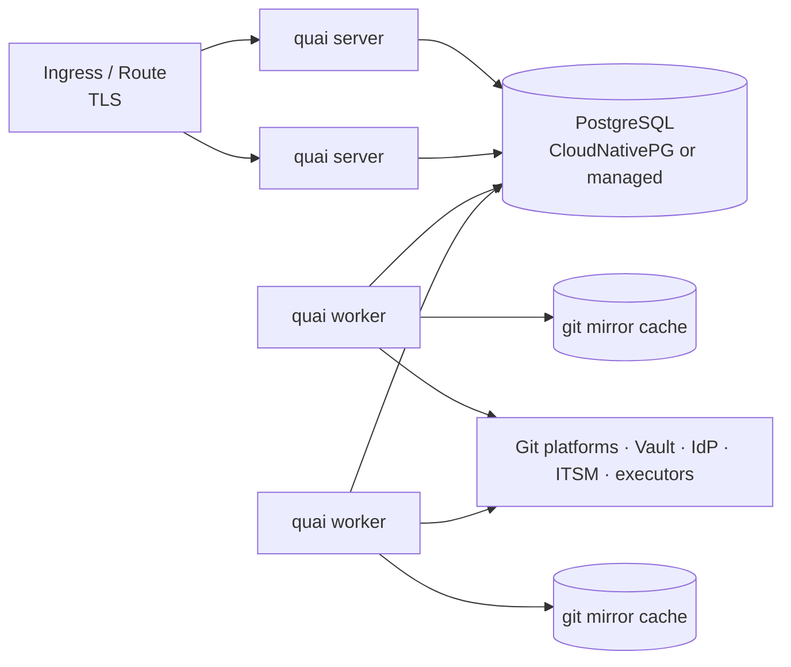

# Deployment and operations

Status: Draft · 2026-10-26

## Topology



| Process | Replicas | State |
| --- | --- | --- |
| `quai server` (API + static UI) | 2+ | None; sessions in PostgreSQL |
| `quai worker` (jobs, schedules) | 2+ | Git mirror cache on a volume per pod (rebuildable); can be `emptyDir` with a warm-up clone |
| PostgreSQL | Primary + replica | All operational state and the job queue |

One image, one binary; the role is a sub-command. Small installs can run a
single pod with both roles.

## Packaging

- **Image:** static Go binary on a distroless or UBI-minimal base, plus `git` and `openssh` (needed for transport). Non-root, read-only root file system, no shell in the distroless variant. Today (`Dockerfile`): Alpine with `git` and `openssh-client`, user 10001 in group 0 (OpenShift's arbitrary user ids run in it), the frontend's build embedded in the binary and served by `quai server` at every path the API and `/auth` do not answer, with a strict Content-Security-Policy and year-long caching of hashed assets. It runs with a read-only root file system given a writable `/tmp` and `/var/cache/quai` (the Git mirror cache). Base images are pinned by digest.
- **Helm chart:** server and worker Deployments, PodDisruptionBudgets, HorizontalPodAutoscaler for the server, NetworkPolicies, ServiceMonitor, optional CloudNativePG `Cluster`, configuration via values and a mounted `quai.yaml`. Today (`deploy/helm/quai`, [below](#helm)): server and worker Deployments, the server's Service, PodDisruptionBudget and optional HorizontalPodAutoscaler, an optional Ingress, `quai migrate` as a pre-install and pre-upgrade hook Job (it needs the database Secret alone, so it runs before the release's other objects exist), the configuration from values (or from an existing Secret when repository URLs carry tokens), the database URL and OIDC client secret from existing Secrets, a Role that lets the pods read the Secrets that repository connections reference (`secretStore.kubernetes`, optionally restricted by name), and the outgoing network setup (`network`: an internal CA from a ConfigMap, the proxy variables). Pods run non-root with a read-only root file system and no capabilities. CI lints it and checks the rendered objects against the Kubernetes schemas, and installs it on kind.
- **Local stack:** `docker compose up --build` runs the server, a worker, PostgreSQL and Gitea, which a one-shot step seeds with `examples/gitops-repo` as `quai/infra-live` (a random password, and a token and a webhook secret Quai reads from a shared volume). Requests go through pull requests: `main` requires `quai/approval`, and Gitea's webhook reaches Quai's server. The development sign-in and its demo users are on; `QUAI_PORT` and `GITEA_PORT` move the published ports.
- **OpenShift:** runs under the `restricted-v2` SCC with an arbitrary UID; a `Route` instead of an `Ingress`; UBI-based image variant.
- **Air-gapped:** an offline bundle (images, chart, `quai` CLI binaries for Linux, macOS and Windows) with checksums and signatures. Nothing is fetched at runtime: no CDNs, no fonts, no telemetry.
- **Configuration:** a YAML file, overridable by environment variables; secrets only as references (Vault, Kubernetes Secrets). Repository connections can be managed in the UI or declared in the configuration (GitOps for Quai itself).

  | Key | Environment variable | Default |
  | --- | --- | --- |
  | (file) | `QUAI_CONFIG`, or `quai server --config` | none: environment and defaults only |
  | `env` | `QUAI_ENV` | `development`; `production` refuses development-only features |
  | `server.addr` | `QUAI_SERVER_ADDR` | `:8080` |
  | `server.publicURL` | `QUAI_SERVER_PUBLIC_URL` | none: where people reach Quai, for the links to requests in pull requests and statuses; without it, pull requests name the request without a link |
  | `server.shutdownTimeout` | `QUAI_SERVER_SHUTDOWN_TIMEOUT` | `20s` for requests in flight to finish |
  | `database.url` | `QUAI_DATABASE_URL` | none; `quai migrate` applies the migrations |
  | `auth.mode` | `QUAI_AUTH_MODE` | `oidc`, or `dev` (the user switcher) in development only |
  | `auth.oidc.issuer`, `.clientID`, `.clientSecret`, `.redirectURL` | `QUAI_AUTH_OIDC_ISSUER`, `_CLIENT_ID`, `_CLIENT_SECRET`, `_REDIRECT_URL` | required for `oidc`; https in production |
  | `auth.oidc.scopes`, `.nameClaim`, `.groupsClaim` | | `openid profile email`, `preferred_username`, `groups` |
  | `auth.roles` | | `- { group: sg-quai-admins, role: platform-admin, scope: global }`; scope can be `team:`, `repository:` or `catalog-item:` and a name |
  | `auth.session.lifetime`, `.idleTimeout` | | `8h`, `30m` |
  | `git.cacheDir`, `git.committer` | `QUAI_GIT_CACHE_DIR` | the user cache directory; `Quai <quai@localhost>` |
  | `git.signingKey.ref` | `QUAI_GIT_SIGNING_KEY_REF` | none: Quai's commits are unsigned. A reference to an SSH private key (`k8s:quai/signing-key#ssh-privatekey`) Quai signs its commits with; see [verifying them](../design/05-delivery-and-approvals.md#merge) |
  | `repositories.path` | `QUAI_REPOSITORIES_PATH` | none: a YAML file, or a directory of them, holding `Repository` documents ([repository connections](../design/01-repository-connections.md#repository-connection)); reconciled into the database at start-up, read-only through the API |
  | `webhooks.host` | `QUAI_WEBHOOKS_HOST` | none: `/webhooks/{repository}` answers on every host. When set, only that host name answers webhooks, and it answers nothing else but run reports and `/healthz`, so it can be exposed to the Git platforms alone |
  | `network.caFile` | `QUAI_NETWORK_CA_FILE` | none: a PEM file of CA certificates trusted in addition to the system's (an internal CA), by Git and every HTTPS call Quai makes |
  | (proxy) | `HTTPS_PROXY`, `HTTP_PROXY`, `NO_PROXY` | none: the HTTP proxy for Git over HTTPS and every HTTP call; loopback addresses are never proxied |
  | `secrets.kubernetes.kubeconfig` | `QUAI_SECRETS_KUBECONFIG` | none: the cluster Quai runs in, or the default kubeconfig outside one. Where `k8s:namespace/name#key` references resolve; `env:NAME` references read Quai's environment |
  | `log.level` | `QUAI_LOG_LEVEL` | `info` (`debug`, `info`, `warn`, `error`) |
  | `log.format` | `QUAI_LOG_FORMAT` | `json` in production, `text` otherwise |
  | `telemetry.otlpEndpoint` | `QUAI_TELEMETRY_OTLP_ENDPOINT` | none: no traces are exported; traces go to `<url>/v1/traces` |
  | `telemetry.serviceName` | `QUAI_TELEMETRY_SERVICE_NAME` | `quai` |

  Unknown keys in the file are errors, and the configuration is validated before the server
  starts. Later tasks add their own keys.

### Helm

Before installing, create in the release's namespace the Secrets the chart reads: the database URL
(`database.secretName`, key `url`) and, with OIDC, the client secret (`oidc.secretName`, key
`clientSecret`). Repository connections refer to their own Secrets (`k8s:<namespace>/<name>#<key>`),
which the release's Role can read (`secretStore.kubernetes.secretNames` restricts it to those).

```bash
helm install quai deploy/helm/quai -n quai -f my-values.yaml --wait   # migrations first, as a hook
helm upgrade quai deploy/helm/quai -n quai -f my-values.yaml --wait   # the same, before the new pods
```

CI installs the chart on a kind cluster on every change (`.github/workflows/kind.yml`), with the
image built from the commit and PostgreSQL in the cluster (`deploy/kind/fixtures.yaml`): install,
upgrade, every migration applied, then a smoke test in the cluster (`deploy/kind/smoke.yaml`):
health, a development sign-in, a repository connected, and a run report whose token's hash Quai
reads from a Kubernetes Secret. Locally, the same commands (`kind`, `kubectl` and `helm` run
outside the agents' sandbox):

```bash
kind create cluster --name quai && docker build -t quai:kind . && kind load docker-image quai:kind --name quai
kubectl apply -f deploy/kind/fixtures.yaml && kubectl -n quai rollout status deploy/postgres
helm install quai deploy/helm/quai -n quai -f deploy/kind/values.yaml --wait
kubectl apply -f deploy/kind/smoke.yaml && kubectl -n quai wait --for=condition=complete job/smoke && kubectl -n quai logs job/smoke
kind delete cluster --name quai
```

### Runners

Pipelines report their plans and applies with `quai report`, a step after `terraform plan` and
after `terraform apply` ([runs](../design/06-runs-status-and-drift.md#run-report-protocol)). It
needs three variables: `QUAI_URL`, `QUAI_REPOSITORY` (the repository's name in Quai) and
`QUAI_RUN_TOKEN`, the repository's run token (`POST /api/v1/repositories/{name}/run-token`,
shown once), kept as a secret variable; `QUAI_RUN_TOKEN_FILE` can name a file that holds it
instead, and `QUAI_CA_FILE` a PEM file for an internal CA. The commit, the pull request and the
run's page come from Azure Pipelines, GitHub Actions or GitLab CI (`--commit`, `--pull-request`
and `--url` elsewhere). A report Quai refuses fails the step. The image runs it as a container
step. In Azure Pipelines, after `terraform show -json tfplan > plan.json`:

```yaml
- bash: |
    docker run --rm -v "$PWD:/work:ro" -w /work \
      -e QUAI_URL -e QUAI_REPOSITORY -e QUAI_RUN_TOKEN -e TF_BUILD -e BUILD_SOURCEVERSION -e BUILD_BUILDID \
      -e SYSTEM_COLLECTIONURI -e SYSTEM_TEAMPROJECT -e SYSTEM_PULLREQUEST_PULLREQUESTID \
      ghcr.io/damhau/quai:main report --stack envs/prod --kind plan --status succeeded --plan plan.json
  env:
    QUAI_RUN_TOKEN: $(quaiRunToken) # a secret variable
```

The same with `-e GITHUB_ACTIONS -e GITHUB_SHA -e GITHUB_REF -e GITHUB_SERVER_URL -e
GITHUB_REPOSITORY -e GITHUB_RUN_ID -e GITHUB_RUN_ATTEMPT` in GitHub Actions; in GitLab CI, a job
with `image: { name: ghcr.io/damhau/quai:main, entrypoint: [""] }` runs `quai report …` directly.
A step that runs when the plan or apply fails reports `--status failed`.

`deploy/runners/` holds them ready-made, each file saying how to use it:

| File | For |
| --- | --- |
| `azure-pipelines/quai-report.yml` | A step template (`- template: deploy/runners/azure-pipelines/quai-report.yml@quai`): it reports how the job went, after a plan (with its `plan.json`) or an apply. `examples/gitops-repo/pipelines/` plans and applies with it |
| `github-actions/action.yml` | A composite action (`uses: damhau/quai/deploy/runners/github-actions@main`) |
| `gitlab-ci/quai-report.yml` | A job template to `include` and `extends: .quai-report` |
| `argocd/notifications.yaml` | Argo CD's notifications: each sync of a subscribed Application posted as a `sync` run, with the repository and the stack from its annotations |
| `flux/alert.yaml` | Flux's notification controller: a generic provider posting the events of the Kustomizations an Alert follows to `/api/v1/runs/flux` |

## Network

Egress needed, all configurable through an HTTP proxy (`HTTPS_PROXY`, `NO_PROXY`), with an internal CA trusted through `network.caFile`:

| Destination | Why |
| --- | --- |
| Git platforms (HTTPS or SSH) | Fetch, push, platform API: `dev.azure.com` for Azure DevOps Services; the Azure DevOps Server URL (internal, often with an internal CA) once Server is supported |
| Microsoft Entra ID (`login.microsoftonline.com`) | Quai's own user login (OIDC; the pilot's IdP), and tokens for Azure DevOps Services and Azure Key Vault. Not needed for Azure DevOps Server itself |
| Microsoft Graph (`graph.microsoft.com`) | Only if group memberships must be resolved beyond what the token carries (see [identity](../design/08-identity-access-tenancy.md#directory)) |
| IdP | OIDC discovery, token exchange, JWKS |
| Secret store | Credentials |
| ITSM, chat, SIEM | Optional integrations |
| Executors (Kubernetes API, AWX, vCenter) | Imperative actions |

Ingress: users and CLI (HTTPS), Git platform webhooks (Azure DevOps service hooks; on Server this needs a firewall path from the Server to Quai, otherwise Quai runs in polling mode), runner reports. Webhook
and run-report endpoints can be exposed on a separate host name for firewalling (`webhooks.host`).

## Scale targets

Sized for a large enterprise installation:

| Dimension | Target |
| --- | --- |
| Connected repositories | 500 |
| Resources in inventory | 100,000 |
| Requests per day | 2,000 |
| Concurrent users | 500 |

| SLO | Target |
| --- | --- |
| API latency (p95, excluding plan) | < 300 ms |
| Plan latency for a single-file change (p95) | < 2 s |
| Submit to PR opened (p95) | < 30 s |
| Webhook received to state updated (p95) | < 10 s |
| Availability (monthly) | 99.9 % |

Work on one repository is serialized (fetch, rebuild branches, merge) with a
PostgreSQL advisory lock per repository; jobs that cannot get the lock are
snoozed and retried. Different repositories proceed in parallel.

## Observability

- **Logs:** structured JSON (`log/slog`), one line per request and per job with request ID, job ID, repository and duration. No bodies, tokens or credentials.
- **Traces:** OpenTelemetry across HTTP handlers, database queries, jobs, `git` subprocesses and connector API calls; exported over OTLP.
- **Metrics** (OpenTelemetry, exported over OTLP with the traces to `telemetry.otlpEndpoint`; a collector's Prometheus exporter serves them to Prometheus):
  - request lead time (submit → applied), approval wait time, PR open → merge time;
  - plan, submit and merge failures by reason;
  - job queue depth, job latency and failures by kind;
  - `git` operation duration and failures by repository;
  - webhook lag and last delivery per repository;
  - credential days-to-expiry; repositories without enforced branch protection.
- **Dashboards and alerts** shipped with the chart: no webhook from a repository for 1 h while pushes happen, enforcement missing, credential expiring within 14 days, job failure rate above threshold, audit export lagging.

## Backup and disaster recovery

| Data | Backup | Recovery |
| --- | --- | --- |
| PostgreSQL | Continuous WAL archiving and daily base backups (CloudNativePG / pgBackRest) to object storage | Point-in-time restore |
| Audit log | Also exported continuously to the SIEM; signed checkpoints | Verify with `quai audit verify` |
| Git mirrors | None needed | Re-clone |
| Desired state | Lives in customer Git | — |

Targets: RPO 5 minutes, RTO 1 hour. After a restore, a reconciliation job
re-indexes every repository from Git and re-reads open pull requests, so
nothing that happened in Git during the outage is lost. A restore drill runs
before GA and twice a year.

## Upgrades

- Database migrations (goose) run as a pre-upgrade Helm hook; migrations are backwards-compatible for one release so rolling upgrades work.
- Definition schema versions (`v1beta1` → `v1`) are converted on read; `quai lint --upgrade` rewrites them in a pull request.
- Feature flags for risky features, per installation.

## Runbooks

Shipped with the docs, one per alert: webhook silence, enforcement missing,
credential expired, stuck request, stale request storm after a large base
change, job queue backlog, audit chain verification failure, restore from
backup, rotating the commit-signing key, break-glass review.
