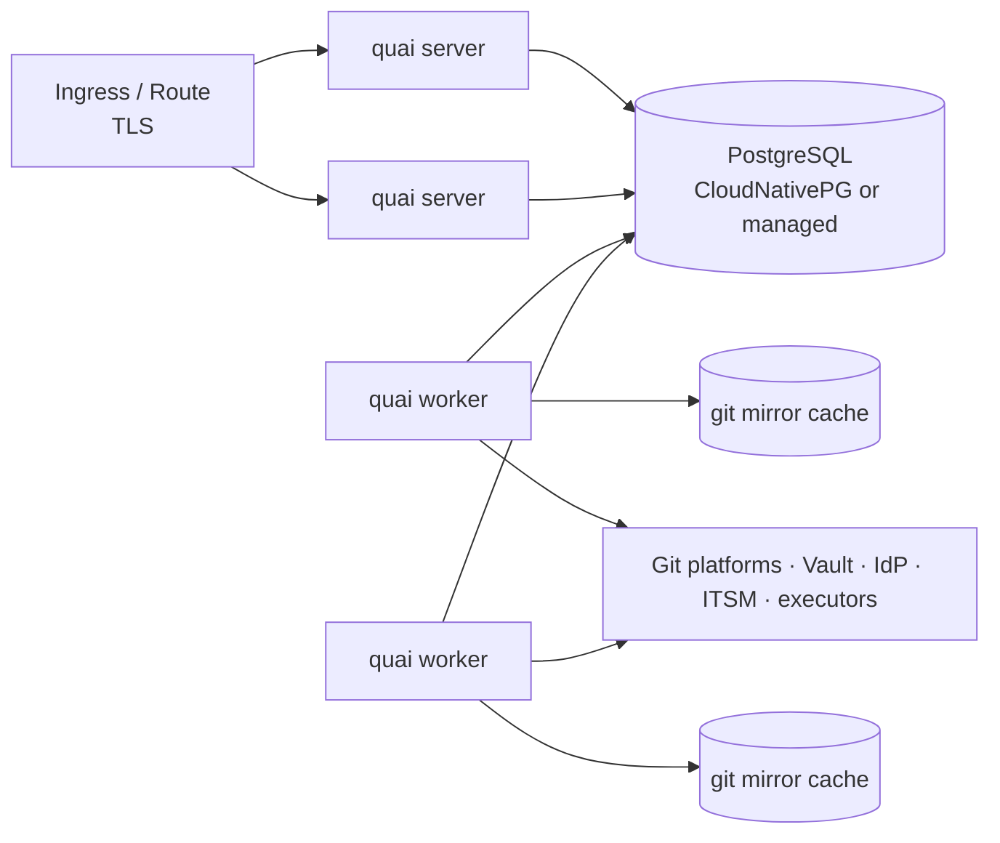

# Deployment and operations

Status: Draft · 2026-11-09

## Topology



| Process | Replicas | State |
| --- | --- | --- |
| `quai server` (API + static UI) | 2+ | None; sessions in PostgreSQL |
| `quai worker` (jobs, schedules) | 2+ | Git mirror cache on a volume per pod (rebuildable); can be `emptyDir` with a warm-up clone |
| PostgreSQL | Primary + replica | All operational state and the job queue |

One image, one binary; the role is a sub-command. Small installs can run a
single pod with both roles.

## Packaging

- **Image:** static Go binary on a distroless or UBI-minimal base, plus `git` and `openssh` (needed for transport). Non-root, read-only root file system, no shell in the distroless variant. Today (`Dockerfile`): Alpine with `git` and `openssh-client`, user 10001 in group 0 (OpenShift's arbitrary user ids run in it), the frontend's build embedded in the binary and served by `quai server` at every path the API and `/auth` do not answer, with a strict Content-Security-Policy and year-long caching of hashed assets. It runs with a read-only root file system given a writable `/tmp` and `/var/cache/quai` (the Git mirror cache). Base images are pinned by digest. CI builds the final stage without its layer cache, and that stage upgrades Alpine's packages, so each image has the fixes Alpine has that day, without waiting for a new base image. The Go dependencies compile in a layer of their own, cached while the packages the binaries import and `go.sum` do not change, so a commit compiles only Quai's packages. Each commit on `main` publishes it to `ghcr.io/damhau/quai` as `main`, `sha-<commit>` and `main-<commit time, UTC, YYYYMMDDHHMMSS>-<short commit>`, which sorts by date so that Argo CD Image Updater can follow `main`; the local stack's fake runner (the `fake-runner` target) is published with the same tags to `ghcr.io/damhau/quai-fake-runner`, for demo installations in a cluster.
- **Helm chart:** server and worker Deployments, PodDisruptionBudgets, HorizontalPodAutoscaler for the server, NetworkPolicies, ServiceMonitor, optional CloudNativePG `Cluster`, configuration via values and a mounted `quai.yaml`. Today (`deploy/helm/quai`, [below](#helm)): server and worker Deployments, the server's Service, PodDisruptionBudget and optional HorizontalPodAutoscaler, an optional Ingress, an optional PrometheusRule with the chart's alerts (`prometheusRule`, [observability](#observability)), `quai migrate` as a pre-install and pre-upgrade hook Job (it needs the database Secrets alone, so it runs before the release's other objects exist), the configuration from values (or from an existing Secret when repository URLs carry tokens), the database URL and OIDC client secret from existing Secrets, a Role that lets the pods read the Secrets that repository connections reference (`secretStore.kubernetes`, optionally restricted by name), and the outgoing network setup (`network`: an internal CA from a ConfigMap, the proxy variables). The migrations Job alone connects as the schema's owner, from a Secret of its own (`database.migrate`); the server and the worker never get it. Pods run non-root with a read-only root file system and no capabilities. CI lints it and checks the rendered objects against the Kubernetes schemas (the PrometheusRule against the Prometheus Operator's), and installs it on kind.
- **Local stack:** `docker compose up --build` runs the server, a worker, PostgreSQL (with the schema's owner, `quai`, which the `migrate` step connects as, and the application role, `quai_app`, which the server and the worker connect as) and Gitea, which a one-shot step seeds with `examples/gitops-repo` as `quai/infra-live` (a random password, and a token and a webhook secret Quai reads from a shared volume). Requests go through pull requests: `main` requires `quai/approval`, and Gitea's webhook reaches Quai's server. A fake runner stands in for the repository's pipelines: on Gitea's webhooks it reports a plan of each pull request and an apply of each push to `main` with `quai report`, so merged requests go through *Applying* to *Applied*. Mailpit catches the notifications the worker sends over STARTTLS (a certificate the seed step makes, trusted through `network.caFile`); its inbox is on `:8025`. The development sign-in and its demo users are on; `QUAI_PORT`, `GITEA_PORT`, `FAKERUNNER_PORT` and `MAILPIT_PORT` move the published ports.
- **OpenShift:** runs under the `restricted-v2` SCC with an arbitrary UID; a `Route` instead of an `Ingress`; UBI-based image variant.
- **Air-gapped:** an offline bundle (images, chart, `quai` CLI binaries for Linux, macOS and Windows) with checksums and signatures. Nothing is fetched at runtime: no CDNs, no fonts, no telemetry.
- **Configuration:** a YAML file, overridable by environment variables; secrets only as references (Vault, Kubernetes Secrets). Repository connections can be managed in the UI or declared in the configuration (GitOps for Quai itself).

  | Key | Environment variable | Default |
  | --- | --- | --- |
  | (file) | `QUAI_CONFIG`, or `quai server --config` | none: environment and defaults only |
  | `env` | `QUAI_ENV` | `development`; `production` refuses development-only features |
  | `server.addr` | `QUAI_SERVER_ADDR` | `:8080` |
  | `server.publicURL` | `QUAI_SERVER_PUBLIC_URL` | none: where people reach Quai, for the links to requests in pull requests, statuses and notifications; without it, pull requests name the request without a link. Required, `http` or `https`, with `notifications.email` or `notifications.teams`: notifications never take a link from a request's `Host` |
  | `server.shutdownTimeout` | `QUAI_SERVER_SHUTDOWN_TIMEOUT` | `20s` for requests in flight to finish |
  | `database.url` | `QUAI_DATABASE_URL` | none. The application role the server and the worker connect as. Each process opens two pools of up to `pool_max_conns` connections (a URL parameter; by default the number of CPUs, at least four): one for its work, one for its advisory locks |
  | `database.migrateURL` | `QUAI_DATABASE_MIGRATE_URL` | `database.url`. The schema's owner, for `quai migrate` alone: it applies the migrations, then grants the role of `database.url` what the server and the worker need, the audit log to read and append only ([database roles](#database-roles)). Without it, or with the same role, the audit log is not protected, and `quai migrate`, the server and the audit log page say so |
  | `auth.mode` | `QUAI_AUTH_MODE` | `oidc`, or `dev` (the user switcher) in development only |
  | `auth.oidc.issuer`, `.clientID`, `.clientSecret`, `.redirectURL` | `QUAI_AUTH_OIDC_ISSUER`, `_CLIENT_ID`, `_CLIENT_SECRET`, `_REDIRECT_URL` | required for `oidc`; https in production |
  | `auth.oidc.scopes`, `.nameClaim`, `.groupsClaim` | | `openid profile email`, `preferred_username`, `groups` |
  | `auth.oidc.managerClaim` | | none. A claim of the ID token holding the person's manager as an immutable identifier of the identity provider (their `sub`, or Entra ID `oid`), never a name or an email; exclusive with `auth.graph.manager` ([managers and Microsoft Graph](#managers-and-microsoft-graph)) |
  | `auth.graph` | | none: Quai never calls Microsoft Graph, a group overage refuses the sign-in, and the manager comes from `managerClaim` or nowhere. `oidc` only |
  | `auth.graph.tenantId` | | required: the Entra ID directory (tenant) ID, a GUID; a sign-in whose `tid` differs is never looked up |
  | `auth.graph.baseURL` | | `https://graph.microsoft.com`; a national cloud's root (`https://graph.microsoft.us`, `https://dod-graph.microsoft.us`, `https://microsoftgraph.chinacloudapi.cn`), https and no path |
  | `auth.graph.manager`, `.groups` | | `false`, `false`; at least one. `manager` reads the manager at each sign-in (delegated `User.Read.All`, with admin consent); `groups` reads the groups of a group overage instead of refusing the sign-in (delegated `User.Read`; needs `groupsClaim: groups`). The login asks for these scopes itself |
  | `auth.roles` | | `- { group: sg-quai-admins, role: platform-admin, scope: global }`; scope can be `team:`, `repository:` or `catalog-item:` and a name |
  | `auth.teams` | | none: each group is the team of its own name. `- { group: sg-quai-*, team: "*" }` maps groups to teams, the first entry that matches deciding; once set, a group no entry matches is no team ([people and teams](#people-and-teams)) |
  | `auth.session.lifetime`, `.idleTimeout` | | `8h`, `30m` |
  | `auth.stepUp` | | none: approval rules with `stepUp` still take only reviews from people who authenticated in the last five minutes, of any class; break-glass and repository changes need none ([step-up authentication](#step-up-authentication)) |
  | `auth.stepUp.maxAge` | | `5m`: how long an authentication satisfies a step-up, from the ID token's `auth_time`; at least `1s` |
  | `auth.stepUp.acrValues` | | none: any class. The `acr` values that count as strong enough, sent as `acr_values` and compared exactly with the ID token's `acr`; `oidc` only |
  | `auth.stepUp.authContext` | | none. Entra ID's Conditional Access authentication context (`c1` to `c99`) a step-up asks for, which the ID token's `acrs` must hold; `oidc` only |
  | `auth.stepUp.admin` | | `false`: when `true`, connecting, changing and disconnecting repositories, installing their webhooks and generating run tokens need a step-up |
  | `git.cacheDir`, `git.committer` | `QUAI_GIT_CACHE_DIR` | the user cache directory; `Quai <quai@localhost>` |
  | `git.signingKey.ref` | `QUAI_GIT_SIGNING_KEY_REF` | none: Quai's commits are unsigned. A reference to an SSH private key (`k8s:quai/signing-key#ssh-privatekey`) Quai signs its commits with; see [verifying them](../design/05-delivery-and-approvals.md#merge) |
  | `repositories.path` | `QUAI_REPOSITORIES_PATH` | none: a YAML file, or a directory of them, holding `Repository` documents ([repository connections](../design/01-repository-connections.md#repository-connection)); reconciled into the database at start-up, read-only through the API |
  | `webhooks.host` | `QUAI_WEBHOOKS_HOST` | none: `/webhooks/{repository}` answers on every host. When set, only that host name answers webhooks, and it answers nothing else but run reports, Slack's interactions (`/slack/interactions`) and `/healthz`, so it can be exposed to the Git platforms and Slack alone |
  | `network.caFile` | `QUAI_NETWORK_CA_FILE` | none: a PEM file of CA certificates trusted in addition to the system's (an internal CA), by Git and every HTTPS call Quai makes |
  | (proxy) | `HTTPS_PROXY`, `HTTP_PROXY`, `NO_PROXY` | none: the HTTP proxy for Git over HTTPS and every HTTP call; loopback addresses are never proxied |
  | `secrets.kubernetes.kubeconfig` | `QUAI_SECRETS_KUBECONFIG` | none: the cluster Quai runs in, or the default kubeconfig outside one. Where `k8s:namespace/name#key` references resolve; `env:NAME` references read Quai's environment |
  | `audit.retention` | `QUAI_AUDIT_RETENTION` | `8760h` (a year), at least `24h`. How long audit events are kept: `quai migrate` stores it, and the worker prunes older events up to a signed checkpoint ([retention](#retention-and-pruning)) |
  | `audit.checkpoints.signingKey.ref` | `QUAI_AUDIT_CHECKPOINTS_SIGNING_KEY_REF` | none: no checkpoint is signed, so nothing is pruned and a rewritten chain goes unnoticed; the worker warns. A reference to an Ed25519 private key in PEM (`k8s:quai/quai-audit-key#private.pem`) the worker signs a checkpoint with every hour ([the checkpoint key](#the-checkpoint-key)) |
  | `audit.checkpoints.previousKeys` | | none: the public keys (PEM) of the signing keys before a rotation, kept as long as the checkpoints they signed |
  | `audit.checkpoints.repository` | `QUAI_AUDIT_CHECKPOINTS_REPOSITORY` | none: the name of a repository connection, with delivery mode `direct`, the worker commits each checkpoint to ([the audit repository](#the-audit-repository)) |
  | `audit.export` | | none: the SIEMs the worker sends the audit log to, a list of destinations, each a `name` (lowercase letters, digits and `-`, the key of its cursor) and one of `syslog`, `otlp` and `splunk` ([exporting to a SIEM](#exporting-to-a-siem)) |
  | `audit.export[].syslog.address`, `.transport`, `.facility` | | required `host:port` (RFC 5425's port is 6514); `tls`, or `tcp`, unencrypted, which production refuses except to a loopback address; `13` (log audit) |
  | `audit.export[].otlp.endpoint`, `.headers` | | required: the collector's URL, `https`, its logs at `/v1/logs` unless it names a path; `http` only to a loopback address in production. Headers by name, each a secret reference (`{ ref: env:OTLP_TOKEN }`) |
  | `audit.export[].splunk.url`, `.token.ref`, `.index`, `.sourcetype` | | required: the HTTP Event Collector's base URL (`https://splunk.example.com:8088`), `http` only to a loopback address in production; required: a secret reference to the HEC token, a token without indexer acknowledgment; the token's default index; none |
  | `approvals.reminders.after` | | none: no reminder. How long after its submission a request still waiting for approval reminds the people it waits for, once: a Go duration (`48h`) ([reminders, escalation and expiry](#reminders-escalation-and-expiry)) |
  | `approvals.escalation.after`, `.to` | | none: no escalation. How long after its submission a request still waiting for approval is escalated, once, after the reminder, and to whom: `group:<name>` and `user:<name>` entries; one needs the other |
  | `changeWindows` | | none: requests merge whenever approved. Windows and freezes for every repository, each a `name`, an optional `when` (CEL on `params` and `request`), `allow` entries (`Mon-Thu 08:00-16:00 Europe/Zurich`) and `deny` entries (`2026-12-18T00:00 to 2027-01-05T00:00 Europe/Zurich`); zones are IANA names, checked at start; a repository document's own windows only narrow these ([change windows and freezes](#change-windows-and-freezes)) |
  | `itsm.servicenow.instanceURL` | | none: no change requests, and a rule with `external: servicenow` is never satisfied ([ServiceNow change requests](#servicenow-change-requests)). The instance's root, `https://<instance>.service-now.com`: https, without a path, a query or credentials; the only address Quai calls for it |
  | `itsm.servicenow.oauth.clientId`, `.clientSecret.ref` | | one of `oauth` and `basic` is required. An OAuth application of the instance with the client credentials grant: its client ID, and a secret reference to its client secret (`k8s:quai/quai-servicenow#client-secret`), read when a token is fetched |
  | `itsm.servicenow.basic.username`, `.password.ref` | | the service account's user name (no colon) and a secret reference to its password, for basic authentication when OAuth is not set up |
  | `itsm.servicenow.standardChanges` | | none: every change request is a normal change. A list of catalog items mapped to standard change templates, the first that matches counting: `repository`, one of `type` and `blueprint`, optional `kinds` (`create`, `update`, `delete`, `action`, `migrate`) and `actions`, and `template`, the template's sys_id (32 lowercase hex digits) |
  | `itsm.servicenow.fields` | | none. Fields set on every change request Quai creates, as written (`assignment_group`, `category`): the ones the instance makes mandatory. Names of lowercase letters, digits and `_`, not `sys_*`, nor a field Quai sets or reads itself (`short_description`, `description`, `justification`, `implementation_plan`, `risk_impact_analysis`, `correlation_id`, `correlation_display`, `start_date`, `end_date`, `work_notes`, `state`, `approval`, …); values at most 4,000 bytes, no control characters |
  | `itsm.servicenow.pollInterval` | | `5m`, between `1m` and `1h`: how often Quai reads a change request it waits on. Opening the request's page reads it too |
  | `notifications.email.host`, `.port`, `.transport` | | none: no email is sent ([notifications](#notifications)). The SMTP server's host name or address; `587` with `starttls`, `465` with `tls`; `starttls` (the default), which the server must offer, or `tls` from the first byte. There is no plaintext transport, and the certificate is verified against the system's CAs and `network.caFile` |
  | `notifications.email.from` | | required: the sender, an address with or without a display name (`Quai <quai@example.com>`) |
  | `notifications.email.username`, `.password.ref` | | none: no authentication. PLAIN, or LOGIN when the server offers only that, over TLS only; the password is a secret reference (`k8s:quai/quai-smtp#password`), read at each send |
  | `notifications.alerts` | | none: email addresses that get every alert (a pull request merged without Quai's approval, approvals no longer enforced), besides the repository's admins; alerts only, never a request's content. Needs `notifications.email` |
  | `notifications.defaults.channels` | | none: every kind at once. What people get until they choose on their profile page: per channel (`email`, `teams` with its bot, or `slack`, which must be configured) and kind (`approval_needed`, `submitted`, `approved`, `rejected`, `stale`, `merged`, `applied`, `failed`, `expiring_soon`, `expired`), `immediate`, `digest` or `off` ([preferences](#preferences-and-digests)). Not `alert` or `escalation`: they always go at once; `approval_needed` (reminders included) is never `off` on every channel |
  | `notifications.defaults.digest.hour`, `.timeZone` | | `8`, `UTC`: when a digest goes until people choose: an hour (0 to 23) in an IANA time zone (`Europe/Zurich`) |
  | `notifications.teams.bot.appId`, `.tenantId`, `.clientSecret.ref` | | none: no personal cards in Teams ([Microsoft Teams](#microsoft-teams)). The bot's Entra ID application (client) ID and directory (tenant) ID, GUIDs; a secret reference to its client secret (`k8s:quai/quai-teams#client-secret`), read when a token is fetched. Needs `notifications.links` |
  | `notifications.teams.bot.tokenURL`, `.scope`, `.serviceURL` | | `https://login.microsoftonline.com/<tenantId>/oauth2/v2.0/token`, `https://api.botframework.com/.default`, `https://smba.trafficmanager.net/teams/`: Microsoft's public cloud. Another cloud's (GCC, DoD) endpoints; https, without credentials or a query |
  | `notifications.teams.channels` | | none: no channel posts. A list of channels, each a `name` (lowercase letters, digits and `-`), a `webhook.ref` (a secret reference to the URL of the workflow's webhook trigger: the URL is the credential), `repositories` and `teams` (the requests to these repositories, or to resources these teams own, and the alerts of these repositories; at least one), and `events` (`submitted`, `approval_needed`, `approved`, `rejected`, `stale`, `merged`, `applied`, `failed`, `expiring_soon`, `alert`) |
  | `notifications.slack.botToken.ref` | | none: no Slack ([Slack](#slack)). A secret reference to the app's bot token (`xoxb-…`, or `xoxe.xoxb-…` when Slack rotates it; a user token is refused), read at each call. Needs `server.publicURL` and `notifications.links` |
  | `notifications.slack.signingSecret.ref` | | none: no endpoint for Slack's interactions (`POST /slack/interactions` answers 404). A secret reference to the app's signing secret, which verifies the requests Slack sends when someone clicks a button |
  | `notifications.slack.apiURL` | | `https://slack.com/api`: Slack's Web API (GovSlack: `https://slack-gov.com/api`); https, without credentials or a query |
  | `notifications.slack.channels` | | none: no channel posts. A list of channels, each a `name` (lowercase letters, digits and `-`), a `channel` (the Slack channel's ID, `C0123ABCDEF`, from its details in Slack; not its name), `repositories` and `teams`, and `events`, as `notifications.teams.channels` |
  | `notifications.links.key.ref`, `.previousKeys` | | none: required with the Teams bot or Slack. A secret reference to the key that signs the Approve and Deny links of approval cards: at least 32 bytes, used for nothing else (`openssl rand -base64 32`); the keys before a rotation, kept a day ([rotating the link key](#rotating-the-link-key)) |
  | `log.level` | `QUAI_LOG_LEVEL` | `info` (`debug`, `info`, `warn`, `error`) |
  | `log.format` | `QUAI_LOG_FORMAT` | `json` in production, `text` otherwise |
  | `telemetry.otlpEndpoint` | `QUAI_TELEMETRY_OTLP_ENDPOINT` | none: no traces are exported; traces go to `<url>/v1/traces` |
  | `telemetry.serviceName` | `QUAI_TELEMETRY_SERVICE_NAME` | `quai` |

  Unknown keys in the file are errors, and the configuration is validated before the server
  starts. Later tasks add their own keys.

### Helm

Before installing, create in the release's namespace the Secrets the chart reads: the
application role's database URL (`database.secretName`, key `url`), the schema owner's
(`database.migrate.secretName`, by default `quai-database-owner`, key `url`; [database
roles](#database-roles)) and, with OIDC, the client secret (`oidc.secretName`, key
`clientSecret`). Repository connections refer to their own Secrets (`k8s:<namespace>/<name>#<key>`),
which the release's Role can read. List them in `secretStore.kubernetes.secretNames`: without a
list, the pods may read every Secret of the namespace, the owner's too, and the chart's notes
warn about it.

```bash
helm install quai deploy/helm/quai -n quai -f my-values.yaml --wait   # migrations first, as a hook
helm upgrade quai deploy/helm/quai -n quai -f my-values.yaml --wait   # the same, before the new pods
```

CI installs the chart on a kind cluster on every change (`.github/workflows/kind.yml`), with the
image built from the commit and PostgreSQL in the cluster (`deploy/kind/fixtures.yaml`): install,
upgrade, every migration applied, the application role refused deleting audit events, then a
smoke test in the cluster (`deploy/kind/smoke.yaml`):
health, a development sign-in, a repository connected, and a run report whose token's hash Quai
reads from a Kubernetes Secret. Locally, the same commands (`kind`, `kubectl` and `helm` run
outside the agents' sandbox):

```bash
kind create cluster --name quai && docker build -t quai:kind . && kind load docker-image quai:kind --name quai
kubectl apply -f deploy/kind/fixtures.yaml && kubectl -n quai rollout status deploy/postgres
helm install quai deploy/helm/quai -n quai -f deploy/kind/values.yaml --wait
kubectl apply -f deploy/kind/smoke.yaml && kubectl -n quai wait --for=condition=complete job/smoke && kubectl -n quai logs job/smoke
kind delete cluster --name quai
```

### Database roles

Quai connects to PostgreSQL as two roles, so that the server and the worker cannot change or delete
audit events ([audit log](../design/09-security-and-compliance.md#audit-log), [open question
19](../plan/open-questions.md#still-open)):

- **The schema's owner** (`database.migrateURL`) owns the tables. Only `quai migrate` connects as
  it; it needs no superuser rights.
- **The application role** (`database.url`) is what the server and the worker connect as. It
  needs only `LOGIN`: after migrating, `quai migrate` grants it the schema's usage, `SELECT`,
  `INSERT`, `UPDATE` and `DELETE` on the tables, `SELECT` only on the migrations' records
  (`goose_db_version`, `river_migration`), `SELECT` and `INSERT` only on the audit tables
  (`audit_events`, `audit_personal`, `audit_checkpoints`; on `audit_events`, `INSERT` on every
  column but `recorded`, when the database recorded the event), `SELECT` only on the retention
  (`audit_retention`), and `EXECUTE` on `audit_prune()`, the owner's function that prunes
  ([retention](#retention-and-pruning)). It prints `<role> may read and append the audit log, and
  not change it`.

```sql
-- as an administrator, once
CREATE ROLE quai LOGIN PASSWORD '…';      -- the schema's owner
CREATE ROLE quai_app LOGIN PASSWORD '…';  -- the application role
CREATE DATABASE quai OWNER quai;
```

A new installation from a single role moves to two by creating the application role, setting
`database.migrateURL` to the old URL and `database.url` to the new role's, and running `quai
migrate` (the chart's upgrade does). Until then, `quai migrate` and the server log a warning, and
the audit log page says the database does not protect it.

### The audit log

The worker keeps the audit log ([design](../design/09-security-and-compliance.md#audit-log)):
every hour and when it stops, it signs a checkpoint of the latest event, commits it to the audit
repository and prunes what the retention lets go; every day it verifies the chain.

#### The checkpoint key

Checkpoints are signed with an Ed25519 key the worker reads from the secret store
(`audit.checkpoints.signingKey.ref`); verifying them needs only its public key. Generate it on a
machine you trust, store the private key, and keep only the public key:

```bash
openssl genpkey -algorithm ed25519 -out audit-key.pem
openssl pkey -in audit-key.pem -pubout -out audit-key.pub
kubectl -n quai create secret generic quai-audit-key --from-file=private.pem=audit-key.pem
shred -u audit-key.pem
```

```yaml
audit:
  checkpoints:
    signingKey: { ref: "k8s:quai/quai-audit-key#private.pem" }
```

Add `quai-audit-key` to `secretStore.kubernetes.secretNames` when the list is set. Quai never logs
the key and does not publish its public key: give `audit-key.pub` to the auditors, and keep it
where they can check it without Quai, such as a reviewed commit of a person in the audit
repository or the security team's records ([open question 35](../plan/open-questions.md#still-open)).
A key from the server that the log is about would prove nothing to them. Each checkpoint names
its key by the SHA-256 of the public key.

**Rotating it** (a schedule of the security team's, or a key that may have leaked): generate a new
key as above, in a new Secret; set `signingKey.ref` to it and add the old public key to
`previousKeys`, then upgrade. Checkpoints signed before still verify, with the old key, in the
worker and in `quai audit verify --key old.pub --key new.pub`. Keep the old public key as long as
the retention keeps a checkpoint it signed. A leaked key lets whoever holds it sign checkpoints:
with the application role, that prunes nothing the retention does not already let go; with the
owner's credentials too, they could rewrite the chain and sign it, which only the audit
repository's earlier checkpoints and the SIEM's export would show. Rotate a key that may have
leaked at once.

```yaml
audit:
  checkpoints:
    signingKey: { ref: "k8s:quai/quai-audit-key-2027#private.pem" }
    previousKeys:
      - |
        -----BEGIN PUBLIC KEY-----
        MCowBQYDK2VwAyEA…
        -----END PUBLIC KEY-----
```

#### The audit repository

`audit.checkpoints.repository` names a repository connection the worker commits each new
checkpoint to, as `checkpoints/YYYY/MM/DD/<seq>.json`: a copy outside the database, timestamped by
the platform, that a restored or rewritten database cannot change. Connect a repository of its own
with `delivery: { mode: direct }` and a credential that can push to its branch, and protect the
branch against force pushes and deletion; the platform's history then dates each checkpoint.
When the repository cannot be reached, the next hour commits the latest checkpoint. The daily verification reads
the checkpoint of the highest `seq` in it; `quai audit verify --anchors` reads them all.

#### Retention and pruning

`audit.retention` (a year by default) is how long events are kept. `quai migrate` stores it in the
database, as the schema's owner, so it takes effect at the next migration (the chart's upgrade),
and the application role cannot shorten it. Every hour the worker calls `audit_prune()`: it
deletes the events before the latest checkpoint whose hash is its event's and whose event the
database recorded longer than the retention ago, with their personal data and the checkpoints
before it, and records an `audit.pruned` event. An event's age is the database's clock when it
inserted the event (`recorded`), not the time the event states, which the application writes.
Events written before the version that added `recorded` count from the upgrade to it. The kept checkpoint is where the chain starts from: verification
accepts a log that starts at a signed checkpoint only when an `audit.pruned` event names it.
Without a signing key, nothing is pruned. Longer periods (often 10 years for financial
institutions) need nothing else than a longer retention; the SIEM's export is the long-term
record.

**Pseudonymizing a person** (a request to erase their personal data) deletes their clear values
from `audit_personal`; their events keep the pseudonyms, and the chain still verifies. As the
schema's owner, delete the rows whose value is their name, their emails and their addresses
([open question 39](../plan/open-questions.md#still-open)):

```sql
DELETE FROM audit_personal WHERE value IN ('alice', 'alice@example.com');
```

Their notifications and digests name them too (`user:alice`, or `email:alice@example.com` for an
address of `notifications.alerts`), and the error of one that failed may quote their address:
delete those rows, which nothing else refers to (a digest's notifications go with it). Their
preferences go with their row of the directory ([below](#people-and-teams)). The audit log's
`preferences.changed` events hold their time zone as a pseudonym, which the first statement
erases with the others when you add it to the list.

```sql
DELETE FROM notification_digests WHERE recipient IN ('user:alice');
DELETE FROM notifications WHERE recipient IN ('user:alice', 'email:alice@example.com');
```

The audit log page then shows "(erased)" where they were.

#### Verifying the log

The worker verifies the chain every day, from the database and the latest checkpoint in the audit
repository: it records `audit.verified` or `audit.broken` in the log, counts it in
`quai.audit.verifications` (`outcome`: `ok`, `broken`, `error`), logs an error when the chain
breaks, and the audit log page shows the last outcome, a banner when it broke. Alert on an outcome
other than `ok`, and on no `ok` for more than 25 hours.

Auditors verify it offline, with nothing from Quai but an export of the log:

```bash
quai audit export --config quai.yaml -o audit.jsonl   # as database.url; or the Export button of the audit log page (GET /api/v1/audit/export)
git clone <audit repository> audit-checkpoints
quai audit verify --key audit-key.pub --anchors audit-checkpoints audit.jsonl
```

The export holds the checkpoints and the events, with personal data as pseudonyms. `quai audit
verify` checks each event's hash, each link to the event before, each checkpoint's signature and
that its hash is its event's, and the audit repository's checkpoints too: one beyond the export's
last event means events were lost. It prints what it verified, or names the first `seq` where the
log fails and why, and exits with status 1.

#### When the chain does not verify

An alert, a banner on the audit log page, or an auditor's check. The audit log's events are
evidence: do not repair or delete them, and change nothing in the database or the audit
repository until the cause is known.

1. **Keep the evidence**: export the log now (`quai audit export -o`), and clone the audit
   repository.
2. **Reproduce it offline** with every public key, old ones too: `quai audit verify --key …
   --anchors <clone> audit.jsonl`. It names the first `seq` that fails and why.
3. **Read the reason**:

   | Reason | What happened |
   | --- | --- |
   | `signed with key …, which was not given` | A key rotated without its public key in `previousKeys` (or `--key`): add it. Not an incident, if the key is yours |
   | `its hash is not the hash of its content` | The event was changed |
   | `the event is missing or out of order`, `comes again or out of order`, `its prev is not the hash of the event before it` | An event was deleted, inserted or moved |
   | `its hash is not the one the checkpoint signed` | The chain was rewritten after the checkpoint: changed events with their hashes recomputed |
   | `its signature does not verify` | A checkpoint was forged or changed, in the database or the audit repository |
   | `the log starts at the checkpoint at seq …, but no audit.pruned event…`, `the log starts at seq …, with no signed checkpoint of it` | The first events were deleted, not pruned |
   | `the log ends at seq …, but a checkpoint … says it reached seq …` | The last events are gone: a database restored from a backup older than the checkpoint, or deleted |

4. **Otherwise, treat it as a security incident**. Find when the log changed from the database's
   own logs, its backups and the SIEM's export (which has the events as they were sent); check
   that the server and the worker connect as the application role (the server logs a warning at
   start otherwise) and who holds the owner's credentials and the checkpoint key. The events
   before the break still verify, and so do those after it from the broken event's hash.

**After a restore from backup**, the events between the backup and the restore are lost, and the
audit repository's checkpoints after the backup say so: the daily verification fails until the
log has grown past them and a new checkpoint is committed, and `quai audit verify` with the whole
repository keeps failing there.
That is the record of the restore: write it in the incident report, with the SIEM's copy of the
lost events, and verify the log since then with the checkpoints after the restore (`--anchors`
naming their files). The restored cursors make the export send again the `seq` the SIEM already
has from the lost events, with other hashes, and the worker logs `the audit log changed after it
was exported`: keep both in the SIEM.

#### Evidence for auditors

Each request has an evidence bundle: what was asked and why, the diff, the plans and policy
results, the reviews with their authentication times and delegations, the merge commit and its
trailers, the applies, the break-glass and its review, and the request's audit events with their
hashes and the segments of the log that prove them ([evidence bundle](../design/09-security-and-compliance.md#evidence-bundle)).

- **One request**: the **Evidence** card of its page, **JSON bundle** (the evidence, to verify)
  and **PDF summary** (to read). Auditors, platform admins, the requester and the owners may
  download it; with an API token, `GET /api/v1/requests/<id>/evidence` (`?format=pdf`) and the
  `evidence:read` scope.
- **A sample**: **Evidence** in the navigation (auditors and platform admins). Pick the period
  (at most 366 days), the repository, the state and whether merged by break-glass, **List**, tick
  up to 50 requests and **Download as an archive**: a ZIP of `request-<number>.json` and
  `request-<number>.pdf` for each, and `manifest.json` with each file's SHA-256 and the requests
  left out. An auditor of one repository samples that repository. Two archives are made at once
  per server; a third is refused for a minute (429).

Only auditors of the whole platform and platform admins get the proof, downloading in their
session: it holds other requests' events, with their personal data as pseudonyms. A bundle
downloaded by anyone else, or with an API token, says `proof.omitted`; its events are checked
against the export instead.

To verify a bundle offline, with the checkpoints' public key (the operator gives it to the
auditors, [the checkpoint key](#the-checkpoint-key)):

```bash
quai audit verify --bundle request-42.json --key audit-key.pub
# request #42 3b6f2a8c-…: 9 events, 9 proven by 2 checkpoints (seq 18240, 18310) with 412 records of other events
# the bundle verifies
```

It checks each event's hash, each segment of the log from the request's events to a signed
checkpoint (no event missing, none of the request's left out, every link), each checkpoint's
signature, the clear personal values against their pseudonyms, the change sets against their
content, and the summary (the submission, the state, the reviews, the merge commit, the
break-glass) against the events. It exits with status 1 naming what fails:

| Message | What happened |
| --- | --- |
| `event seq … its hash is not the hash of its content: the event was changed` | An event of the request was edited |
| `segment … seq … is missing: an event was removed` | An event was taken out of the segment |
| `segment … the record was changed`, `… does not chain on seq …` | An event of the segment was edited, inserted or moved |
| `segment … the checkpoint at seq … does not hold`, `… the events were changed, or the checkpoint swapped` | A checkpoint forged or taken from elsewhere, or signed with a key not given (`--key` again with the keys before a rotation) |
| `segment … is an event of the request that the bundle's events leave out` | An event of the request was removed from the bundle |
| `the summary's … is not the one event seq … records: the summary was edited`, `the summary has … reviews, the events …` | The summary was changed: the events are what counts |
| `change set …: its hash is not the hash of its changes` | A change was edited, added or removed |
| `personal: the clear value given for … is not the one its pseudonym was made of` | A name, reason or comment was changed |

An **unproven** event (listed with its reason) also exits with status 1, unless
`--allow-unproven`, which ends with `the bundle verifies, with N events of the request unproven`: no signed checkpoint follows it yet (download the bundle again after the next
hourly checkpoint), the audit log has no checkpoint at all (no signing key configured), the
bundle carries no proof (not downloaded by an auditor of the whole platform), or its proof passes
the bundle's bound. Then verify it with the whole log: `quai audit export`, `quai audit verify`,
and find the bundle's events in the export by `seq` and hash. The same holds for completeness: a
bundle cut down to fewer events and segments still verifies, the export shows every event of the
request (`object.id`).

Every download is in the audit log as `evidence.downloaded`: who, which requests, the format, and
whether it carried the proof.

#### Exporting to a SIEM

`audit.export` lists the SIEMs the worker sends the audit log to, at least once and in order: a
destination that was down or refused a batch gets it again at the next run, 30 seconds later, and
catches up with no gap. A record is the event as `quai audit export` writes it, with its `seq` and
`hash` and personal data as pseudonyms ([what is sent](../design/09-security-and-compliance.md#export-to-a-siem)):
de-duplicate on `seq`, and alert in the SIEM on a gap in it.

```yaml
audit:
  export:
    - name: siem                                    # its cursor's key: renaming it sends everything again
      syslog: { address: "siem.example.com:6514" } # RFC 5424 over TLS, octet counting
    - name: otel
      otlp:
        endpoint: https://otel-collector.example.com:4318
        headers: { Authorization: { ref: "k8s:quai/quai-otlp#authorization" } }
    - name: splunk
      splunk: { url: "https://splunk.example.com:8088", token: { ref: "k8s:quai/quai-splunk#token" }, index: audit, sourcetype: "quai:audit" }
```

- Certificates are verified against the image's CAs and `network.caFile`, with no way to turn
  that off: an internal CA goes in `network.caFile` (the chart's `network.caBundle`). Syslog
  connects directly, not through the proxy; OTLP and HEC go through it.
- The syslog receiver must accept octet-counted messages larger than 2 KiB (a request's event
  carries its change set) and close the connection once the worker has closed its side: until
  it does, the batch does not count as delivered.
- The HEC token must not require indexer acknowledgment, which Quai does not ask for.
- A new destination starts with the oldest event the database holds; events pruned before a
  destination took them are lost to it, and the worker logs an error.

The worker counts each run in `quai.audit.exports` (`destination`, `outcome`: `ok` or `error`),
logs a warning when one fails, and reports each destination's lag: `quai.audit.export.lag`, in
seconds, since the database recorded the oldest event the destination has not taken (0 when it
has them all), and `quai.audit.export.pending`, how many there are. The chart's
`QuaiAuditExportLagging` alert fires when a lag stays above 10 minutes for 5 minutes.

#### When the audit export lags

`QuaiAuditExportLagging`, or a SIEM missing recent events. Nothing is lost while the events are
in the database: the export resumes where the destination's cursor is, once it can.

1. **Read the worker's warnings** for the destination: `the audit export failed`, with the error.
2. **By error**:

   | Error | What to do |
   | --- | --- |
   | `connection refused`, `i/o timeout`, `no such host` | The receiver is down or unreachable: its state, the network path (syslog does not use the proxy), `NO_PROXY` for an HTTP destination reached directly |
   | `certificate signed by unknown authority`, `certificate is valid for …` | Its certificate is not signed by a CA in `network.caFile`, or does not name the address configured |
   | `the receiver did not close the connection after reading the messages` | A syslog receiver that resets the connection or never closes it: one that rejects messages too large, or not octet-counted |
   | `the collector answered 4xx`, `HEC answered 4xx: "Invalid token"`, `"Incorrect index"`, `"Token disabled"` | The credential or the index: the secret the reference names, the token's allowed indexes |
   | `the collector answered 5xx`, `HEC answered 503: "Server is busy"`, `429` | The SIEM is overloaded: it catches up once it takes events again |
   | `the collector rejected n of m records` | The collector dropped records it took (an OTLP partial success): they are not sent again; its own logs say why |
   | `answered 3xx` | The URL redirects, which Quai does not follow: configure the address it redirects to |

3. **A lag that keeps growing while runs succeed** means the destination takes the events more
   slowly than they are recorded: `quai.audit.export.pending` grows. A run sends 500 events at a
   time for at most a minute every 30 seconds.
4. **Before the retention runs out**, the oldest pending event is pruned and the destination
   never gets it (the worker logs `audit events were pruned before they were exported`). If the
   lag nears `audit.retention`, keep an export of the log (`quai audit export -o`) for the SIEM.

`the audit log changed after it was exported`, an error, means the event after the last one a
destination took does not link to it: the database was restored from an older backup, or the log
rewritten. Follow [when the chain does not verify](#when-the-chain-does-not-verify).

### People and teams

People come from the identity provider: their name from `auth.oidc.nameClaim`, their groups from
`auth.oidc.groupsClaim`. `auth.roles` gives groups roles at a scope, and `auth.teams` puts groups in
teams, which own resources (`ownership: { team: shop }`) and match `team:` owner entries:

```yaml
auth:
  teams:
    - { group: sg-quai-shop-ops, team: shop } # the first entry that matches a group decides
    - { group: sg-quai-*, team: "*" }         # sg-quai-blog is in the team blog
```

A group is a name or a pattern with one `*`, which matches one or more characters (with their
case); a `*` in the team stands for what it matched. Without `auth.teams`, each group is the team
of its own name. Once it is set, **a group no entry matches is no team**: someone in a group that
happens to be named `shop` (a self-service group, another department's) is not in the team `shop`,
does not own its resources nor approve as its owner. That group still counts for `auth.roles` and
for `group:` entries. To keep the old behavior for the groups no other entry maps, end the list
with `- { group: "*", team: "*" }`. Teams and roles are worked out from the groups on every
request, so a change applies at once, to sessions and API tokens alike; a token acts with the groups
its owner had when creating it.

Each sign-in keeps the person in the directory, the `users` table: their name, their email when the
identity provider vouches for it, their groups, the ID token's `sub` and Entra ID's `oid`, and when
they last signed in. The **access report** (Admin, for auditors and platform admins, and
`GET /api/v1/access-report`) lists each of them, and each owner of an API token that still works,
with their groups, teams, roles by scope and the group that gives each, and their tokens; **Download
CSV** is the same report for a periodic access review, one row per person or token, role, scope and
group. Spreadsheets would run a cell starting with `=`, `+`, `-`, `@`, a tab or a carriage return as
a formula, so those cells start with an apostrophe. People appear once they sign in after the
upgrade to the version with the directory.

- **A name that belongs to another account.** A sign-in whose name the directory holds for another
  `sub` is refused: it would act as that person, on their requests, reviews and resources
  ([open question 45](../plan/open-questions.md#still-open)). Check that the name claim gives
  unique, stable names (`preferred_username`, the UPN on Entra ID; never a display name). When the
  account really changed (recreated, or another identity provider), release the name; the next
  sign-in takes it:

  ```sql
  UPDATE users SET subject = '', object_id = '' WHERE name = 'alice';
  ```

- **Deactivating someone** by hand, without SCIM ([below](#provisioning-with-scim), which does all
  of it): their sign-ins are refused, their sessions end at their next request, their API tokens are
  refused while they are deactivated, and the report shows them as deactivated. Revoke the tokens
  too, so that they stay refused if the person comes back. Their requests, approvals and
  delegations are left as they are: cancel, and revoke, what should not outlive them:

  ```sql
  UPDATE users SET deactivated_at = now() WHERE name = 'alice';
  UPDATE api_tokens SET revoked_at = now() WHERE owner = 'alice' AND revoked_at IS NULL;
  ```

- **Erasing someone** ([open question 44](../plan/open-questions.md#still-open)): delete their row,
  which their next sign-in would create again, and with it their notification preferences, and
  pseudonymize them in the audit log ([above](#retention-and-pruning)):

  ```sql
  DELETE FROM users WHERE name = 'alice';
  ```

### Managers and Microsoft Graph

An approval rule with `approvers: [manager]` waits for the requester's manager
([design 05](../design/05-delivery-and-approvals.md#approver-kinds)). Quai learns the manager at
each sign-in, as an identifier of the identity provider, never a name or an email, and keeps it in
the directory:

```yaml
auth:
  oidc:
    managerClaim: manager_oid  # a claim the identity provider adds: the manager's sub or oid
  # or, on Entra ID, from Microsoft Graph:
  graph:
    tenantId: 8f2a1c3e-0b6d-4e57-9a41-2c7d5e9b0f13
    manager: true   # GET /v1.0/me/manager at each sign-in
    groups: true    # a group overage is read from Graph instead of refusing the sign-in
```

When a request is planned, the manager is the one person of the directory with that identifier
(Entra ID's `oid`; from a claim, a `sub` or an `oid`). The plan and the request page name them, or
say why there is none, in which case nobody can satisfy the rule: the manager has never signed in
to Quai, is deactivated, or is ambiguous; the requester is their own manager; or the requester's
last sign-in found none (no claim, none in Graph, a contact rather than a user, a Graph lookup that
failed, another tenant). The manager is kept with the request when it is submitted: a later change
does not move who approves it, only new requests. A change of manager is audited
(`auth.manager_changed`).

**Microsoft Graph.** Quai calls Graph with the access token the person's own sign-in returns, with
delegated permissions, for that person only (`/me`), during the sign-in, and keeps no token. The
login asks for the permissions as scopes, on top of `auth.oidc.scopes`:

| Setting | Scope asked | Graph call | Admin consent |
| --- | --- | --- | --- |
| `groups: true` | `https://graph.microsoft.com/User.Read` | `POST /v1.0/me/getMemberObjects` with `securityEnabledOnly: true` | no |
| `manager: true` | `https://graph.microsoft.com/User.Read.All` | `GET /v1.0/me/manager` | **yes** |

(With `baseURL` set, the scopes are under it.) In Quai's app registration, **API permissions**, add
Microsoft Graph's delegated permissions `User.Read` and, for the manager, `User.Read.All`, then
**Grant admin consent** for the tenant: people cannot consent to `User.Read.All` themselves, and
without it Entra ID refuses their sign-in. No application permission and no other client secret is
needed. `auth.oidc.scopes` may then hold only OpenID Connect scopes and Graph's: an access token is
for one resource.

With `groups`, the groups Graph answers are object IDs, so `auth.roles` and `auth.teams` name groups
by object ID, and `auth.oidc.groupsClaim` must be `groups` (the registration's group claims as
"Group ID"). Only security groups count, transitive memberships included; at most 10,000.

**Failures.** Quai calls `auth.graph.baseURL` and nothing else, through the proxy and
`network.caFile`, with TLS verified. A 429, 503 or 504 is retried twice, waiting as `Retry-After`
says when it is five seconds or less; all of a sign-in's calls take at most twenty seconds. Each
lookup is counted (`quai.graph.lookups`, by `lookup`, `groups` or `manager`, and `outcome`: `ok`,
`none`, `error`, `skipped` for another tenant) and a failure logged, without the token.

- **"more groups than the ID token can list, and Quai could not read them from Microsoft Graph"**:
  the sign-in is refused. The log line says what Graph answered: 401 (the token: check the
  registration's scopes), 403 (`User.Read` not consented), 429 (throttled beyond the retries),
  a partial answer (`@odata.nextLink`) or more than 10,000 groups. Prefer app roles, or emitting
  only the groups assigned to Quai, so that no overage happens.
- **"your directory is not the one Quai reads groups from"**: the ID token's `tid` is not
  `auth.graph.tenantId` (a guest from another tenant, or a wrong tenant ID).
- **"more groups than the ID token can list"** without Graph: set `auth.graph.groups`, or reduce
  the groups in the token.
- **A request says "Quai could not read their manager from Microsoft Graph"**: the requester's last
  sign-in could not read it; they get a manager again at their next sign-in that can. Check
  `quai.graph.lookups{lookup="manager",outcome="error"}` and the log; a 403 is `User.Read.All`
  without admin consent.
- **"…'s manager has not signed in to Quai yet"**: the manager must sign in once to be in the
  directory.

Development users have no manager: the user switcher reads no identity provider.

### Provisioning with SCIM

With SCIM 2.0, the identity provider keeps Quai's people and groups current between sign-ins, and
a leaver is deactivated at once: sessions ended, API tokens and delegations revoked, requests
cancelled, approvals of waiting requests voided and their approvers told again
([design 08](../design/08-identity-access-tenancy.md#scim-provisioning)). Quai serves it at
`/scim/v2` with `auth.scim` set, and `auth.mode: oidc`.

> **Not verified against a real Entra ID tenant.** Quai's tests send the requests Microsoft
> documents for Entra ID's provisioning service (its test connection, users looked up by
> `userName`, then created, PATCH operations on attributes and members, a deactivation, a delete).
> Try it on a test application first, and check the provisioning logs.

**1. Make a SCIM token**, on a trusted machine, and keep the two lines apart:

```bash
quai scim-token
# token: quai_scim_…   → Entra ID's Secret Token, and nowhere else
# sha256: 3f1a…        → the secret Quai reads
kubectl -n quai create secret generic quai-scim --from-literal=sha256=3f1a…
```

Quai keeps only the hash: it cannot show the token again, nor mint one.

**2. Configure Quai:**

```yaml
auth:
  scim:
    tokens:
      - { name: entra, sha256: { ref: "k8s:quai/quai-scim#sha256" } } # the name is the audit log's actor
    groupName: externalId        # the default: a group is named by its externalId, Entra ID's object ID
    reserved: [breakglass@contoso.com] # emergency accounts: never created, changed or deactivated by SCIM
```

`groupName: externalId` matches groups the way the ID token's `groups` claim names them (object
IDs); use `displayName` only if `auth.roles` and `auth.teams` name groups by display name (the
`roles` claim of app roles does not come from SCIM, and SCIM groups then have no effect on them).
List in `reserved` the identity provider's emergency (break-glass) accounts, whatever their case:
they must sign in whatever provisioning does. Development users are reserved too.

**3. In Entra ID**, under **Enterprise applications**, the application Quai signs in with (or a
non-gallery application for provisioning), **Provisioning**:

1. **Provisioning Mode**: Automatic. **Tenant URL**: `https://quai.example.com/scim/v2` (the server's
   public URL). **Secret Token**: the `token` line. **Test Connection**: Entra ID looks up a user
   and a group that do not exist; Quai answers with empty lists.
2. **Mappings, Provision Microsoft Entra ID Users**: map `objectId` to `externalId` (the default maps
   `mailNickname`, which Quai would take for the account's identifier: change it), keep
   `userPrincipalName` to `userName` (the name people sign in with, `preferred_username`), keep
   `Switch([IsSoftDeleted], …)` to `active`, and `manager` to
   `urn:ietf:params:scim:schemas:extension:enterprise:2.0:User:manager` for `approvers: [manager]`.
   Delete the other mappings: Quai accepts and ignores them, and fewer attributes leave fewer
   personal data in transit. Matching: `userName`.
3. **Mappings, Provision Microsoft Entra ID Groups**: map `objectId` to `externalId`, keep
   `displayName` and `members`. Matching: `displayName` (unique in Quai, in any case).
4. **Users and groups**: assign who is provisioned. Groups assigned are provisioned with their
   members (nested groups are not).
5. **Provisioning Status**: On. The first cycle takes everything assigned; the next ones, every 40
   minutes, the changes. **Provision on demand** tries one user at once.

**What it changes.** A person signs in under the name SCIM gave them, from their `userName` at
creation, even after a rename in Entra ID: Quai binds them by `externalId`, their object ID. Someone
who signed in before provisioning is adopted when their object ID matches. Their groups are their
sign-in's, less the groups SCIM provisions that do not list them: SCIM never adds a group the ID
token does not have, and a removal (from the admin group, say) applies at their next request, in
their sessions and API tokens too. An addition applies to sessions and tokens made with the group,
otherwise at the next sign-in. For people SCIM provisions, SCIM's manager is the manager, whatever
`auth.oidc.managerClaim` or `auth.graph.manager` say. The access report marks them **Provisioned**
and shows each SCIM token's last use; the audit log names the token for each change (actor
`Provisioning (SCIM token entra)`, filter `scim`).

**Rotating the token.** Make a new one, add it as a second entry (say `entra-2`), put its `token` in
Entra ID, check its last use in the access report, then remove the old entry and its secret. A
token is revoked by removing its entry or changing its secret: Quai reads secrets again within a
minute.

**Leavers.** Entra ID sends `active: false` when a user is disabled, deleted or unassigned, and a
delete when the user is deleted for good (30 days later); Quai acts at the first: sign-ins refused, sessions ended, API tokens
and delegations revoked, requests not yet delivered cancelled, approvals of requests still waiting
voided (their approvers told again; approvals of requests already approved stand). A requester's
manager who leaves stays the manager of the requests they had: those wait until they expire.
Re-enabled, the person signs in again, with none of it back. A delete keeps the person's name and
history in Quai, and the same object ID provisioned again gets them back. A new person given the
same `userName` is refused (409): the name, and what was done under it, are the old person's. To
hand them over deliberately, release the name; the next provisioning of that `userName` then
adopts the row, history included:

```sql
UPDATE users SET subject = '', object_id = '', scim_external_id = '' WHERE name = 'alice' AND scim_id IS NULL;
```

**When something fails** (Entra ID's provisioning logs show Quai's answer):

- **401** "a SCIM token is needed": the token is wrong, revoked, or not a SCIM token (an API token is
  not one). Quai logs the refusal with the client's address.
- **503** "the SCIM tokens cannot be checked now": a token's secret cannot be read, or does not hold
  a SHA-256 in hex; the log names the token.
- **409** "uniqueness" on a user: the `userName` is reserved, is another person's name in Quai (in
  any case), or another user has the `externalId`. On a group: the `displayName` is taken.
- **400** "mutability" on `externalId`: the mapping changed after users were provisioned; Quai does
  not move a person to another account. "invalidFilter": a filter Quai does not take.
- **429**: more than 50 requests a second; Entra ID retries.
- **A provisioned person's sign-in is refused** with "Quai's provisioning knows you as …" or "gave
  the name … to another account": the ID token's object ID and the `externalId` disagree. Check that
  `externalId` is mapped from `objectId` and that `auth.oidc.nameClaim` is `preferred_username`.

### Step-up authentication

Some actions take only a recent, and strong enough, authentication with the identity provider
([design 08](../design/08-identity-access-tenancy.md#step-up)): reviewing a request whose approval
asks for it (`approval.stepUp` in a type or blueprint, such as `"params.env == 'prod'"`), breaking
glass and delegating one's approvals ([delegation](#delegation)) whenever `auth.stepUp` is set, and
changing repository connections with `auth.stepUp.admin`.
Quai checks it on the server when the action is made, with what the ID token of the person's last
sign-in said: its `auth_time` no older than `maxAge` (and no more than a minute in the future), its
`acr` one of `acrValues`, its `acrs` holding `authContext`. Whatever is missing fails: an identity
provider that sends no `auth_time` satisfies no step-up. An API token never does.

```yaml
auth:
  stepUp:
    maxAge: 5m
    acrValues: [gold]   # Keycloak: an ACR mapped to a level of authentication
    # authContext: c1   # Entra ID, instead of acrValues
    admin: true
```

When the request page (or a repository page) needs a step-up, it says why and offers **Sign in
again**: the browser goes through `/auth/login?stepUp=1` to the identity provider, asking it to
authenticate the person again (`prompt=login`, `max_age`, with `acr_values` and the authentication
context when set), and comes back to the page. A refusal is audited as `auth.step_up_refused`; the
review keeps its reviewer's `auth_time`, `acr` and `acrs`. In development, the user switcher signs
the person in again. Sessions from before the version with step-up have no authentication time:
those people sign in again once to step up.

**Entra ID.** Entra ID expresses "MFA for this action" with Conditional Access *authentication
contexts*, and reports the contexts a sign-in satisfied in the `acrs` claim:

1. In the Entra admin center, under Conditional Access, **Authentication contexts**, create one
   (`c1`, "Quai approvals") and publish it to apps.
2. Create a Conditional Access policy whose target is that authentication context, requiring
   multifactor authentication (or an authentication strength), with the session control
   **Sign-in frequency: Every time**, so that each step-up authenticates again.
3. In Quai's app registration, **Token configuration**, add the optional claims `auth_time` and
   `acrs` to the **ID** token: Quai reads the ID token, and without them no step-up succeeds.
4. Set `auth.stepUp.authContext: c1`, not `acrValues`.

Quai asks for the context with the `claims` request parameter
(`{"id_token":{"acrs":{"essential":true,"value":"c1"}}}`); the ID token's `acrs` holds it only
when the policy was satisfied. This round trip is tested against a fake identity provider that
answers as Microsoft documents it, not yet against a real tenant ([open question
49](../plan/open-questions.md#still-open)).

### Separation of duties

Besides the rules every repository has (no one approves their own request, one person counts once),
a repository document can ask for more, under `spec.enforcement`
([design 05](../design/05-delivery-and-approvals.md#separation-of-duties)):

```yaml
spec:
  enforcement:
    separationOfDuties:
      definitionAuthors: 7d   # Nd or a duration such as 36h; positive, at most 90d
      destroys: requireTwo
```

- **`definitionAuthors`**: who changed the files of a request's type or blueprint in that period
  before it is planned cannot approve it. Quai reads the commits' authors, committers and
  `Co-authored-by` trailers, and matches them by email to people whose email the identity provider
  verified, so people must sign in with a verified email (`email_verified`, or Entra ID's
  `xms_edov`, [people and teams](#people-and-teams)) for their commits to exclude them. The plan
  and the request list who is excluded, with their commits, and the identities that match no one:
  a bot, a personal address, a former colleague. An identity that matches no one excludes no one
  until someone signs in with its email, verified; protect `.quai/` with CODEOWNERS so that
  definition changes are reviewed whoever writes them. The period counts from the definitions
  Quai recorded, never from commit dates: on a connection newer than the period, the whole
  history counts, and its authors cannot approve until Quai has recorded the definitions for that
  long.
- **`destroys: requireTwo`**: a request needs two different approvers until a plan shows that it
  destroys nothing. Without a runner (`spec.runner`) or with direct delivery, no plan comes, so
  every request needs two; make sure the rules name at least two people besides the requester.
- **Changing them.** A request keeps the options it was planned with. Stricter options make a
  request still pending approval stale at its next review (the requester plans it again);
  approved ones are left as decided. Looser options leave requests planned before as they are.

Troubleshooting:

- **"You changed the definitions this request was planned with"**: the reviewer's verified email
  is in a commit of the period. Someone else approves; to clear it, wait until the period has
  passed and plan the request again.
- **An author is not excluded**: the commit's email is not their verified email in Quai; the
  request lists it among the identities that match no one.
- **Every request needs two approvers**: no plan reports for the request (no runner, direct
  delivery, or the pipeline does not report the pull request's plan), or its latest plan failed;
  the rule on the request says which.

### Delegation

An approver who will be away hands their approvals to a colleague for a period, on their profile
page, under **Delegation** ([design 05](../design/05-delivery-and-approvals.md#delegation)):
the colleague's name, **From** (empty: now) and **Until**, in the browser's time zone. Nothing to
configure:

- **The colleague** must have signed in to Quai once and not be deactivated. A period lasts 90
  days at most, starts now at the earliest and within a year. One delegate at a time: to change
  it, revoke the delegation first. No one delegates to someone who has delegated their own
  approvals for part of the period.
- **With `auth.stepUp`**, delegating needs a recent sign-in, as approving does; the page offers
  **Sign in again**. Revoking needs none. API tokens can neither delegate nor review on someone's
  behalf.
- **During the period**, the delegate reviews on the delegator's behalf what the delegator could
  review then, never their own requests or the delegator's. The request page says so; someone who
  may also review in their own right chooses under **Review as**. The review names both people
  everywhere: the request page, the audit log and the commit's
  `Approved-by: fiona (on behalf of alice)`. It counts once: for the delegator, not for the
  delegate as well, so one person never gives two of the approvals a rule needs. The delegator's "approval needed"
  messages, in every channel, go to the delegate; alerts and their own requests' messages still
  reach the delegator.
- **Revoking.** The delegator revokes it on their profile page at any time. A platform admin
  revokes someone's (someone who left in a hurry) with the API: `GET /api/v1/delegations` lists
  those neither revoked nor ended, `DELETE /api/v1/delegations/<id>` revokes one, from a browser
  session (an API token cannot). Reviews made before stand. Both are in the audit log
  (`delegation.created`, `delegation.revoked` with who revoked it).

Troubleshooting:

- **"is no one who has signed in to Quai"**: the colleague signs in once, then the delegation can
  be made.
- **The delegate cannot review a request**: the delegator could not review it themselves now (no
  rule names them, they requested it, or they changed its definitions), the delegate requested it
  or changed its definitions, the delegator has reviewed it already (their decision stands), or
  the delegation has not started, ended or was revoked.
- **The delegator still gets "approval needed"**: the delegate cannot review that request for
  them, or has reviewed it already.

### Reminders, escalation and expiry

A request that waits for approval can remind its approvers, then tell an escalation group, and
expires after the `expiry` its definitions set ([design
05](../design/05-delivery-and-approvals.md#reminders-escalation-expiry)). Reminders and
escalation are configured here, for every repository; the expiry is an approval block's
`expiry` in the definitions (`7d`), the shortest of those that apply to a request:

```yaml
approvals:
  reminders:
    after: 48h            # the people it waits for are reminded once
  escalation:
    after: 120h           # after the reminder
    to: [group:platform-leads, user:dana]
```

- **The worker** takes the steps: its `approval_sweep` job runs every minute. Without a worker
  running, nothing is reminded and nothing expires.
- **Reminders** are "approval needed" messages again, with each person's preferences (their
  digest, their Teams or Slack card) and delegations; the subject says "Reminder".
- **Escalation** goes at once to the people `to` names who signed in to Quai (not the requester,
  nobody deactivated), on every channel that reaches them. It does not let them approve. Those
  who may not review the request get its number, repository and link, not its content.
- **Expiry.** The requester hears a day before (`expiring_soon`) and when it expires
  (`expired`). An expired request's approvals no longer count; `quai/approval` fails ("Expired in
  Quai") and Quai comments on its pull request and closes it. The requester asks again with a new
  request. The expiry is the one the definitions set when the request was submitted: changing a
  type's `expiry` changes new requests only.
- **Audit**: `request.reminded`, `request.escalated`, `request.expired`,
  `request.pull_request_closed`.

Troubleshooting:

- **A pull request of an expired request is still open**: the worker could not reach the
  platform; the request's status job tries again (the worker's log says why). Quai closes only
  the pull request it opened; one someone else closed stays closed, one merged meanwhile raises
  the bypass alert.
- **Someone got no reminder**: they were not among those the request waits for then (they
  reviewed it, their rule was satisfied, they delegated), their preferences put it in their
  digest, or Quai has no address of theirs.

### Change windows and freezes

Approved requests can be kept from merging outside working hours, or during a freeze ([design
05](../design/05-delivery-and-approvals.md#change-windows-and-freezes)). Windows for every
repository are in Quai's configuration; a repository document adds its own under
`spec.enforcement.changeWindows`, which can only narrow these:

```yaml
changeWindows:
  - name: prod-business-hours
    when: "has(params.env) && params.env == 'prod'"   # production only; without when, every request
    allow: ["Mon-Thu 08:00-16:00 Europe/Zurich"]
  - name: year-end-freeze
    deny: ["2026-12-18 to 2027-01-05 Europe/Zurich"]
```

- **The worker** holds and releases requests: its `window_sweep` job runs every minute and at
  start. Without a worker running, an approved request outside its windows waits, and one whose
  windows opened is not delivered until it runs again. A request merges within a minute of its
  windows opening; times are those of the worker's clock (keep it synchronized with NTP).
- **While a request waits**, it stays *Approved*: its page says when it can merge next, in the
  reader's time zone and the window's; its pull request's `quai/approval` is pending with the
  same reason, so neither Quai nor a person merges it (the branch protection requires the check);
  in direct mode nothing is committed. It does not expire meanwhile; its requester can still
  cancel it.
- **A freeze added** in the configuration (after a restart) or in a repository document holds
  every request that has not merged yet, from the next decision on, even one approved before.
  Removing it releases them at the next sweep.
- **Audit**: `request.window_waiting`, `request.window_opened`, and `request.merged_outside_window`
  for a pull request merged while Quai held it (the bypass alert goes to the admins).

Troubleshooting:

- **A request says "held: change window …: no such key"**: the window's `when` reads a param the
  request's type does not have. A condition that fails holds the request rather than guess; write
  `has(params.env) && params.env == 'prod'`, then the request goes on at the next sweep.
- **A request waits although its window is open**: another window that applies to it is closed
  (the page names the windows that hold it); every window that applies, the configuration's and
  the repository's, must be open. "None opens within a year" means they never are all open within
  366 days.
- **Quai refuses to start, or a repository document is refused**: an entry does not parse (the
  error names it: `changeWindows[0].allow[1]`), or its zone is not an IANA name.

### Break-glass

In an incident, a member of the `break-glass` role merges a request without its approvals and
past its change windows ([design 05](../design/05-delivery-and-approvals.md#break-glass)). Give the
role to the on-call group, and make sure alerts reach security:

```yaml
auth:
  roles:
    - { group: sg-quai-oncall, role: break-glass, scope: global }   # or repository:<name>
    - { group: sg-quai-audit, role: auditor, scope: global }
  stepUp: { maxAge: 5m }   # with auth.stepUp set, breaking glass and signing off need a recent sign-in
notifications:
  alerts: [security@example.com]   # "security": every break-glass alert goes there
```

- **Who may.** Only the role: a platform admin without it may not. Never for one's own request,
  one whose requester delegated their approvals to the person, or one whose definitions the person
  authored within the repository's separation of duties. From the request page, signed in: API
  tokens cannot break glass. A deactivated person cannot.
- **What it takes.** A request pending approval, or approved and waiting for its change windows,
  whose pull request is open. The dialog asks for the incident (a ticket's identifier, at most 64
  characters: `INC0012345`) and why it cannot wait (one line, at most 500 characters), and binds
  the content on the page: if the request changed meanwhile, Quai refuses and the page reloads.
- **What it lifts.** Quai's approvals and Quai's change windows, nothing else: the platform's
  branch protection, its other required checks and approvals, and `spec.delivery.waitForChecks` still
  apply. `quai/approval` turns success with "Break-glass by <name>"; the merge commit carries
  `Break-glass-by` and `Break-glass-incident` trailers. With `merge: manual`, someone merges the
  pull request as usual. The reason stays in Quai (the request page and the audit log): it is
  never sent to the platform or in an alert.
- **Alerts** go at once to the repository's admins, `notifications.alerts` and the request's
  owners, by email and to the Teams and Slack channels that route alerts for the repository or the
  owning team; preferences do not mute them. They name the request, who broke glass and the
  incident, and link to the request.
- **Audit**: `request.break_glass` (a warning in the SIEM export),
  `request.break_glass_signed_off`, `request.break_glass_review_closed`,
  `request.break_glass_reminded`, and `auth.step_up_refused` for an attempt without a recent
  sign-in. The merge is `request.merged` with `breakGlass`, never a bypass.

#### Reviewing a break-glass

Every break-glass opens a post-incident review, which stays open until two people sign it off.
The worker reminds the reviewers every 24 hours, from the break-glass, while it is open (by
email and the alert channels, as `alert_break_glass_review`, not to those who signed it off).

1. Open **Break-glass** in the navigation (platform admins and auditors, global): the open
   reviews first, with their incident and how many sign-offs they have. **All** lists the closed
   ones too.
2. Open the request. Its page shows who broke glass, when, for which incident and why, what was
   merged (the diff, the plan, the merge commit) and the timeline.
3. Check the incident: that it was real, that the change was needed then and did what the reason
   says, and whether something must follow (a fix, a revert as a new request, a permanent change
   reviewed normally).
4. Sign it off with what the review found. Platform admins, auditors and the request's owners
   may, never the person who broke glass, the requester, or a delegate of either; each once; with
   a recent sign-in when `auth.stepUp` is set. A sign-off cannot be withdrawn: write what you
   found, including what remains to do.
5. The second sign-off by another person closes the review (`request.break_glass_review_closed`).
   Nothing else closes it.

If no one may sign off a review (the request has no owners and the installation has a single
admin or auditor), grant the auditor role to a second person: the review stays open, and
reminded, until two people do.

### ServiceNow change requests

With `itsm.servicenow`, a request that a rule with `external: servicenow` applies to gets a change
request in ServiceNow, and the rule is satisfied when ServiceNow approves it ([ITSM](../design/05-delivery-and-approvals.md#itsm)).
This was built from ServiceNow's documentation and tested on a fake of it: **it is not verified
against a real instance yet**. Try it on a sub-production instance first.

```yaml
itsm:
  servicenow:
    instanceURL: https://example.service-now.com
    oauth:
      clientId: 0123456789abcdef0123456789abcdef
      clientSecret: { ref: k8s:quai/quai-servicenow#client-secret }
    fields:
      assignment_group: Platform Engineering   # what your instance makes mandatory
    standardChanges:
      - repository: infra-live
        type: vm
        kinds: [update]
        template: 0123456789abcdef0123456789abcdef   # the sys_id of a standard change template
    pollInterval: 5m
```

```yaml
# .quai/types/vm.yaml: a production change needs a change request approved in ServiceNow
approval:
  rules:
    - name: change-ticket
      when: "params.env == 'prod'"
      external: servicenow
```

1. **A service account.** Create a user for Quai (*Web service access only*), with the roles that
   create, read and update change requests: `itil` (or `sn_change_write`), `sn_change_read`, and
   whatever your instance requires to move a change to Assess or Scheduled, and to Implement,
   Review and Closed. Quai never approves (it never writes `approval`), so the account needs no
   approver role, and should not be one. Since P4-20 it also needs, **from the documentation, not
   verified on a real instance**: to attach files to change requests (the Attachment API needs a
   role that creates `sys_attachment` records and reads them, and write access to
   `change_request`, as `itil` gives on a default instance), and to read incidents and write their
   `rfc` field (`itil`). A break-glass's incident is checked with this account: it must be able to
   read every incident a break-glass may name.
2. **OAuth (recommended).** In *System OAuth > Application Registry*, create an OAuth API
   endpoint for external clients with the client credentials grant, bound to that user (the
   `glide.oauth.inbound.client.credential.grant_type.enabled` system property must be `true`).
   Put its client secret in the secret store, its client ID in `oauth.clientId`. Quai gets tokens
   from `/oauth_token.do` and keeps each until two minutes before it expires. Without OAuth,
   `basic` takes the account's user name and a secret reference to its password.
3. **Standard changes.** For each catalog item that is pre-approved, publish a standard change
   template in ServiceNow and map it in `standardChanges` by its sys_id. A request for it gets a
   standard change from the template, which keeps the template's description and implementation
   plan (Quai's go in a work note) and needs no CAB. The others get normal changes.
4. **Mandatory fields.** Set in `fields` what your instance requires on a change request
   (`assignment_group`, `category`, a configuration item). The values are sent as written.
5. **Egress.** Allow the instance's host as an outgoing endpoint, through the proxy, with its CA
   trusted (`network.caFile` when it is internal). ServiceNow calls nothing in Quai: Quai polls.

What happens then:

- **Opening.** Quai creates the change request with the request's number and title, who asks and
  why, the files it changes, the rules that apply, the planned window from the change windows,
  and a correlation ID (`quai:…`); then it moves a normal change to Assess, a standard one to
  Scheduled. When a plan reports, a work note gives its result (counts, cost, policies; never a
  value). The request page shows the change request, linked to its form.
- **Approval.** The rule is satisfied when ServiceNow reports `approval` approved with the state
  Scheduled or Implement. A rejection, a cancellation or a closure before the merge rejects the
  request, with ServiceNow as the actor, and the requester is told. Quai's other rules still need
  their approvals, and change windows still hold the merge.
- **Content changes.** A push to the request's branch makes a new change set: the change request
  gets a work note saying it no longer counts, and Quai opens a new one, to approve again. Quai
  leaves the old one for you to cancel.
- **When ServiceNow is down.** Requests wait, and nothing is approved meanwhile. Quai tries again
  with a backoff up to an hour; the request page says why and since when; the worker logs a
  warning for each failure and an error once it has failed for over an hour; the metric
  `quai.servicenow.calls` counts calls by `operation` (`open`, `poll`, `note`, `close`,
  `incident`, `link`) and `outcome` (`ok`, `refused`, `unreachable`). A move ServiceNow refuses (to Assess or Scheduled, a template
  that does not allow it, a mandatory field missing) is shown on the request page as a problem:
  someone moves the change in ServiceNow, and Quai reads it on its next poll.
- **Closing.** Once the request's content is applied (or its apply failed), Quai attaches the
  evidence to the change request, the bundle without its proof and its PDF
  (`quai-evidence-<number>-<token>.json` and `.pdf`, at most 10 MiB each), then moves it to
  Implement, Review and Closed with the close code `successful` (or `unsuccessful`) and close
  notes naming the files. Verify an attached bundle with `quai audit verify --bundle`. A change
  request that was never approved (break-glass, a merge outside Quai) gets the evidence and a work
  note, and is left for its change manager to close; one closed or canceled already is left as it
  is. A step ServiceNow refuses (a state your instance's model does not allow, a mandatory close
  field, an attachment type it refuses) is a problem on the request page and a warning in the log,
  not tried again: close the change in ServiceNow by hand. A change request superseded by new
  content is never closed by Quai: cancel it.
- **Break-glass** lets the request through without the change request's approval, and adds a
  work note to it with the time, who broke glass and the incident (never the reason). With
  `itsm.servicenow`, the incident must be the number of a ServiceNow incident that is not closed or
  canceled (`INC0012345`): an unknown one, two with the number, or a closed one refuse the
  break-glass. When ServiceNow cannot be reached, the break-glass goes ahead and the incident is
  marked *not verified*; Quai asks again, and if ServiceNow then says it does not exist, the
  break-glass review shows it, for the reviewers to look into. A confirmed incident is linked to
  the change request (its *Incidents Fixed By Change*), unless it names another change already.
- **Audit**: `request.change_request_opened`, `request.change_request_superseded`,
  `request.approval_withdrawn`, `request.change_request_closed`, `request.incident_linked`,
  `request.approved` and `request.rejected` with the system `servicenow` as the actor when a change
  request decides, and `request.break_glass_incident` by `servicenow` when it answers for an
  incident not verified at the break-glass.

### Notifications

With `notifications.email`, Quai tells people what happens by email ([what is sent to
whom](../design/05-delivery-and-approvals.md#notifications)): requesters, of their requests;
approvers, of a request waiting for them; and of alerts (a pull request merged without Quai's
approval, approvals no longer enforced, a break-glass and its review's reminders), the
repository's admins (`metadata.owners`) and the addresses of `notifications.alerts`, and for a
break-glass the request's owners too ([break-glass](#break-glass)). The server records the events, the worker sends the mail.

```yaml
server:
  publicURL: https://quai.example.com # required: the messages link to the requests
notifications:
  email:
    host: smtp.example.com
    port: 587             # 465 with transport: tls
    transport: starttls   # or tls
    from: "Quai <quai@example.com>"
    username: quai        # none: no authentication
    password: { ref: "k8s:quai/quai-smtp#password" }
  alerts: [platform-team@example.com]
  defaults:               # until people choose on their profile page
    channels:
      email: { merged: digest, applied: digest } # the others at once
    digest: { hour: 8, timeZone: Europe/Zurich }
```

- **TLS only.** `starttls` needs the server to offer STARTTLS, and sends nothing when it does
  not; `tls` speaks TLS from the first byte. There is no plaintext transport, not even to a local
  relay ([open question 52](../plan/open-questions.md#still-open)). The certificate must name
  `host` and chain to the image's CAs or `network.caFile` (the chart's `network.caBundle`).
  The worker connects to the server directly, not through the HTTP proxy.
- **People are reached at the verified email** the directory holds from their last sign-in
  (`email`, with `email_verified` or Entra ID's `xms_edov`). Someone who never signed in, or whose
  identity provider sends no verified email, is not reached, and the request says so ("No one
  who may approve is notified", "… gets no notifications of this request").
- **A request never waits for its notifications.** Each message is a job on the worker's
  `notifications` queue, tried 20 times from 30 seconds to an hour apart (about 14 hours), and a
  row of the `notifications` table, one per event, recipient and channel, so that a message is
  sent once ([open question 57](../plan/open-questions.md#still-open)).
- **What a message holds**: a request's title, reason, diff summary and plan (its summary, cost,
  policy results and the resources it changes, never an attribute's value) go to its requester
  and the approvers it waits for; alerts carry identifiers only (the repository, the request's
  number and state, the pull request, the commit), since admins and the addresses of
  `notifications.alerts` may not read the request.

The worker counts each message in `quai.notifications` (`channel`, `outcome`: `sent`, `retried`,
`skipped` or `failed`; a notification in a digest counts when its digest goes) and logs `a
notification was not sent` (`a digest was not sent`) with the error: a warning while attempts
remain, an error after the last.

#### Preferences and digests

Each person chooses on their profile page (the account menu, **Profile**), per kind of
notification, whether it goes at once, in a daily digest or not at all, and when their digest
goes: an hour in their time zone. Until they do, `notifications.defaults` applies; only what
differs from it is kept (`notification_preferences`), so changing a default changes it for
everyone who did not choose otherwise. Alerts always go at once, and approval needed cannot be
turned off: an approver hears of a request at once or in their digest. API tokens can neither
read nor change preferences ([open question 58](../plan/open-questions.md#still-open)); each
change is in the audit log (`preferences.changed`).

- **A digest** is one message a day, on days with something in it, a few minutes after the
  chosen hour (the worker looks every 5 minutes), of the notifications added since the last one.
  It goes at that hour on the wall clock across changes to and from daylight saving time. It is
  made once per person, channel and day (`notification_digests`), and checks each notification
  as an immediate one would, when it is sent: a person deactivated since gets nothing, an
  approval the request no longer waits for is left out.
- **Changing the hour or the time zone** takes effect from the next digest: a digest already
  made that day is the day's, so the next may wait until the following day. Moving to a zone
  where that day has not yet come may make a second digest the same day ([open question
  59](../plan/open-questions.md#still-open)).

#### When mail does not arrive

1. **Find the notifications** of the request, as any role that reads the database:

   ```sql
   SELECT n.recipient, n.kind, n.state, n.attempts, n.last_error, n.created_at, n.sent_at
     FROM notifications n JOIN events e ON e.id = n.event_id
    WHERE e.request_id = '<the request id>' ORDER BY n.id;
   ```

   Alerts are on the repository's timeline: `WHERE e.target = 'repository:<name>'`.
2. **By state**:

   | State | What it means | What to do |
   | --- | --- | --- |
   | (no row) | The event notifies no one (a cancellation, a review), no one can be reached (the request says so), or the worker has not run its `notifications` queue yet | The worker's health and logs |
   | `skipped` | Nothing was sent, `last_error` says why: no verified email, never signed in, deactivated, turned off in their preferences, or the request no longer waits for them | The person signs in once, with an identity provider that sends their verified email; or changes their preferences |
   | `digest`, no `digest_id` | It waits for the person's digest, at the hour they chose | Their preferences: `SELECT * FROM notification_preferences WHERE name = '…'` (no row: the defaults) |
   | `digest`, with a `digest_id` | Its digest is being sent | The digest's row: `SELECT state, attempts, last_error, period, due FROM notification_digests WHERE id = …`, by error below |
   | `pending`, attempts above 0 | It is being retried: `last_error` is the last answer | By error, below |
   | `failed` | Every attempt failed; nothing sends it again | By error, below |
   | `sent` | The mail server accepted it | The server's logs, spam filters, the address in the directory (`SELECT name, email FROM users WHERE name = '…'`) |

3. **By error**:

   | Error | What to do |
   | --- | --- |
   | `connect to the SMTP server …: connection refused`, `i/o timeout`, `no such host` | The server is down or unreachable: `host` and `port`, the network path (not through the proxy) |
   | `does not offer STARTTLS: Quai sends no mail in plaintext` | The server, or something between, does not offer STARTTLS: enable it, or use `transport: tls` and port 465 |
   | `certificate signed by unknown authority`, `certificate is valid for …` | Its certificate is not signed by a CA in `network.caFile`, or does not name `host` |
   | `authenticate to the SMTP server … as …: 535 …` | The username, or the secret the password reference names |
   | `offers no authentication`, `offers neither PLAIN nor LOGIN` | The server's authentication: Quai needs PLAIN or LOGIN when `username` is set |
   | `refused the sender: 5…` | The server does not let this account send as `from` |
   | `refused the recipient: 5…` | The recipient's address (the directory's, or one of `notifications.alerts`) |
   | `4…` (`421`, `451`) | The server deferred it: Quai tries again |
   | `the SMTP password: …` | The reference does not resolve: the secret it names, the worker's access to it |

#### Microsoft Teams

With `notifications.teams`, Quai posts to Teams channels, sends people personal cards, or both
([Teams as built](../design/11-integrations.md#notifications)). Nothing comes in from Teams: Quai
has no messaging endpoint, and the cards' buttons open Quai in the browser.

```yaml
notifications:
  teams:
    bot:                                   # personal cards; none: channel posts only
      appId: 00000000-0000-0000-0000-000000000000
      tenantId: 11111111-1111-1111-1111-111111111111
      clientSecret: { ref: "k8s:quai/quai-teams#client-secret" }
    channels:
      - name: infra-approvals
        webhook: { ref: "k8s:quai/quai-teams#infra-approvals" }
        repositories: [infra-live]
        teams: [platform]
        events: [approval_needed, approved, rejected, failed, alert]
  links:
    key: { ref: "k8s:quai/quai-links#key" }  # signs the Approve and Deny links
```

- **Channel posts** carry the event, the request's number, its repository, state and a link,
  never a title, reason, diff or plan: anyone in the channel reads them, and may not read the
  request ([open question 64](../plan/open-questions.md#still-open)). To add one, in the channel's
  **Workflows**, create a workflow from "Post to a channel when a webhook request is received"
  ("When a Teams webhook request is received", who can trigger it: anyone), copy its URL into the
  secret the reference names, and name the channel in the configuration. The URL holds the
  signature that lets anyone post: Quai never logs it nor shows it in an error, and anyone who
  has it can post to the channel, so a leaked one is replaced by a new workflow.
- **Personal cards** go to people's Entra ID object ID (`oid`), which Quai keeps from their last
  sign-in with Entra ID: someone who never signed in, or signs in through another identity
  provider, gets none, and the notification is `skipped` with the reason. An approval needed
  carries the request's title, reason, diff summary and plan (as email does) with **Approve** and
  **Deny**; once the request no longer waits for that person, the card is updated to say why,
  without its buttons. Each person chooses, on their profile page, what reaches them on Teams.
- **Approve and Deny decide nothing.** They open the request in Quai with the decision ready;
  the person confirms it there, signed in, after a step-up when the request needs one. The link
  works for a day, for that person, that decision and the content the card showed, while the
  request waits for approval; otherwise Quai says why and records `request.link_refused` in the
  audit log ([approving from chat](../design/05-delivery-and-approvals.md#approving-from-chat)).

##### Registering the bot

Not verified against a Microsoft 365 tenant: the tests use fakes built from Microsoft's
documentation ([testing](../engineering/testing.md#tiers), [services with no
account](../plan/phase-4-backlog.md#test-infrastructure)).

1. **The application.** In Entra ID, **App registrations**, **New registration**: single tenant
   ("Accounts in this organizational directory only"), no redirect URI. Note its application
   (client) ID and directory (tenant) ID. Under **Certificates & secrets**, add a client secret
   and put its value in the secret `clientSecret.ref` names; note when it expires. It needs no
   API permission: the bot's token is for the Bot Connector, not Graph.
2. **The bot.** Create an **Azure Bot** resource, type single tenant, with that application
   (**Use existing app registration**). Under **Channels**, add **Microsoft Teams**. Leave the
   messaging endpoint empty: Quai answers nothing from Teams.
3. **The Teams app.** A Teams app package (a `manifest.json` and two icons) whose `bots` names the
   application's ID with the scope `personal`, uploaded by a Teams admin to the organization's
   apps (**Teams admin center**, **Manage apps**, **Upload new app**).
4. **Install it for the approvers.** A bot can message only people who have its app: in the
   Teams admin center, an **app setup policy** that installs it for the users or groups who
   approve (or everyone), or each person adds it. Until then Teams refuses their cards (`403`).
5. **The link key.** `openssl rand -base64 32`, in the secret `notifications.links.key.ref`
   names. Then `notifications.teams.bot` and restart the server and the worker.

##### Rotating the link key

A link is checked with the key and every key of `previousKeys`. To rotate: generate a new key,
put it in a new secret, name it `key` and move the old one to `previousKeys`; restart, or wait a
minute for the secret store's cache. After a day every link the old key signed has expired:
remove it from `previousKeys`. A key that leaked is removed at once instead: the links it signed
are refused ("made with a key Quai no longer has"), and their approvers review in Quai. Nothing
else uses this key, and no other key signs links.

The bot's client secret expires (at most two years in Entra ID): add a new secret to the
application, update the secret the reference names, and delete the old one in Entra ID once
the worker has fetched a token with the new one (the next within an hour; restart the worker to
fetch one at once).

##### When a Teams card does not arrive

The notifications of a request are found as for mail, above; Teams' rows have the channel
`teams`, and a channel post's recipient is `teams-channel:<name>`. Cards are in `chat_cards`
(`SELECT recipient, created_at, closed_at FROM chat_cards WHERE request_id = '…'`; `closed_at`
set: the card was updated, or is being).

| Error, or `last_error` | What to do |
| --- | --- |
| `Quai knows no Entra ID object ID (oid) of theirs` | The person signs in to Quai once with Entra ID; another identity provider gives no `oid` |
| `the Teams bot's client secret: …` | The reference does not resolve: the secret it names, the worker's access to it |
| `the Teams bot's token: HTTP 400 invalid_client`, `HTTP 401 …` | The client secret expired, or is not the application's: `clientSecret.ref`, `appId`, `tenantId` |
| `the Teams bot's token: …` (no HTTP status) | Entra ID's token endpoint is unreachable: the proxy, `network.caFile`, `tokenURL` |
| `start a conversation in Teams: HTTP 403 ForbiddenOperationException: the app is not installed for the person` | Install the app for the person (the setup policy); Quai tries again, so a card still in its retries is delivered |
| `… HTTP 403 errorCode 209 MessageWritesBlocked: the person blocked the bot` | The person blocked the bot in Teams: they unblock it |
| `start a conversation in Teams: HTTP 401 …`, `send a card in Teams: HTTP 401 …` | Refused with a new token too (Quai renews it once): the bot's type (single tenant), its app ID, the Teams channel added to the Azure Bot |
| `… HTTP 429 …` | Teams throttles: Quai waits for `Retry-After` up to 10 seconds, twice, then the job backs off |
| `post to Teams channel <name>: HTTP 401`, `HTTP 403`, `HTTP 404` | The workflow was deleted or turned off, or its URL changed: a new workflow, its URL in the secret |
| `post to Teams channel <name>: HTTP 400`, `HTTP 413` | The card was refused: report it, with the request |
| `the webhook of Teams channel <name>: …`, `… is not an https URL without credentials` | The secret does not resolve, or does not hold an https URL |

Errors name a channel and never its webhook's URL: its query is replaced by `[redacted]`.

#### Slack

With `notifications.slack`, a Slack app sends people direct messages and posts to Slack channels
([Slack as built](../design/11-integrations.md#notifications)). One app, in one workspace (or one
Enterprise organization).

```yaml
notifications:
  slack:
    botToken: { ref: "k8s:quai/quai-slack#bot-token" }
    signingSecret: { ref: "k8s:quai/quai-slack#signing-secret" }
    channels:
      - name: infra-approvals
        channel: C0123ABCDEF                 # the channel's ID, from its details in Slack
        repositories: [infra-live]
        teams: [platform]
        events: [approval_needed, approved, rejected, failed, alert]
  links:
    key: { ref: "k8s:quai/quai-links#key" }  # signs the Approve and Deny links
```

- **Direct messages** go to the Slack account with the person's verified email (the directory's,
  from their sign-in), and only when it is an active full member of the app's workspace (or of
  its Enterprise organization): someone without one, a guest, a bot, an account of another
  workspace, or one whose email Slack has not confirmed gets nothing, and the notification is
  `skipped` with the reason ([open question 66](../plan/open-questions.md#still-open)). An
  approval needed carries what email does, with **Approve** and **Deny**, which decide nothing,
  as in Teams (above); once the request no longer waits for that person, the message is updated
  to say why, without its buttons. Each person chooses, on their profile page, what reaches them
  on Slack; `notifications.defaults.channels.slack` sets what they get until they do.
- **Channel posts** carry the event, the request's number, its repository, state and a link,
  never a title, reason, diff or plan ([open question
  64](../plan/open-questions.md#still-open)). The app posts only to channels it is in.
- **Interactions.** Slack sends Quai a request for every click on a button, even one that opens
  a link, and shows the person a warning when it is not acknowledged. Quai answers them at
  `POST /slack/interactions`: it verifies the signature with the signing secret and the
  timestamp (five minutes either way: the server's clock must be right), acknowledges, and does
  nothing else. Every refusal is the same `401`, logged as `a Slack interaction request was
  refused` with the reason and the client's address. Without `signingSecret`, the path answers
  404.

##### Creating the Slack app

Not verified against a Slack workspace: the tests use a fake built from Slack's documentation
([testing](../engineering/testing.md#tiers), [services with no
account](../plan/phase-4-backlog.md#test-infrastructure)).

1. **The app.** At `api.slack.com/apps`, **Create New App**, **From scratch**, in the workspace
   (on Enterprise Grid, installed at the organization or in one workspace). Under **OAuth &
   Permissions**, the bot token scopes: `chat:write` (send and update messages), `im:write` (open
   direct messages), `users:read` and `users:read.email` (find people by email). No user token
   scope; not `chat:write.public` (the app posts only to the channels it is invited to).
2. **Interactivity.** Under **Interactivity & Shortcuts**, turn it on, with the request URL
   `https://<server.publicURL's host, or webhooks.host>/slack/interactions`. It must be reachable
   from Slack over the internet, with a certificate Slack trusts (a public CA's): with
   `webhooks.host`, expose that host to Slack, which answers only webhooks, run reports, Slack's
   interactions and `/healthz`.
3. **Install it** to the workspace; copy the **Bot User OAuth Token** (`xoxb-…`) into the secret
   `botToken.ref` names, and the **Signing Secret** (**Basic Information**, **App Credentials**)
   into the one `signingSecret.ref` names. Token rotation, when turned on, gives `xoxe.xoxb-…`
   tokens that expire in 12 hours: Quai does not refresh them, so leave it off, or have
   something else refresh the secret.
4. **The channels.** In each channel, `/invite @<the app>`; its ID is at the bottom of its
   details. Then `notifications.slack`, `notifications.links` and restart the server and the
   worker.

To rotate the signing secret, **Regenerate** it in **App Credentials** and update the secret at
once: Slack signs with the new one only, so clicks are refused (`401`) until Quai has it (a
minute for the secret store's cache, or a restart). A clicked button still opens its link either
way. To revoke the bot token, **Revoke** it under **OAuth & Permissions**, reinstall the app, and
put the new token in the secret.

##### When a Slack message does not arrive

The notifications of a request are found as for mail, above; Slack's rows have the channel
`slack`, and a channel post's recipient is `slack-channel:<name>`. Direct messages are in
`chat_cards` too.

| Error, or `last_error` | What to do |
| --- | --- |
| `Quai knows no verified email of theirs to find them in Slack with` | The identity provider gives Quai no verified email for the person |
| `Slack knows no active account with their email in the app's workspace` | The person's Slack account has another email, is deactivated, or is in another workspace: their Slack profile's email must be the directory's |
| `… is a guest's: Quai writes to full members of the workspace only`, `… belongs to another workspace than the app's`, `… a bot's or an app's`, `… has not confirmed it` | By design ([open question 66](../plan/open-questions.md#still-open)): the person gets email, or another channel |
| `Slack does not let the app write to their account (user_not_visible)` and others | The account is not visible to the app (Enterprise Grid: the app not installed in their workspace) |
| `the Slack bot token (…): …`, `… is not a bot token: a bot token starts with xoxb-` | The reference does not resolve, or holds a user token: the bot token, which starts `xoxb-` |
| `Slack's <method>: invalid_auth`, `not_authed`, `token_revoked`, `account_inactive` | The token is wrong or revoked: reinstall the app and update the secret |
| `Slack's <method>: missing_scope` | A scope is missing (above): add it and reinstall the app |
| `post to Slack channel <name>: Slack's chat.postMessage: not_in_channel`, `channel_not_found` | Invite the app to the channel; `channel` is the channel's ID, not its name |
| `Slack's <method>: HTTP 429 ratelimited`, `HTTP 5…` | Slack throttles, or fails: Quai waits for `Retry-After` up to 10 seconds, twice, then the job backs off |
| `Slack's <method>: invalid_blocks`, `msg_too_long` | The message was refused: report it, with the request |
| `an approval card was not updated: the channel refused it` (log, `channel=slack`) | The message was deleted, or can no longer be edited: nothing to do |
| `a Slack interaction request was refused` (log) | `a timestamp more than five minutes from the server's clock`: the server's clock (NTP); `a signature that does not match`: the signing secret in the secret is not the app's (rotated?); many from one address: someone else is calling the endpoint, which they cannot do more than knock on |

Errors and logs never show the bot token, the signing secret or a request's signature.

### Runners

Pipelines report their plans and applies with `quai report`, a step after `terraform plan` and
after `terraform apply` ([runs](../design/06-runs-status-and-drift.md#run-report-protocol)). It
needs three variables: `QUAI_URL`, `QUAI_REPOSITORY` (the repository's name in Quai) and
`QUAI_RUN_TOKEN`, the repository's run token (`POST /api/v1/repositories/{name}/run-token`,
shown once), kept as a secret variable; `QUAI_RUN_TOKEN_FILE` can name a file that holds it
instead, and `QUAI_CA_FILE` a PEM file for an internal CA. The commit, the pull request and the
run's page come from Azure Pipelines, GitHub Actions or GitLab CI (`--commit`, `--pull-request`
and `--url` elsewhere). A report Quai refuses fails the step. The image runs it as a container
step. In Azure Pipelines, after `terraform show -json tfplan > plan.json`:

```yaml
- bash: |
    docker run --rm -v "$PWD:/work:ro" -w /work \
      -e QUAI_URL -e QUAI_REPOSITORY -e QUAI_RUN_TOKEN -e TF_BUILD -e BUILD_SOURCEVERSION -e BUILD_BUILDID \
      -e SYSTEM_COLLECTIONURI -e SYSTEM_TEAMPROJECT -e SYSTEM_PULLREQUEST_PULLREQUESTID \
      ghcr.io/damhau/quai:main report --stack envs/prod --kind plan --status succeeded --plan plan.json
  env:
    QUAI_RUN_TOKEN: $(quaiRunToken) # a secret variable
```

The same with `-e GITHUB_ACTIONS -e GITHUB_SHA -e GITHUB_REF -e GITHUB_SERVER_URL -e
GITHUB_REPOSITORY -e GITHUB_RUN_ID -e GITHUB_RUN_ATTEMPT` in GitHub Actions; in GitLab CI, a job
with `image: { name: ghcr.io/damhau/quai:main, entrypoint: [""] }` runs `quai report …` directly.
A step that runs when the plan or apply fails reports `--status failed`.

`deploy/runners/` holds them ready-made, each file saying how to use it:

| File | For |
| --- | --- |
| `azure-pipelines/quai-report.yml` | A step template (`- template: deploy/runners/azure-pipelines/quai-report.yml@quai`): it reports how the job went, after a plan (with its `plan.json`) or an apply. `examples/gitops-repo/pipelines/` plans and applies with it |
| `github-actions/action.yml` | A composite action (`uses: damhau/quai/deploy/runners/github-actions@main`) |
| `gitlab-ci/quai-report.yml` | A job template to `include` and `extends: .quai-report` |
| `argocd/notifications.yaml` | Argo CD's notifications: each sync of a subscribed Application posted as a `sync` run, with the repository and the stack from its annotations |
| `flux/alert.yaml` | Flux's notification controller: a generic provider posting the events of the Kustomizations an Alert follows to `/api/v1/runs/flux` |

### Onboarding an Azure DevOps repository

Rehearsed in P2-13 on a stand-in for the pilot (`pilot-infra` in the sandbox organization: VM
files in `vms/<env>/`, a Terraform stack per environment in `stacks/<env>/`), in this order:

1. **Policies on the default branch.** A *Status check* requiring `quai/approval`, from Quai's
   identity only and reset when the source branch changes (Quai's
   [enforcement](../design/05-delivery-and-approvals.md)); *Build validation* by the plan
   pipeline; *Automatically included reviewers* for `/.quai/*`, the platform owners, so that the
   definitions change only through their review (trust). No minimum number of reviewers:
   approvals are Quai's, and the pull requests Quai opens complete once `quai/approval` and the
   build pass. The status check goes last if the onboarding pull requests below are to complete
   without a policy bypass.
2. **The type, in a pull request the platform owners merge.** `.quai/types/<type>.yaml` and its
   JSON Schema, written from the repository's files and the Terraform variables they feed: the
   schema follows the variables' validations, `locate`, `stack` and `address` follow the stacks.
   `quai lint <dir>` loads them and checks every file; `quai lint --plan plan.json --stack <stack>
   <dir>`, on the plan of a change, checks that every Terraform resource it changes belongs to
   exactly one resource. A type that writes part of another's entries (a `field` type, such as a
   quota) needs Terraform resources of its own: two types claiming one resource is a problem.
3. **`quai lint` in the plan pipeline**, before the plan and, with `--plan` and `--stack`, after
   each stack's plan, from the image pinned to a commit (`ghcr.io/damhau/quai:sha-<commit>`).
4. **`quai report` after each plan and apply** ([runners](#runners)), with the condition
   `and(always(), ne(variables['quaiUrl'], ''))` until the agents can reach Quai.
5. **The repository connection**: `connector: azure-devops`, the repository's URL, a PAT with
   Code (read and write), Pull Request Threads (read and write) and Build (read and execute),
   `delivery: { mode: pull-request, merge: auto }`, and `runner.pipelines` naming the plan and
   apply pipelines with the stacks they cover.

Pull requests people open after the status check (another type, a module, the pipelines) need
`quai/approval` too, which Quai posts only on its own: until
[open question 16](../plan/open-questions.md#still-open) is answered, the platform owners complete
them with a policy bypass. The pilot's next types (P3-19: namespaces and quotas, DNS records,
firewall rules, in `examples/pilot-infra`) wait on it on `pilot-infra`, as !407 to !410.

What reaches Quai depends on the network. Quai reaching Azure DevOps Services and polling it is
enough to request, approve and merge; to read pull requests' build validation runs as plans
(their state, without the plan's details); and to read the apply and drift-check pipelines'
runs, so that merged requests settle and drift checks finish, at the next poll. The plan's
details, and results within seconds, need the service hooks
(`ms.vss-pipelines.run-state-changed-event`) or the `quai report` step to reach Quai: from
Microsoft-hosted agents and from Services, over the internet (`webhooks.host`); from self-hosted
agents, inside the network.

## Network

Egress needed, all configurable through an HTTP proxy (`HTTPS_PROXY`, `NO_PROXY`), with an internal CA trusted through `network.caFile`:

| Destination | Why |
| --- | --- |
| Git platforms (HTTPS or SSH) | Fetch, push, platform API: `dev.azure.com` for Azure DevOps Services; the Azure DevOps Server URL (internal, often with an internal CA) once Server is supported |
| Microsoft Entra ID (`login.microsoftonline.com`) | Quai's own user login (OIDC; the pilot's IdP), and tokens for Azure DevOps Services and Azure Key Vault. Not needed for Azure DevOps Server itself |
| Microsoft Graph (`graph.microsoft.com`, or `auth.graph.baseURL`'s host) | HTTPS, through the proxy, with `auth.graph` only: the groups of a group overage and the manager, at sign-in ([managers and Microsoft Graph](#managers-and-microsoft-graph)) |
| IdP | OIDC discovery, token exchange, JWKS |
| Secret store | Credentials |
| SIEMs (`audit.export`) | The audit log's export: syslog over TLS straight to the receiver, never through the proxy; OTLP and Splunk HEC over HTTPS |
| SMTP server (`notifications.email`) | Notifications by email, over TLS (port 465) or STARTTLS (587), straight to the server, never through the proxy |
| Microsoft Teams (`notifications.teams`) | HTTPS, through the proxy: the bot's tokens from Entra ID (`login.microsoftonline.com`), its messages through the Bot Connector service (`smba.trafficmanager.net`), channel posts to each workflow's trigger (`*.logic.azure.com`, or the host of its URL). Nothing comes in from Teams |
| Slack (`notifications.slack`) | HTTPS, through the proxy, to the Web API (`slack.com`, or `apiURL`'s host) |
| ServiceNow (`itsm.servicenow`) | HTTPS, through the proxy, to `instanceURL`'s host only: the Change Management, Table and Attachment APIs, and `/oauth_token.do` with OAuth. Nothing comes in from ServiceNow |
| Executors (Kubernetes API, AWX, vCenter) | Imperative actions |

Ingress: users and CLI (HTTPS), Git platform webhooks (Azure DevOps service hooks; on Server this needs a firewall path from the Server to Quai, otherwise Quai runs in polling mode), runner reports, Slack's interactions (`/slack/interactions`, from Slack over the internet, when `notifications.slack.signingSecret` is set). Webhook,
run-report and Slack endpoints can be exposed on a separate host name for firewalling (`webhooks.host`).

## Scale targets

Sized for a large enterprise installation:

| Dimension | Target |
| --- | --- |
| Connected repositories | 500 |
| Resources in inventory | 100,000 |
| Requests per day | 2,000 |
| Concurrent users | 500 |

| SLO | Target |
| --- | --- |
| API latency (p95, excluding plan) | < 300 ms |
| Plan latency for a single-file change (p95) | < 2 s |
| Submit to PR opened (p95) | < 30 s |
| Webhook received to state updated (p95) | < 10 s |
| Availability (monthly) | 99.9 % |

Work on one repository is serialized (fetch, rebuild branches, merge) with a
PostgreSQL advisory lock per repository; jobs that cannot get the lock are
snoozed and retried. Different repositories proceed in parallel.

## Observability

- **Logs:** structured JSON (`log/slog`), one line per request and per job with request ID, job ID, repository and duration. No bodies, tokens or credentials.
- **Traces:** OpenTelemetry across HTTP handlers, database queries, jobs, `git` subprocesses and connector API calls; exported over OTLP.
- **Metrics** (OpenTelemetry, exported over OTLP with the traces to `telemetry.otlpEndpoint`; a collector's Prometheus exporter serves them to Prometheus):
  - request lead time (submit → applied), approval wait time, PR open → merge time;
  - plan, submit and merge failures by reason;
  - job queue depth, job latency and failures by kind;
  - `git` operation duration and failures by repository;
  - webhook lag and last delivery per repository;
  - credential days-to-expiry; repositories without enforced branch protection;
  - audit checkpoints signed (`quai.audit.checkpoints`, by outcome) and verifications of the audit
    log (`quai.audit.verifications`: `ok`, `broken`, `error`);
  - the audit log's export, by destination: runs (`quai.audit.exports`, by outcome), the lag
    (`quai.audit.export.lag`, seconds) and the events pending (`quai.audit.export.pending`). Every
    worker reports the same lag, read from the database;
  - notifications (`quai.notifications`, by `channel` and `outcome`: `sent`, `retried`, `skipped`,
    `failed`); a rising `failed` or `retried` is mail that does not go out
    ([when mail does not arrive](#when-mail-does-not-arrive));
  - Microsoft Graph lookups at sign-in (`quai.graph.lookups`, by `lookup`, `groups` or `manager`,
    and `outcome`: `ok`, `none`, `error`, `skipped`); a rising `error` is people refused at sign-in
    (groups) or left without a manager ([managers and Microsoft Graph](#managers-and-microsoft-graph));
  - calls to ServiceNow about change requests and incidents (`quai.servicenow.calls`, by
    `operation`, `open`, `poll`, `note`, `close`, `incident` or `link`, and `outcome`: `ok`,
    `refused`, `unreachable`); a rising `unreachable` is requests waiting on their change requests,
    change requests left open and break-glass incidents not verified ([ServiceNow change requests](#servicenow-change-requests)).
- **Dashboards and alerts** shipped with the chart: no webhook from a repository for 1 h while pushes happen, enforcement missing, credential expiring within 14 days, job failure rate above threshold, audit export lagging.
  Today the chart ships `QuaiAuditExportLagging` (`max by (destination) (quai_audit_export_lag_seconds)`
  above `prometheusRule.auditExportLag.seconds`, 600, for `.for`, 5m) in a PrometheusRule of the
  Prometheus Operator, with `prometheusRule.enabled` and the labels its `ruleSelector` matches in
  `prometheusRule.labels`. The names are those a collector's Prometheus exporter gives the
  metrics: `quai.audit.export.lag` becomes `quai_audit_export_lag_seconds`.

## Backup and disaster recovery

| Data | Backup | Recovery |
| --- | --- | --- |
| PostgreSQL | Continuous WAL archiving and daily base backups (CloudNativePG / pgBackRest) to object storage | Point-in-time restore |
| Audit log | Also exported continuously to the SIEM; signed checkpoints, committed to the audit repository | Verify with `quai audit verify` ([after a restore](#when-the-chain-does-not-verify)) |
| Git mirrors | None needed | Re-clone |
| Desired state | Lives in customer Git | — |

Targets: RPO 5 minutes, RTO 1 hour. After a restore, a reconciliation job
re-indexes every repository from Git and re-reads open pull requests, so
nothing that happened in Git during the outage is lost. A restore drill runs
before GA and twice a year.

## Upgrades

- Database migrations (goose) run as a pre-upgrade Helm hook; migrations are backwards-compatible for one release so rolling upgrades work.
- Definition schema versions (`v1beta1` → `v1`) are converted on read; `quai lint --upgrade` rewrites them in a pull request.
- Feature flags for risky features, per installation.

## Runbooks

Shipped with the docs, one per alert: webhook silence, enforcement missing,
credential expired, stuck request, stale request storm after a large base
change, job queue backlog, audit chain verification failure and audit export lagging (the
first ones, in the audit log's section: [when the chain does not
verify](#when-the-chain-does-not-verify) and [when the audit export
lags](#when-the-audit-export-lags)), restore from backup, rotating the
commit-signing key and [the checkpoint key](#the-checkpoint-key), [break-glass
review](#reviewing-a-break-glass).
