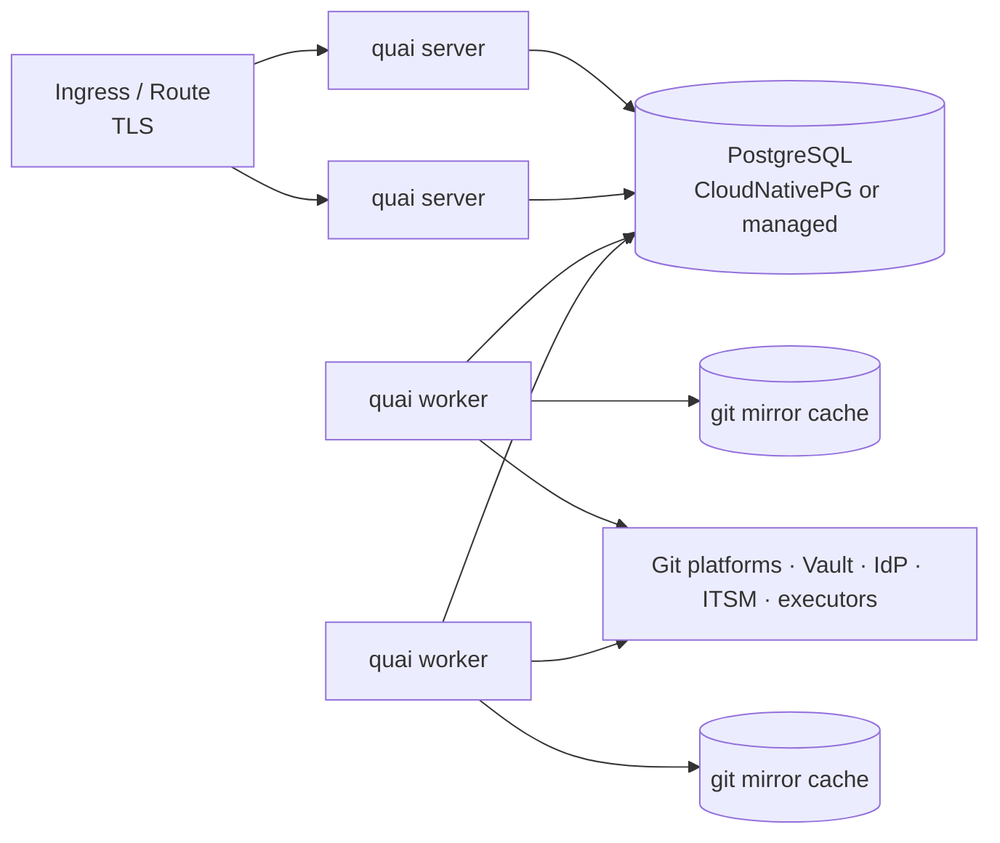

# Deployment and operations

Status: Draft · 2026-10-26

## Topology

| Process | Replicas | State |
| --- | --- | --- |
| `quai server` (API + static UI) | 2+ | None; sessions in PostgreSQL |
| `quai worker` (jobs, schedules) | 2+ | Git mirror cache on a volume per pod (rebuildable); can be `emptyDir` with a warm-up clone |
| PostgreSQL | Primary + replica | All operational state and the job queue |

One image, one binary; the role is a sub-command. Small installs can run a
single pod with both roles.

## Packaging

- **Image:** static Go binary on a distroless or UBI-minimal base, plus `git` and `openssh` (needed for transport). Non-root, read-only root file system, no shell in the distroless variant.
- **Helm chart:** server and worker Deployments, PodDisruptionBudgets, HorizontalPodAutoscaler for the server, NetworkPolicies, ServiceMonitor, optional CloudNativePG `Cluster`, configuration via values and a mounted `quai.yaml`.
- **OpenShift:** runs under the `restricted-v2` SCC with an arbitrary UID; a `Route` instead of an `Ingress`; UBI-based image variant.
- **Air-gapped:** an offline bundle (images, chart, `quai` CLI binaries for Linux, macOS and Windows) with checksums and signatures. Nothing is fetched at runtime: no CDNs, no fonts, no telemetry.
- **Configuration:** a YAML file, overridable by environment variables; secrets only as references (Vault, Kubernetes Secrets). Repository connections can be managed in the UI or declared in the configuration (GitOps for Quai itself).

  | Key | Environment variable | Default |
  | --- | --- | --- |
  | (file) | `QUAI_CONFIG`, or `quai server --config` | none: environment and defaults only |
  | `env` | `QUAI_ENV` | `development`; `production` refuses development-only features |
  | `server.addr` | `QUAI_SERVER_ADDR` | `:8080` |
  | `server.shutdownTimeout` | `QUAI_SERVER_SHUTDOWN_TIMEOUT` | `20s` for requests in flight to finish |
  | `database.url` | `QUAI_DATABASE_URL` | none; `quai migrate` applies the migrations |
  | `log.level` | `QUAI_LOG_LEVEL` | `info` (`debug`, `info`, `warn`, `error`) |
  | `log.format` | `QUAI_LOG_FORMAT` | `json` in production, `text` otherwise |
  | `telemetry.otlpEndpoint` | `QUAI_TELEMETRY_OTLP_ENDPOINT` | none: no traces are exported; traces go to `<url>/v1/traces` |
  | `telemetry.serviceName` | `QUAI_TELEMETRY_SERVICE_NAME` | `quai` |

  Unknown keys in the file are errors, and the configuration is validated before the server
  starts. Later tasks add their own keys (database, authentication, repositories).

## Network

Egress needed, all configurable through an HTTP proxy:

| Destination | Why |
| --- | --- |
| Git platforms (HTTPS or SSH) | Fetch, push, platform API: the Azure DevOps Server URL first (internal, often with an internal CA), `dev.azure.com` for Services |
| Microsoft Entra ID (`login.microsoftonline.com`) | Quai's own user login (OIDC; the pilot's IdP), and tokens for Azure DevOps Services and Azure Key Vault. Not needed for Azure DevOps Server itself |
| Microsoft Graph (`graph.microsoft.com`) | Only if group memberships must be resolved beyond what the token carries (see [identity](../design/08-identity-access-tenancy.md#directory)) |
| IdP | OIDC discovery, token exchange, JWKS |
| Secret store | Credentials |
| ITSM, chat, SIEM | Optional integrations |
| Executors (Kubernetes API, AWX, vCenter) | Imperative actions |

Ingress: users and CLI (HTTPS), Git platform webhooks (Azure DevOps service hooks; on Server this needs a firewall path from the Server to Quai, otherwise Quai runs in polling mode), runner reports. Webhook
and run-report endpoints can be exposed on a separate host name for firewalling.

## Scale targets

Sized for a large enterprise installation:

| Dimension | Target |
| --- | --- |
| Connected repositories | 500 |
| Resources in inventory | 100,000 |
| Requests per day | 2,000 |
| Concurrent users | 500 |

| SLO | Target |
| --- | --- |
| API latency (p95, excluding plan) | < 300 ms |
| Plan latency for a single-file change (p95) | < 2 s |
| Submit to PR opened (p95) | < 30 s |
| Webhook received to state updated (p95) | < 10 s |
| Availability (monthly) | 99.9 % |

Work on one repository is serialized (fetch, rebuild branches, merge) with a
PostgreSQL advisory lock per repository; jobs that cannot get the lock are
snoozed and retried. Different repositories proceed in parallel.

## Observability

- **Logs:** structured JSON (`log/slog`), one line per request and per job with request ID, job ID, repository and duration. No bodies, tokens or credentials.
- **Traces:** OpenTelemetry across HTTP handlers, database queries, jobs, `git` subprocesses and connector API calls; exported over OTLP.
- **Metrics** (Prometheus):
  - request lead time (submit → applied), approval wait time, PR open → merge time;
  - plan, submit and merge failures by reason;
  - job queue depth, job latency and failures by kind;
  - `git` operation duration and failures by repository;
  - webhook lag and last delivery per repository;
  - credential days-to-expiry; repositories without enforced branch protection.
- **Dashboards and alerts** shipped with the chart: no webhook from a repository for 1 h while pushes happen, enforcement missing, credential expiring within 14 days, job failure rate above threshold, audit export lagging.

## Backup and disaster recovery

| Data | Backup | Recovery |
| --- | --- | --- |
| PostgreSQL | Continuous WAL archiving and daily base backups (CloudNativePG / pgBackRest) to object storage | Point-in-time restore |
| Audit log | Also exported continuously to the SIEM; signed checkpoints | Verify with `quai audit verify` |
| Git mirrors | None needed | Re-clone |
| Desired state | Lives in customer Git | — |

Targets: RPO 5 minutes, RTO 1 hour. After a restore, a reconciliation job
re-indexes every repository from Git and re-reads open pull requests, so
nothing that happened in Git during the outage is lost. A restore drill runs
before GA and twice a year.

## Upgrades

- Database migrations (goose) run as a pre-upgrade Helm hook; migrations are backwards-compatible for one release so rolling upgrades work.
- Definition schema versions (`v1beta1` → `v1`) are converted on read; `quai lint --upgrade` rewrites them in a pull request.
- Feature flags for risky features, per installation.

## Runbooks

Shipped with the docs, one per alert: webhook silence, enforcement missing,
credential expired, stuck request, stale request storm after a large base
change, job queue backlog, audit chain verification failure, restore from
backup, rotating the commit-signing key, break-glass review.
