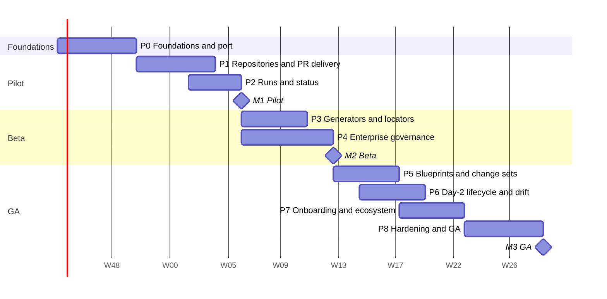

# Implementation roadmap

Status: Draft · 2026-10-26

From the prototype to a generally available enterprise product, in nine
phases and three milestones. The order puts the pilot customer first: their
repository is split by environment with one YAML file per resource, which the
`file` locator and `identity` generator already handle. What they lack is pull
requests, real run status and enterprise identity.

## Assumptions

- Implementation is AI-assisted; the owner reviews, tests and decides. Calendar estimates assume that setup with one person reviewing full-time. They are rough: **re-estimate after Phase 0**, whose actual duration is the best calibration available.
- The Azure DevOps connector is built first and accepted on **Azure DevOps Services**, in Phase 1 and for M1. The pilot runs **Azure DevOps Server** 2022 on-premises; the connector is written against its API version (7.0), but running it on a real Server is a [future improvement](#future-improvements) ([ADR 0010](../adr/0010-git-connectors-azure-devops-first.md)). Azure Pipelines is the first runner adapter.
- Phases overlap where dependencies allow.

## Overview

Weeks are counted from an assumed start on 2 November 2026.

Progress is tracked on GitHub: [milestones M1, M2, M3](https://github.com/damhau/quai/milestones), one issue per task or epic, labelled by phase (`phase:N`), type (`type:task`, `type:epic`) and area (`area:*`). GitHub is the only task list; this document keeps the phases, goals, exit criteria and risks.

| Milestone | Target | Meaning |
| --- | --- | --- |
| **M1 Pilot** | ~week 14 | The pilot customer uses Quai on a real Azure DevOps **Services** repository for **VMs**: forms from their schema, PRs, approvals enforced by a required status, plan and apply status from Azure Pipelines, Entra ID login, on OpenShift. |
| **M2 Beta** | ~week 21 | The pilot gets **namespaces and quotas, DNS records and firewall rules**, including the data kept in HCL. Two or three design partners. Mapping generators, shared-file locators, full governance (roles, SoD, change windows, break-glass, ITSM if needed), tamper-evident audit. |
| **M3 GA** | ~week 37 | Composite blueprints across repositories, imperative actions, drift, onboarding assistant, hardened, load-tested, pentested, documented. |

## Phase 0: Foundations and port (6 weeks)

Goal: the prototype's features on the target stack, with production-grade
foundations. See [migration from the prototype](../engineering/migration-from-prototype.md).

Tasks: GitHub issues #1–#29 ([label `phase:0`](https://github.com/damhau/quai/issues?q=is%3Aissue%20label%3Aphase%3A0)); the loop procedure is in the [Phase 0 backlog](phase-0-backlog.md).

**Exit:** the prototype's end-to-end scenarios pass on Go + new frontend (direct delivery); `quai lint` passes on `examples/gitops-repo` and on the pilot repository; prototype code removed.

## Phase 1: Repository connections and PR delivery (6 weeks)

Goal: Quai works against real repositories through pull requests, and its
approval is enforced. See [repository connections](../design/01-repository-connections.md)
and [delivery and approvals](../design/05-delivery-and-approvals.md).

Epics: [GitHub issues labelled `phase:1`](https://github.com/damhau/quai/issues?q=is%3Aissue%20label%3Aphase%3A1). Tasks: issues #77–#99 (`P1-01` to `P1-23`), except #97 (moved to M3 GA) and #98 (a [future improvement](#future-improvements)); the loop procedure and the test infrastructure are in the [Phase 1 backlog](phase-1-backlog.md).

**Exit:** an Azure DevOps **Services** repository is connected; a request opens a PR, the build validation pipeline plans, approvals in Quai flip the `quai/approval` status, auto-complete merges once every policy passes; removing the status-check policy (or its authorized identity) is detected within an hour and blocks delivery. The conformance suite passes on Azure DevOps Services and on Gitea.

## Phase 2: Runs and status (4 weeks)

Goal: approvers see the plan; owners see whether their change is live. See
[runs, status and drift](../design/06-runs-status-and-drift.md).

Epics: [GitHub issues labelled `phase:2`](https://github.com/damhau/quai/issues?q=is%3Aissue%20label%3Aphase%3A2). Tasks: issues #101–#114 (`P2-02` to `P2-15`; `P2-01`, #100, moved to Phase 4); the loop procedure and the test infrastructure are in the [Phase 2 backlog](phase-2-backlog.md).

**Exit (M1 Pilot):** the pilot's users request, approve with the plan in front of them, and see the apply result, on their own repository and pipeline.

## Phase 3: Generators and locators (5 weeks)

Goal: Quai fits repositories that are not one-file-per-resource. See
[resource types and generators](../design/02-resource-types-and-generators.md)
and [file editing](../design/03-file-editing.md).

Epics: [GitHub issues labelled `phase:3`](https://github.com/damhau/quai/issues?q=is%3Aissue%20label%3Aphase%3A3). Each epic is broken into task issues when the phase starts.

**Exit:** the pilot's namespace-and-quota, DNS record and firewall rule types (including those backed by HCL) pass round-trip lint on the pilot's repository and are live in their Quai; concurrent requests on two entries of one file do not conflict.

## Phase 4: Enterprise governance (7 weeks)

Goal: what a bank's or insurer's change and access management requires. See
[identity, access and tenancy](../design/08-identity-access-tenancy.md) and
[security and compliance](../design/09-security-and-compliance.md).

Epics: [GitHub issues labelled `phase:4`](https://github.com/damhau/quai/issues?q=is%3Aissue%20label%3Aphase%3A4). Each epic is broken into task issues when the phase starts.

**Exit (M2 Beta):** an auditor can sample ten changes and get, for each, the reason, diff, plan, approvers with authentication times, merge commit and apply result from one bundle; the audit chain verifies; break-glass works end to end with alerting.

## Phase 5: Blueprints and change sets (5 weeks)

Goal: composite catalog items across repositories. See
[blueprints and change sets](../design/04-blueprints-and-change-sets.md).

Epics: [GitHub issues labelled `phase:5`](https://github.com/damhau/quai/issues?q=is%3Aissue%20label%3Aphase%3A5). Each epic is broken into task issues when the phase starts.

## Phase 6: Day-2, lifecycle and drift (5 weeks)

See [day-2 actions and executors](../design/07-day2-actions-and-executors.md).

Epics: [GitHub issues labelled `phase:6`](https://github.com/damhau/quai/issues?q=is%3Aissue%20label%3Aphase%3A6). Each epic is broken into task issues when the phase starts.

## Phase 7: Onboarding and ecosystem (5 weeks)

See [onboarding](../design/10-onboarding.md) and [integrations](../design/11-integrations.md).

Epics: [GitHub issues labelled `phase:7`](https://github.com/damhau/quai/issues?q=is%3Aissue%20label%3Aphase%3A7). Each epic is broken into task issues when the phase starts.

## Phase 8: Hardening and GA (6 weeks)

Epics: [GitHub issues labelled `phase:8`](https://github.com/damhau/quai/issues?q=is%3Aissue%20label%3Aphase%3A8). Each epic is broken into task issues when the phase starts.

**Exit (M3 GA).**

## Future improvements

Wanted, but in no phase or milestone yet: each is an issue labelled `enhancement`, without a
`phase:N` label or a milestone, and is scheduled when a customer needs it.

- **Azure DevOps Server 2022** ([#98](https://github.com/damhau/quai/issues/98), formerly P1-22):
  run the Azure DevOps connector on a real Server. Verify the Go SDK and the pinned API 7.0 calls,
  Server's URL forms (virtual directory, collection) and an internal CA; run the conformance suite
  and fix the differences; list the supported Server versions in
  [Git connectors](../design/12-git-connectors.md#editions-and-versions). The connector already
  targets API 7.0, authenticates with a PAT and unit-tests Server's URLs. Needs a Server instance
  (a lab VM, or a test project on a customer's Server) and a service account's PAT.

## Risks

| Risk | Likelihood | Impact | Mitigation |
| --- | --- | --- | --- |
| Minimal-diff YAML editing in Go does not reach the prototype's quality | Low | High | Week-1 spike with go/no-go; corpus and fuzzing; fallback: refuse edits rather than rewrite |
| Platform edition lacks enforcement features (e.g. GitLab tier, older Azure DevOps Server) | Medium | High | Check during registration; alternative mechanisms per connector; health page shows the active one |
| Azure DevOps service hooks are unsigned | Certain | Medium | Dedicated webhook host, secret header, re-read every object from the API, polling reconciliation |
| `azure-devops-go-api` gaps or slow maintenance | Medium | Low | Wrapped in Quai's own client; missing endpoints called through `net/http` |
| No Azure DevOps Server instance available for conformance tests | Medium | High | Server support is a [future improvement](#future-improvements), outside the milestones; when it is scheduled, ask the customer for a test project on their Server or set up a Server 2022 VM in the lab (licensing to be checked) |
| The Go SDK sends API versions newer than Server accepts | Medium | Medium | Quai's wrapper controls API versions and falls back to `net/http`; verified on a real Server with the [future improvement](#future-improvements) |
| Server cannot reach Quai for service hooks (firewalls) | Medium | Low | Polling mode with the same functions and higher latency |
| Pilot runs a Server version older than 2022 | Low | Medium | Support 2020 only if needed, with the missing capabilities shown explicitly; 2019 and older are out of scope |
| Pilot's runner cannot report plan JSON | Medium | Medium | `quai report` step; fall back to check status only, without per-resource plan |
| Customers' repositories are too irregular for declarative types | Medium | High | Mapping generator, shared-file locators, plugins; onboarding metrics after three customers decide whether to invest more |
| Approval enforcement removed by repository admins | Medium | High | Hourly verification, delivery blocked, alerts, audit |
| Scope creep from design partners | High | Medium | Milestone exit criteria are the contract; new asks go to the backlog unless they block a milestone |
| CEL in the browser lags cel-go | Low | Low | Server is authoritative; visibility falls back to server evaluation |
| Estimates wrong | High | Medium | Re-plan after Phase 0 with measured velocity |
