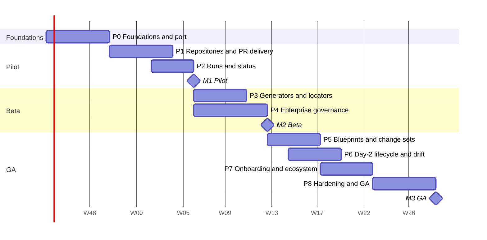

# Implementation roadmap

Status: Draft · 2026-10-26

From the prototype to a generally available enterprise product, in nine
phases and three milestones. The order puts the pilot customer first: their
repository is split by environment with one YAML file per resource, which the
`file` locator and `identity` generator already handle. What they lack is pull
requests, real run status and enterprise identity.

## Assumptions

- Implementation is AI-assisted; the owner reviews, tests and decides. Calendar estimates assume that setup with one person reviewing full-time. They are rough: **re-estimate after Phase 0**, whose actual duration is the best calibration available.
- The pilot uses **Azure DevOps Server on-premises**, so the Azure DevOps connector is built first and accepted on Server; **Azure DevOps Services** is delivered in the same phase or right after ([ADR 0010](../adr/0010-git-connectors-azure-devops-first.md)). Azure Pipelines is the first runner adapter. The exact Server version is still open ([open questions](open-questions.md)).
- Phases overlap where dependencies allow.

## Overview

Weeks are counted from an assumed start on 2 November 2026.

| Milestone | Target | Meaning |
| --- | --- | --- |
| **M1 Pilot** | ~week 14 | The pilot customer uses Quai on their real repository: forms from their schema, PRs, approvals enforced by a required check, plan and apply status from their pipeline, OIDC login. |
| **M2 Beta** | ~week 21 | Two or three design partners. Mapping generators, shared-file locators, full governance (roles, SoD, change windows, break-glass, ITSM), tamper-evident audit. |
| **M3 GA** | ~week 37 | Composite blueprints across repositories, imperative actions, drift, onboarding assistant, hardened, load-tested, pentested, documented. |

## Phase 0: Foundations and port (6 weeks)

Goal: the prototype's features on the target stack, with production-grade
foundations. See [migration from the prototype](../engineering/migration-from-prototype.md).
Task-level breakdown, for autonomous sessions: [Phase 0 backlog](phase-0-backlog.md).

| Epic | Deliverables |
| --- | --- |
| YAML editing spike (week 1, go/no-go) | `yamledit` in Go passing the prototype's `patchYaml` tests and a corpus from the pilot repository; fuzz target |
| Engine port | `internal/engine`: CEL expressions with `v1alpha1` converter, JSON Schema, `file`/`dir` locators, `identity`/`component` generators, plan and diff, policy evaluation; ported tests |
| Backend skeleton | Config, Huma API with OpenAPI, PostgreSQL with goose and sqlc, River jobs, slog, OpenTelemetry, `authz.Authorize` with the build check |
| Identity | OIDC login, sessions, API tokens; dev mode for local only |
| Frontend rebuild | `frontend/` with TanStack Router and Query, Tailwind, shadcn, generated client; catalog, request, inventory, resource, approvals, git log, designer pages |
| `quai lint` | Definitions and resource-file validation, round trip, golden tests; usable in customer CI |
| Delivery pipeline | CI gates, multi-arch images, SBOM, cosign signing, Helm chart v0, compose stack with Gitea |

**Exit:** the prototype's end-to-end scenarios pass on Go + new frontend (direct delivery); `quai lint` passes on `examples/gitops-repo` and on the pilot repository; prototype code removed.

## Phase 1: Repository connections and PR delivery (6 weeks)

Goal: Quai works against real repositories through pull requests, and its
approval is enforced. See [repository connections](../design/01-repository-connections.md)
and [delivery and approvals](../design/05-delivery-and-approvals.md).

| Epic | Deliverables |
| --- | --- |
| Repository connections | `Repository` resource (UI, API, config-as-code); registration wizard with access checks; health page and metrics; floor rules |
| Secrets | `SecretStore` with Vault, Azure Key Vault, Kubernetes and environment backends |
| Git layer | Mirror cache, worktrees, sparse/partial clone, per-repository locks, webhook ingestion with de-duplication, polling reconciliation |
| Connector framework | `Connector` interface with capabilities, normalized webhook events, shared conformance suite ([Git connectors](../design/12-git-connectors.md)) |
| Azure DevOps Server connector (first) | Week 1: verify the Go SDK and REST API 7.0 against a Server 2022 instance. Then: collection URLs, PAT authentication, internal CA bundles, version detection and API pinning, PRs and iterations, PR statuses, "Status check" policy verification with authorized identity, auto-complete, policy evaluations, path-based reviewer policies as `codeowners`, service hooks with secret header and a polling mode when Server cannot reach Quai, `tf git permission` guidance for branch folders; conformance suite green on the pilot's Server version |
| Azure DevOps Services (alongside or right after) | Entra service principal with workload identity federation (`azidentity`), bearer tokens for Git, `dev.azure.com` URLs, throttling headers; conformance suite green on a sandbox organization |
| Gitea connector | Reference connector in testcontainers; anchors the conformance suite and the end-to-end tests |
| Definitions | Load per commit, last-valid fallback, preview from branches, audit of definition changes, CODEOWNERS check |
| PR protocol | Branches, signed commits with trailers, PR body and labels, `quai/approval` check, auto and manual merge, branch deletion |
| Content-bound approvals | Change set hash, staleness detection, branch rebuilds, outside-push and bypass detection |
| Enforcement verification | Hourly branch protection check; block delivery when enforcement is missing |

**Exit:** the pilot's Azure DevOps **Server** repository is connected; a request opens a PR, the build validation pipeline plans, approvals in Quai flip the `quai/approval` status, auto-complete merges once every policy passes; removing the status-check policy (or its authorized identity) is detected within an hour and blocks delivery. The conformance suite also passes on Azure DevOps Services (at the latest by the end of Phase 2).

## Phase 2: Runs and status (4 weeks)

Goal: approvers see the plan; owners see whether their change is live. See
[runs, status and drift](../design/06-runs-status-and-drift.md).

| Epic | Deliverables |
| --- | --- |
| Run reports | `POST /api/v1/runs`, per-repository run tokens, `quai report` CLI and container image |
| Adapters | **Azure Pipelines first**: `quai report` task, build validation results through policy evaluations, run state through service hooks, drift runs queued through the Pipelines runs API. Then generic CI (GitHub Actions, GitLab CI) through `quai report`; Argo CD and Flux templates |
| Plan mapping | `terraform-json` parsing, address patterns, per-resource plan summary on the request page, sensitive-value handling |
| Status | Per-stack runs, derived resource status, request timeline, notifications on apply success and failure |

**Exit (M1 Pilot):** the pilot's users request, approve with the plan in front of them, and see the apply result, on their own repository and pipeline.

## Phase 3: Generators and locators (5 weeks)

Goal: Quai fits repositories that are not one-file-per-resource. See
[resource types and generators](../design/02-resource-types-and-generators.md)
and [file editing](../design/03-file-editing.md).

| Epic | Deliverables |
| --- | --- |
| Mapping generator | Structured templates, automatic and explicit read-back, managed vs unmanaged paths, lint for unrecoverable inputs |
| Shared-file locators | `entry` (lists and maps, ordering) and `field`, with per-region fingerprints |
| Formats | JSON and `*.tfvars.json` editors; HCL editor on `hclwrite` with literal-only rule |
| Components | Generic `crossplane.claim`, `argocd.application`, `flux.kustomization` |
| Plugins | `wazero` runtime, ABI, limits, Go plugin SDK and template repository |
| Type lifecycle | Schema evolution (non-conforming resources, migrate expressions), deletion policy |
| GitHub connector | GitHub App auth, check runs, branch protection and rulesets pinned to the app, auto-merge and merge queue, `CODEOWNERS`, signed webhooks; conformance suite green on github.com and GHES |

**Exit:** a namespace-quota type on a shared `namespaces.yaml` and a tfvars-based type both pass round-trip lint on real repositories; concurrent requests on two entries of one file do not conflict.

## Phase 4: Enterprise governance (7 weeks)

Goal: what a bank's or insurer's change and access management requires. See
[identity, access and tenancy](../design/08-identity-access-tenancy.md) and
[security and compliance](../design/09-security-and-compliance.md).

| Epic | Deliverables |
| --- | --- |
| Roles and teams | Roles and scopes, team mapping from IdP groups, entitlements on catalog items, SCIM provisioning |
| Approval features | Approver kinds (owners, codeowners, manager, external), SoD options, delegation, reminders and escalation, expiry, step-up authentication |
| Change control | Change windows and freezes, break-glass with mandatory review |
| Audit | Hash chain, insert-only role, signed checkpoints, SIEM export (syslog/CEF, OTLP, Splunk HEC), `quai audit verify`, evidence bundles |
| Notifications | Email, Microsoft Teams (cards), Slack (interactive), preferences, digests |
| ITSM | ServiceNow change requests: create, approve via `external` rule, close with evidence |

**Exit (M2 Beta):** an auditor can sample ten changes and get, for each, the reason, diff, plan, approvers with authentication times, merge commit and apply result from one bundle; the audit chain verifies; break-glass works end to end with alerting.

## Phase 5: Blueprints and change sets (5 weeks)

Goal: composite catalog items across repositories. See
[blueprints and change sets](../design/04-blueprints-and-change-sets.md).

| Epic | Deliverables |
| --- | --- |
| Catalog repository | Blueprints referencing `{repository, type, version}`, lint of references, catalog index |
| Change sets | One PR per repository, single approval, `dependsOn` ordering across repositories with apply waits, partial-apply handling, rollback change sets |
| Instances | Instance records in Git, instance day-2 actions fanning out to resources, missing-resource detection |
| Designer | Palette from connected types, inspector from input schemas, save as PR to the catalog repository |
| Bulk changes | Multi-select actions in the inventory |

## Phase 6: Day-2, lifecycle and drift (5 weeks)

See [day-2 actions and executors](../design/07-day2-actions-and-executors.md).

| Epic | Deliverables |
| --- | --- |
| Executors | Kubernetes (KubeVirt operations, snapshots), AWX, pipeline trigger, webhook; streamed output; audit |
| Lifecycle | Leases with reminders and expiry requests; quotas per team and type; cost (Infracost from runs, showback formulas) |
| Drift | Scheduled drift checks through runners, per-resource drift, reconcile and acknowledge actions; Kubernetes read-only observer |

## Phase 7: Onboarding and ecosystem (5 weeks)

See [onboarding](../design/10-onboarding.md) and [integrations](../design/11-integrations.md).

| Epic | Deliverables |
| --- | --- |
| Onboarding assistant | Repository scanner, pattern and schema inference, Terraform analysis, verification gates, review UI, PR with `.quai/`; optional LLM assistance with redaction |
| `quai schema from-terraform` | Variables to JSON Schema |
| Ecosystem | Backstage plugin (entities, scaffolder action), MCP server, outgoing webhooks, Port action |
| Remaining connectors | GitLab (edition-dependent enforcement), then Bitbucket; the remaining runner adapters (Spacelift, HCP Terraform, Atlantis) |

## Phase 8: Hardening and GA (6 weeks)

| Epic | Deliverables |
| --- | --- |
| Scale and resilience | k6 load tests to the [scale targets](../operations/deployment-and-operations.md#scale-targets); worker crash and provider outage tests; HA failover |
| Security | External penetration test and fixes; ZAP; threat model review; `SECURITY.md` |
| Operations | OpenShift validation, air-gapped bundle, dashboards and alerts, runbooks, DR drill |
| Product | Documentation site, admin and user guides, French and German translations, accessibility audit (WCAG 2.1 AA) |
| Compliance | Control mapping reviewed with a design partner's compliance team |

**Exit (M3 GA).**

## Risks

| Risk | Likelihood | Impact | Mitigation |
| --- | --- | --- | --- |
| Minimal-diff YAML editing in Go does not reach the prototype's quality | Low | High | Week-1 spike with go/no-go; corpus and fuzzing; fallback: refuse edits rather than rewrite |
| Platform edition lacks enforcement features (e.g. GitLab tier, older Azure DevOps Server) | Medium | High | Check during registration; alternative mechanisms per connector; health page shows the active one |
| Azure DevOps service hooks are unsigned | Certain | Medium | Dedicated webhook host, secret header, re-read every object from the API, polling reconciliation |
| `azure-devops-go-api` gaps or slow maintenance | Medium | Low | Wrapped in Quai's own client; missing endpoints called through `net/http` |
| No Azure DevOps Server instance available for conformance tests | Medium | High | Ask the pilot for a test project on their Server; in parallel, set up a Server 2022 VM in the lab (licensing to be checked) |
| The Go SDK sends API versions newer than Server accepts | Medium | Medium | Quai's wrapper controls API versions and falls back to `net/http`; verified in week 1 of Phase 1 |
| Server cannot reach Quai for service hooks (firewalls) | Medium | Low | Polling mode with the same functions and higher latency |
| Pilot runs a Server version older than 2022 | Low | Medium | Support 2020 only if needed, with the missing capabilities shown explicitly; 2019 and older are out of scope |
| Pilot's runner cannot report plan JSON | Medium | Medium | `quai report` step; fall back to check status only, without per-resource plan |
| Customers' repositories are too irregular for declarative types | Medium | High | Mapping generator, shared-file locators, plugins; onboarding metrics after three customers decide whether to invest more |
| Approval enforcement removed by repository admins | Medium | High | Hourly verification, delivery blocked, alerts, audit |
| Scope creep from design partners | High | Medium | Milestone exit criteria are the contract; new asks go to the backlog unless they block a milestone |
| CEL in the browser lags cel-go | Low | Low | Server is authoritative; visibility falls back to server evaluation |
| Estimates wrong | High | Medium | Re-plan after Phase 0 with measured velocity |
